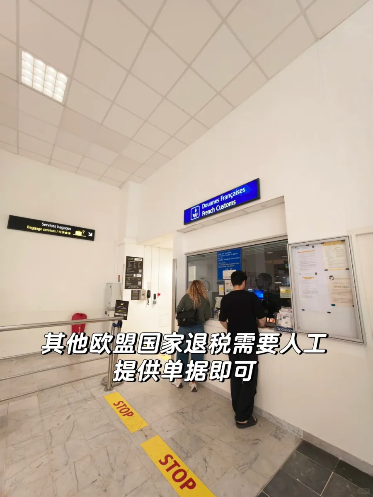
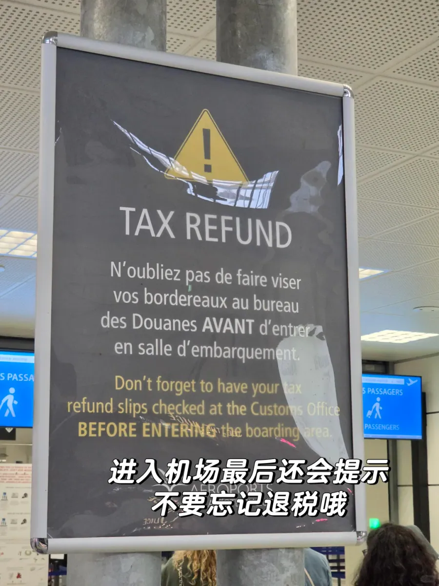

Bandara Nice Côte d'Azur (NCE) adalah gerbang utama ke Riviera Prancis, dan Terminal 1 menangani sebagian besar penerbangannya. Sebagian besar pelancong menghabiskan hari-hari terakhir perjalanan berbelanja di kota tua Nice, Èze, atau Monaco, dan baru memikirkan pengembalian PPN saat kembali ke bandara. Pengembalian pajak adalah satu bagian perjalanan yang urutannya paling penting: validasi dulu, baru periksa bagasi. Jika urutannya salah, uangnya hilang.

Pengembalian pajak Prancis — détaxe — biasanya dibayangkan sebagai meja di bandara yang membagikan uang tunai. Dalam praktiknya ada dua langkah terpisah: bea cukai mengonfirmasi bahwa barang benar-benar meninggalkan UE bersama Anda, lalu operator pengembalian membayar berdasarkan konfirmasi itu. Langkah bea cukai sekarang sebagian besar dilakukan oleh mesin swalayan bertanda DETAXE, dan di Nice mesin itu berada di **aula kedatangan Terminal 1, di samping kantor bea cukai Prancis**. Banyak orang menyeret koper keliling lantai keberangkatan untuk mencarinya, dan baru melihat pemberitahuan agar menemui bea cukai dalam perjalanan ke gerbang, saat kembali sudah bukan pilihan.

Panduan ini membahas lima hal: apa yang perlu disiapkan, cara menemukan kios di T1, arti hasil hijau dan merah, apakah memilih pengembalian ke kartu atau tunai, dan berapa banyak waktu yang harus disisakan.

## 1. Apa yang perlu disiapkan sebelum berangkat

Prancis menetapkan beberapa syarat ketat, dan melewatkan salah satunya membuat bea cukai menolak memvalidasi formulir. Anda harus tinggal di luar UE, berusia minimal 16 tahun, dan membelanjakan **lebih dari €100 termasuk PPN di satu toko pada satu hari**. Ambang ini berlaku sejak 1 Januari 2021, dan pembelian kecil yang tersebar jarang mencapainya, jadi kelompokkan barang yang ingin Anda minta pengembaliannya dalam satu transaksi — dua cabang merek yang sama dihitung sebagai dua toko berbeda.

Tenggat waktu adalah syarat yang sering dilupakan. Formulir harus divalidasi sebelum akhir bulan ketiga setelah bulan pembelian: barang yang dibeli pada Oktober harus meninggalkan UE dan divalidasi paling lambat akhir Januari. Setelah itu formulir batal, dan tidak ada proses banding. Aturan lainnya adalah barang bepergian bersama Anda. Bea cukai dapat meminta melihatnya, jadi tidak ada barang yang diminta pengembaliannya boleh masuk bagasi tercatat sebelum validasi, dan Anda tentu tidak dapat menyerahkan bagasi lalu kembali untuk capnya nanti. Tanpa barang, tidak ada validasi.

Daftarnya sendiri singkat, tetapi barang yang hilang dapat membuat Anda kehilangan tempat di antrean:

- **Paspor** — namanya harus sama dengan yang tercantum di formulir pengembalian;
- **Formulir pengembalian (bordereau)** — diterbitkan toko melalui sistem PABLO, membawa logo PABLO dan barcode, ditandatangani toko dan Anda;
- **Struk** — menyertai formulir, dan jumlah serta tanggalnya harus cocok;
- **Barangnya sendiri** — di tas kabin atau koper yang belum diserahkan, siap dibuka;
- **Boarding pass atau itinerary** — kadang diminta.

Satu detail sebaiknya diselesaikan di toko, bukan di bandara: metode pengembalian. Jika memilih kartu, nomor, tanggal kedaluwarsa, dan nama pemegang kartu harus semuanya benar — nomor kartu yang salah adalah alasan paling umum pengembalian gagal. Jika memilih tunai, pastikan formulir benar-benar dicentang untuk tunai. Menemukan salah ketik di kios sudah terlambat; bandara tidak dapat memperbaikinya, dan Anda harus menulis kepada toko atau operator pengembalian.

## 2. Menemukan DETAXE dan PABLO di Terminal 1

Titik validasi bukan di aula check-in keberangkatan. Titik itu berada di **aula kedatangan di samping kantor bea cukai Prancis (Douanes françaises)**: di Terminal 1, di seberang meja informasi; di Terminal 2, di seberang gerbang A3. Pengunjung pertama kali cenderung berkeliling lantai keberangkatan. Carilah tanda biru bertuliskan "Douanes françaises / French Customs" — kios berada di pintunya.

Tanda pilar itu dalam bahasa Prancis, Inggris, Mandarin, Rusia, dan Arab, dengan panah menunjuk ke jendela bea cukai. Deretan lemari putih di bawahnya adalah peralatan swalayan: **DETAXE** di bagian atas, **TAX REFUND** di depan, layar sentuh di tengah, tudung pemindai biru tua di bawahnya dengan celah baca merah di dalamnya, dan nomor unit di badan mesin (86 pada mesin di foto). Kios berada tepat di samping meja berstaf, jadi jalur elektronik dan jalur manual bercabang di titik yang sama: selesaikan mesin lalu berjalan terus, atau gagal lalu berbalik ke jendela.

Mesinnya mudah digunakan. Layar pertama meminta bahasa, dan ikon bendera mengubahnya ke bahasa Mandarin, setelah itu setiap petunjuk — termasuk "pindai formulir pengembalian Anda satu per satu" yang sangat spesifik — muncul dalam bahasa Mandarin. Bagi yang tidak membaca bahasa Prancis, itu paling penting saat ada masalah: hasil merah akan memberi tahu Anda, dalam bahasa Mandarin, ke mana harus pergi berikutnya.

Ingat lokasinya: di area publik, sebelum keamanan. Bandara Nice mewajibkan formulir **divalidasi sebelum Anda melewati pos pemeriksaan keamanan**, dan setelah berada di airside Anda tidak dapat kembali. Meja penukaran di dalam area terbatas juga tidak akan membayar formulir yang belum divalidasi. Urutan yang benar adalah: tiba, temukan kios DETAXE, validasi, lalu check-in dan serahkan bagasi.

## 3. Lampu hijau dan lampu merah: dua hasil

Pemindaian hanya satu gerakan: putar formulir agar barcode menghadap celah merah dan dorong masuk. Mesin berbunyi saat membaca kode, dan layar mulai menghitung dalam tiga kolom — **formulir dipindai**, **formulir divalidasi** (centang hijau), dan **formulir tidak divalidasi** (tanda minus merah). Tata letaknya berguna: Anda dapat langsung melihat apakah formulir yang baru Anda masukkan benar-benar lolos, alih-alih mencoba mengingatnya satu per satu.

Saat memasukkan formulir, barcode harus menghadap strip lampu merah dan kertas harus rata, bukan terlipat. Penghitung dipindai naik lebih dulu, lalu kolom hijau atau merah menyusul. Pemberitahuan kecil yang ditempel di sisi mesin menambahkan catatan penting: **formulir yang ditandai untuk Geneva atau Basel divalidasi saat tiba di Swiss**. Jika rute pulang Anda Nice ke Zurich lalu seterusnya, formulir itu tidak akan lolos di kios ini — harus menunggu sampai Anda mendarat di Swiss.

**Hijau berarti selesai.** Layar mengumumkan bahwa pengembalian telah divalidasi, dan satu baris di bawahnya menyatakan Anda dapat meninggalkan area pengembalian dan tidak perlu mengunjungi jendela pengembalian bea cukai. Menurut aturan bea cukai Prancis, pesan elektronik dari terminal PABLO memiliki bobot yang sama dengan cap fisik, dan hasilnya diteruskan ke operator pengembalian pada hari yang sama; tidak ada yang perlu dikirim kembali ke toko. Prosesnya beberapa detik per formulir, dan layar diakhiri dengan tanda penutup yang ramah.

**Merah berarti perlu petugas.** Layar mengarahkan Anda ke kantor bea cukai di sebelahnya, tempat petugas memeriksa dokumen dan mencap atau menandatanganinya. Alasan yang biasa sangat umum: formulir tidak diterbitkan dengan benar melalui PABLO (dibeli di negara UE lain, atau slip tulisan tangan lama), barcode terlipat atau kotor dan tidak terbaca, nama tidak cocok dengan paspor, jendela tiga bulan telah lewat, atau pemeriksaan acak ingin melihat barang. Tiga alasan pertama berarti jalur manual apa pun; formulir kedaluwarsa tidak dapat diselamatkan sama sekali; dan pemeriksaan acak bergantung pada apakah barang masih bersama Anda.

Satu pesan berbeda dari lampu merah biasa: layar mungkin menyatakan formulir tidak dapat divalidasi oleh bea cukai Prancis karena tidak diterbitkan dengan benar oleh operator pengembalian Anda. Itu bukan ajakan mengantre untuk cap — formulirnya sendiri bermasalah, dan bea cukai tidak dapat memperbaikinya. Hubungi operator yang detailnya tercetak di formulir.

Biasanya ada antrean yang dibentuk dengan pita pembatas di depan jendela, mencapai tengah aula pada musim ramai. Saat giliran Anda, serahkan paspor, formulir, dan barang sekaligus; petugas mungkin hampir tidak meliriknya, atau meminta Anda membuka koper dan menunjukkan barang tertentu. Cap menyelesaikan dokumen — baru setelah itu pertanyaan pembayaran muncul.

## 4. Kartu atau tunai

Banyak orang menganggap uang datang otomatis setelah lampu hijau. Validasi hanya berarti operator sekarang diizinkan membayar; di mana dan kapan pembayaran dilakukan bergantung pada pilihan Anda di toko. Di Nice, pengembalian tunai ditangani meja penukaran mata uang seperti Global Exchange — satu di area publik di samping bea cukai, satu di airside — sedangkan pengembalian ke kartu diproses operator (Global Blue, Planet, dan lainnya) setelah mereka menerima data bea cukai.

**Pengembalian ke kartu** adalah pilihan paling andal. Anda tidak membawa gepokan euro, jumlahnya dikonversi dengan kurs skema kartu, dan jika dokumen hilang atau jumlahnya disengketakan Anda memiliki nomor kartu untuk dijadikan dasar. Biayanya waktu: berminggu-minggu hingga berbulan-bulan adalah normal, dan lebih lama pada musim puncak. Ini cocok untuk pengembalian besar saat Anda tidak terburu-buru. Periksa nomor dan tanggal kedaluwarsa, karena pengembalian ke kartu yang sudah mati menyulitkan pemulihan.

**Tunai** dibayar segera. Serahkan formulir yang telah divalidasi di meja penukaran, terima euro, dan belanjakan di luar terminal. Biayanya adalah kurs: meja membeli mata uang jauh di bawah kurs pasar, jadi Anda menukar sebagian pengembalian untuk uang instan dan tanpa tindak lanjut. Untuk jumlah kecil, jadwal ketat, atau siapa pun yang tidak ingin mengejar pembayaran berbulan-bulan, tunai adalah pilihan yang lebih tenang.

Cara praktis memutuskan adalah berdasarkan ukuran dan apa yang terjadi berikutnya. Pengembalian tunggal yang besar layak dimasukkan ke kartu, karena kerugian kursnya kecil secara proporsional dan menunggu dapat diterima. Beberapa formulir senilai beberapa puluh euro lebih baik diselesaikan tunai — usaha yang dihemat lebih bernilai daripada selisih kurs. Dan jika Anda sudah di airside, ingat bahwa hanya formulir tervalidasi yang dapat dibayar di meja penukaran di dalam; itulah tepatnya mengapa urutan validasi sebelum keamanan tidak dapat dibalik.

## 5. Waktu dan daftar periksa

Musim Riviera panjang, dan pada Juli dan Agustus wisatawan liburan, penumpang kapal pesiar, dan pengunjung akhir pekan saling bertumpuk, sehingga antrean pengembalian pajak maupun antrean keamanan di T1 memanjang. **Sediakan setidaknya 3 jam di bandara** — saran dari pelancong yang rutin memakai rute ini. Mesin sendiri menangani formulir dalam beberapa detik, tetapi mengantre, mengeluarkan dokumen, membuka koper untuk diperiksa, dan berjalan dari kedatangan kembali ke check-in semuanya memakan waktu. Pada tengah hari di musim puncak, antrean di jendela bea cukai dapat memanjang ke tengah aula, dan bergerak lambat bahkan saat terlihat pendek.

Papan pemberitahuan abu-abu berdiri di koridor menuju area boarding: segitiga peringatan kuning, kata **TAX REFUND**, dan paragraf dalam bahasa Prancis dan Inggris yang mengingatkan pelancong agar formulir pengembalian diperiksa di kantor bea cukai sebelum memasuki area boarding. Posisinya mengatakan segalanya — papan itu muncul saat Anda sudah dekat keamanan. Melihatnya sebagai pengingat biasanya berarti harus berbalik, dan di Nice berbalik tidak selalu diizinkan.

Seluruh prosesnya, sebagai daftar periksa untuk hari keberangkatan:

1. **Tiba 3 jam lebih awal**, dan sedikit lebih awal pada musim puncak.
2. **Pengembalian dulu, bagasi kemudian** — tidak ada barang yang diminta pengembaliannya masuk bagasi tercatat sebelum validasi.
3. **Kemas ulang setelah validasi**, bukan di depan jendela bea cukai.
4. **Pindai satu formulir sekaligus** dan lihat penghitung tervalidasi naik satu setiap kali.
5. **Jangan memindai ulang formulir merah** — pergi ke jendela bea cukai; percobaan berulang hanya menahan antrean.
6. **Simpan setiap struk dan formulir sampai uangnya tiba**, terutama untuk pengembalian ke kartu, karena itulah satu-satunya bukti Anda jika pembayaran gagal.
7. **Foto formulir yang telah dicap**, atau layar tervalidasi, untuk rekonsiliasi nanti.
8. **Periksa nomor kartu dua kali** — nomor, tanggal kedaluwarsa, dan nama pemegang kartu.

Satu catatan terakhir: ambang, posisi kios, dan jam buka meja semuanya dapat berubah. Ini mencerminkan situasi pada Oktober 2026; periksa situs Bandara Nice dan bea cukai Prancis pada hari itu, dan tanyakan kepada staf di lokasi jika ada yang tidak jelas.

## Tautan terkait

- **Di situs ini**: [Prancis (FR)](/country/FR)
- **Wikipedia**: [Bandara Nice Côte d'Azur](https://en.wikipedia.org/wiki/Nice_C%C3%B4te_d%27Azur_Airport)
- **Baidu Baike**: [Bandara Nice Côte d'Azur](https://baike.baidu.com/item/%E5%B0%BC%E6%96%AF%E8%93%9D%E8%89%B2%E6%B5%B7%E5%B2%B8%E6%9C%BA%E5%9C%BA)
