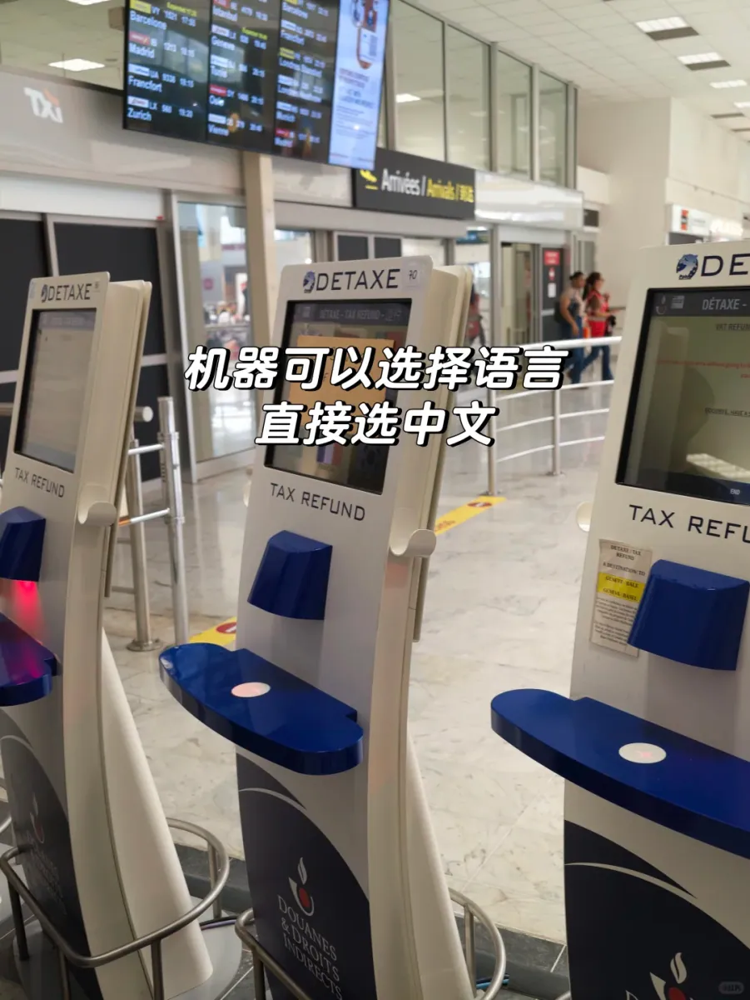

O Aeroporto de Nice Côte d'Azur (NCE) é o principal portal da Riviera Francesa, e o Terminal 1 recebe uma boa parte dos seus voos. A maioria dos viajantes passa os últimos dias da viagem comprando na cidade antiga de Nice, em Èze ou em Mônaco, e só pensa na restituição do IVA no caminho de volta ao aeroporto. A restituição é a única parte da viagem em que a ordem importa mais do que tudo: valide primeiro, despache as malas depois. Se errar a ordem, o dinheiro se perde.

A restituição de impostos francesa — a détaxe — costuma ser imaginada como um balcão no aeroporto que entrega dinheiro. Na prática, são duas etapas separadas: a alfândega confirma que as mercadorias realmente saíram da UE com você, e depois um operador de restituição paga com base nessa confirmação. A etapa da alfândega hoje é feita principalmente por uma máquina de autoatendimento com a marca DETAXE, e em Nice essa máquina fica no **saguão de chegadas do Terminal 1, ao lado do escritório da alfândega francesa**. Muitas pessoas arrastam as malas pelo andar de embarque à procura dela e só percebem o aviso que manda procurar a alfândega no caminho para o portão, quando voltar atrás já não é mais possível.

Este guia cobre cinco pontos: o que ter pronto, como encontrar os quiosques no T1, o que significam os resultados verde e vermelho, se convém receber em cartão ou em dinheiro e quanto tempo reservar.

## 1. O que ter pronto antes de ir

A França impõe algumas condições rígidas, e faltar a qualquer uma delas faz a alfândega recusar a validação do formulário. Você precisa morar fora da UE, ter pelo menos 16 anos e gastar **mais de €100 com IVA em uma única loja, em um único dia**. Esse limite vale desde 1º de janeiro de 2021, e compras pequenas e dispersas raramente o alcançam, então agrupe as coisas que quer restituir em uma única transação — duas filiais da mesma marca contam como duas lojas diferentes.

O prazo é a condição que as pessoas esquecem. O formulário precisa ser validado antes do fim do terceiro mês após o mês da compra: algo comprado em outubro deve sair da UE e ser validado até o fim de janeiro. Depois disso, é inválido, e não há processo de recurso. A outra regra é que as mercadorias viajam com você. A alfândega pode pedir para vê-las, então nada que esteja sendo restituído deve ir para a bagagem despachada antes da validação, e você certamente não pode despachar a mala e voltar depois para o carimbo. Sem mercadorias, sem validação.

A lista em si é curta, mas qualquer item faltante pode custar seu lugar na fila:

- **Passaporte** — o nome deve coincidir com o do formulário de restituição;
- **O formulário de restituição (bordereau)** — emitido pela loja pelo sistema PABLO, com o logotipo PABLO e um código de barras, assinado pela loja e por você;
- **Recibos** — acompanham os formulários, e os valores e as datas precisam coincidir;
- **As próprias mercadorias** — em uma bagagem de cabine ou mala não despachada, prontas para serem abertas;
- **Cartão de embarque ou itinerário** — pedido ocasionalmente.

Um detalhe vale ser resolvido na loja, e não no aeroporto: a forma de restituição. Se você escolher cartão, o número, a validade e o nome do titular precisam estar todos corretos — um número de cartão errado é o motivo mais comum de falha na restituição. Se escolher dinheiro, confira se o formulário está de fato marcado para pagamento em espécie. Descobrir um erro de digitação no quiosque é tarde demais; o aeroporto não pode corrigi-lo, e você terá de escrever para a loja ou para o operador de restituição.

## 2. Como encontrar a DETAXE e o PABLO no Terminal 1

O ponto de validação não fica no saguão de check-in do embarque. Fica no **saguão de chegadas ao lado do escritório da alfândega francesa (Douanes françaises)**: no Terminal 1, em frente ao balcão de informações; no Terminal 2, em frente ao portão A3. Quem chega pela primeira vez tende a circular pelo andar de embarque. Em vez disso, procure a placa azul com os dizeres “Douanes françaises / French Customs” — os quiosques ficam na porta dela.

A placa do pilar está em francês, inglês, chinês, russo e árabe, com setas apontando para o guichê da alfândega. A fileira de armários brancos embaixo é o equipamento de autoatendimento: **DETAXE** na parte superior, **TAX REFUND** na frente, uma tela sensível ao toque no meio, uma cúpula escura de leitura abaixo dela com uma fenda vermelha de leitura dentro, e um número de unidade no corpo (86 na máquina da foto). Os quiosques ficam bem ao lado do balcão com atendente, então o caminho eletrônico e o manual se separam no mesmo ponto: passe pela máquina e siga em frente; se ela falhar, vire-se para o guichê.

A máquina é simples. A primeira tela pede um idioma, e os ícones de bandeira a mudam para o chinês, depois do que todas as instruções — inclusive a muito específica “escaneie seus formulários de restituição um de cada vez” — aparecem em chinês. Para quem não lê francês, isso importa sobretudo quando algo dá errado: um resultado vermelho dirá, em chinês, para onde ir em seguida.

Lembre-se de onde isto fica: na área pública, antes da segurança. O aeroporto de Nice exige que os formulários sejam **validados antes de você passar pela verificação de segurança**, e, uma vez na área restrita, você não pode voltar. Os balcões de câmbio dentro da área restrita também não pagam formulários não validados. A ordem correta é: chegue, encontre os quiosques DETAXE, valide, depois faça o check-in e despache as malas.

## 3. Luz verde e luz vermelha: os dois resultados

O escaneamento exige um único movimento: vire o formulário com o código de barras voltado para a fenda vermelha e empurre-o para dentro. A máquina emite um bipe quando lê o código, e a tela começa a contar em três colunas — **formulários escaneados**, **formulários validados** (marca verde) e **formulários não validados** (sinal de menos vermelho). A disposição é útil: você vê de relance se os formulários que acabou de inserir realmente passaram, em vez de tentar lembrá-los um por um.

Quando você insere um formulário, o código de barras precisa ficar voltado para a faixa de luz vermelha e o papel deve estar plano, não dobrado. O contador de escaneados sobe primeiro, e depois vem a coluna verde ou a vermelha. Um pequeno aviso colado na lateral da máquina acrescenta uma ressalva que vale saber: **formulários marcados para Genebra ou Basileia são validados na chegada à Suíça**. Se o seu caminho de volta é Nice–Zurique e depois adiante, esses formulários não serão liberados neste quiosque — terão de esperar até você pousar na Suíça.

**Verde significa concluído.** A tela anuncia que a restituição foi validada, e uma linha abaixo diz que você pode deixar a área de restituição e não precisa ir ao guichê de restituição da alfândega. Pelas regras da alfândega francesa, a mensagem eletrônica de um terminal PABLO tem o mesmo peso que um carimbo físico, e o resultado é transmitido ao operador de restituição no mesmo dia; não há nada para enviar de volta à loja. Leva segundos por formulário, e a tela termina com uma despedida animada.

**Vermelho significa atendimento presencial.** A tela manda você ao escritório da alfândega ao lado, onde um agente verifica a papelada e carimba ou assina. Os motivos habituais são banais: o formulário não foi emitido corretamente pelo PABLO (comprado em outro país da UE, ou uma via manuscrita antiga), o código de barras está dobrado ou sujo e não pode ser lido, o nome não coincide com o passaporte, o prazo de três meses passou, ou uma verificação aleatória quer ver as mercadorias. Os três primeiros significam o caminho manual de qualquer forma; um formulário vencido não pode ser salvo; e uma verificação aleatória depende simplesmente de as mercadorias ainda estarem com você.

Uma mensagem é diferente de uma luz vermelha comum: a tela pode dizer que o formulário não pode ser validado pela alfândega francesa porque não foi emitido corretamente pelo seu operador de restituição. Isso não é um convite para enfrentar a fila do carimbo — o formulário em si está com problema, e a alfândega não pode consertá-lo. Entre em contato com o operador cujos dados estão impressos no formulário.

Costuma haver uma fila delimitada por fita de isolamento em frente ao guichê, que na alta temporada chega ao meio do saguão. Quando chega a sua vez, você entrega passaporte, formulários e mercadorias juntos; o agente pode mal olhar para eles ou pedir que você abra uma mala e mostre um item específico. O carimbo conclui a papelada — só então surge a questão do pagamento.

## 4. Cartão ou dinheiro

Muitas pessoas acham que o dinheiro chega automaticamente depois de uma luz verde. A validação significa apenas que o operador agora está autorizado a pagar; onde e quando ele paga depende do que você escolheu na loja. Em Nice, as restituições em dinheiro são feitas por casas de câmbio como a Global Exchange — uma na área pública ao lado da alfândega, outra na área restrita —, enquanto as restituições em cartão são processadas pelos operadores (Global Blue, Planet e outros) depois que recebem os dados da alfândega.

**A restituição em cartão** é a opção mais confiável. Você não carrega um maço de euros, o valor é convertido pelo câmbio da bandeira do cartão e, se a papelada se perder ou o valor for contestado, você tem um número de cartão para reclamar. O custo é o tempo: semanas a meses é normal, e mais ainda na alta temporada. Serve para restituições maiores quando você não tem pressa. Confira mesmo o número e a validade, porque uma restituição enviada para um cartão cancelado é penosa de recuperar.

**Dinheiro** paga na hora. Entregue o formulário validado no balcão de câmbio, receba os euros e gaste-os fora do terminal. O custo é o câmbio: o balcão compra a moeda bem abaixo da taxa de mercado, então você troca parte da restituição por dinheiro imediato e nenhum acompanhamento. Para valores pequenos, horários apertados ou para quem não quer correr atrás de um pagamento por meses, dinheiro é a escolha mais tranquila.

Uma forma prática de decidir é pelo tamanho e pelo que vem depois. Uma restituição grande e única vale a pena no cartão, em que a perda cambial é proporcionalmente pequena e a espera é aceitável. Um punhado de formulários no valor de algumas dezenas de euros é melhor resolvido em dinheiro — o esforço economizado vale mais do que a diferença de câmbio. E, se você já está na área restrita, lembre-se de que só formulários validados podem ser pagos no balcão de câmbio interno; é exatamente por isso que a sequência de validação antes da segurança não pode ser invertida.

## 5. Tempo e lista de verificação

A temporada na Riviera é longa, e em julho e agosto veranistas, passageiros de cruzeiro e visitantes de fim de semana se sobrepõem, então tanto a fila da restituição quanto a da segurança no T1 crescem. **Reserve pelo menos 3 horas no aeroporto** — o conselho de viajantes que usam esta rota com frequência. A máquina em si processa um formulário em poucos segundos, mas a fila, o tempo para achar a papelada, abrir uma mala para inspeção e caminhar das chegadas de volta ao check-in consomem tempo. Ao meio-dia na alta temporada, a fila do guichê da alfândega pode se estender até o meio do saguão, e anda devagar mesmo quando parece curta.

Um painel cinza fica no corredor em direção à área de embarque: um triângulo amarelo de aviso, as palavras **TAX REFUND** e um parágrafo em francês e inglês lembrando os viajantes de mandar verificar os formulários de restituição no escritório da alfândega antes de entrar na área de embarque. A posição diz tudo — ele aparece quando você já está perto da segurança. Percebê-lo como um lembrete geralmente significa voltar atrás, e em Nice voltar nem sempre é permitido.

O processo inteiro, como lista de verificação para o dia da partida:

1. **Chegue 3 horas antes**, e um pouco mais cedo na alta temporada.
2. **Restituição primeiro, malas depois** — nada que esteja sendo restituído entra na bagagem despachada antes da validação.
3. **Reorganize a bagagem depois da validação**, não na frente do guichê da alfândega.
4. **Escaneie um formulário de cada vez** e observe o contador de validados subir uma unidade a cada vez.
5. **Não escaneie de novo um formulário vermelho** — vá ao guichê da alfândega; tentativas repetidas só atrasam a fila.
6. **Guarde todos os recibos e formulários até o dinheiro chegar**, especialmente nas restituições em cartão, em que eles são a única prova se o pagamento falhar.
7. **Fotografe o formulário carimbado**, ou a tela de validação, para conferir depois.
8. **Confira o número do cartão duas vezes** — número, validade e nome do titular.

Uma última observação: limites, posições dos quiosques e horários de funcionamento dos balcões podem mudar. Isto reflete a situação em outubro de 2026; consulte os sites do aeroporto de Nice e da alfândega francesa no dia e pergunte à equipe no local se algo não estiver claro.

## Links relacionados

- **Neste site**: [França (FR)](/country/FR)
- **Wikipedia**: [Aeroporto de Nice Côte d'Azur](https://en.wikipedia.org/wiki/Nice_C%C3%B4te_d%27Azur_Airport)
- **Baidu Baike**: [Aeroporto de Nice Côte d'Azur](https://baike.baidu.com/item/%E5%B0%BC%E6%96%AF%E8%93%9D%E8%89%B2%E6%B5%B7%E5%B2%B8%E6%9C%BA%E5%9C%BA)
