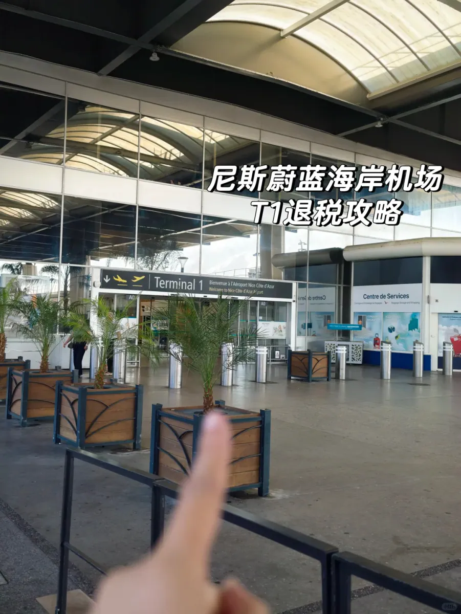

Aeroportul Nice Côte d’Azur (NCE) este principala poartă de intrare pe Coasta de Azur, iar Terminalul 1 preia o bună parte din zborurile sale. Majoritatea călătorilor își petrec ultimele zile ale călătoriei făcând cumpărături în orașul vechi din Nisa, în Èze sau în Monaco și se gândesc la rambursarea TVA abia în drum spre aeroport. Rambursarea este singurul moment al călătoriei în care ordinea contează mai mult decât orice: mai întâi validarea, apoi predarea bagajelor. Dacă greșești ordinea, banii se pierd.

Rambursările de taxe franceze — détaxe — sunt de obicei imaginate ca un ghișeu la aeroport care împarte numerar. În practică, sunt doi pași separați: vama confirmă că mărfurile au ieșit într-adevăr din UE împreună cu tine, iar apoi un operator de rambursare plătește pe baza acestei confirmări. Pasul vamal se face acum în mare parte la un automat self-service marcat DETAXE, iar la Nisa acel automat se află în **sala de sosiri a Terminalului 1, lângă biroul vamal francez**. Destui oameni își târâie valizele prin sala de plecări căutându-l și observă abia în drum spre poartă anunțul care îi îndrumă la vamă, moment în care întoarcerea nu mai este o opțiune.

Acest ghid acoperă cinci lucruri: ce trebuie să ai pregătit, cum să găsești chioșcurile din T1, ce înseamnă rezultatele verzi și roșii, dacă să alegi rambursarea pe card sau în numerar și cât timp să lași.

## 1. Ce trebuie să ai pregătit înainte de plecare

Franța impune câteva condiții stricte, iar dacă lipsește oricare dintre ele, vama poate refuza validarea formularului. Trebuie să locuiești în afara UE, să ai cel puțin 16 ani și să cheltui **peste 100 €, cu TVA inclus, într-un singur magazin, într-o singură zi**. Acest prag se aplică din 1 ianuarie 2021, iar cumpărăturile mici, împrăștiate, îl ating rareori, așa că grupează lucrurile pentru care vrei rambursare într-o singură tranzacție — două filiale ale aceleiași mărci contează ca două magazine diferite.

Termenul-limită este condiția pe care oamenii o uită. Formularul trebuie validat înainte de sfârșitul celei de-a treia luni după luna achiziției: ceva cumpărat în octombrie trebuie să iasă din UE și să fie validat până la sfârșitul lunii ianuarie. După aceea, este nul și nu există procedură de contestație. Cealaltă regulă este că mărfurile călătoresc cu tine. Vama poate cere să le vadă, așa că nimic din ce urmează să fie rambursat nu trebuie pus într-o valiză de cală înainte de validare și, desigur, nu poți preda valiza la cală și reveni mai târziu pentru ștampilă. Fără mărfuri, fără validare.

Lista în sine este scurtă, dar orice element lipsă te poate costa un loc la coadă:

- **Pașaportul** — numele trebuie să corespundă cu cel de pe formularul de rambursare;
- **Formularul de rambursare (bordereau)** — emis de magazin prin sistemul PABLO, cu logo-ul PABLO și un cod de bare, semnat de magazin și de tine;
- **Bonurile fiscale** — însoțesc formularele, iar sumele și datele trebuie să corespundă;
- **Mărfurile în sine** — într-o geantă de cabină sau într-o valiză nepredată, gata de a fi deschise;
- **Biletul de îmbarcare sau itinerariul** — cerute ocazional.

Un detaliu merită lămurit în magazin, nu la aeroport: metoda de rambursare. Dacă alegi cardul, numărul, data expirării și numele titularului trebuie să fie toate corecte — un număr de card greșit este cel mai frecvent motiv pentru care o rambursare eșuează. Dacă alegi numerar, verifică dacă formularul este într-adevăr bifat pentru numerar. Să descoperi o greșeală de tastare la chioșc este prea târziu; aeroportul nu o poate remedia, iar tu vei scrie în schimb magazinului sau operatorului de rambursare.

## 2. Cum găsești DETAXE și PABLO în Terminalul 1

Punctul de validare nu este în sala de check-in a plecărilor. Este în **sala de sosiri, lângă biroul vamal francez (Douanes françaises)**: în Terminalul 1, vizavi de biroul de informații; în Terminalul 2, vizavi de poarta A3. Cei aflați la prima vizită au tendința de a înconjura etajul plecărilor. Caută în schimb panoul albastru cu inscripția „Douanes françaises / French Customs” — chioșcurile stau la ușa acestuia.

Panoul de pe stâlp este în franceză, engleză, chineză, rusă și arabă, cu săgeți care indică spre ghișeul vamal. Șirul de dulapuri albe de dedesubt reprezintă echipamentul self-service: **DETAXE** în partea de sus, **TAX REFUND** pe față, un ecran tactil la mijloc, sub el o carcasă de scanare albastru închis cu o fantă de citire roșie în interior și un număr de unitate pe corp (86 pe aparatul din fotografie). Chioșcurile se află chiar lângă ghișeul cu personal, așa că ruta electronică și cea manuală se despart în același loc: treci de automat și mergi mai departe sau eșuezi și te întorci la ghișeu.

Automatul este simplu. Primul ecran cere o limbă, iar pictogramele cu steaguri o comută pe chineză, după care fiecare mesaj — inclusiv foarte precisul „scanați formularele de rambursare unul câte unul” — apare în chineză. Pentru cineva care nu citește franceză, acest lucru contează cel mai mult când ceva merge prost: un rezultat roșu îți va spune, în chineză, unde trebuie să mergi mai departe.

Ține minte unde se află: în zona publică, înainte de controlul de securitate. Aeroportul Nisa cere ca formularele să fie **validate înainte de a trece de punctul de control de securitate**, iar odată ce ai trecut în zona restricționată nu mai poți reveni. Nici ghișeele de schimb valutar din zona restricționată nu plătesc pe baza unui formular nevalidat. Ordinea corectă este: sosești, găsești chioșcurile DETAXE, validezi, apoi faci check-in și predai bagajele.

## 3. Lumina verde și lumina roșie: cele două rezultate

Scanarea presupune o singură mișcare: întoarce formularul astfel încât codul de bare să fie orientat spre fanta roșie și împinge-l înăuntru. Aparatul emite un semnal sonor când citește codul, iar ecranul începe să numere pe trei coloane — **formulare scanate**, **formulare validate** (bifă verde) și **formulare nevalidate** (minus roșu). Aspectul este util: vezi dintr-o privire dacă formularele pe care tocmai le-ai introdus au trecut efectiv, în loc să încerci să ți le amintești unul câte unul.

Când introduci un formular, codul de bare trebuie să fie orientat spre banda luminoasă roșie, iar hârtia trebuie să fie plană, nu îndoită. Contorul de scanate crește primul, apoi urmează fie coloana verde, fie cea roșie. Un mic anunț lipit pe lateralul aparatului adaugă o precizare care merită știută: **formularele marcate pentru Geneva sau Basel se validează la sosirea în Elveția**. Dacă drumul spre casă este Nisa–Zürich și mai departe, acele formulare nu vor fi acceptate la acest chioșc — trebuie să aștepte până aterizezi în Elveția.

**Verde înseamnă gata.** Ecranul anunță că rambursarea a fost validată, iar o linie dedesubt spune că poți părăsi zona de rambursare și nu trebuie să te prezinți la ghișeul vamal de rambursare. Conform regulilor vamale franceze, mesajul electronic de la un terminal PABLO are aceeași valoare ca o ștampilă fizică, iar rezultatul este transmis operatorului de rambursare în aceeași zi; nu ai nimic de trimis prin poștă magazinului. Durează câteva secunde pe formular, iar ecranul se încheie cu un mesaj vesel de rămas-bun.

**Roșu înseamnă un om.** Ecranul te trimite la biroul vamal de alături, unde un funcționar verifică actele și le ștampilează sau le semnează. Motivele obișnuite sunt banale: formularul nu a fost emis corespunzător prin PABLO (cumpărat în altă țară din UE sau un vechi tichet scris de mână), codul de bare este îndoit sau murdar și nu poate fi citit, numele nu corespunde cu cel din pașaport, fereastra de trei luni a expirat sau un control aleatoriu vrea să vadă mărfurile. Primele trei înseamnă în orice caz ruta manuală; un formular expirat nu poate fi salvat deloc; iar un control aleatoriu depinde pur și simplu de dacă mărfurile mai sunt la tine.

Un mesaj este diferit de o simplă lumină roșie: ecranul poate spune că formularul nu poate fi validat de vama franceză pentru că nu a fost emis corespunzător de operatorul tău de rambursare. Aceasta nu este o invitație să stai la coadă pentru o ștampilă — formularul în sine este defect, iar vama nu îl poate repara. Contactează operatorul ale cărui date sunt tipărite pe formular.

De obicei se formează o coadă delimitată cu bandă de separare în fața ghișeului, care în sezonul de vârf ajunge până în mijlocul holului. Când îți vine rândul, predai împreună pașaportul, formularele și mărfurile; funcționarul poate abia să arunce o privire asupra lor sau poate să te roage să deschizi o valiză și să arăți un anumit articol. Ștampila încheie formalitățile — abia atunci apare și întrebarea plății.

## 4. Card sau numerar

Mulți oameni presupun că banii ajung automat după lumina verde. Validarea înseamnă doar că operatorul are acum voie să plătească; unde și când plătește depinde de ce ai ales în magazin. La Nisa, rambursările în numerar sunt gestionate de ghișee de schimb valutar precum Global Exchange — unul în zona publică, lângă vamă, unul în zona restricționată —, iar rambursările pe card sunt procesate de operatori (Global Blue, Planet și alții) odată ce primesc datele vamale.

**Rambursarea pe card** este cea mai sigură opțiune. Nu cari cu tine un teanc de euro, suma este convertită la cursul schemei de card, iar dacă actele se pierd sau suma este contestată ai un număr de card pe baza căruia poți face reclamație. Costul este timpul: săptămâni până la luni este normal, iar în sezonul de vârf chiar mai mult. Se potrivește pentru rambursările mari, când nu ești grăbit. Verifică totuși numărul și data expirării, pentru că o rambursare trimisă pe un card închis este greu de recuperat.

**Numerarul** plătește imediat. Predai formularul validat la ghișeul de schimb, iei euro și îi cheltui în afara terminalului. Costul este cursul: ghișeul cumpără valută cu mult sub cursul pieței, așa că renunți la o parte din rambursare în schimbul banilor pe loc și al lipsei oricărei urmăriri ulterioare. Pentru sume mici, programe strânse sau pentru oricine nu vrea să alerge după o plată luni întregi, numerarul este alegerea mai liniștită.

O modalitate practică de a decide este după mărime și după ce urmează. O rambursare mare, unică, merită pusă pe card, unde pierderea din schimb este proporțional mică și așteptarea este acceptabilă. Câteva formulare în valoare de câteva zeci de euro se rezolvă mai bine în numerar — efortul economisit valorează mai mult decât diferența de curs. Iar dacă ai trecut deja în zona restricționată, ține minte că doar formularele validate pot fi plătite la ghișeul de schimb din interior; exact de aceea ordinea validării înainte de securitate nu poate fi inversată.

## 5. Timp și o listă de verificare

Sezonul pe Coasta de Azur este lung, iar în iulie și august se suprapun vacanții, pasagerii de pe navele de croazieră și vizitatorii de weekend, așa că cresc atât coada de la rambursare, cât și cea de la securitate din T1. **Rezervă cel puțin 3 ore la aeroport** — sfatul călătorilor care folosesc regulat această rută. Automatul în sine procesează un formular în câteva secunde, dar statul la coadă, scotocitul după acte, deschiderea unei valize pentru inspecție și mersul de la sosiri înapoi la check-in iau toate timp. La amiază, în sezonul de vârf, rândul de la ghișeul vamal poate ajunge până în mijlocul holului și înaintează lent chiar și atunci când pare scurt.

Un panou gri se află pe coridorul spre zona de îmbarcare: un triunghi galben de avertizare, cuvintele **TAX REFUND** și un paragraf în franceză și engleză care le reamintește călătorilor să își verifice formularele de rambursare la biroul vamal înainte de a intra în zona de îmbarcare. Poziția sa spune totul — apare abia când ești aproape de securitate. Să îl observi ca memento înseamnă de obicei să te întorci, iar la Nisa întoarcerea nu este întotdeauna permisă.

Întregul proces, sub forma unei liste de verificare pentru ziua plecării:

1. **Sosește cu 3 ore înainte** și puțin mai devreme în sezonul de vârf.
2. **Mai întâi rambursarea, apoi bagajele** — nimic din ce urmează a fi rambursat nu intră într-o valiză de cală înainte de validare.
3. **Reîmpachetează după validare**, nu în fața ghișeului vamal.
4. **Scanează câte un formular pe rând** și urmărește cum contorul de validate crește cu unu de fiecare dată.
5. **Nu rescana un formular roșu** — mergi în schimb la ghișeul vamal; încercările repetate doar blochează coada.
6. **Păstrează fiecare bon și formular până când ajung banii**, mai ales în cazul rambursărilor pe card, unde sunt singura ta dovadă dacă plata eșuează.
7. **Fotografiază formularul ștampilat** sau ecranul de validare, pentru verificări ulterioare.
8. **Verifică de două ori numărul cardului** — număr, data expirării și numele titularului.

O ultimă notă: pragurile, amplasarea chioșcurilor și programul ghișeelor se pot schimba. Aceasta reflectă situația din octombrie 2026; verifică în ziua respectivă site-urile aeroportului Nisa și ale vămii franceze și întreabă personalul de la fața locului dacă ceva nu este clar.

## Linkuri utile

- **Pe acest site**: [Franța (FR)](/country/FR)
- **Wikipedia**: [Nice Côte d'Azur Airport](https://en.wikipedia.org/wiki/Nice_C%C3%B4te_d%27Azur_Airport)
- **Baidu Baike**: [Nice Côte d'Azur Airport](https://baike.baidu.com/item/%E5%B0%BC%E6%96%AF%E8%93%9D%E8%89%B2%E6%B5%B7%E5%B2%B8%E6%9C%BA%E5%9C%BA)
