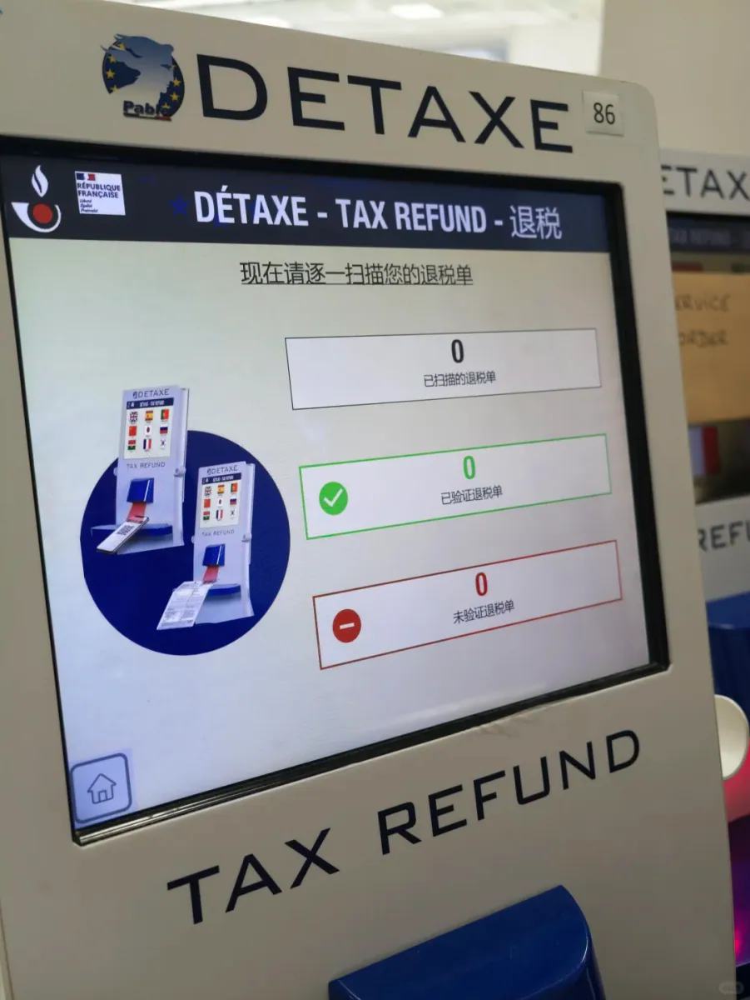

ท่าอากาศยานนีซโกตดาซูร์ (NCE) เป็นประตูหลักสู่เฟรนช์ริวีเอรา และอาคารผู้โดยสาร 1 รองรับเที่ยวบินจำนวนมาก นักเดินทางส่วนใหญ่ใช้วันสุดท้ายของการเดินทางช้อปปิ้งในย่านเมืองเก่านีซ, แอซ หรือโมนาโก และเพิ่งนึกถึงการขอคืนภาษีตอนเดินทางกลับสนามบิน การคืนภาษีเป็นส่วนเดียวของการเดินทางที่ลำดับสำคัญกว่าสิ่งอื่นใด: รับรองก่อน ส่งกระเป๋าทีหลัง หากลำดับผิด เงินก็หายไป

การคืนภาษีฝรั่งเศส — détaxe — มักถูกจินตนาการว่าเป็นเคาน์เตอร์ที่สนามบินซึ่งจ่ายเงินสดให้ ในทางปฏิบัติมีสองขั้นตอนแยกกัน: ศุลกากรยืนยันว่าสินค้าออกจากสหภาพยุโรปไปกับคุณจริง แล้วผู้ให้บริการคืนภาษีจึงจ่ายเงินตามการยืนยันนั้น ขั้นตอนศุลกากรตอนนี้ส่วนใหญ่ทำผ่านเครื่องบริการตนเองที่ติดป้าย DETAXE และที่สนามบินนีซ เครื่องนั้นตั้งอยู่ใน **โถงผู้โดยสารขาเข้าของอาคารผู้โดยสาร 1 ข้างสำนักงานศุลกากรฝรั่งเศส** หลายคนลากกระเป๋าไปทั่วชั้นขาออกเพื่อหาเครื่องนี้ และเพิ่งเห็นประกาศที่บอกให้ไปพบศุลกากรก่อนเข้าประตูขึ้นเครื่อง ซึ่งตอนนั้นจะย้อนกลับไม่ได้แล้ว

คู่มือนี้ครอบคลุมห้าเรื่อง: สิ่งที่ต้องเตรียม ตำแหน่งตู้ใน T1 ความหมายของผลสีเขียวและสีแดง การเลือกคืนเข้าบัตรหรือรับเงินสด และเวลาที่ควรเผื่อ

## 1. สิ่งที่ต้องเตรียมก่อนเดินทาง

ฝรั่งเศสกำหนดเงื่อนไขตายตัวหลายข้อ และหากขาดข้อใดข้อหนึ่ง ศุลกากรจะปฏิเสธการรับรองแบบฟอร์ม คุณต้องพำนักนอกสหภาพยุโรป มีอายุอย่างน้อย 16 ปี และใช้จ่าย **มากกว่า €100 รวม VAT ในร้านเดียวในวันเดียว** เกณฑ์นี้ใช้ตั้งแต่ 1 มกราคม 2021 และการซื้อชิ้นเล็ก ๆ กระจายกันมักไม่ถึงเกณฑ์ จึงควรรวมของที่ต้องการขอคืนไว้ในธุรกรรมเดียว — สองสาขาของแบรนด์เดียวกันนับเป็นสองร้านต่างกัน

กำหนดเวลาเป็นเงื่อนไขที่คนลืม แบบฟอร์มต้องได้รับการรับรองก่อนสิ้นเดือนที่สามหลังเดือนที่ซื้อ: ของที่ซื้อในเดือนตุลาคมต้องออกจากสหภาพยุโรปและได้รับการรับรองภายในสิ้นเดือนมกราคม หลังจากนั้นเป็นโมฆะและไม่มีกระบวนการอุทธรณ์ กฎอีกข้อคือสินค้าต้องเดินทางไปกับคุณ ศุลกากรอาจขอดู จึงไม่ควรนำสิ่งใดที่ขอคืนภาษีใส่กระเป๋าโหลดใต้เครื่องก่อนการรับรอง และแน่นอนว่าส่งกระเป๋าแล้วกลับมารับตราประทับทีหลังไม่ได้ ไม่มีสินค้า ไม่มีการรับรอง

รายการนี้สั้น แต่ของที่ขาดใด ๆ อาจทำให้คุณเสียคิว:

- **หนังสือเดินทาง** — ชื่อต้องตรงกับชื่อบนแบบฟอร์มขอคืนภาษี
- **แบบฟอร์มขอคืนภาษี (bordereau)** — ออกโดยร้านผ่านระบบ PABLO มีโลโก้ PABLO และบาร์โค้ด ลงนามโดยร้านและโดยคุณ
- **ใบเสร็จ** — ไปพร้อมแบบฟอร์ม และจำนวนเงินกับวันที่ต้องตรงกัน
- **ตัวสินค้า** — ในกระเป๋าถือหรือกระเป๋าที่ไม่ได้โหลด พร้อมเปิดให้ตรวจ
- **บัตรขึ้นเครื่องหรือกำหนดการเดินทาง** — บางครั้งถูกขอ

รายละเอียดหนึ่งที่ควรจัดการในร้านมากกว่าที่สนามบิน: วิธีรับเงินคืน หากเลือกบัตร หมายเลข วันหมดอายุ และชื่อผู้ถือบัตรต้องถูกต้องทั้งหมด — หมายเลขบัตรผิดเป็นสาเหตุที่พบบ่อยที่สุดของการคืนภาษีล้มเหลว หากเลือกเงินสด ตรวจสอบว่าแบบฟอร์มติ๊กเงินสดจริง การค้นพบคำผิดที่ตู้สายเกินไป; สนามบินแก้ไขไม่ได้ และคุณต้องเขียนถึงร้านหรือผู้ให้บริการคืนภาษีแทน

## 2. หา DETAXE และ PABLO ในอาคารผู้โดยสาร 1

จุดรับรองไม่ได้อยู่ในโถงเช็คอินขาออก แต่อยู่ใน **โถงผู้โดยสารขาเข้าข้างสำนักงานศุลกากรฝรั่งเศส (Douanes françaises)**: ที่อาคารผู้โดยสาร 1 ตรงข้ามเคาน์เตอร์ข้อมูล; ที่อาคารผู้โดยสาร 2 ตรงข้ามประตู A3 ผู้มาครั้งแรกมักวนอยู่ชั้นขาออก ให้มองหาป้ายสีน้ำเงินที่เขียนว่า «Douanes françaises / French Customs» แทน — ตู้ตั้งอยู่ที่ประตูนั้น

ป้ายเสาเป็นภาษาฝรั่งเศส อังกฤษ จีน รัสเซีย และอาหรับ พร้อมลูกศรชี้ไปที่หน้าต่างศุลกากร ตู้สีขาวเรียงรายด้านล่างคืออุปกรณ์บริการตนเอง: **DETAXE** ที่ด้านบน **TAX REFUND** ที่ด้านหน้า จอสัมผัสตรงกลาง ฝาครอบสแกนเนอร์สีน้ำเงินเข้มด้านล่างพร้อมช่องอ่านสีแดง และหมายเลขเครื่องบนตัวเครื่อง (86 บนเครื่องในภาพ) ตู้นี้อยู่ติดกับเคาน์เตอร์ที่มีเจ้าหน้าที่ เส้นทางอิเล็กทรอนิกส์และเส้นทางเจ้าหน้าที่ จึงแยกกันที่จุดเดียวกัน: ผ่านเครื่องได้ก็เดินต่อ ไม่ผ่านก็เลี้ยวกลับไปที่หน้าต่าง

เครื่องใช้งานง่าย จอแรกถามภาษา และไอคอนธงเปลี่ยนเป็นภาษาจีนได้ หลังจากนั้นทุกข้อความ — รวมถึงข้อความเฉพาะเจาะจง «สแกนแบบฟอร์มขอคืนภาษีทีละใบ» — จะปรากฏเป็นภาษาจีน สำหรับผู้ที่อ่านภาษาฝรั่งเศสไม่ได้ สิ่งนี้สำคัญที่สุดเมื่อมีปัญหา: ผลสีแดงจะบอกคุณเป็นภาษาจีนว่าต้องไปที่ไหนต่อ

จำตำแหน่งนี้ไว้: อยู่ในพื้นที่สาธารณะก่อนการตรวจความปลอดภัย สนามบินนีซกำหนดให้แบบฟอร์ม **ได้รับการรับรองก่อนผ่านจุดตรวจความปลอดภัย** และเมื่ออยู่ฝั่ง airside แล้วจะกลับออกมาไม่ได้ เคาน์เตอร์แลกเปลี่ยนเงินในพื้นที่จำกัดก็ไม่จ่ายเงินให้แบบฟอร์มที่ไม่ได้รับการรับรองเช่นกัน ลำดับที่ถูกต้องคือ: มาถึง หาตู้ DETAXE รับรอง แล้วจึงเช็คอินและส่งกระเป๋า

## 3. ไฟเขียวและไฟแดง: ผลลัพธ์สองแบบ

การสแกนใช้การเคลื่อนไหวเดียว: หมุนแบบฟอร์มให้บาร์โค้ดหันเข้าช่องสีแดงแล้วดันเข้าไป เครื่องจะส่งเสียงเมื่ออ่านโค้ด และจอจะเริ่มนับในสามคอลัมน์ — **แบบฟอร์มที่สแกน**, **แบบฟอร์มที่รับรองแล้ว** (เครื่องหมายถูกสีเขียว) และ **แบบฟอร์มที่ไม่ผ่านการรับรอง** (เครื่องหมายลบสีแดง) ผังนี้มีประโยชน์: คุณเห็นได้ทันทีว่าแบบฟอร์มที่เพิ่งป้อนผ่านจริงหรือไม่ แทนที่จะพยายามจำทีละใบ

เมื่อใส่แบบฟอร์ม บาร์โค้ดต้องหันเข้าหาแถบไฟสีแดงและกระดาษต้องวางราบไม่พับ ตัวนับที่สแกนจะเพิ่มขึ้นก่อน แล้วคอลัมน์สีเขียวหรือสีแดงจะตามมา ประกาศเล็ก ๆ ที่ติดข้างเครื่องเพิ่มข้อควรรู้: **แบบฟอร์มที่ระบุเจนีวาหรือบาเซิลจะได้รับการรับรองเมื่อถึงสวิตเซอร์แลนด์** หากเส้นทางกลับบ้านของคุณคือนีซไปซูริกแล้วต่อไป แบบฟอร์มเหล่านั้นจะไม่ผ่านที่ตู้นี้ — ต้องรอจนลงจอดที่สวิตเซอร์แลนด์

**สีเขียวหมายถึงเสร็จสิ้น** จอประกาศว่าการคืนภาษีได้รับการรับรองแล้ว และข้อความด้านล่างบอกว่าคุณออกจากพื้นที่คืนภาษีได้และไม่ต้องไปที่หน้าต่างคืนภาษีของศุลกากร ตามกฎศุลกากรฝรั่งเศส ข้อความอิเล็กทรอนิกส์จากเครื่อง PABLO มีน้ำหนักเท่ากับตราประทับจริง และผลจะถูกส่งไปยังผู้ให้บริการคืนภาษีในวันเดียวกัน ไม่ต้องส่งอะไรกลับไปที่ร้าน ใช้เวลาวินาทีต่อแบบฟอร์ม และจอจบด้วยข้อความอำลาอย่างสดใส

**สีแดงหมายถึงต้องพบเจ้าหน้าที่** จอจะส่งคุณไปยังสำนักงานศุลกากรข้าง ๆ ซึ่งเจ้าหน้าที่จะตรวจเอกสารและประทับตราหรือลงนาม เหตุผลปกติเป็นเรื่องธรรมดา: แบบฟอร์มไม่ได้ออกผ่าน PABLO อย่างถูกต้อง (ซื้อในประเทศสหภาพยุโรปอื่น หรือเป็นใบเขียนมือเก่า) บาร์โค้ดยับหรือสกปรกและอ่านไม่ได้ ชื่อไม่ตรงกับหนังสือเดินทาง ผ่านหน้าต่างสามเดือนไปแล้ว หรือการสุ่มตรวจต้องการดูสินค้า สามข้อแรกหมายถึงต้องใช้เส้นทางเจ้าหน้าที่เสมอ; แบบฟอร์มที่หมดอายุช่วยไม่ได้เลย; และการสุ่มตรวจขึ้นอยู่กับว่าสินค้ายังอยู่กับคุณหรือไม่

ข้อความหนึ่งต่างจากไฟแดงธรรมดา: จออาจแจ้งว่าแบบฟอร์มไม่สามารถรับรองโดยศุลกากรฝรั่งเศสได้เพราะผู้ให้บริการคืนภาษีออกไม่ถูกต้อง นั่นไม่ใช่คำเชิญให้ไปต่อคิวรับตราประทับ — แบบฟอร์มเองมีปัญหาและศุลกากรแก้ไม่ได้ ให้ติดต่อผู้ให้บริการที่รายละเอียดพิมพ์อยู่บนแบบฟอร์ม

ปกติมีคิวที่เกิดจากเทปกั้นหน้าหน้าต่าง ซึ่งในฤดูกาลท่องเที่ยวทอดยาวถึงกลางโถง เมื่อถึงคิวคุณ ยื่นหนังสือเดินทาง แบบฟอร์ม และสินค้าพร้อมกัน; เจ้าหน้าที่อาจแทบไม่มอง หรืออาจขอให้เปิดกระเป๋าและแสดงสินค้าชิ้นหนึ่ง ตราประทับทำให้เอกสารสมบูรณ์ — จากนั้นจึงเกิดคำถามเรื่องการจ่ายเงิน

## 4. บัตรหรือเงินสด

หลายคนคิดว่าเงินจะมาอัตโนมัติหลังไฟเขียว การรับรองเพียงหมายความว่าผู้ให้บริการได้รับอนุญาตให้จ่ายแล้ว; จ่ายที่ไหนและเมื่อไรขึ้นอยู่กับสิ่งที่คุณเลือกในร้าน ที่สนามบินนีซ การคืนเงินสดดำเนินการโดยเคาน์เตอร์แลกเปลี่ยนเงิน เช่น Global Exchange — แห่งหนึ่งในพื้นที่สาธารณะข้างศุลกากร อีกแห่งฝั่ง airside — ขณะที่การคืนเข้าบัตรดำเนินการโดยผู้ให้บริการ (Global Blue, Planet และอื่น ๆ) เมื่อได้รับข้อมูลศุลกากรแล้ว

**การคืนเข้าบัตร** เป็นตัวเลือกที่เชื่อถือได้ที่สุด คุณไม่ต้องพกยูโรเป็นปึก จำนวนเงินถูกแปลงตามอัตราของเครือข่ายบัตร และหากเอกสารหายหรือจำนวนเงินมีข้อโต้แย้ง คุณมีหมายเลขบัตรไว้ต่อสู้ ต้นทุนคือเวลา: หลายสัปดาห์ถึงหลายเดือนเป็นเรื่องปกติ และนานขึ้นในช่วงฤดูกาลท่องเที่ยว เหมาะกับเงินคืนก้อนใหญ่ที่คุณไม่รีบ ตรวจสอบหมายเลขและวันหมดอายุ เพราะเงินคืนที่ส่งไปบัตรที่ใช้ไม่ได้นั้นกู้คืนได้เจ็บปวด

**เงินสด** จ่ายทันที ยื่นแบบฟอร์มที่รับรองแล้วที่เคาน์เตอร์แลกเปลี่ยน รับเงินยูโร แล้วใช้จ่ายนอกอาคารผู้โดยสาร ต้นทุนคืออัตราแลกเปลี่ยน: เคาน์เตอร์ซื้อเงินต่ำกว่าอัตราตลาดมาก คุณจึงแลกส่วนหนึ่งของเงินคืนเพื่อเงินสดทันทีและไม่ต้องติดตามต่อ สำหรับจำนวนเล็ก กำหนดการแน่น หรือใครก็ตามที่ไม่ต้องการตามเงินเป็นเดือน ๆ เงินสดเป็นทางเลือกที่สงบกว่า

วิธีตัดสินใจในทางปฏิบัติคือดูขนาดและสิ่งที่จะเกิดขึ้นต่อ เงินคืนก้อนใหญ่ควรเข้าบัตร ซึ่งขาดทุนจากอัตราแลกเปลี่ยนเล็กน้อยตามสัดส่วนและการรอเป็นที่ยอมรับได้ แบบฟอร์มหลายใบมูลค่ารวมไม่กี่สิบยูโรควรรับเงินสด — แรงที่ประหยัดได้มีค่ามากกว่าส่วนต่างอัตรา และหากคุณอยู่ฝั่ง airside แล้ว จำว่ามีเพียงแบบฟอร์มที่รับรองแล้วเท่านั้นที่รับเงินได้ที่เคาน์เตอร์แลกเปลี่ยนด้านใน นั่นคือเหตุผลที่ลำดับการรับรองก่อนการตรวจความปลอดภัยย้อนกลับไม่ได้

## 5. เวลาและรายการตรวจสอบ

ฤดูกาลริวีเอรายาวนาน และในเดือนกรกฎาคมกับสิงหาคมนักท่องเที่ยว ผู้โดยสารเรือสำราญ และผู้มาเที่ยวสุดสัปดาห์ทับซ้อนกัน ทั้งคิวคืนภาษีและคิวตรวจความปลอดภัยที่ T1 จึงยาวขึ้น **เผื่อเวลาที่สนามบินอย่างน้อย 3 ชั่วโมง** — คำแนะนำของนักเดินทางที่ใช้เส้นทางนี้เป็นประจำ เครื่องใช้เวลาวินาทีต่อแบบฟอร์ม แต่การต่อคิว การหาเอกสาร การเปิดกระเป๋าให้ตรวจ และการเดินจากผู้โดยสารขาเข้ากลับขึ้นไปเช็คอินล้วนใช้เวลา ในช่วงเที่ยงของฤดูกาลท่องเที่ยว คิวที่หน้าต่างศุลกากรอาจยาวถึงกลางโถง และเคลื่อนช้าแม้ดูสั้น

ป้ายประกาศสีเทาตั้งอยู่ในทางเดินไปยังพื้นที่ขึ้นเครื่อง: สามเหลี่ยมเตือนสีเหลือง คำว่า **TAX REFUND** และข้อความภาษาฝรั่งเศสกับอังกฤษเตือนนักเดินทางให้ตรวจแบบฟอร์มขอคืนภาษีที่สำนักงานศุลกากรก่อนเข้าพื้นที่ขึ้นเครื่อง ตำแหน่งของมันบอกทุกอย่าง — ปรากฏเมื่อคุณใกล้จุดตรวจความปลอดภัย หากเห็นเป็นครั้งแรกมักหมายถึงต้องย้อนกลับ และที่สนามบินนีซการย้อนกลับไม่ได้รับอนุญาตเสมอ

กระบวนการทั้งหมดในรูปแบบรายการตรวจสอบสำหรับวันเดินทาง:

1. **มาถึงก่อน 3 ชั่วโมง** และเร็วขึ้นเล็กน้อยในฤดูกาลท่องเที่ยว
2. **คืนภาษีก่อน กระเป๋าทีหลัง** — สิ่งที่ขอคืนภาษีต้องไม่เข้าสู่กระเป๋าโหลดใต้เครื่องก่อนการรับรอง
3. **จัดกระเป๋าใหม่หลังการรับรอง** ไม่ใช่หน้าหน้าต่างศุลกากร
4. **สแกนทีละใบ** และดูตัวนับที่รับรองเพิ่มขึ้นครั้งละหนึ่ง
5. **อย่าสแกนแบบฟอร์มสีแดงซ้ำ** — ไปที่หน้าต่างศุลกากรแทน; การลองซ้ำทำให้คิวช้าลง
6. **เก็บใบเสร็จและแบบฟอร์มทุกใบจนเงินมาถึง** โดยเฉพาะการคืนเข้าบัตร ซึ่งเป็นหลักฐานเดียวหากการจ่ายล้มเหลว
7. **ถ่ายภาพแบบฟอร์มที่ประทับตรา** หรือหน้าจอที่รับรองแล้ว ไว้กระทบยอดภายหลัง
8. **ตรวจหมายเลขบัตรสองครั้ง** — หมายเลข วันหมดอายุ และชื่อผู้ถือบัตร

หมายเหตุสุดท้าย: เกณฑ์ ตำแหน่งตู้ และเวลาเปิดเคาน์เตอร์เปลี่ยนได้ ข้อมูลนี้อ้างอิงสถานการณ์ในเดือนตุลาคม 2026; โปรดตรวจสอบเว็บไซต์สนามบินนีซและศุลกากรฝรั่งเศสในวันเดินทาง และสอบถามเจ้าหน้าที่หน้างานหากไม่ชัดเจน

## ลิงก์ที่เกี่ยวข้อง

- **ในเว็บไซต์นี้**: [ฝรั่งเศส (FR)](/country/FR)
- **Wikipedia**: [ท่าอากาศยานนีซโกตดาซูร์](https://en.wikipedia.org/wiki/Nice_C%C3%B4te_d%27Azur_Airport)
- **Baidu Baike**: [ท่าอากาศยานนีซโกตดาซูร์](https://baike.baidu.com/item/%E5%B0%BC%E6%96%AF%E8%93%9D%E8%89%B2%E6%B5%B7%E5%B2%B8%E6%9C%BA%E5%9C%BA)
