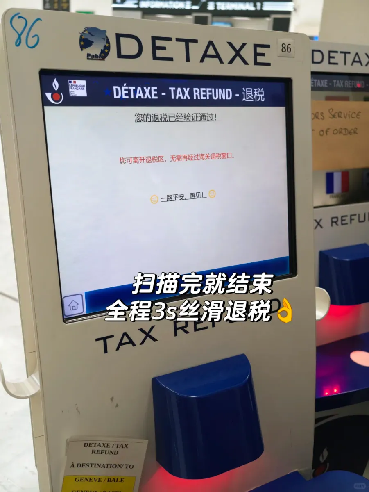

Nice Côte d'Azur Havalimanı (NCE), Fransız Rivierası'nın ana kapısı ve Terminal 1 uçuşların önemli bir bölümünü karşılıyor. Çoğu gezgin yolculuğun son günlerini Nice eski şehrinde, Èze veya Monako'da alışveriş yaparak geçirir ve KDV iadesini ancak havalimanına dönerken düşünür. İade, yolculuğun sırası her şeyden önemli olan tek bölümü: önce doğrulatın, sonra bagajınızı teslim edin. Sırayı yanlış yaparsanız para gider.

Fransız vergi iadeleri — détaxe — genellikle havalimanında nakit dağıtan bir gişe olarak hayal edilir. Pratikte iki ayrı adımdır: gümrük, eşyaların gerçekten sizinle AB'den çıktığını doğrular, ardından bir iade işletmesi bu doğrulamaya dayanarak ödeme yapar. Gümrük adımı artık çoğunlukla DETAXE yazılı bir self-servis makineyle yapılıyor ve Nice'te bu makine **Terminal 1'in varış salonunda, Fransız gümrük ofisinin yanında** duruyor. Birçok kişi valizlerini kalkış katında sürükleyerek onu arar ve ancak kapıya giderken gümrüğe uğramalarını söyleyen notu fark eder; o noktada geri dönmek artık seçenek değildir.

Bu rehber beş şeyi kapsıyor: hazırda neler olmalı, T1'deki kiosklar nasıl bulunur, yeşil ve kırmızı sonuçlar ne anlama gelir, karta mı nakde mi iade alınmalı ve ne kadar zaman bırakılmalı.

## 1. Gitmeden önce hazırda neler olmalı

Fransa birkaç katı koşul koyuyor ve bunlardan birinin eksik olması gümrüğün formu doğrulamayı reddetmesine yol açar. AB dışında yaşıyor olmalısınız, en az 16 yaşında olmalısınız ve **tek bir mağazada tek bir günde KDV dahil 100 €'dan fazla** harcamalısınız. Bu eşik 1 Ocak 2021'den beri geçerli ve dağınık küçük alışverişler nadiren ona ulaşır, bu yüzden iade almak istediğiniz şeyleri tek bir işlemde toplayın — aynı markanın iki şubesi iki ayrı mağaza sayılır.

Son tarih, insanların unuttuğu koşul. Form, satın alma ayından sonraki üçüncü ayın sonuna kadar doğrulanmalı: Ekim'de alınan bir şey Ocak sonuna kadar AB'den çıkmalı ve doğrulanmalı. Ondan sonra geçersizdir ve itiraz süreci yoktur. Diğer kural, eşyaların sizinle seyahat etmesi. Gümrük onları görmek isteyebilir, bu yüzden iade edilecek hiçbir şey doğrulamadan önce check-in bagajına girmemeli ve elbette bagajı teslim edip sonra damga için geri dönemezsiniz. Eşya yoksa doğrulama da yok.

Liste kısa, ama eksik bir şey sizi kuyruktaki yerinizden edebilir:

- **Pasaport** — ad, iade formundaki adla eşleşmelidir;
- **İade formu (bordereau)** — mağaza tarafından PABLO sistemi üzerinden düzenlenir, PABLO logosu ve barkod taşır, mağaza ve siz tarafından imzalanır;
- **Fişler** — formlarla birlikte gider ve tutarlar ile tarihler birbirini tutmalıdır;
- **Eşyaların kendisi** — el bagajında veya teslim edilmemiş bir valizde, açılmaya hazır;
- **Biniş kartı veya seyahat planı** — ara sıra istenir.

Bir ayrıntıyı havalimanında değil mağazada kesinleştirmeye değer: iade yöntemi. Kart seçerseniz numara, son kullanma tarihi ve kart sahibinin adı doğru olmalı — yanlış kart numarası bir iadenin başarısız olmasının en yaygın tek nedeni. Nakit seçerseniz formda gerçekten nakit işaretli olduğunu kontrol edin. Yazım hatasını kioskta fark etmek çok geçtir; havalimanı bunu düzeltemez ve bunun yerine mağazaya veya iade işletmesine yazmanız gerekir.

## 2. Terminal 1'de DETAXE ve PABLO'yu bulmak

Doğrulama noktası kalkış check-in salonunda değil. **Fransız gümrük ofisinin (Douanes françaises) yanındaki varış salonunda**: Terminal 1'de danışma gişesinin karşısında; Terminal 2'de A3 kapısının karşısında. İlk kez gelenler kalkış katında dönüp durur. Bunun yerine “Douanes françaises / French Customs” yazan mavi tabelayı arayın — kiosklar onun kapısında.

Sütun tabelası Fransızca, İngilizce, Çince, Rusça ve Arapça; oklar gümrük gişesini gösteriyor. Altındaki beyaz dolaplar sırası self-servis ekipmanı: üstte **DETAXE**, önde **TAX REFUND**, ortada bir dokunmatik ekran, altında kırmızı bir okuma yarığı olan koyu mavi bir tarayıcı başlığı ve gövdede bir birim numarası (fotoğraftaki makinede 86). Kiosklar görevli gişenin hemen yanında, bu yüzden elektronik güzergâh ile manuel güzergâh aynı noktada ayrılıyor: makineyi geçin ve yürüyün, başarısız olursa gişeye dönün.

Makine basit. İlk ekran dil soruyor ve bayrak simgeleri onu Çinceye çeviriyor; ardından “iade formlarınızı tek tek tarayın” gibi çok özel yönergeler dahil her istem Çince görünüyor. Fransızca bilmeyen biri için bu en çok bir şeyler ters gittiğinde önemli: kırmızı sonuç size Çince nereye gideceğinizi söyleyecek.

Buranın yerini unutmayın: halka açık alanda, güvenlikten önce. Nice Havalimanı formların **güvenlik kontrolünden geçmeden önce doğrulanmasını** şart koşuyor ve airside'a geçtikten sonra geri dönemezsiniz. Kısıtlı alan içindeki döviz gişeleri de doğrulanmamış bir formu ödemez. Doğru sıra: gelin, DETAXE kiosklarını bulun, doğrulayın, sonra check-in yapıp bagajları teslim edin.

## 3. Yeşil ışık ve kırmızı ışık: iki sonuç

Tarama tek hareket: formu barkodu kırmızı yarığa bakacak şekilde çevirin ve içeri itin. Makine kodu okuduğunda bip sesi verir ve ekran üç sütunda saymaya başlar — **taranan formlar**, **doğrulanan formlar** (yeşil tik) ve **doğrulanmayan formlar** (kırmızı eksi). Düzen kullanışlı: az önce verdiğiniz formların gerçekten geçip geçmediğini tek tek hatırlamaya çalışmak yerine bir bakışta görüyorsunuz.

Bir form yerleştirdiğinizde barkod kırmızı ışık şeridine bakmalı ve kâğıt katlanmış değil düz durmalı. Önce taranan sayacı artar, sonra yeşil ya da kırmızı sütun gelir. Makinenin yanına yapıştırılmış küçük bir not bilinmeye değer bir uyarı ekliyor: **Cenevre veya Basel için işaretlenmiş formlar İsviçre'ye varışta doğrulanır**. Eve dönüş güzergâhınız Nice'ten Zürih'e ve devamıysa o formlar bu kioskta geçmez — İsviçre'ye inene kadar beklemeleri gerekir.

**Yeşil, iş bitti demek.** Ekran iadenin doğrulandığını bildirir ve altındaki satır iade alanından ayrılabileceğinizi ve gümrük iade gişesine uğramanız gerekmediğini söyler. Fransız gümrük kurallarına göre bir PABLO terminalinden gelen elektronik mesaj fiziksel damgayla aynı ağırlığı taşır ve sonuç aynı gün iade işletmesine iletilir; mağazaya geri postalanacak bir şey yoktur. Form başına saniyeler sürer ve ekran neşeli bir kapanışla biter.

**Kırmızı, bir insan demek.** Ekran sizi yan kapıdaki gümrük ofisine gönderir; bir memur evrakı kontrol eder ve damgalar ya da imzalar. Olağan nedenler sıradan: form PABLO üzerinden düzgün düzenlenmemiş (başka bir AB ülkesinde alınmış veya eski el yazısı bir fiş), barkod kırışmış ya da kirli ve okunamıyor, ad pasaportla eşleşmiyor, üç aylık süre geçmiş veya bir nokta kontrolü eşyaları görmek istiyor. İlk üçü her hâlükârda manuel güzergâh demek; süresi geçmiş bir form hiçbir şekilde kurtarılamaz; nokta kontrolü ise yalnızca eşyaların hâlâ yanınızda olup olmadığına bağlı.

Bir mesaj düz kırmızı ışıktan farklı: ekran, form iade işletmeniz tarafından düzgün düzenlenmediği için Fransız gümrüğünün onu doğrulayamayacağını söyleyebilir. Bu damga için kuyruğa girme daveti değil — formun kendisi hatalı ve gümrük onu onaramaz. Formda bilgileri basılı olan işletmeyle iletişime geçin.

Gişenin önünde genellikle bariyer bandıyla oluşturulmuş bir kuyruk olur ve yoğun sezonda salonun ortasına ulaşır. Sıra size geldiğinde pasaport, formlar ve eşyaları birlikte verirsiniz; memur onlara neredeyse bakmaz ya da bir valizi açıp belirli bir eşyayı göstermenizi isteyebilir. Damga evrakı tamamlar — ancak ondan sonra ödeme sorunu ortaya çıkar.

## 4. Kart veya nakit

Birçok kişi yeşil ışıktan sonra paranın kendiliğinden geleceğini sanır. Doğrulama yalnızca işletmenin artık ödeme yapmasına izin verildiği anlamına gelir; nerede ve ne zaman ödeyeceği mağazada neyi seçtiğinize bağlıdır. Nice'te nakit iadeler Global Exchange gibi döviz gişeleri tarafından yapılır — biri gümrüğün yanında halka açık alanda, biri airside'da — kart iadeleri ise gümrük verilerini aldıktan sonra işletmeler (Global Blue, Planet ve diğerleri) tarafından işlenir.

**Karta iade** en güvenilir seçenek. Bir tomar euro taşımıyorsunuz, tutar kart şeması kuru üzerinden çevriliyor ve evrak kaybolursa ya da tutara itiraz edilirse tartışabileceğiniz bir kart numaranız oluyor. Bedeli zaman: haftalar ila aylar normal, yoğun sezonda daha uzun. Aceleniz olmayan büyük iadeler için uygun. Numarayı ve son kullanma tarihini mutlaka kontrol edin, çünkü geçersiz bir karta gönderilen iadeyi kurtarmak zahmetlidir.

**Nakit** hemen öder. Doğrulanmış formu döviz gişesine verin, euroyu alın ve terminal dışında harcayın. Bedeli kur: gişe dövizi piyasa kurunun oldukça altında alır, yani iadenin bir kısmını hemen parayla ve takipsizlikle değiş tokuş ediyorsunuz. Küçük tutarlar, sıkışık programlar veya aylarca bir ödemenin peşinden koşmak istemeyenler için nakit daha sakin seçim.

Karar vermenin pratik yolu tutara ve sonrasında ne olacağına bakmak. Büyük tek bir iadeyi karta koymaya değer; orada kur kaybı oransal olarak küçük ve beklemek kabul edilebilir. Birkaç on euro değerinde bir avuç form için nakit daha iyi — kazanılan zahmet, kur farkından daha değerli. Ve zaten airside'daysanız, içerideki döviz gişesinde yalnızca doğrulanmış formların ödenebileceğini unutmayın; güvenlikten önce doğrulama sırasının tersine çevrilememesinin nedeni tam olarak bu.

## 5. Zamanlama ve bir kontrol listesi

Riviera sezonu uzun; Temmuz ve Ağustos'ta tatilciler, kruvaziyer yolcuları ve hafta sonu ziyaretçileri üst üste biner, bu yüzden T1'de hem iade kuyruğu hem güvenlik kuyruğu uzar. **Havalimanında en az 3 saat bırakın** — bu güzergâhı düzenli kullanan yolcuların tavsiyesi. Makine bir formu saniyeler içinde işler, ama kuyruğa girmek, evrakı çıkarmak, valizin denetim için açılması ve varıştan check-in'e geri yürümek zaman alır. Yoğun sezonda öğle vakti gümrük gişesindeki sıra salonun ortasına kadar uzanabilir ve kısa görünse bile yavaş ilerler.

Biniş alanına giden koridorda gri bir duyuru panosu duruyor: sarı bir uyarı üçgeni, **TAX REFUND** yazısı ve yolculara biniş alanına girmeden önce iade formlarını gümrük ofisinde kontrol ettirmelerini hatırlatan Fransızca ve İngilizce bir paragraf. Konumu her şeyi söylüyor — güvenliğe yaklaştığınızda görünür. Onu bir hatırlatma olarak fark etmek genellikle geri dönmek demektir ve Nice'te geri dönmeye her zaman izin verilmez.

Kalkış günü için kontrol listesi olarak tüm süreç:

1. **3 saat önce gelin**, yoğun sezonda biraz daha erken.
2. **Önce iade, sonra bagaj** — iade edilecek hiçbir şey doğrulamadan önce check-in bagajına girmez.
3. **Yeniden paketlemeyi doğrulamadan sonra** yapın, gümrük gişesinin önünde değil.
4. **Formları tek tek tarayın** ve her seferinde doğrulanan sayacının bir artmasını izleyin.
5. **Kırmızı formu yeniden taramayın** — bunun yerine gümrük gişesine gidin; tekrarlanan denemeler yalnızca kuyruğu yavaşlatır.
6. **Para gelene kadar her fişi ve formu saklayın**, özellikle kart iadelerinde, ödeme başarısız olursa tek kanıtınız onlar.
7. **Damgalı formun veya doğrulanmış ekranın fotoğrafını çekin**, sonraki karşılaştırma için.
8. **Kart numarasını iki kez kontrol edin** — numara, son kullanma tarihi ve kart sahibinin adı.

Son bir not: eşikler, kiosk konumları ve gişe çalışma saatleri değişebilir. Bu, Ekim 2026'daki durumu yansıtıyor; o gün Nice Havalimanı ve Fransız gümrük web sitelerini kontrol edin, bir şey net değilse yerindeki görevlilere sorun.

## İlgili bağlantılar

- **Bu sitede**: [Fransa (FR)](/country/FR)
- **Wikipedia**: [Nice Côte d'Azur Havalimanı](https://en.wikipedia.org/wiki/Nice_C%C3%B4te_d%27Azur_Airport)
- **Baidu Baike**: [Nice Côte d'Azur Havalimanı](https://baike.baidu.com/item/%E5%B0%BC%E6%96%AF%E8%93%9D%E8%89%B2%E6%B5%B7%E5%B2%B8%E6%9C%BA%E5%9C%BA)
