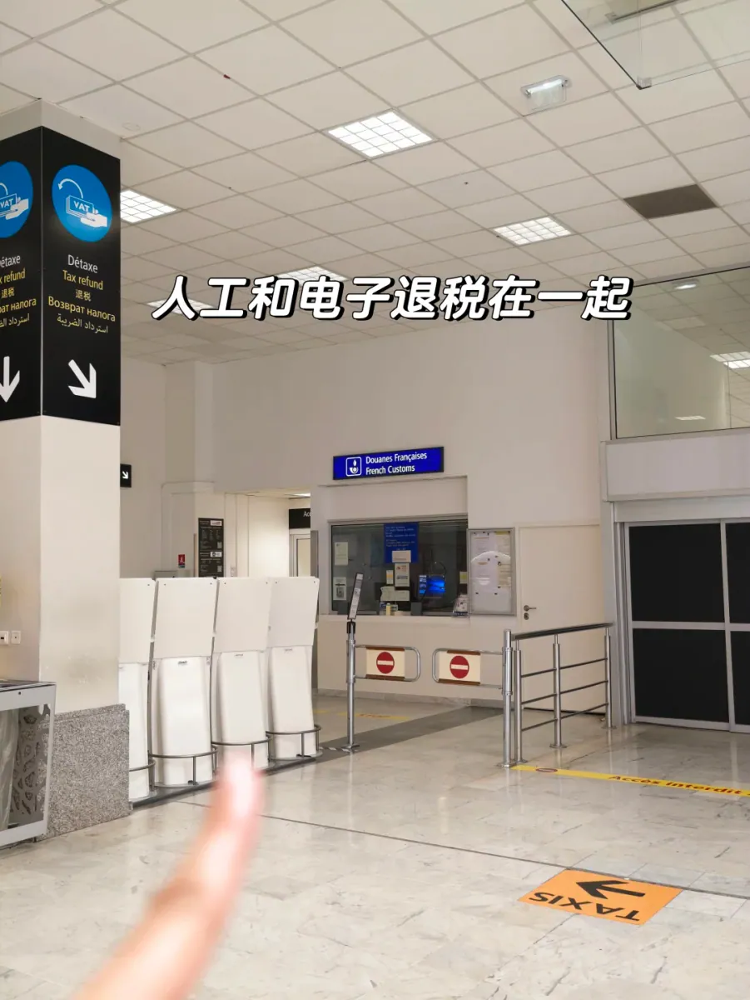

Аеропорт Ніцца — Лазуровий Берег (NCE) — головні повітряні ворота Французької Рив'єри, і термінал 1 обслуговує чималу частку його рейсів. Більшість мандрівників проводять останні дні подорожі за покупками в старому місті Ніцци, Езі чи Монако й згадують про повернення ПДВ лише дорогою назад до аеропорту. Повернення — це та частина поїздки, де порядок важить понад усе: спершу підтвердження, потім здавання багажу. Переплутайте послідовність — і грошей немає.

Французьке повернення податків — détaxe — зазвичай уявляють як стійку в аеропорту, де видають готівку. Насправді це два окремі кроки: митниця підтверджує, що товари справді вивезено з ЄС разом із вами, а потім оператор повернення виплачує кошти на підставі цього підтвердження. Митний крок тепер переважно виконує автомат самообслуговування з написом DETAXE, і в Ніцці він стоїть у **залі прильотів термінала 1, поруч із відділенням французької митниці**. Чимало людей тягають валізи залом вильотів у пошуках цього автомата й помічають табличку, яка велить звернутися до митниці дорогою до виходу на посадку, лише тоді, коли повертатися вже нікуди.

Цей посібник охоплює п'ять речей: що підготувати, як знайти кіоски в T1, що означають зелений і червоний результати, обрати повернення на картку чи готівкою і скільки часу закласти.

## 1. Що підготувати заздалегідь

Франція встановлює кілька жорстких умов, і якщо не виконано хоча б одну з них, митниця може відмовитися підтверджувати форму. Ви повинні жити за межами ЄС, мати щонайменше 16 років і витратити **понад 100 євро з ПДВ в одному магазині за один день**. Цей поріг діє з 1 січня 2021 року, а розрізнені дрібні покупки рідко його сягають, тож об'єднуйте речі, за які хочете повернути податок, в одну транзакцію — два відділення одного бренду вважаються двома різними магазинами.

Про дедлайн найчастіше забувають. Форму треба підтвердити до кінця третього місяця після місяця покупки: річ, куплена в жовтні, має виїхати з ЄС і бути підтверджена до кінця січня. Після цього вона недійсна, і жодної процедури оскарження немає. Інше правило — товари подорожують разом із вами. Митниця може попросити їх показати, тому ніщо з того, за що ви хочете повернути податок, не повинно потрапляти до зданого багажу до підтвердження, і вже точно не можна здати валізу, а потім повернутися по штамп. Немає товарів — немає підтвердження.

Список короткий, але кожен відсутній пункт може коштувати вам місця в черзі:

- **Паспорт** — ім'я має збігатися з тим, що вказане у формі повернення;
- **Форма повернення (bordereau)** — її видає магазин через систему PABLO; на ній є логотип PABLO і штрихкод, підписи магазину та ваші;
- **Чеки** — вони додаються до форм, а суми й дати мають збігатися;
- **Самі товари** — у ручній поклажі або незаданій валізі, готові до огляду;
- **Посадковий талон або маршрут** — інколи просять.

Одну деталь краще з'ясувати в магазині, а не в аеропорту: спосіб повернення. Якщо обираєте картку, номер, термін дії та ім'я власника мають бути правильними — неправильний номер картки є найпоширенішою причиною невдалого повернення. Якщо обираєте готівку, переконайтеся, що у формі справді позначено готівку. Помітити помилку в кіоску — уже запізно; аеропорт не може її виправити, і вам доведеться писати магазину чи оператору повернення.

## 2. Як знайти DETAXE і PABLO в терміналі 1

Пункт підтвердження не в залі реєстрації вильотів. Він у **залі прильотів поруч із відділенням французької митниці (Douanes françaises)**: у терміналі 1 — навпроти стійки інформації; у терміналі 2 — навпроти виходу A3. Ті, хто тут уперше, зазвичай кружляють залом вильотів. Натомість шукайте синю табличку з написом «Douanes françaises / French Customs» — кіоски стоять біля її дверей.

На стелі — написи французькою, англійською, китайською, російською та арабською, зі стрілками на митне вікно. Ряд білих шаф унизу — це обладнання самообслуговування: **DETAXE** угорі, **TAX REFUND** на передній панелі, посередині сенсорний екран, під ним темно-синій кожух сканера з червоною щілиною для читання, а на корпусі — номер пристрою (86 на автоматі з фото). Кіоски стоять просто біля стійки з персоналом, тож електронний і ручний шляхи розходяться в одному місці: пройшли автомат — ідіть далі, не пройшли — повертайтеся до вікна.

Автомат простий. Перший екран просить обрати мову, і кнопки з прапорцями перемикають його на китайську, після чого всі підказки — зокрема й вельми конкретна «скануйте форми повернення по одній» — з'являються китайською. Для тих, хто не володіє французькою, це найважливіше тоді, коли щось іде не так: червоний результат китайською підкаже, куди йти далі.

Запам'ятайте, де це: у загальнодоступній зоні, до контролю безпеки. Аеропорт Ніцци вимагає, щоб форми було **підтверджено до проходження контролю безпеки**, а щойно ви пройшли контроль, повернутися вже не можна. Обмінні стійки в обмеженій зоні також не виплачують за непідтвердженими формами. Правильна послідовність: приїхати, знайти кіоски DETAXE, підтвердити форми, а вже потім реєструватися й здавати багаж.

## 3. Зелене світло і червоне світло: два результати

Сканування — це один рух: поверніть форму так, щоб штрихкод дивився в червону щілину, і вставте її. Коли автомат зчитує код, він подає звуковий сигнал, а екран починає рахувати в трьох стовпчиках — **форм відскановано**, **форм підтверджено** (зелена галочка) і **форм не підтверджено** (червоний мінус). Компонування екрана зручне: одразу видно, чи справді пройшли форми, які ви щойно вставили, замість того, щоб згадувати їх по одній.

Коли вставляєте форму, штрихкод має дивитися на червону світлову смужку, а папір має лежати рівно, не згинаючись. Спочатку збільшується лічильник відсканованих, потім додається або зелений, або червоний стовпчик. Невелика табличка збоку автомата додає важливе застереження: **форми, призначені для Женеви чи Базеля, підтверджують після прибуття до Швейцарії**. Якщо ваш шлях додому — Ніцца — Цюрих і далі, ці форми в цьому кіоску не пройдуть: їм доведеться чекати, доки ви прилетите до Швейцарії.

**Зелений означає «готово».** Екран повідомляє, що повернення підтверджено, а рядок нижче каже, що можна залишити зону повернення податків і не звертатися до митного вікна. За правилами французької митниці електронне повідомлення з термінала PABLO має ту саму силу, що й фізичний штамп, і результат того ж дня передають оператору повернення; надсилати щось назад до магазину не потрібно. Кожна форма займає секунди, а екран завершує процедуру веселим прощальним написом.

**Червоний означає «до людини».** Екран скеровує вас до сусіднього митного відділення, де офіцер перевіряє документи й ставить штамп або підпис. Причини зазвичай буденні: форму неправильно оформлено через PABLO (куплено в іншій країні ЄС або це старий рукописний бланк), штрихкод зім'ятий чи забруднений і не зчитується, ім'я не збігається з паспортом, тримісячний строк минув або вибіркова перевірка вимагає показати товари. Перші три означають ручний шлях у будь-якому разі; прострочену форму врятувати неможливо; а вибіркова перевірка просто залежить від того, чи товари досі з вами.

Одне повідомлення відрізняється від звичайного червоного світла: екран може сказати, що французька митниця не може підтвердити форму, бо її неправильно оформив ваш оператор повернення. Це не привід ставати в чергу по штамп — сама форма дефектна, і митниця не може її виправити. Зверніться до оператора, чиї дані надруковані на формі.

Перед вікном зазвичай стоїть черга, відгороджена стрічками, яка в пік сезону сягає середини зали. Коли доходить ваша черга, ви подаєте паспорт, форми й товари разом; офіцер може ледве глянути на них, а може попросити відкрити валізу й показати конкретну річ. Штамп завершує оформлення документів — і лише тоді постає питання виплати.

## 4. Картка чи готівка

Багато хто думає, що гроші надходять автоматично після зеленого світла. Підтвердження лише означає, що оператор тепер має право платити; де і коли він заплатить, залежить від того, що ви обрали в магазині. У Ніцці готівкові повернення видають обмінні стійки, як-от Global Exchange — одна в загальнодоступній зоні біля митниці, одна після контролю безпеки, — а повернення на картку обробляють оператори (Global Blue, Planet та інші), щойно отримають митні дані.

**Повернення на картку** — найнадійніший варіант. Вам не треба носити з собою пачку євро, суму конвертують за курсом платіжної системи, а якщо документи загубляться чи суму оспорять, у вас є номер картки, на який можна спертися в суперечці. Ціна — час: тижні або місяці — це норма, а в пік сезону ще довше. Він підходить для великих сум, коли ви не поспішаєте. Обов'язково перевірте номер і термін дії, бо виплату на недійсну картку потім болісно повертати.

**Готівка** виплачується одразу. Віддайте підтверджену форму за обмінною стійкою, заберіть євро й витратьте їх поза терміналом. Ціна — курс: стійка купує валюту значно нижче ринкового курсу, тож ви обмінюєте частину повернення на негайні гроші й відсутність подальшого клопоту. Для дрібних сум, щільного графіка або тих, хто не хоче місяцями ганятися за виплатою, готівка — спокійніший вибір.

Практичний спосіб вирішити — за розміром суми й тим, що буде далі. Велике одноразове повернення варто відправити на картку, де втрата на обміні пропорційно мала й очікування прийнятне. Кілька форм на кілька десятків євро краще закрити готівкою — зекономлені зусилля коштують більше, ніж різниця в курсі. А якщо ви вже після контролю безпеки, пам'ятайте, що обмінна стійка всередині оплачує лише підтверджені форми; саме тому послідовність «підтвердження до контролю безпеки» не можна змінити.

## 5. Час і контрольний список

Сезон на Рив'єрі довгий, а в липні й серпні відпочивальники, пасажири круїзних лайнерів і туристи вихідного дня накладаються один на одного, тож і черга на повернення податків, і черга на контроль безпеки в T1 ростуть. **Закладайте щонайменше 3 години в аеропорту** — так радять мандрівники, які регулярно користуються цим маршрутом. Сам автомат обробляє форму за кілька секунд, але черга, пошук документів, відкривання валізи для огляду й дорога від прильотів назад до реєстрації забирають час. Опівдні в пік сезону черга до митного вікна може сягати середини зали й рухається повільно, навіть коли здається короткою.

У коридорі до зони посадки стоїть сіра інформаційна таблиця: жовтий попереджувальний трикутник, слова **TAX REFUND** і абзац французькою та англійською, який нагадує мандрівникам перевірити форми повернення у митному відділенні до входу в зону посадки. Її розташування промовисте — вона з'являється, коли ви вже близько до контролю безпеки. Помітити її як нагадування зазвичай означає повертатися назад, а в Ніцці повертатися дозволяють не завжди.

Увесь процес як контрольний список на день вильоту:

1. **Приїжджайте за 3 години**, а в пік сезону — трохи раніше.
2. **Спершу повернення, потім багаж** — ніщо з того, за що повертають податок, не потрапляє до зданої валізи до підтвердження.
3. **Перепаковуйте після підтвердження**, а не перед митним вікном.
4. **Скануйте по одній формі** й стежте, щоб лічильник підтверджених щоразу збільшувався на один.
5. **Не скануйте червону форму повторно** — натомість ідіть до митного вікна; повторні спроби лише затримують чергу.
6. **Зберігайте кожен чек і кожну форму, доки не надійдуть гроші**, особливо при поверненні на картку, де вони — ваш єдиний доказ, якщо виплата не пройде.
7. **Сфотографуйте форму зі штампом** або екран із підтвердженням для подальшого звіряння.
8. **Перевірте номер картки двічі** — номер, термін дії та ім'я власника.

Останнє зауваження: пороги, розташування кіосків і години роботи стійок можуть змінюватися. Тут описано ситуацію станом на жовтень 2026 року; у день вильоту перевіряйте сайти аеропорту Ніцци та французької митниці, а якщо щось незрозуміло, питайте персонал на місці.

## Пов'язані посилання

- **На цьому сайті**: [Франція (FR)](/country/FR)
- **Вікіпедія**: [Аеропорт Ніцца — Лазуровий Берег](https://en.wikipedia.org/wiki/Nice_C%C3%B4te_d%27Azur_Airport)
- **Baidu Baike**: [Аеропорт Ніцца — Лазуровий Берег](https://baike.baidu.com/item/%E5%B0%BC%E6%96%AF%E8%93%9D%E8%89%B2%E6%B5%B7%E5%B2%B8%E6%9C%BA%E5%9C%BA)
