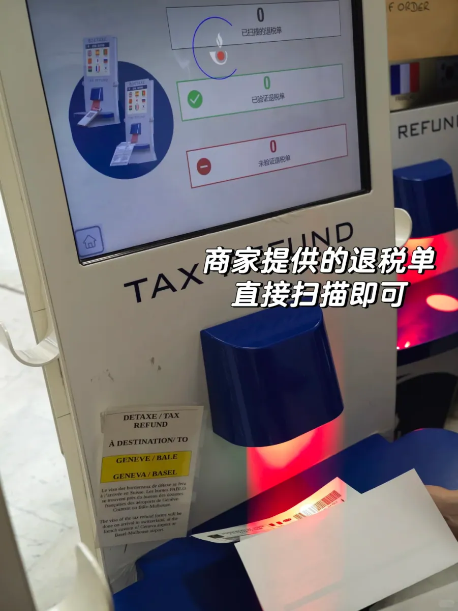

Sân bay Nice Côte d'Azur (NCE) là cửa ngõ chính của Riviera Pháp, và Nhà ga 1 đảm nhận một phần lớn chuyến bay. Phần lớn du khách dành những ngày cuối của chuyến đi để mua sắm ở phố cổ Nice, Èze hoặc Monaco, và chỉ nghĩ đến hoàn thuế VAT trên đường trở lại sân bay. Hoàn thuế là phần duy nhất của hành trình mà thứ tự quan trọng hơn mọi thứ khác: xác nhận trước, ký gửi hành lý sau. Sai thứ tự là mất tiền.

Hoàn thuế Pháp — détaxe — thường được hình dung là một quầy ở sân bay phát tiền mặt. Trên thực tế đây là hai bước riêng: hải quan xác nhận hàng thực sự rời EU cùng bạn, sau đó một nhà vận hành hoàn thuế trả tiền dựa trên xác nhận đó. Bước hải quan nay chủ yếu do máy tự phục vụ ghi DETAXE thực hiện, và tại Nice máy đó đứng trong **sảnh đến của Nhà ga 1, cạnh văn phòng hải quan Pháp**. Nhiều người kéo vali quanh tầng khởi hành để tìm nó, và chỉ nhận ra thông báo bảo họ đến hải quan trên đường ra cổng khi việc quay lại không còn là lựa chọn.

Hướng dẫn này đề cập năm điều: cần chuẩn bị gì, tìm máy ở đâu trong T1, kết quả xanh và đỏ có nghĩa gì, nên nhận hoàn thuế vào thẻ hay tiền mặt, và cần dành bao nhiêu thời gian.

## 1. Cần chuẩn bị trước khi đi

Pháp đặt ra một số điều kiện cứng, và thiếu bất kỳ điều nào hải quan có thể từ chối xác nhận tờ khai. Bạn phải sống ngoài EU, ít nhất 16 tuổi, và chi **trên €100 đã gồm VAT trong một cửa hàng vào một ngày**. Ngưỡng này áp dụng từ ngày 1 tháng 1 năm 2021, và các món nhỏ mua rải rác hiếm khi đạt, nên hãy gộp những thứ muốn hoàn thuế vào một giao dịch — hai chi nhánh của cùng thương hiệu tính là hai cửa hàng khác nhau.

Hạn chót là điều kiện người ta hay quên. Tờ khai phải được xác nhận trước cuối tháng thứ ba sau tháng mua: món mua tháng 10 phải rời EU và được xác nhận trước cuối tháng 1. Sau đó tờ khai vô hiệu, và không có quy trình khiếu nại. Quy định còn lại là hàng phải đi cùng bạn. Hải quan có thể yêu cầu xem, nên không món nào được hoàn thuế nên vào hành lý ký gửi trước khi xác nhận, và dĩ nhiên bạn không thể ký gửi vali rồi quay lại lấy dấu sau. Không có hàng, không có xác nhận.

Danh sách thì ngắn, nhưng thiếu bất kỳ món nào cũng có thể khiến bạn mất lượt trong hàng chờ:

- **Hộ chiếu** — tên phải khớp với tên trên tờ khai hoàn thuế;
- **Tờ khai hoàn thuế (bordereau)** — do cửa hàng phát hành qua hệ thống PABLO, có logo PABLO và mã vạch, do cửa hàng và bạn ký;
- **Hóa đơn** — đi kèm tờ khai, số tiền và ngày phải khớp;
- **Chính hàng hóa** — trong túi xách tay hoặc vali chưa ký gửi, sẵn sàng để mở;
- **Thẻ lên máy bay hoặc lịch trình** — đôi khi được yêu cầu.

Một chi tiết nên giải quyết tại cửa hàng thay vì ở sân bay: cách nhận hoàn thuế. Nếu chọn thẻ, số thẻ, ngày hết hạn và tên chủ thẻ đều phải đúng — sai số thẻ là lý do phổ biến nhất khiến hoàn thuế thất bại. Nếu chọn tiền mặt, hãy kiểm tra tờ khai thực sự được đánh dấu tiền mặt. Phát hiện lỗi đánh máy tại máy thì đã quá muộn; sân bay không thể sửa, và bạn sẽ phải viết thư cho cửa hàng hoặc nhà vận hành hoàn thuế.

## 2. Tìm DETAXE và PABLO trong Nhà ga 1

Điểm xác nhận không nằm trong sảnh làm thủ tục khởi hành. Nó ở **sảnh đến cạnh văn phòng hải quan Pháp (Douanes françaises)**: ở Nhà ga 1, đối diện quầy thông tin; ở Nhà ga 2, đối diện cổng A3. Người lần đầu thường đi vòng quanh tầng khởi hành. Thay vào đó, hãy tìm biển xanh ghi “Douanes françaises / French Customs” — máy đứng ngay cửa.

Biển cột bằng tiếng Pháp, Anh, Trung, Nga và Ả Rập, với mũi tên chỉ cửa sổ hải quan. Dãy tủ trắng bên dưới là thiết bị tự phục vụ: **DETAXE** ở phía trên, **TAX REFUND** ở mặt trước, màn hình cảm ứng ở giữa, nắp quét màu xanh đậm bên dưới với khe đọc màu đỏ bên trong, và số đơn vị trên thân máy (86 trên máy trong ảnh). Máy đứng ngay cạnh quầy có nhân viên, nên lối điện tử và lối thủ công tách nhau tại cùng một điểm: qua máy thì đi tiếp, không qua thì quay sang cửa sổ.

Máy rất đơn giản. Màn hình đầu tiên hỏi ngôn ngữ, và các biểu tượng cờ chuyển sang tiếng Trung, sau đó mọi lời nhắc — kể cả dòng rất cụ thể “quét từng tờ khai một” — hiện bằng tiếng Trung. Với ai không đọc được tiếng Pháp, điều này quan trọng nhất khi có sự cố: kết quả đỏ sẽ nói bằng tiếng Trung rằng bạn cần đi đâu tiếp.

Hãy nhớ vị trí này: trong khu công cộng, trước an ninh. Sân bay Nice yêu cầu tờ khai phải được **xác nhận trước khi bạn qua điểm kiểm tra an ninh**, và khi đã vào khu cách ly bạn không thể quay lại. Các quầy đổi tiền bên trong khu hạn chế cũng không trả tiền cho tờ khai chưa xác nhận. Thứ tự đúng là: đến, tìm máy DETAXE, xác nhận, rồi làm thủ tục và ký gửi hành lý.

## 3. Đèn xanh và đèn đỏ: hai kết quả

Quét chỉ gồm một động tác: xoay tờ khai để mã vạch hướng vào khe đỏ và đẩy vào. Máy kêu khi đọc mã, và màn hình bắt đầu đếm ở ba cột — **tờ khai đã quét**, **tờ khai đã xác nhận** (dấu tick xanh) và **tờ khai chưa xác nhận** (dấu trừ đỏ). Cách bố trí hữu ích: bạn thấy ngay tờ khai vừa đưa vào có qua hay không, thay vì cố nhớ từng tờ.

Khi đưa tờ khai vào, mã vạch phải hướng vào dải đèn đỏ và giấy phải phẳng, không gấp. Bộ đếm đã quét tăng trước, rồi cột xanh hoặc đỏ theo sau. Một thông báo nhỏ dán bên máy nêu một lưu ý đáng biết: **tờ khai đánh dấu Geneva hoặc Basel được xác nhận khi đến Thụy Sĩ**. Nếu đường về của bạn là Nice đến Zürich rồi đi tiếp, những tờ khai đó sẽ không qua máy này — chúng phải chờ đến khi bạn hạ cánh ở Thụy Sĩ.

**Xanh nghĩa là xong.** Màn hình thông báo khoản hoàn thuế đã được xác nhận, và dòng bên dưới nói bạn có thể rời khu hoàn thuế và không cần đến cửa sổ hoàn thuế hải quan. Theo quy định hải quan Pháp, thông điệp điện tử từ thiết bị PABLO có giá trị như dấu thật, và kết quả được chuyển cho nhà vận hành hoàn thuế trong cùng ngày; không cần gửi gì lại cửa hàng. Mỗi tờ mất vài giây, và màn hình kết thúc bằng lời chào vui vẻ.

**Đỏ nghĩa là cần người thật.** Màn hình chỉ bạn đến văn phòng hải quan bên cạnh, nơi nhân viên kiểm tra giấy tờ và đóng dấu hoặc ký. Lý do thường rất đời thường: tờ khai không được phát hành đúng qua PABLO (mua ở nước EU khác, hoặc phiếu viết tay cũ), mã vạch bị nhàu hoặc bẩn nên không đọc được, tên không khớp hộ chiếu, đã quá hạn ba tháng, hoặc kiểm tra ngẫu nhiên muốn xem hàng. Ba nguyên nhân đầu đồng nghĩa với lối thủ công; tờ khai hết hạn không thể cứu; còn kiểm tra ngẫu nhiên chỉ phụ thuộc hàng còn bên bạn hay không.

Một thông báo khác với đèn đỏ thông thường: màn hình có thể nói tờ khai không thể được hải quan Pháp xác nhận vì không được nhà vận hành hoàn thuế của bạn phát hành đúng. Đó không phải lời mời xếp hàng lấy dấu — bản thân tờ khai bị lỗi, và hải quan không sửa được. Hãy liên hệ nhà vận hành có thông tin in trên tờ khai.

Thường có một hàng chờ tạo bằng dây chắn trước cửa sổ, kéo đến giữa sảnh vào mùa cao điểm. Khi đến lượt, bạn đưa hộ chiếu, tờ khai và hàng cùng lúc; nhân viên có thể chỉ liếc qua, hoặc yêu cầu mở vali và chỉ một món cụ thể. Dấu hoàn tất giấy tờ — chỉ khi đó mới phát sinh câu hỏi thanh toán.

## 4. Thẻ hay tiền mặt

Nhiều người tưởng tiền tự động về sau đèn xanh. Xác nhận chỉ có nghĩa là nhà vận hành được phép trả; trả ở đâu và khi nào phụ thuộc lựa chọn của bạn tại cửa hàng. Tại Nice, hoàn tiền mặt do các quầy đổi tiền như Global Exchange xử lý — một quầy ở khu công cộng cạnh hải quan, một quầy ở khu cách ly — còn hoàn vào thẻ do các nhà vận hành (Global Blue, Planet và những công ty khác) xử lý khi nhận được dữ liệu hải quan.

**Hoàn vào thẻ** là lựa chọn đáng tin cậy nhất. Bạn không phải mang một xấp euro, số tiền được quy đổi theo tỷ giá của tổ chức phát hành thẻ, và nếu giấy tờ thất lạc hoặc số tiền bị tranh chấp, bạn có số thẻ để khiếu nại. Cái giá là thời gian: vài tuần đến vài tháng là bình thường, và lâu hơn vào mùa cao điểm. Phù hợp với khoản hoàn lớn khi bạn không vội. Hãy kiểm tra số thẻ và ngày hết hạn, vì khoản hoàn gửi đến thẻ đã hủy rất khó lấy lại.

**Tiền mặt** trả ngay. Đưa tờ khai đã xác nhận qua quầy đổi tiền, nhận euro và tiêu bên ngoài nhà ga. Cái giá là tỷ giá: quầy mua ngoại tệ thấp hơn nhiều so với thị trường, nên bạn đang đổi một phần khoản hoàn lấy tiền ngay và không phải theo đuổi. Với khoản nhỏ, lịch trình chặt hoặc ai không muốn đòi tiền suốt nhiều tháng, tiền mặt là lựa chọn nhẹ nhàng hơn.

Một cách thực tế để quyết định là theo quy mô và điều gì xảy ra sau đó. Một khoản hoàn lớn nên đưa vào thẻ, khi tổn thất tỷ giá tương đối nhỏ và việc chờ đợi chấp nhận được. Vài tờ khai trị giá vài chục euro nên giải quyết bằng tiền mặt — công sức tiết kiệm đáng hơn chênh lệch tỷ giá. Và nếu bạn đã ở khu cách ly, hãy nhớ chỉ tờ khai đã xác nhận mới được trả tại quầy đổi tiền bên trong; đó chính là lý do thứ tự xác nhận trước an ninh không thể đảo ngược.

## 5. Thời gian và danh sách kiểm tra

Mùa Riviera kéo dài, và vào tháng 7, tháng 8 du khách nghỉ dưỡng, khách du thuyền và khách cuối tuần chồng lên nhau, nên cả hàng hoàn thuế và hàng an ninh ở T1 đều dài ra. **Hãy dành ít nhất 3 giờ tại sân bay** — lời khuyên của những du khách thường dùng tuyến này. Bản thân máy xử lý một tờ khai trong vài giây, nhưng xếp hàng, lục giấy tờ, mở vali để kiểm tra và đi bộ từ sảnh đến ngược lên quầy làm thủ tục đều tốn thời gian. Giữa trưa mùa cao điểm, hàng ở cửa sổ hải quan có thể kéo đến giữa sảnh, và di chuyển chậm ngay cả khi trông ngắn.

Một bảng thông báo màu xám đứng trong hành lang về phía khu lên máy bay: tam giác cảnh báo vàng, dòng chữ **TAX REFUND**, và một đoạn tiếng Pháp và tiếng Anh nhắc du khách kiểm tra tờ khai hoàn thuế tại văn phòng hải quan trước khi vào khu lên máy bay. Vị trí của nó nói lên tất cả — nó xuất hiện khi bạn đã gần an ninh. Nhìn thấy nó như một lời nhắc thường có nghĩa là phải quay lại, và tại Nice không phải lúc nào cũng được phép quay lại.

Toàn bộ quy trình, dưới dạng danh sách kiểm tra cho ngày khởi hành:

1. **Đến sớm 3 giờ**, và sớm hơn một chút vào mùa cao điểm.
2. **Hoàn thuế trước, hành lý sau** — không món nào được hoàn thuế vào vali ký gửi trước khi xác nhận.
3. **Đóng gói lại sau khi xác nhận**, không phải trước cửa sổ hải quan.
4. **Quét từng tờ một** và xem bộ đếm đã xác nhận tăng thêm một mỗi lần.
5. **Không quét lại tờ đỏ** — hãy đến cửa sổ hải quan; cố lại chỉ làm chậm hàng chờ.
6. **Giữ mọi hóa đơn và tờ khai cho đến khi tiền về**, đặc biệt với hoàn vào thẻ, khi chúng là bằng chứng duy nhất nếu thanh toán thất bại.
7. **Chụp ảnh tờ khai đã đóng dấu**, hoặc màn hình đã xác nhận, để đối chiếu sau.
8. **Kiểm tra số thẻ hai lần** — số, ngày hết hạn và tên chủ thẻ.

Một lưu ý cuối: ngưỡng, vị trí máy và giờ mở quầy đều có thể thay đổi. Bài này phản ánh tình hình tháng 10 năm 2026; hãy kiểm tra trang web Sân bay Nice và hải quan Pháp vào ngày đi, và hỏi nhân viên tại chỗ nếu có gì chưa rõ.

## Liên kết liên quan

- **Trên trang này**: [Pháp (FR)](/country/FR)
- **Wikipedia**: [Sân bay Nice Côte d'Azur](https://en.wikipedia.org/wiki/Nice_C%C3%B4te_d%27Azur_Airport)
- **Baidu Baike**: [Sân bay Nice Côte d'Azur](https://baike.baidu.com/item/%E5%B0%BC%E6%96%AF%E8%93%9D%E8%89%B2%E6%B5%B7%E5%B2%B8%E6%9C%BA%E5%9C%BA)
