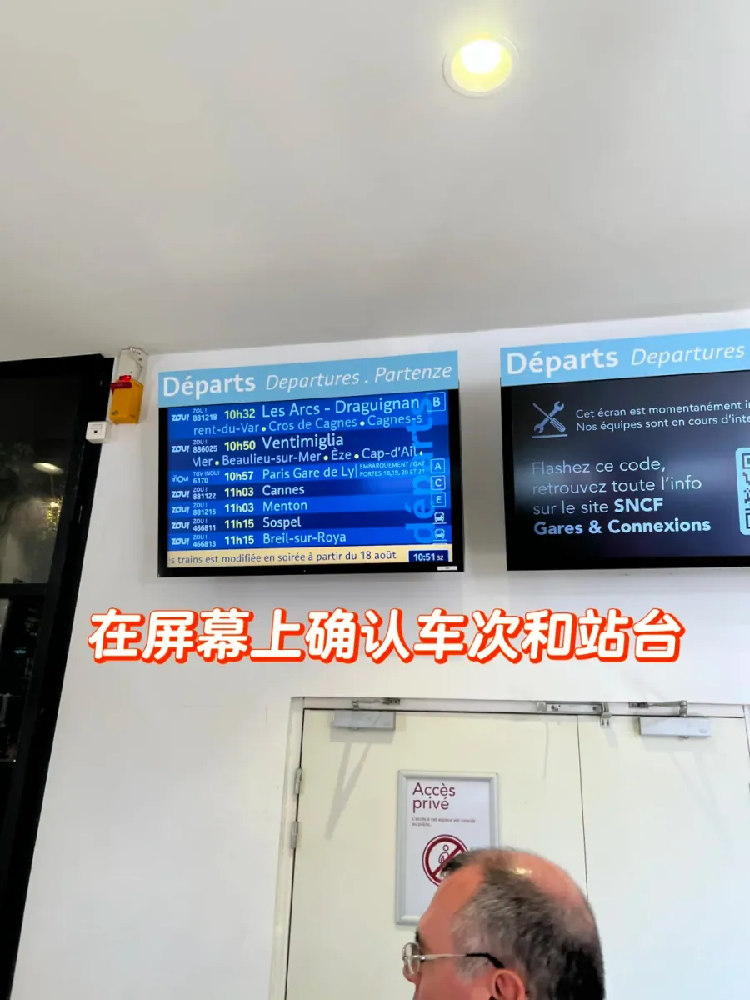
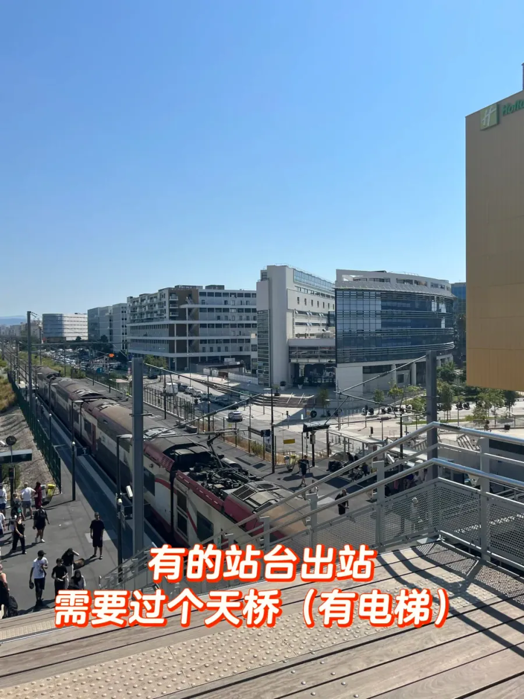
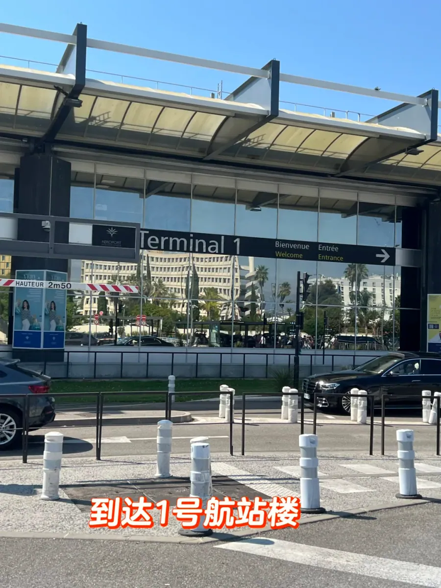

Nice se při cestě po jihu Francie těžko vynechá. Většina návštěvníků přijíždí vysokorychlostním vlakem z Paříže, Lyonu nebo Marseille, bydlí někde u Promenade des Anglais, dny tráví ve starém městě, v Èze nebo v Monaku a nakonec odlétá. Právě poslední den začínají potíže: letiště Nice Côte d'Azur (NCE) leží západně od města, na mapě blízko, ale s zavazadly nepohodlně.

Ven se dostanete třemi obvyklými způsoby: letištním autobusem, tramvají a vlakem. Autobusy zastavují na několika místech ve městě a jsou levné, ale jezdí po pobřežní silnici, která se v létě zácpami ucpe; tramvaj je pomalejší, zato jezdí často. Vlak je z těch tří nejrychlejší a nejlevnější – z Nice-Ville, hlavního nádraží, do **Nice Saint-Augustin**, zastávky u letiště, trvá cesta čtyři až šest minut a jednorázová jízdenka stojí **4 €**.

Tento průvodce sleduje trasu z původní poznámky: kupte si jízdenku a projděte turnikety na Nice-Ville, jeďte čtyři až šest minut, dojděte ze Saint-Augustin k terminálu 1 a zakončete to bezplatnou tramvají mezi oběma terminály. Bez taxíku a bez nutnosti rozumět francouzským hlášením.

## 1. Proč vlakem

Pobřeží u Nice se stáčí, letiště vzniklo za západními plážemi a železnice zrovna tak vede kolem severního okraje letištní plochy. Tak se ze Saint-Augustin, kdysi obyčejné příměstské zastávky, stalo faktické letištní nádraží: od terminálu je jen 300–400 metrů a v posledních letech bylo přestavěno, aby provoz zvládlo.

První výhoda je, že **vlak nestojí v zácpě**. Silnice z města na letiště se v dopravní špičce a po celou letní sezónu tvoří kolony a autobusy běžně jezdí o deset minut později. Vlak má vlastní koleje a čtyři až šest minut znamená čtyři až šest minut. Druhá výhoda je cena: 4 € obstojí ve srovnání s taxíkem i se specializovanými letištními autobusy.

Třetí výhoda se snadno přehlédne: **nádraží je jednodušší než letištní terminál**. Nice-Ville je hlavní nádraží města a nástupiště začínají hned za odbavovací halou; naskenujete kód, dojdete na nástupiště, nastoupíte a celé to trvá pár minut. Na druhé straně vyjdete ze Saint-Augustin, přejdete krátkou pěšinu a jednu silnici a jste u dveří terminálu 1. Žádné dlouhé fronty a žádné nutnosti přijet dvě hodiny předem.

Vlak má ovšem i meze. Dostane se do Saint-Augustin, ale ne k terminálu 2; večer je spojů méně; a některé změny nástupiště znamenají přechod přes lávku. Tomu se věnují následující části.

## 2. Nákup jízdenky a průchod turnikety

Nice-Ville je hlavní nádraží města a je fotogenické: světlé kamenné zdi, oblouková okna, pár palem venku a cedule s nápisem „Nice Ville“. Z centra jeďte tramvají nebo autobusem do oblasti Jean Médecin a deset minut jděte pěšky, nebo si při těžkých zavazadlech vezměte taxík až ke vchodu.

Koupit jízdenku lze třemi způsoby. Nejjednodušší je automat uvnitř nádraží: obrazovka se přepne do angličtiny, vyberete Nice Saint-Augustin, zaplatíte kartou nebo mincemi a jízdenka se vytiskne. Druhou možností je **SNCF Connect**, oficiální aplikace francouzských drah, která vystaví elektronickou jízdenku ve francouzštině nebo angličtině. Třetí je **Omio** s čínským rozhraním, které je snazší pro každého, kdo není zvyklý na francouzské rezervační systémy; ceny obvykle odpovídají oficiálnímu webu a občas jsou o něco vyšší.

Dostanete elektronickou jízdenku a QR kód v telefonu stačí – **papírovou není třeba vyzvedávat**. Vstup na Nice-Ville tvoří řada automatických turniketů: přiložte kód ke čtečce, turniket se otevře a jste uvnitř. Pokud kód nepřečte, obvykle je poblíž zaměstnanec a ukázání stránky s objednávkou funguje stejně dobře.

Nespěchejte hned dolů na nástupiště. Obrazovky v hale ukazují „Départs / Departures“ a vypisují každý vlak, jeho cíl, čas odjezdu a nástupiště (voie). Nice označuje nástupiště písmeny – A, B, C – a obrazovka písmeno zobrazuje v rámečku. **Než se vydáte, zkontrolujte nástupiště**, protože vlaky stejným směrem někdy odjíždějí z různých kolejí.

Jeden detail se snadno přehlédne: **kontrolujte směr**. Saint-Augustin leží západně od Nice, takže tam zastavují jen vlaky na Cannes, Grasse a Marseille; vlaky na Menton a Ventimiglia jedou na východ a na letiště se nikdy nedostanou. Cíl na obrazovce vám řekne, který je který, a pohled před nástupem ušetří pozdější trapné vysvětlování.

## 3. Čtyři až šest minut

Skok z Nice do Saint-Augustin je jeden z nejkratších na pobřežní trati. Vlak vyjíždí z Nice-Ville, jede vnitrozemsky od pobřeží a do Saint-Augustin dorazí téměř hned, **bez mezizastávky** – celkem čtyři až šest minut, tak krátce, že se sotva usadíte a už je čas vystoupit.

Vozový park se liší. Někdy přijede jednopodlažní TER, jindy dvoupodlažní. Dvoupodlažní vlaky mají ve vestibulu schodiště, takže s zavazadly je snazší zůstat v dolním podlaží než tahat kufr nahoru. Uvnitř jsou modrá čalouněná sedadla, malé stolky u okna a zavazadlové police nad hlavou; **volné místo je vaše**, protože jízdenka druhé třídy žádnou místenku nemá a ani ji nepotřebuje.

Čtyři až šest minut projíždí vlak západními předměstími. Za oknem se míhají husté bloky domů, pak rozlehlé kolejiště a nízké dílenské budovy a nakonec letištní dráha a střechy terminálů. Když uvidíte letadla, začněte se chystat k vystoupení.

Četnost je další důvod, proč tuto trať mít rád. Z Nice-Ville **první vlak odjíždí v 05:33 a poslední ve 22:42** a během dne jezdí **přibližně každých 10 až 20 minut**, takže není třeba přijíždět brzy – nástupiště začínají hned za halou a deset minut na nádraží bohatě stačí. Časy, nad kterými je třeba přemýšlet, jsou brzké ráno a pozdní večer. Na let, který odlétá před 07:00, vás 05:33 doveze do Saint-Augustin kolem 05:40, což při pěší cestě a odbavení tak tak stačí; cokoli dřívějšího znamená taxík. Kdo přistává po 22:42, měl by počítat s taxíkem nebo letištním autobusem, ne s posledním vlakem.

## 4. Pěšky ze Saint-Augustin k terminálu 1

Saint-Augustin je nové nádraží. Zelené ploty, šedé cedule s názvem a velká deska venku s nápisem „Votre nouvelle gare de Nice Saint-Augustin“ ukazují na nedávnou přestavbu. Po příjezdu hned nehledejte východ: jděte s proudem na konec nástupiště a dívejte se nahoru po „Sortie / Exit“ a symbolu letadla.

Z některých nástupišť se vychází přes lávku. Lávka má schody i výtah a s velkým kufrem se vyplatí na výtah počkat. Z lávky vidíte celé nádraží: několik kolejí, trakční vedení a v dálce letištní budovy, takže směr je zřejmý.

Venku jsou cedule jasné. Tmavě šedý panel nese nápisy „Av. Me Maurice Slama“ a „Sortie / Exit“, pod nimi **Bus**, **Tramway** a **Aéroport** a šipku ukazující vpřed. Držte se symbolu letadla a míříte k terminálu.

Následuje krytá pěšina se světlým propustným povrchem, nízkými keři a drátěným plotem po obou stranách. Není dlouhá a na jejím konci je schodiště a skleněná věž výtahu; k terminálu 1 se odsud jde dolů a pod lávkou na chodník směrem k letišti.

Schody a věž výtahu jsou jediná část cesty, u které je třeba se rozhodnout. Kdo má těžká zavazadla, kočárek nebo omezenou pohyblivost, měl by jet výtahem; je malý a v sezóně může čekat na jednu nebo dvě jízdy. Schody nejsou strmé, ale s těžkým kufrem dají zabrat.

Míjení nádražní budovy je dobrá chvíle si v hlavě zafixovat směr: nový vchod tvoří řada bílých ocelových přístřešků, cedule s názvem nese „Gare de Nice Saint-Augustin“ a venku obvykle čekají cestující. Tudy se nastupuje i cestou zpět – přijďte pěšky od letiště a když uvidíte tuto ceduli, jste na místě.

Venku stojí tmavě modrá deska: „Votre nouvelle gare de Nice Saint-Augustin“ s nápisem „Entrée“ a šipkou doprava, po spodním okraji loga francouzského státu, SNCF Gares & Connexions, regionu Provence-Alpes-Côte d'Azur a města Nice. Často před ní stojí letištní vozík na zavazadla, což vystihuje vztah obou míst.

O kousek dál přichází jediné přecházení silnice na celé cestě. Je tu semafor a přechod pro chodce a na druhé straně letištní pruhy pro vysazení a skleněné průčelí terminálu 1. **Od východu z nádraží ke dveřím terminálu je to asi 300–400 metrů, tedy 8 až 12 minut pěšky**; s velkými kufry, pomalejším tempem nebo zastávkou na fotky počítejte patnáct.

Přes silnici je zóna pro vysazení cestujících u terminálu 1. Nad skleněnou stěnou je nápis „Terminal 1“, venku zastavují taxíky a letištní autobusy a dveře vedou do odbavovací haly. Než sem dojdete, od Nice-Ville neuplynulo ani půl hodiny.

Tato pěší cesta má jeden praktický problém: **je tu velmi málo stínu**. Kromě přístřešku před nádražím a krátkého úseku pod lávkou je většina trasy na plném slunci. Letní slunce v Nice je silné, takže v poledne je klobouk a opalovací krém důležitější než cokoli jiného a láhev vody se vyplatí nosit, zvlášť s kufrem.

Cestou zpět to prostě obraťte: vyjděte z příletové haly terminálu 1, jděte podél pruhu pro vysazení k přechodu, přejděte a hledejte bílé přístřešky „Gare de Nice Saint-Augustin“, potom vyjděte po schodech nebo výtahem na nástupiště. I v tomto směru si na cestu vyhraďte deset až patnáct minut, protože zavazadla a hledání cesty čas ukrajují; pokud má vaše jízdenka konkrétní vlak, počítejte s pěší cestou před odjezdem, ne až po něm.

## 5. Bezplatná tramvaj z terminálu 1 k terminálu 2

Pokud váš let odlétá z terminálu 2, dosažení terminálu 1 není konec. Terminál 2 je na druhé straně letiště, pěšky by to znamenalo dlouhou okliku, a správným krokem je bezplatná letištní tramvaj před terminálem 1: **linka 2** (některé zdroje ji označují jako linku B). Jede dvě až tři minuty, jezdí **přibližně každé dvě minuty** a nestojí nic.

Zastávka je šikmo naproti dveřím terminálu 1. Cedule je výmluvná: zelená šipka ukazuje k „Quai en face / Opposite Platform“, tedy na nástupiště na druhé straně silnice; pod ní má symbol tramvaje „2“ a „B“, potom „Vers / To: Terminal 2“ a slova „Liaison gratuite / Free connection“.

Nástupiště má přístřešek a lavičky a displej ukazuje, kolik minut zbývá do dalšího spoje. Až tramvaj přijede, přečtěte si displej na její přední straně: spoje s nápisem „AÉROPORT“ jsou tramvaje linky 2 směřující na letiště a terminál 2 je dvě zastávky daleko. Pokud omylem nastoupíte do té, která jede do města, vystupte na další zastávce a vraťte se – stojí to čas, ne peníze.

Na terminálu 2 vystupte a jděte podle značek „Départs / Departures“ do terminálu, přičemž na obrazovkách najdete svůj odbavovací ostrůvek a bezpečnostní kontrolu. Cestou domů sledujte opačné pořadí: tramvají z terminálu 2 k terminálu 1, přes pruh pro vysazení, po chodníku do Saint-Augustin a vlakem zpět do Nice.

Tramvaj jezdí oběma směry a tak často, že jízdní řád skoro nemá smysl: než jedna odjede, ta další už bývá na displeji. Mezi oběma letištními zastávkami se jízdenka nekupuje ani nekontroluje – prostě nastoupíte. Pokud je vaše skupina rozdělená mezi terminály, sejít se na zastávce tramvaje u terminálu 1 je mnohem snazší než se hledat uvnitř budov.

Uvedené časy, jízdné a spojení pocházejí z vyprávění cestovatele z října 2026; vlakové časy, jízdné a nástupiště tramvají se řídí aktuálními informacemi na místě a na webu provozovatele. Dvě poslední poznámky: jízdenka je na konkrétní vlak, ale podle původní poznámky jsou někdy uznány i jiné spoje, takže v případě nejistoty se zeptejte personálu na nástupišti; a ta 300–400 metrová pěší cesta je opravdu na přímém slunci, takže ji neberte jako pohodovou procházku.

## Související odkazy

- **Na tomto webu**: [Francie (FR)](/country/FR)
- **Wikipedie**: [Nice Côte d'Azur Airport](https://en.wikipedia.org/wiki/Nice_C%C3%B4te_d%27Azur_Airport)
- **Baidu Baike**: [Nice Côte d'Azur Airport](https://baike.baidu.com/item/%E5%B0%BC%E6%96%AF%E8%93%9D%E8%89%B2%E6%B5%B7%E5%B2%B8%E6%9C%BA%E5%9C%BA)
