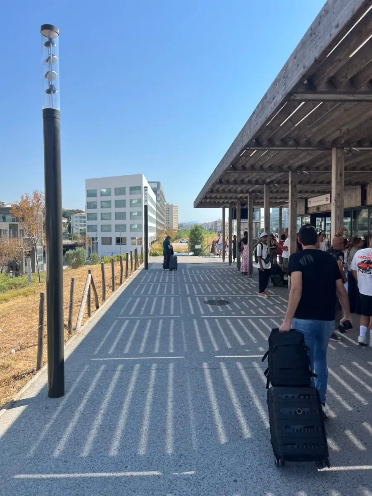

Niza es difícil de evitar en un viaje por el sur de Francia. La mayoría de los visitantes llegan en tren de alta velocidad desde París, Lyon o Marsella, se alojan cerca del Paseo de los Ingleses, pasan los días en el casco antiguo, Èze o Mónaco, y salen en avión al final. Ese último día es donde empiezan los problemas: el aeropuerto de Niza Costa Azul (NCE) está al oeste de la ciudad, cerca en el mapa pero incómodo con equipaje.

Hay tres formas habituales de salir: el autobús del aeropuerto, el tranvía y el tren. Los autobuses paran en unos cuantos puntos de la ciudad y son baratos, pero usan la carretera de la costa, que en verano se colapsa; el tranvía es más lento pero frecuente. El tren es el más rápido y el más barato de los tres: de Nice-Ville, la estación principal, a **Nice Saint-Augustin**, la parada junto al aeropuerto, se tarda de cuatro a seis minutos por una tarifa sencilla de **4 €**.

Esta guía sigue la ruta de la nota original: comprar el billete y pasar los tornos en Nice-Ville, viajar cuatro o seis minutos, caminar de Saint-Augustin a la Terminal 1 y terminar con el tranvía gratuito entre las dos terminales. Sin taxi y sin necesidad de entender los anuncios en francés.

## 1. Por qué el tren

La costa de Niza se curva, el aeropuerto se construyó detrás de las playas del oeste y el ferrocarril pasa rozando el borde norte del campo de aviación. Así es como Saint-Augustin, antes un apeadero suburbano cualquiera, se convirtió en la estación de facto del aeropuerto: está a solo 300–400 metros de la terminal y se ha reconstruido en los últimos años para absorber el tráfico.

La primera ventaja es que **el tren no se queda en el tráfico**. La carretera de la ciudad al aeropuerto se atasca en hora punta y durante toda la temporada de verano, y los autobuses se retrasan diez minutos con regularidad. El tren tiene su propia vía, y cuatro a seis minutos son cuatro a seis minutos. La segunda ventaja es el precio: 4 € sale bien frente a un taxi y frente a los servicios de autobús específicos del aeropuerto.

Hay una tercera ventaja que se pasa por alto: **una estación es más sencilla que una terminal de aeropuerto**. Nice-Ville es la estación principal de la ciudad, con los andenes justo detrás del vestíbulo; escaneas el código, caminas al andén, subes, y todo el trámite lleva unos minutos. Al otro lado sales de Saint-Augustin, cruzas un sendero corto y una carretera, y estás en la puerta de la Terminal 1. Sin colas largas y sin necesidad de llegar dos horas antes.

El tren tiene límites, eso sí. Llega a Saint-Augustin pero no a la Terminal 2; los servicios escasean por la noche; y algunos cambios de andén implican una pasarela. Todo eso se explica más abajo.

## 2. Comprar el billete y pasar los tornos

Nice-Ville es la estación principal de la ciudad y una de las más fotogénicas: muros de piedra clara, ventanas en arco, unas palmeras fuera y un cartel que dice “Nice Ville”. Desde el centro, toma el tranvía o un autobús hasta la zona de Jean Médecin y camina diez minutos, o toma un taxi hasta la puerta si las maletas pesan.

Hay tres formas de comprar. La más sencilla es la máquina de billetes dentro de la estación: la pantalla cambia al inglés, eliges Nice Saint-Augustin, pagas con tarjeta o monedas y el billete se imprime. La segunda es **SNCF Connect**, la app oficial de la compañía ferroviaria nacional francesa, que emite un billete electrónico en francés o inglés. La tercera es **Omio**, que tiene interfaz en chino y resulta más fácil para quien no está acostumbrado a los sistemas de reserva franceses; los precios suelen coincidir con la web oficial y a veces son algo más altos.

Lo que obtienes es un billete electrónico, y basta con el código QR del móvil: **no hace falta recoger papel**. La entrada de Nice-Ville es una fila de tornos automáticos: acerca el código al lector, la puerta se abre y ya estás dentro. Si no lo lee, normalmente hay un empleado cerca, y mostrar la página del pedido funciona igual de bien.

No te apresures a bajar a un andén enseguida. Las pantallas del vestíbulo muestran “Départs / Departures”, con cada tren, su destino, la hora de salida y el andén (voie). Niza nombra sus andenes con letras (A, B, C) y la pantalla muestra la letra en un recuadro. **Comprueba el andén antes de moverte**, porque los trenes en la misma dirección a veces salen de vías distintas.

Hay un detalle fácil de pasar por alto: **comprueba la dirección**. Saint-Augustin está al oeste de Niza, así que solo paran allí los trenes hacia Cannes, Grasse y Marsella; los trenes hacia Menton y Ventimiglia van al este y nunca llegan al aeropuerto. El destino en la pantalla te dice cuál es cuál, y un vistazo antes de subir te ahorra una conversación incómoda después.

## 3. Cuatro a seis minutos

El salto de Niza a Saint-Augustin es uno de los más cortos de la línea costera. El tren sale de Nice-Ville y circula tierra adentro respecto a la orilla, llegando a Saint-Augustin casi de inmediato, **sin paradas intermedias**: cuatro a seis minutos en total, tan poco que apenas te has acomodado cuando ya toca bajarse.

El material rodante varía. A veces es un TER de un piso, a veces de dos. Los de dos pisos tienen una escalera en el vestíbulo, así que con equipaje es más fácil quedarse en el piso inferior que subir una maleta. Dentro hay asientos tapizados en azul, mesitas junto a la ventana y portaequipajes superiores; **cualquier asiento libre es tuyo**, ya que un billete de segunda clase no lleva reserva ni la necesita.

Durante cuatro o seis minutos el tren recorre los suburbios del oeste. Por la ventana aparecen bloques de pisos densos, luego una extensión de vías y naves bajas, y finalmente la pista del aeropuerto y los tejados de las terminales. Cuando veas aviones, empieza a prepararte para bajar.

La frecuencia es otra razón para apreciar esta línea. Desde Nice-Ville, **el primer tren sale a las 05:33 y el último a las 22:42**, y durante el día pasa **aproximadamente cada 10 a 20 minutos**, así que no hace falta llegar temprano: los andenes empiezan detrás del vestíbulo y diez minutos en la estación son suficientes. Las horas que hay que pensar son la madrugada y la noche. Para un vuelo que salga antes de las 07:00, el de las 05:33 te deja en Saint-Augustin hacia las 05:40, justo con el paseo y la facturación; cualquier cosa anterior significa taxi. Quien aterrice después de las 22:42 debería contar con un taxi o el autobús del aeropuerto en lugar de fiarse del último tren.

## 4. El paseo de Saint-Augustin a la Terminal 1

Saint-Augustin es una estación nueva. La valla verde, los carteles grises con el nombre y un gran panel exterior que dice “Votre nouvelle gare de Nice Saint-Augustin” apuntan a una reconstrucción reciente. Al llegar, no busques una salida de inmediato: camina con la corriente hasta el final del andén y mira hacia arriba en busca de “Sortie / Exit” y el símbolo del avión.

Algunos andenes requieren una pasarela para salir. La pasarela tiene escaleras y ascensor, y con una maleta grande el ascensor merece la espera. Desde la pasarela se ve toda la estación: un puñado de vías, la catenaria y los edificios del aeropuerto a lo lejos, lo que deja la dirección clara.

Fuera, los carteles son claros. Un panel gris oscuro dice “Av. Me Maurice Slama” y “Sortie / Exit”, con **Bus**, **Tramway** y **Aéroport** debajo y una flecha que apunta hacia delante. Sigue el símbolo del avión y vas camino de la terminal.

Después viene una pasarela cubierta con una superficie clara y permeable, arbustos bajos y valla metálica a ambos lados. No es larga, y al final hay un tramo de escaleras y una torre de ascensor de cristal; para llegar a la Terminal 1 bajas aquí y pasas por debajo de la pasarela para tomar la acera hacia el aeropuerto.

Las escaleras y la torre del ascensor son la única parte del paseo que exige una decisión. Quien lleve mucho equipaje, un carrito de niño o movilidad reducida debería tomar el ascensor; es pequeño, y en temporada alta puede que esperes uno o dos viajes. Las escaleras no son empinadas, pero una maleta pesada las convierte en un trabajo duro.

Pasar junto al edificio de la estación es un buen momento para fijar la dirección en la cabeza: la nueva entrada es una fila de marquesinas de acero blanco, el panel del nombre dice “Gare de Nice Saint-Augustin” y normalmente hay pasajeros esperando fuera. Aquí también se sube a la vuelta: llega caminando desde el aeropuerto, y ver ese cartel significa que has llegado.

Fuera hay un panel azul oscuro: “Votre nouvelle gare de Nice Saint-Augustin”, con “Entrée” y una flecha que apunta a la derecha, y a lo largo de la parte inferior los logotipos del Estado francés, SNCF Gares & Connexions, la región Provenza-Alpes-Costa Azul y la ciudad de Niza. A menudo hay un carrito de equipaje del aeropuerto aparcado delante, lo que resume la relación entre ambos.

Un poco más adelante llega el único cruce de carretera del paseo. Hay semáforo y paso de cebra, y al otro lado están los carriles de dejar pasajeros del aeropuerto y la fachada de cristal de la Terminal 1. **De la salida de la estación a la puerta de la terminal hay unos 300–400 metros, u 8 a 12 minutos a pie**; con maletas grandes, a paso más lento o con una parada para hacer fotos, calcula quince.

Al otro lado de la carretera está la zona de dejar pasajeros de la Terminal 1. “Terminal 1” está escrito sobre la pared de cristal, los taxis y autobuses del aeropuerto paran fuera, y las puertas dan al vestíbulo de facturación. A estas alturas, contando desde Nice-Ville, apenas ha pasado media hora.

Hay un problema práctico con este paseo: **hay muy poca sombra**. Aparte de la marquesina a la salida de la estación y el tramo corto bajo la pasarela, la mayor parte está a pleno sol. El sol de verano en Niza es fuerte, así que un sombrero y protector solar importan más que nada a mediodía, y vale la pena llevar una botella de agua, sobre todo con una maleta.

A la vuelta, basta con invertir el recorrido: sal de las llegadas de la Terminal 1, camina por el carril de dejar pasajeros hasta el paso de cebra, cruza, busca las marquesinas blancas de “Gare de Nice Saint-Augustin” y luego sube por las escaleras o el ascensor hasta el andén. Calcula diez o quince minutos para el paseo también en ese sentido, ya que el equipaje y la orientación se comen el tiempo; si tu billete indica un tren concreto, pon el paseo antes de la hora de salida y no después.

## 5. El tranvía gratuito de la Terminal 1 a la Terminal 2

Si tu vuelo sale de la Terminal 2, llegar a la Terminal 1 no es el final. La Terminal 2 está al otro lado del aeropuerto, ir a pie supondría un largo rodeo, y lo correcto es el tranvía gratuito del aeropuerto que hay fuera de la Terminal 1: **línea 2** (algunas fuentes la llaman línea B). Tarda dos o tres minutos, pasa **aproximadamente cada dos minutos** y no cuesta nada.

La parada está en diagonal frente a las puertas de la Terminal 1. El cartel es explícito: una flecha verde apunta a “Quai en face / Opposite Platform”, es decir, el andén al otro lado de la carretera; debajo, el símbolo del tranvía lleva un “2” y una “B”, luego “Vers / To: Terminal 2” y las palabras “Liaison gratuite / Free connection”.

El andén tiene marquesina y bancos, y la pantalla indica cuántos minutos faltan para el próximo servicio. Cuando llegue el tranvía, lee la pantalla frontal: los servicios que muestran “AÉROPORT” son los tranvías de la línea 2 que van al aeropuerto, con la Terminal 2 a dos paradas. Si te subes por error a uno que va a la ciudad, bájate en la siguiente parada y vuelve: cuesta tiempo, no dinero.

En la Terminal 2, baja y sigue los carteles de “Départs / Departures” hacia la terminal, usando las pantallas para encontrar tu isla de facturación y la seguridad. A la vuelta, invierte la secuencia: tranvía de la Terminal 2 a la Terminal 1, cruzar el carril de dejar pasajeros, seguir la acera hasta Saint-Augustin y el tren de vuelta a Niza.

El tranvía funciona en ambos sentidos y con tanta frecuencia que el horario apenas importa: cuando sale uno, el siguiente suele estar ya anunciado. Entre las dos paradas del aeropuerto no hay billete que comprar ni que validar: simplemente subes. Si tu grupo está repartido entre terminales, quedar en la parada del tranvía de la Terminal 1 es mucho más fácil que encontrarse dentro de los edificios.

Los tiempos, las tarifas y los enlaces que aparecen aquí proceden del relato de un viajero de octubre de 2026; los horarios de los trenes, las tarifas y los andenes del tranvía están sujetos a la información del día in situ y en la web del operador. Dos últimos puntos: el billete indica un tren concreto, pero según la nota original a veces se aceptan otros servicios, así que pregunta al personal del andén si tienes dudas; y ese paseo de 300–400 metros está realmente a la intemperie, así que no lo tomes como un paseo tranquilo.

## Enlaces relacionados

- **En este sitio**: [Francia (FR)](/country/FR)
- **Wikipedia**: [Aeropuerto de Niza Costa Azul](https://en.wikipedia.org/wiki/Nice_C%C3%B4te_d%27Azur_Airport)
- **Baidu Baike**: [Aeropuerto de Niza Costa Azul](https://baike.baidu.com/item/%E5%B0%BC%E6%96%AF%E8%93%9D%E8%89%B2%E6%B5%B7%E5%B2%B8%E6%9C%BA%E5%9C%BA)
