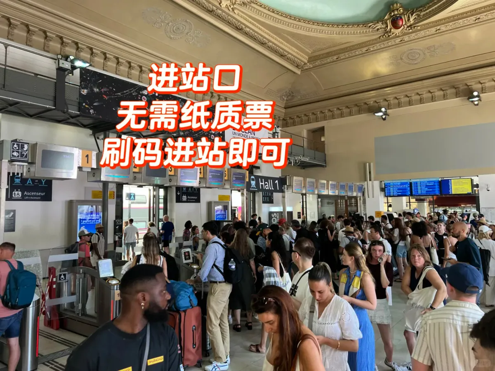
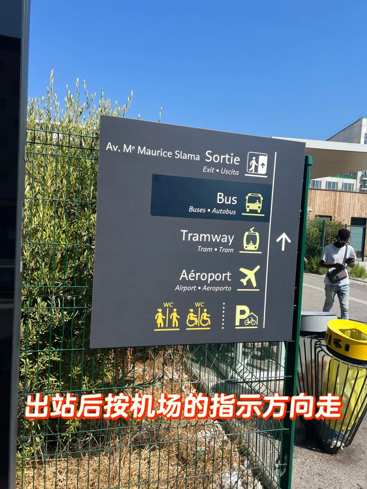
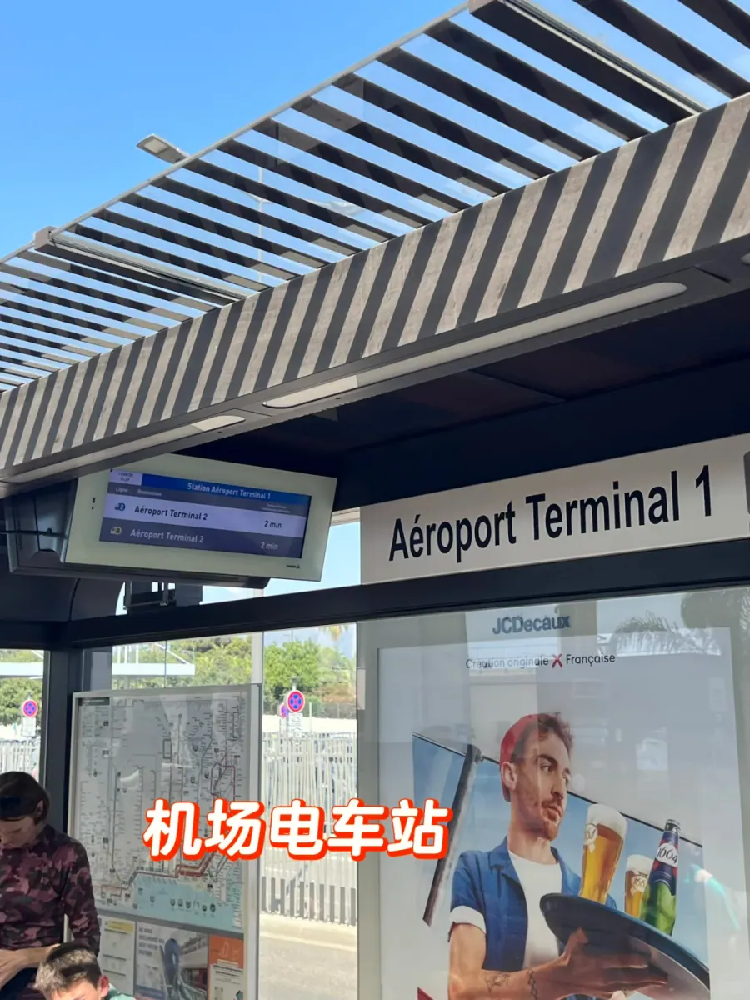

दक्षिणी फ़्रांस की यात्रा में नीस को छोड़ना मुश्किल है। ज़्यादातर पर्यटक पेरिस, ल्यों या मार्से से हाई-स्पीड ट्रेन से पहुँचते हैं, प्रोमनेड दे ज़ाँग्ले के आसपास कहीं ठहरते हैं, दिन पुराने शहर, एज़ या मोनाको में बिताते हैं, और अंत में हवाई जहाज़ से रवाना होते हैं। दिक्कत उस आख़िरी दिन से शुरू होती है: नीस कोट द’ज़ुर एयरपोर्ट (NCE) शहर के पश्चिम में है — नक़्शे पर पास, लेकिन सामान के साथ मुश्किल।

निकलने के तीन सामान्य रास्ते हैं: एयरपोर्ट बस, ट्राम और ट्रेन। बसें शहर में कुछ ही जगहों पर रुकती हैं और सस्ती हैं, लेकिन वे तटीय सड़क से जाती हैं, जो गर्मियों में जाम से ठप हो सकती है; ट्राम धीमी है पर लगातार चलती है। ट्रेन इन तीनों में सबसे तेज़ और सबसे सस्ती है — मुख्य स्टेशन Nice-Ville से एयरपोर्ट के बग़ल वाले स्टॉप **Nice Saint-Augustin** तक चार से छह मिनट लगते हैं, और एक तरफ़ का किराया **€4** है।

यह मार्गदर्शिका मूल नोट में बताए मार्ग पर चलती है: Nice-Ville पर टिकट खरीदें और गेट से गुज़रें, चार से छह मिनट की यात्रा करें, Saint-Augustin से टर्मिनल 1 तक पैदल जाएँ, और अंत में दोनों टर्मिनलों के बीच मुफ़्त ट्राम लें। न टैक्सी, और फ़्रेंच घोषणाएँ समझने की ज़रूरत।

## 1. ट्रेन क्यों

नीस की तटरेखा मुड़ती है, एयरपोर्ट पश्चिमी समुद्र-तटों के पीछे बना है, और रेलवे संयोग से हवाई क्षेत्र के उत्तरी किनारे को छूती हुई निकल जाती है। इसी तरह Saint-Augustin, जो कभी एक साधारण उपनगरीय हॉल्ट था, एयरपोर्ट का वास्तविक स्टेशन बन गया: यह टर्मिनल से सिर्फ़ 300–400 मीटर दूर है, और बढ़ते यातायात को संभालने के लिए हाल के वर्षों में इसे नए सिरे से बनाया गया है।

पहला फ़ायदा यह है कि **ट्रेन जाम में नहीं फँसती**। शहर से एयरपोर्ट तक की सड़क पर व्यस्त समय और पूरे गर्मी के मौसम में कतार लगती है, और बसें नियमित रूप से दस मिनट देर से चलती हैं। ट्रेन की अपनी पटरी है, और चार से छह मिनट का मतलब चार से छह मिनट ही है। दूसरा फ़ायदा किराया है: €4 टैक्सी और समर्पित एयरपोर्ट बस सेवाओं की तुलना में कहीं बेहतर है।

तीसरा फ़ायदा नज़र से चूक सकता है: **स्टेशन एयरपोर्ट टर्मिनल से आसान होता है**। Nice-Ville शहर का मुख्य स्टेशन है, जिसके प्लेटफ़ॉर्म कॉन्कोर्स के ठीक पीछे से शुरू होते हैं; कोड स्कैन करें, प्लेटफ़ॉर्म तक चलें, चढ़ें, और सारा काम कुछ ही मिनटों में हो जाता है। दूसरे छोर पर आप Saint-Augustin से निकलते हैं, एक छोटा रास्ता और एक सड़क पार करते हैं, और टर्मिनल 1 के दरवाज़े पर पहुँच जाते हैं। न लंबी कतारें, न दो घंटे पहले पहुँचने की ज़रूरत।

फिर भी ट्रेन की अपनी सीमाएँ हैं। यह Saint-Augustin तक पहुँचती है पर टर्मिनल 2 तक नहीं; शाम को सेवाएँ कम हो जाती हैं; और कुछ प्लेटफ़ॉर्म बदलने में पैदल पुल पार करना पड़ता है। इन बातों को नीचे समझाया गया है।

## 2. टिकट खरीदना और गेट से गुज़रना

Nice-Ville शहर का मुख्य स्टेशन है और तस्वीर लेने लायक़ सुंदर भी: हल्के पत्थर की दीवारें, मेहराबदार खिड़कियाँ, बाहर कुछ ताड़ के पेड़ और "Nice Ville" लिखा एक साइनबोर्ड। केंद्र से ट्राम या बस लेकर Jean Médecin इलाक़े तक जाएँ और दस मिनट चलें, या बैग भारी हों तो सीधे दरवाज़े तक टैक्सी ले लें।

टिकट खरीदने के तीन तरीक़े हैं। सबसे आसान है स्टेशन के अंदर वाली टिकट मशीन: स्क्रीन अंग्रेज़ी में बदल जाती है, आप Nice Saint-Augustin चुनते हैं, कार्ड या सिक्कों से भुगतान करते हैं, और टिकट छप जाता है। दूसरा है **SNCF Connect**, फ़्रेंच राष्ट्रीय रेलवे का आधिकारिक ऐप, जो फ़्रेंच या अंग्रेज़ी में ई-टिकट जारी करता है। तीसरा है **Omio**, जिसका इंटरफ़ेस चीनी में है और फ़्रेंच बुकिंग सिस्टम से अनभिज्ञ किसी भी व्यक्ति के लिए आसान है; दाम आम तौर पर आधिकारिक साइट के बराबर होते हैं और कभी-कभी थोड़े ज़्यादा।

आपको ई-टिकट मिलता है, और फ़ोन पर QR कोड काफ़ी है — **काग़ज़ी टिकट लेने की ज़रूरत नहीं**। Nice-Ville पर प्रवेश स्वचालित गेटों की कतार है: कोड रीडर के सामने रखें, गेट खुलता है और आप पार। अगर कोड पढ़ा न जाए, तो आम तौर पर पास ही कोई स्टाफ़ सदस्य होता है, और ऑर्डर पेज दिखाना भी उतना ही काम करता है।

फ़ौरन किसी प्लेटफ़ॉर्म की ओर न भागें। कॉन्कोर्स की स्क्रीनों पर "Départs / Departures" दिखता है, जिसमें हर ट्रेन, उसका गंतव्य, प्रस्थान समय और प्लेटफ़ॉर्म (voie) सूचीबद्ध होता है। नीस अपने प्लेटफ़ॉर्मों को अक्षरों — A, B, C — से चिह्नित करता है, और स्क्रीन उस अक्षर को एक बॉक्स में दिखाती है। **चलने से पहले प्लेटफ़ॉर्म जाँच लें**, क्योंकि एक ही दिशा की ट्रेनें कभी-कभी अलग पटरियों से निकलती हैं।

एक बात आसानी से छूट सकती है: **दिशा जाँचें**। Saint-Augustin नीस के पश्चिम में है, इसलिए सिर्फ़ कान, ग्रास और मार्से की ओर जाने वाली ट्रेनें ही वहाँ रुकती हैं; माँतों और वेंतिमिल्या की ओर जाने वाली ट्रेनें पूर्व की ओर चलती हैं और एयरपोर्ट तक कभी नहीं पहुँचतीं। स्क्रीन पर गंतव्य बता देता है कि कौन-सी कौन-सी है, और चढ़ने से पहले एक नज़र बाद की असहज बातचीत से बचा लेती है।

## 3. चार से छह मिनट

नीस से Saint-Augustin तक की छोटी सवारी तटीय लाइन पर सबसे छोटी सवारियों में से एक है। ट्रेन Nice-Ville से निकलती है और तटरेखा के भीतर की ओर चलती है, लगभग तुरंत Saint-Augustin पहुँच जाती है, **बीच में कोई स्टॉप नहीं** — कुल चार से छह मिनट, इतने कम कि आप ठीक से बैठ भी नहीं पाते कि उतरने का समय आ जाता है।

ट्रेनें अलग-अलग तरह की होती हैं। कभी एक-मंज़िला TER, कभी दो-मंज़िला। दो-मंज़िला ट्रेनों के प्रवेश-कक्ष में सीढ़ियाँ होती हैं, इसलिए सामान के साथ सूटकेस ऊपर ढोने के बजाय निचले तल पर ही रहना आसान है। अंदर नीले गद्देदार सीटें, खिड़की के पास छोटी मेज़ें और ऊपर सामान रखने की जालियाँ हैं; **कोई भी खाली सीट आपकी है**, क्योंकि सेकंड-क्लास टिकट पर कोई आरक्षण नहीं होता और उसकी ज़रूरत भी नहीं।

चार से छह मिनट तक ट्रेन पश्चिमी उपनगरों से गुज़रती है। खिड़की के बाहर घने अपार्टमेंट ब्लॉक आते हैं, फिर फैली हुई रेल पटरियाँ और नीची कारख़ाना-नुमा इमारतें, और अंत में एयरपोर्ट का रनवे और टर्मिनलों की छतें। जब हवाई जहाज़ दिखें, तो उतरने की तैयारी शुरू कर दें।

बार-बार चलना इस लाइन को पसंद करने की एक और वजह है। Nice-Ville से **पहली ट्रेन 05:33 पर और आख़िरी 22:42 पर** है, और दिन में ट्रेन **लगभग हर 10 से 20 मिनट** में चलती है, इसलिए जल्दी पहुँचने की ज़रूरत नहीं — प्लेटफ़ॉर्म कॉन्कोर्स के पीछे से ही शुरू होते हैं और स्टेशन पर दस मिनट काफ़ी हैं। जिन समयों पर सोच-विचार की ज़रूरत है वे सुबह-सुबह और देर शाम हैं। 07:00 से पहले की उड़ान के लिए 05:33 वाली ट्रेन आपको लगभग 05:40 पर Saint-Augustin पहुँचा देती है, जो पैदल और चेक-इन के लिए बस इतना ही काफ़ी है; इससे भी पहले की उड़ान हो तो टैक्सी ही विकल्प है। 22:42 के बाद उतरने वाले यात्री आख़िरी ट्रेन पर भरोसा करने के बजाय टैक्सी या एयरपोर्ट बस की योजना बनाएँ।

## 4. Saint-Augustin से टर्मिनल 1 तक पैदल

Saint-Augustin एक नया स्टेशन है। हरी बाड़, स्लेटी नाम-पट्टिकाएँ और बाहर "Votre nouvelle gare de Nice Saint-Augustin" लिखा बड़ा बोर्ड, सब हाल ही में हुए नवीनीकरण की ओर इशारा करते हैं। उतरने पर फ़ौरन निकास ढूँढने में न लगें: भीड़ के साथ प्लेटफ़ॉर्म के अंत तक चलें और ऊपर "Sortie / Exit" तथा हवाई जहाज़ का चिह्न देखें।

कुछ प्लेटफ़ॉर्मों से निकलने के लिए पैदल पुल पार करना पड़ता है। पुल पर सीढ़ियाँ और लिफ़्ट है, और बड़ा सूटकेस हो तो लिफ़्ट के इंतज़ार करना बेकार नहीं जाता। पुल से पूरा स्टेशन दिखाई देता है: कुछ ही पटरियाँ, ऊपर की तारें, और दूर एयरपोर्ट की इमारतें — जिससे दिशा ख़ुद साफ़ हो जाती है।

बाहर संकेत स्पष्ट हैं। गहरे स्लेटी रंग की एक पट्टिका पर "Av. Me Maurice Slama" और "Sortie / Exit" लिखा है, उसके नीचे **Bus**, **Tramway** और **Aéroport** हैं और आगे की ओर इशारा करता तीर है। हवाई जहाज़ के चिह्न के पीछे चलें और आप टर्मिनल की ओर बढ़ रहे होंगे।

इसके बाद हल्के रंग की पारगम्य सतह, छोटी झाड़ियों और दोनों ओर तार की बाड़ वाला ढका हुआ रास्ता आता है। यह लंबा नहीं है, और इसके अंत में सीढ़ियाँ तथा काँच की लिफ़्ट मीनार है; टर्मिनल 1 पहुँचने के लिए आप यहाँ से नीचे उतरते हैं और पैदल पुल के नीचे से गुज़रकर एयरपोर्ट की ओर जाने वाला फ़ुटपाथ पकड़ते हैं।

सीढ़ियाँ और लिफ़्ट मीनार ही इस पैदल यात्रा का अकेला हिस्सा हैं जहाँ फ़ैसला लेना पड़ता है। भारी सामान, बच्चों की गाड़ी या सीमित गतिशीलता वाले किसी भी व्यक्ति को लिफ़्ट लेनी चाहिए; यह छोटी है, और व्यस्त मौसम में आपको एक-दो बारी इंतज़ार करना पड़ सकता है। सीढ़ियाँ खड़ी नहीं हैं, लेकिन भारी सूटकेस उन्हें मेहनत-भरा बना देता है।

स्टेशन भवन के पास से गुज़रते समय दिशा मन में बिठा लेना अच्छा है: नया प्रवेश सफ़ेद स्टील के शेडों की कतार है, नाम-पट्ट पर "Gare de Nice Saint-Augustin" लिखा है, और बाहर आम तौर पर यात्री इंतज़ार करते मिलते हैं। वापसी में आप यहीं से चढ़ते हैं — एयरपोर्ट से चलकर आएँ, और वह साइनबोर्ड दिखना ही मतलब है कि आप पहुँच गए।

बाहर गहरे नीले रंग का बोर्ड लगा है: "Votre nouvelle gare de Nice Saint-Augustin", साथ में "Entrée" और दाईं ओर इशारा करता तीर, और नीचे की पट्टी पर फ़्रांसीसी राज्य, SNCF Gares & Connexions, प्रोवांस-आल्प-कोट द’ज़ुर क्षेत्र और नीस शहर के लोगो। उसके सामने अक्सर एयरपोर्ट की सामान ट्रॉली खड़ी मिलती है, जो दोनों के रिश्ते का सार है।

थोड़ा आगे इस पैदल यात्रा का एकमात्र सड़क-पार आता है। वहाँ सिग्नल और ज़ेब्रा क्रॉसिंग है, और उस पार एयरपोर्ट की ड्रॉप-ऑफ़ लेन और टर्मिनल 1 का काँच का अग्रभाग। **स्टेशन के निकास से टर्मिनल के दरवाज़े तक लगभग 300–400 मीटर, यानी पैदल 8 से 12 मिनट**; बड़े सूटकेस, धीमी चाल या तस्वीरें खींचने के लिए रुकने के साथ पंद्रह मिनट रखें।

सड़क के पार टर्मिनल 1 का ड्रॉप-ऑफ़ क्षेत्र है। काँच की दीवार के ऊपर "Terminal 1" लिखा है, बाहर टैक्सियाँ और एयरपोर्ट बसें रुकती हैं, और दरवाज़े चेक-इन हॉल में खुलते हैं। यहाँ तक आते-आते, Nice-Ville से गिनें तो, मुश्किल से आधा घंटा बीता होता है।

इस पैदल यात्रा में एक व्यावहारिक दिक्कत है: **छाया बहुत कम है**। स्टेशन के बाहर के शेड और पैदल पुल के नीचे के छोटे हिस्से के अलावा, ज़्यादातर रास्ता पूरी धूप में है। नीस की गर्मियों की धूप तेज़ होती है, इसलिए दोपहर में टोपी और सनस्क्रीन सबसे ज़रूरी हैं, और पानी की बोतल साथ रखना अच्छा है, ख़ासकर सूटकेस के साथ।

वापसी में बस क्रम उलट दें: टर्मिनल 1 के आगमन से निकलें, ड्रॉप-ऑफ़ लेन के साथ ज़ेब्रा क्रॉसिंग तक चलें, सड़क पार करें, "Gare de Nice Saint-Augustin" के सफ़ेद शेड ढूँढें, फिर सीढ़ियों या लिफ़्ट से ऊपर प्लेटफ़ॉर्म तक जाएँ। इस दिशा में भी पैदल के लिए दस से पंद्रह मिनट रखें, क्योंकि सामान और रास्ता ढूँढ़ने में समय जाता है; अगर आपके टिकट पर कोई ख़ास ट्रेन लिखी है, तो पैदल के समय को प्रस्थान समय से पहले जोड़ें, बाद में नहीं।

## 5. टर्मिनल 1 से टर्मिनल 2 तक मुफ़्त ट्राम

अगर आपकी उड़ान टर्मिनल 2 से है, तो टर्मिनल 1 पहुँचना काम का अंत नहीं है। टर्मिनल 2 एयरपोर्ट के दूसरी ओर है, पैदल जाने का मतलब लंबा चक्कर होगा, और सही तरीक़ा है टर्मिनल 1 के बाहर से चलने वाली मुफ़्त एयरपोर्ट ट्राम: **लाइन 2** (कुछ स्रोत इसे लाइन B कहते हैं)। इसमें दो से तीन मिनट लगते हैं, यह **लगभग हर दो मिनट** में चलती है, और कुछ भी ख़र्च नहीं होता।

स्टॉप टर्मिनल 1 के दरवाज़ों के तिरछे सामने है। साइन साफ़ है: एक हरा तीर "Quai en face / Opposite Platform" की ओर इशारा करता है, यानी सड़क के दूसरी ओर वाला प्लेटफ़ॉर्म; उसके नीचे ट्राम के चिह्न पर "2" और "B" हैं, फिर "Vers / To: Terminal 2" और "Liaison gratuite / Free connection" शब्द।

प्लेटफ़ॉर्म पर शेड और बेंचें हैं, और डिस्प्ले बताता है कि अगली सेवा में कितने मिनट बाक़ी हैं। ट्राम आने पर उसके सामने का डिस्प्ले पढ़ें: "AÉROPORT" दिखाने वाली ट्रामें लाइन 2 की हैं और एयरपोर्ट की ओर जाती हैं, जिनमें टर्मिनल 2 दो स्टॉप दूर है। ग़लती से शहर की ओर जाने वाली ट्राम में चढ़ जाएँ, तो अगले स्टॉप पर उतरकर वापस आ जाएँ — इससे पैसा नहीं, समय जाता है।

टर्मिनल 2 पर उतरकर "Départs / Departures" संकेतों के साथ टर्मिनल में जाएँ, और स्क्रीनों से अपना चेक-इन द्वीप और सुरक्षा जाँच ढूँढें। घर लौटते समय क्रम उलट दें: टर्मिनल 2 से टर्मिनल 1 तक ट्राम, ड्रॉप-ऑफ़ लेन पार करके, फ़ुटपाथ के साथ Saint-Augustin तक, और फिर ट्रेन से वापस नीस।

ट्राम दोनों दिशाओं में चलती है और इतनी बार-बार कि समय-सारणी का मतलब ही नहीं रहता: एक ट्राम निकलती है, तब तक अगली आम तौर पर दिखने लगती है। एयरपोर्ट के दोनों स्टॉपों के बीच न कोई टिकट खरीदना है, न जाँचा जाता है — बस चढ़ जाएँ। अगर आपका समूह दोनों टर्मिनलों में बँटा है, तो इमारतों के अंदर एक-दूसरे को ढूँढने के बजाय टर्मिनल 1 के ट्राम स्टॉप पर मिलना कहीं ज़्यादा आसान है।

यहाँ दिए समय, किराए और कनेक्शन अक्टूबर 2026 के एक यात्री के विवरण से हैं; ट्रेनों के समय, किराए और ट्राम प्लेटफ़ॉर्म उस दिन मौके पर और ऑपरेटर की वेबसाइट पर उपलब्ध जानकारी के अधीन हैं। आख़िरी दो बातें: टिकट पर एक निश्चित ट्रेन लिखी होती है, लेकिन मूल नोट के अनुसार कभी-कभी दूसरी सेवाएँ भी स्वीकार की जाती हैं, इसलिए संदेह हो तो प्लेटफ़ॉर्म पर स्टाफ़ से पूछें; और वह 300–400 मीटर की पैदल दूरी सचमुच खुली धूप में है, इसलिए इसे हल्की सैर न समझें।

## संबंधित लिंक

- **इस साइट पर**: [फ़्रांस (FR)](/country/FR)
- **विकिपीडिया**: [नीस कोट द’ज़ुर एयरपोर्ट](https://en.wikipedia.org/wiki/Nice_C%C3%B4te_d%27Azur_Airport)
- **बाइडू बाइके**: [नीस कोट द’ज़ुर एयरपोर्ट](https://baike.baidu.com/item/%E5%B0%BC%E6%96%AF%E8%93%9D%E8%89%B2%E6%B5%B7%E5%B2%B8%E6%9C%BA%E5%9C%BA)
