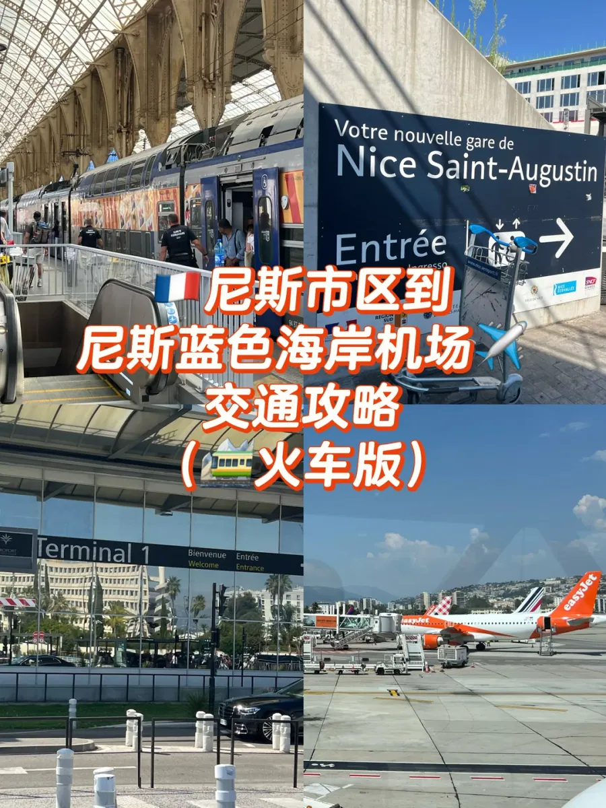

Nice sulit dilewatkan dalam perjalanan ke Prancis selatan. Sebagian besar pengunjung tiba dengan kereta cepat dari Paris, Lyon, atau Marseille, menginap di dekat Promenade des Anglais, menghabiskan hari-hari di kota tua, Èze, atau Monaco, dan terbang pulang di akhir perjalanan. Hari terakhir itulah masalahnya dimulai: Bandara Nice Côte d'Azur (NCE) berada di barat kota, dekat di peta tetapi merepotkan dengan bagasi.

Ada tiga cara umum keluar: bus bandara, trem, dan kereta. Bus berhenti di beberapa titik di kota dan murah, tetapi melewati jalan pesisir yang bisa macet total pada musim panas; trem lebih lambat tetapi sering. Kereta adalah yang tercepat dan termurah dari ketiganya — dari Nice-Ville, stasiun utama, ke **Nice Saint-Augustin**, halte di samping bandara, memakan waktu empat hingga enam menit dengan tarif sekali jalan **€4**.

Panduan ini mengikuti rute dalam catatan asli: beli tiket dan lewati gerbang di Nice-Ville, naik empat hingga enam menit, berjalan dari Saint-Augustin ke Terminal 1, dan selesaikan dengan trem gratis antara kedua terminal. Tanpa taksi, dan tanpa perlu memahami pengumuman bahasa Prancis.

## 1. Mengapa kereta

Garis pantai di Nice melengkung, bandara dibangun di belakang pantai barat, dan jalur kereta kebetulan melintas di tepi utara lapangan terbang. Begitulah Saint-Augustin, dulu halte pinggiran biasa, menjadi stasiun de facto bandara: hanya 300–400 meter dari terminal, dan telah dibangun ulang dalam beberapa tahun terakhir untuk menangani lalu lintas.

Keunggulan pertama adalah **kereta tidak terjebak lalu lintas**. Jalan dari kota ke bandara mengantre pada jam sibuk dan sepanjang musim panas, dan bus rutin terlambat sepuluh menit. Kereta memiliki jalurnya sendiri, dan empat hingga enam menit berarti empat hingga enam menit. Keunggulan kedua adalah harga: €4 bersaing baik dengan taksi dan dengan layanan bus bandara khusus.

Keunggulan ketiga mudah diabaikan: **stasiun lebih sederhana daripada terminal bandara**. Nice-Ville adalah stasiun utama kota, dengan peron dimulai tepat di belakang aula; pindai kode, berjalan ke peron, naik, dan semuanya memakan beberapa menit. Di ujung sana Anda keluar dari Saint-Augustin, menyeberangi jalur pendek dan satu jalan, dan Anda sudah di pintu Terminal 1. Tanpa antrean panjang, dan tanpa perlu tiba dua jam lebih awal.

Namun kereta juga punya keterbatasan. Kereta mencapai Saint-Augustin tetapi tidak Terminal 2; layanan semakin jarang pada malam hari; dan beberapa perubahan peron melibatkan jembatan penyeberangan. Semua itu dibahas di bawah.

## 2. Membeli tiket dan melewati gerbang

Nice-Ville adalah stasiun utama kota dan fotogenik: dinding batu pucat, jendela melengkung, beberapa pohon palm di luar, dan tanda bertuliskan "Nice Ville". Dari pusat kota, naik trem atau bus ke area Jean Médecin dan berjalan sepuluh menit, atau naik taksi ke pintu jika bagasi berat.

Ada tiga cara membeli. Paling sederhana adalah mesin tiket di dalam stasiun: layar berganti ke bahasa Inggris, Anda memilih Nice Saint-Augustin, membayar dengan kartu atau koin, dan tiket tercetak. Kedua adalah **SNCF Connect**, aplikasi resmi kereta nasional Prancis, yang menerbitkan e-tiket dalam bahasa Prancis atau Inggris. Ketiga adalah **Omio**, yang memiliki antarmuka bahasa Mandarin dan lebih mudah bagi siapa pun yang tidak terbiasa dengan sistem pemesanan Prancis; harganya biasanya sama dengan situs resmi dan kadang sedikit lebih tinggi.

Yang Anda dapatkan adalah e-tiket, dan kode QR di ponsel sudah cukup — **tidak perlu mengambil kertas**. Pintu masuk di Nice-Ville adalah deretan gerbang otomatis: dekatkan kode ke pembaca, gerbang terbuka, dan Anda masuk. Jika tidak terbaca, biasanya ada staf di dekatnya, dan menunjukkan halaman pesanan juga berfungsi.

Jangan langsung bergegas turun ke peron. Layar di aula menampilkan "Départs / Departures", mencantumkan setiap kereta, tujuan, waktu keberangkatan, dan peron (voie). Nice memberi huruf pada peronnya — A, B, C — dan layar menampilkan huruf itu dalam kotak. **Periksa peron sebelum bergerak**, karena kereta dengan arah yang sama kadang berangkat dari jalur berbeda.

Satu detail mudah terlewat: **periksa arah**. Saint-Augustin berada di barat Nice, jadi hanya kereta menuju Cannes, Grasse, dan Marseille yang berhenti di sana; kereta menuju Menton dan Ventimiglia berjalan ke timur dan tidak pernah mencapai bandara. Tujuan di layar memberi tahu mana yang mana, dan sekali melirik sebelum naik menghemat percakapan canggung nanti.

## 3. Empat hingga enam menit

Perjalanan singkat dari Nice ke Saint-Augustin adalah salah satu yang terpendek di jalur pesisir. Kereta meninggalkan Nice-Ville dan berjalan di sisi darat garis pantai, mencapai Saint-Augustin hampir seketika, dengan **tanpa perhentian di antaranya** — empat hingga enam menit total, cukup singkat sehingga Anda baru duduk sebelum waktunya turun.

Sarana kereta bervariasi. Kadang TER satu tingkat, kadang dua tingkat. Kereta dua tingkat memiliki tangga di ruang penghubung, jadi dengan bagasi lebih mudah tetap di tingkat bawah daripada menyeret koper ke atas. Di dalam ada kursi berlapis biru, meja kecil dekat jendela, dan rak bagasi di atas; **kursi kosong mana pun milik Anda**, karena tiket kelas dua tidak memuat reservasi dan tidak memerlukannya.

Selama empat hingga enam menit kereta melintasi pinggiran barat. Di luar jendela muncul blok apartemen padat, lalu hamparan jalur kereta dan bangunan bengkel rendah, dan akhirnya landasan bandara serta atap terminal. Saat melihat pesawat, bersiaplah untuk turun.

Frekuensi adalah alasan lain menyukai jalur ini. Dari Nice-Ville, **kereta pertama pukul 05:33 dan terakhir pukul 22:42**, dan pada siang hari kereta berjalan **kira-kira setiap 10 hingga 20 menit**, jadi tidak perlu datang terlalu awal — peron dimulai di belakang aula dan sepuluh menit di stasiun sudah cukup. Waktu yang perlu dipikirkan adalah pagi buta dan malam larut. Untuk penerbangan yang berangkat sebelum pukul 07:00, kereta 05:33 membawa Anda ke Saint-Augustin sekitar pukul 05:40, yang cukup pas dengan jalan kaki dan check-in; lebih awal dari itu berarti taksi. Siapa pun yang mendarat setelah pukul 22:42 sebaiknya merencanakan taksi atau bus bandara daripada mengandalkan kereta terakhir.

## 4. Jalan kaki dari Saint-Augustin ke Terminal 1

Saint-Augustin adalah stasiun baru. Pagar hijau, tanda nama abu-abu, dan papan besar di luar bertuliskan "Votre nouvelle gare de Nice Saint-Augustin" semuanya menunjukkan pembangunan ulang terkini. Saat tiba, jangan langsung mencari pintu keluar: berjalan mengikuti arus ke ujung peron dan cari "Sortie / Exit" serta simbol pesawat.

Beberapa peron memerlukan jembatan penyeberangan untuk keluar. Jembatan memiliki tangga dan lift, dan dengan koper besar lift layak ditunggu. Dari jembatan Anda dapat melihat seluruh stasiun: beberapa jalur, kabel di atas, dan bangunan bandara di kejauhan, yang membuat arahnya jelas.

Di luar, tandanya jelas. Panel abu-abu gelap bertuliskan "Av. Me Maurice Slama" dan "Sortie / Exit", dengan **Bus**, **Tramway**, dan **Aéroport** di bawahnya serta panah menunjuk ke depan. Ikuti simbol pesawat dan Anda menuju terminal.

Berikutnya jalur pejalan kaki beratap dengan permukaan berpori pucat, semak rendah, dan pagar kawat di kedua sisi. Tidak panjang, dan di ujungnya ada tangga serta menara lift kaca; untuk mencapai Terminal 1 Anda turun di sini dan melewati bawah jembatan penyeberangan untuk mengambil trotoar menuju bandara.

Tangga dan menara lift adalah satu-satunya bagian jalan kaki yang memerlukan keputusan. Siapa pun dengan bagasi berat, kereta dorong bayi, atau mobilitas terbatas sebaiknya naik lift; liftnya kecil, dan pada musim ramai Anda mungkin menunggu satu atau dua kali angkutan. Tangganya tidak curam, tetapi koper berat membuatnya melelahkan.

Melewati bangunan stasiun adalah momen baik untuk memastikan arah di pikiran Anda: pintu masuk baru adalah deretan kanopi baja putih, papan nama bertuliskan "Gare de Nice Saint-Augustin", dan biasanya ada penumpang menunggu di luar. Di sinilah Anda naik saat pulang — berjalan dari bandara, dan melihat tanda itu berarti Anda sudah tiba.

Di luar berdiri papan biru tua: "Votre nouvelle gare de Nice Saint-Augustin", dengan "Entrée" dan panah menunjuk ke kanan, serta di sepanjang bagian bawah logo negara Prancis, SNCF Gares & Connexions, wilayah Provence-Alpes-Côte d'Azur, dan kota Nice. Troli bagasi bandara sering diparkir di depannya, yang merangkum hubungan keduanya.

Sedikit lebih jauh adalah satu-satunya penyeberangan jalan dalam perjalanan ini. Ada lampu sinyal dan zebra cross, dan di seberangnya jalur penurunan penumpang bandara serta fasad kaca Terminal 1. **Dari pintu keluar stasiun ke pintu terminal sekitar 300–400 meter, atau 8 hingga 12 menit berjalan kaki**; dengan koper besar, langkah lebih lambat, atau berhenti untuk berfoto, sediakan lima belas menit.

Di seberang jalan adalah area penurunan penumpang Terminal 1. "Terminal 1" tertulis di atas dinding kaca, taksi dan bus bandara berhenti di luar, dan pintu terbuka ke aula check-in. Sampai di sini, dihitung dari Nice-Ville, baru setengah jam berlalu.

Ada satu masalah praktis dengan jalan kaki ini: **sangat sedikit tempat berteduh**. Selain kanopi di luar stasiun dan bentang pendek di bawah jembatan penyeberangan, sebagian besar terbuka di bawah matahari. Matahari musim panas Nice kuat, jadi topi dan tabir surya lebih penting daripada apa pun pada tengah hari, dan sebotol air layak dibawa, terutama dengan koper.

Saat pulang, cukup balik urutannya: tinggalkan kedatangan Terminal 1, berjalan di sepanjang jalur penurunan penumpang ke zebra cross, menyeberang, cari kanopi putih "Gare de Nice Saint-Augustin", lalu naik tangga atau lift ke peron. Sediakan sepuluh hingga lima belas menit untuk jalan kaki ke arah itu juga, karena bagasi dan mencari arah memakan waktu; jika tiket Anda mencantumkan kereta tertentu, letakkan waktu jalan kaki sebelum waktu keberangkatan, bukan sesudahnya.

## 5. Trem gratis dari Terminal 1 ke Terminal 2

Jika penerbangan Anda berangkat dari Terminal 2, mencapai Terminal 1 bukan akhir perjalanan. Terminal 2 berada di sisi lain bandara, berjalan kaki berarti memutar jauh, dan langkah yang tepat adalah trem bandara gratis di luar Terminal 1: **jalur 2** (beberapa sumber menyebutnya jalur B). Perjalanan dua hingga tiga menit, berjalan **kira-kira setiap dua menit**, dan gratis.

Halte berada secara diagonal di seberang pintu Terminal 1. Tandanya eksplisit: panah hijau menunjuk ke "Quai en face / Opposite Platform", yang berarti peron di seberang jalan; di bawahnya simbol trem bertanda "2" dan "B", lalu "Vers / To: Terminal 2" dan kata "Liaison gratuite / Free connection".

Peron memiliki kanopi dan bangku, dan layar memberi tahu berapa menit sampai layanan berikutnya. Saat trem tiba, baca layar di depan: layanan yang menampilkan "AÉROPORT" adalah trem jalur 2 menuju bandara, dengan Terminal 2 dua perhentian lagi. Jika salah naik trem menuju kota, turun di perhentian berikutnya dan kembali — itu memakan waktu, bukan uang.

Di Terminal 2, turun dan ikuti tanda "Départs / Departures" ke dalam terminal, gunakan layar untuk menemukan pulau check-in dan keamanan. Saat pulang, balik urutannya: trem dari Terminal 2 ke Terminal 1, menyeberangi jalur penurunan penumpang, menyusuri trotoar ke Saint-Augustin, dan kereta kembali ke Nice.

Trem berjalan di kedua arah dan begitu sering sehingga jadwalnya hampir tidak penting: saat satu berangkat, berikutnya biasanya sudah ditampilkan. Antara kedua halte bandara tidak ada tiket yang perlu dibeli dan tidak ada yang diperiksa — Anda cukup naik. Jika rombongan Anda terpisah antarterminal, bertemu di halte trem Terminal 1 jauh lebih mudah daripada mencari satu sama lain di dalam gedung.

Waktu, tarif, dan sambungan di sini berasal dari catatan pelancong pada Oktober 2026; jadwal kereta, tarif, dan peron trem mengikuti informasi hari itu di lokasi dan di situs operator. Dua catatan terakhir: tiket mencantumkan kereta tertentu, tetapi menurut catatan asli layanan lain kadang diterima, jadi tanyakan kepada staf di peron jika ragu; dan jalan kaki 300–400 meter itu benar-benar terbuka, jadi jangan menganggapnya jalan santai.

## Tautan terkait

- **Di situs ini**: [Prancis (FR)](/country/FR)
- **Wikipedia**: [Bandara Nice Côte d'Azur](https://en.wikipedia.org/wiki/Nice_C%C3%B4te_d%27Azur_Airport)
- **Baidu Baike**: [Bandara Nice Côte d'Azur](https://baike.baidu.com/item/%E5%B0%BC%E6%96%AF%E8%93%9D%E8%89%B2%E6%B5%B7%E5%B2%B8%E6%9C%BA%E5%9C%BA)
