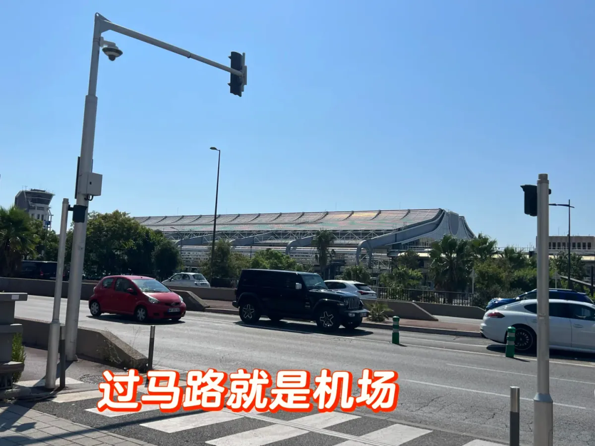

Nicei nie sposób pominąć w podróży po południu Francji. Większość odwiedzających przyjeżdża szybkim pociągiem z Paryża, Lyonu lub Marsylii, zatrzymuje się gdzieś przy Promenade des Anglais, dni spędza na starówce, w Èze lub w Monako, a na koniec odlatuje. I właśnie ostatni dzień sprawia kłopot: lotnisko Nice Côte d'Azur (NCE) leży na zachód od miasta — blisko na mapie, ale niewygodnie z bagażem.

Są trzy zwykłe sposoby, by się stamtąd wydostać: autobus lotniskowy, tramwaj i pociąg. Autobusy zatrzymują się w kilku punktach miasta i są tanie, ale jadą drogą nadmorską, która latem potrafi się zakorkować; tramwaj jest wolniejszy, za to jeździ często. Pociąg jest najszybszy i najtańszy z całej trójki — z Nice-Ville, głównego dworca, do **Nice Saint-Augustin**, przystanku przy lotnisku, jedzie się cztery do sześciu minut, a bilet w jedną stronę kosztuje **4 €**.

Ten przewodnik opisuje trasę z oryginalnej notatki: kup bilet i przejdź przez bramki na Nice-Ville, jedź cztery do sześciu minut, przejdź z Saint-Augustin do terminalu 1 i zakończ darmowym tramwajem między dwoma terminalami. Bez taksówki i bez potrzeby rozumienia francuskich komunikatów.

## 1. Dlaczego pociąg

Linia brzegowa w okolicy Nicei się zakrzywia, lotnisko zbudowano za zachodnimi plażami, a kolej biegnie akurat skrajem północnej strony pola wzlotów. Tak Saint-Augustin, niegdyś zwykły podmiejski przystanek, stał się faktyczną stacją lotniskową: dzieli go od terminalu zaledwie 300–400 metrów, a w ostatnich latach został przebudowany, by obsłużyć ruch.

Pierwsza zaleta: **pociąg nie stoi w korku**. Droga z miasta na lotnisko korkuje się w godzinach szczytu i przez cały sezon letni, a autobusy regularnie mają po dziesięć minut opóźnienia. Pociąg ma własny tor, a cztery do sześciu minut znaczy cztery do sześciu minut. Druga zaleta to cena: 4 € wypada dobrze zarówno na tle taksówki, jak i dedykowanych autobusów lotniskowych.

Trzecią zaletę łatwo przeoczyć: **dworzec jest prostszy niż terminal lotniczy**. Nice-Ville to główny dworzec miasta, a perony zaczynają się tuż za halą; skanujesz kod, idziesz na peron, wsiadasz — i całość zajmuje kilka minut. Na drugim końcu wychodzisz z Saint-Augustin, przechodzisz krótką ścieżkę i jedną jezdnię i jesteś przy drzwiach terminalu 1. Bez długich kolejek i bez potrzeby przyjazdu dwie godziny wcześniej.

Pociąg ma jednak ograniczenia. Dojeżdża do Saint-Augustin, ale nie do terminalu 2; wieczorem kursów jest rzadziej; a przy niektórych zmianach peronu trzeba przejść kładką. O tym niżej.

## 2. Kupno biletu i przejście przez bramki

Nice-Ville to główny dworzec miasta i jeden z tych, które dobrze wychodzą na zdjęciach: jasne kamienne ściany, łukowe okna, kilka palm przed wejściem i napis „Nice Ville”. Z centrum dojedź tramwajem lub autobusem w okolice Jean Médecin i idź pieszo dziesięć minut albo, jeśli bagaże są ciężkie, weź taksówkę pod same drzwi.

Bilet można kupić na trzy sposoby. Najprostszy to automat na dworcu: ekran przełącza się na angielski, wybierasz Nice Saint-Augustin, płacisz kartą lub monetami i bilet się drukuje. Drugi sposób to **SNCF Connect**, oficjalna aplikacja francuskich kolei państwowych, która wystawia e-bilet po francusku lub angielsku. Trzeci to **Omio**, z chińskim interfejsem, łatwiejszy dla kogoś, kto nie zna francuskich systemów rezerwacji; ceny zwykle odpowiadają oficjalnej stronie, a czasem są nieco wyższe.

Dostajesz e-bilet i kod QR w telefonie wystarczy — **nie trzeba odbierać papierowego**. Wejście na Nice-Ville to rząd automatycznych bramek: przyłóż kod do czytnika, bramka się otwiera i jesteś w środku. Jeśli nie chce odczytać, w pobliżu zwykle stoi pracownik, a pokazanie strony z zamówieniem działa równie dobrze.

Nie spiesz się od razu na peron. Ekrany w hali pokazują „Départs / Departures”, wymieniając każdy pociąg, jego kierunek, godzinę odjazdu i peron (voie). Nicea oznacza perony literami — A, B, C — a ekran pokazuje literę w ramce. **Sprawdź peron, zanim ruszysz**, bo pociągi w tym samym kierunku czasem odjeżdżają z różnych torów.

Jeden szczegół łatwo przeoczyć: **sprawdź kierunek**. Saint-Augustin leży na zachód od Nicei, więc zatrzymują się tam tylko pociągi w stronę Cannes, Grasse i Marsylii; pociągi w stronę Menton i Ventimiglii jadą na wschód i nigdy nie docierają na lotnisko. Kierunek na ekranie mówi, który jest który, a rzut oka przed wejściem oszczędza niezręcznej rozmowy później.

## 3. Cztery do sześciu minut

Przeskok z Nicei do Saint-Augustin to jeden z najkrótszych na linii nadmorskiej. Pociąg wyjeżdża z Nice-Ville i jedzie w głębi lądu względem linii brzegowej, docierając do Saint-Augustin niemal od razu, **bez przystanków pośrednich** — cztery do sześciu minut w sumie, dość krótko, by ledwo się rozsiąść, a już trzeba wysiadać.

Tabor bywa różny. Czasem to jednopoziomowy TER, czasem piętrowy. W piętrowych w przedsionku są schody, więc z bagażem łatwiej zostać na niższym poziomie niż wciągać walizkę na górę. W środku są niebieskie tapicerowane fotele, małe stoliki przy oknie i półki na bagaż nad głowami; **każde wolne miejsce jest twoje**, bo bilet drugiej klasy nie ma rezerwacji i jej nie wymaga.

Przez cztery do sześciu minut pociąg jedzie przez zachodnie przedmieścia. Za oknem najpierw gęste bloki mieszkalne, potem rozległe tory i niskie budynki warsztatów, wreszcie pas startowy lotniska i dachy terminali. Gdy zobaczysz samoloty, zacznij szykować się do wyjścia.

Częstotliwość to kolejny powód, by polubić tę linię. Z Nice-Ville **pierwszy pociąg odjeżdża o 05:33, a ostatni o 22:42**, a w ciągu dnia pociąg jedzie **mniej więcej co 10–20 minut**, więc nie trzeba przyjeżdżać wcześnie — perony zaczynają się za halą, a dziesięć minut na dworcu to aż nadto. Przemyślenia wymagają godziny poranne i późnowieczorne. Na samolot odlatujący przed 07:00 pociąg o 05:33 dowiezie cię do Saint-Augustin około 05:40, co wystarcza z ledwością na spacer i odprawę; na coś wcześniejszego pozostaje taksówka. Kto ląduje po 22:42, powinien planować taksówkę albo autobus lotniskowy, zamiast liczyć na ostatni pociąg.

## 4. Spacer z Saint-Augustin do terminalu 1

Saint-Augustin to nowy dworzec. Zielone ogrodzenie, szare tabliczki z nazwą i duża tablica przed wejściem z napisem „Votre nouvelle gare de Nice Saint-Augustin” wskazują na niedawną przebudowę. Po przyjeździe nie szukaj od razu wyjścia: idź z tłumem do końca peronu i rozglądaj się za „Sortie / Exit” oraz symbolem samolotu.

Z niektórych peronów wychodzi się kładką. Kładka ma schody i windę, a z dużą walizką warto poczekać na windę. Z kładki widać cały dworzec: kilka torów, sieć trakcyjną i w oddali budynki lotniska, co czyni kierunek oczywistym.

Na zewnątrz oznaczenia są czytelne. Ciemnoszary panel głosi „Av. Me Maurice Slama” i „Sortie / Exit”, a pod nim **Bus**, **Tramway** i **Aéroport** oraz strzałka skierowana przed siebie. Trzymaj się symbolu samolotu, a trafisz w stronę terminalu.

Dalej jest zadaszona ścieżka o jasnej przepuszczalnej nawierzchni, z niskimi krzewami i siatką po obu stronach. Nie jest długa, a na końcu czekają schody i szklana wieża windy; żeby dotrzeć do terminalu 1, schodzisz tu w dół i przechodzisz pod kładką, by wyjść na chodnik w stronę lotniska.

Schody i wieża windy to jedyny fragment spaceru, który wymaga decyzji. Kto ma ciężki bagaż, wózek dziecięcy lub ograniczoną mobilność, powinien skorzystać z windy; jest mała, a w szczycie sezonu może trzeba poczekać na jeden lub dwa kursy. Schody nie są strome, ale ciężka walizka czyni je męczącymi.

Przejście obok budynku dworca to dobry moment, by utrwalić sobie kierunek: nowe wejście to rząd białych stalowych wiat, tablica z nazwą głosi „Gare de Nice Saint-Augustin”, a przed nim zwykle czekają pasażerowie. Tu również wsiadasz w drodze powrotnej — idziesz z lotniska i widok tej tabliczki oznacza, że dotarłeś.

Przed wejściem stoi ciemnoniebieska tablica: „Votre nouvelle gare de Nice Saint-Augustin”, z napisem „Entrée” i strzałką w prawo, a wzdłuż dolnej krawędzi logotypy państwa francuskiego, SNCF Gares & Connexions, regionu Provence-Alpes-Côte d'Azur i miasta Nicea. Często parkuje przed nią lotniskowy wózek bagażowy, co dobrze podsumowuje relację między tymi dwoma miejscami.

Nieco dalej jest jedyne przejście przez jezdnię na całej trasie. Jest sygnalizacja i zebra, a po drugiej stronie pasy podjazdu lotniska i przeszklona fasada terminalu 1. **Od wyjścia z dworca do drzwi terminalu jest około 300–400 metrów, czyli 8–12 minut pieszo**; z dużymi walizkami, wolniejszym tempem albo przystankiem na zdjęcia licz piętnaście.

Po drugiej stronie jezdni jest strefa podjazdu terminalu 1. Nad szklaną ścianą widnieje napis „Terminal 1”, przed wejściem zatrzymują się taksówki i autobusy lotniskowe, a drzwi prowadzą do hali odpraw. Do tego momentu, licząc od Nice-Ville, minęło zaledwie pół godziny.

Z tym spacerem wiąże się jeden praktyczny problem: **prawie nie ma tu cienia**. Poza wiatą przed dworcem i krótkim odcinkiem pod kładką większość trasy jest w pełnym słońcu. Letnie słońce w Nicei mocno grzeje, więc w południe kapelusz i krem z filtrem znaczą więcej niż cokolwiek innego, a butelka wody warta jest noszenia, zwłaszcza z walizką.

W drodze powrotnej wystarczy odwrócić kolejność: wyjdź z przylotów terminalu 1, idź wzdłuż pasów podjazdu do zebry, przejdź na drugą stronę, wypatruj białych wiat „Gare de Nice Saint-Augustin”, a potem wejdź schodami albo windą na peron. W tym kierunku też zarezerwuj dziesięć–piętnaście minut, bo bagaż i szukanie drogi zjadają czas; jeśli bilet wskazuje konkretny pociąg, lepiej zaplanować spacer przed godziną odjazdu niż po niej.

## 5. Darmowy tramwaj z terminalu 1 do terminalu 2

Jeśli twój lot odlatuje z terminalu 2, dotarcie do terminalu 1 to nie koniec. Terminal 2 leży po drugiej stronie lotniska, pieszo oznaczałoby to długie nadłożenie drogi, a właściwym ruchem jest darmowy tramwaj lotniskowy przed terminalem 1: **linia 2** (niektóre źródła oznaczają ją jako linię B). Jazda trwa dwie do trzech minut, tramwaj jeździ **mniej więcej co dwie minuty** i nic nie kosztuje.

Przystanek jest po skosie naprzeciwko drzwi terminalu 1. Znak jest jednoznaczny: zielona strzałka wskazuje „Quai en face / Opposite Platform”, czyli peron po drugiej stronie jezdni; niżej symbol tramwaju z „2” i „B”, potem „Vers / To: Terminal 2” i słowa „Liaison gratuite / Free connection”.

Peron ma wiatę i ławki, a wyświetlacz podaje, ile minut zostało do następnego kursu. Gdy tramwaj podjeżdża, przeczytaj wyświetlacz z przodu: kursy z napisem „AÉROPORT” to tramwaje linii 2 jadące na lotnisko, z terminalem 2 dwa przystanki dalej. Jeśli omyłkowo wsiądziesz w ten jadący do miasta, wysiądź na następnym przystanku i wróć — to kosztuje czas, nie pieniądze.

Na terminalu 2 wysiadasz i idziesz za znakami „Départs / Departures” do środka terminalu, a ekrany pomagają znaleźć wyspę odpraw i kontrolę bezpieczeństwa. W drodze do domu odwróć sekwencję: tramwaj z terminalu 2 do terminalu 1, przez pasy podjazdu, chodnikiem do Saint-Augustin i pociąg z powrotem do Nicei.

Tramwaj jeździ w obu kierunkach i tak często, że rozkład jazdy prawie nie ma znaczenia: zanim jeden odjedzie, zwykle już wyświetla się następny. Między dwoma przystankami lotniskowymi nie trzeba kupować biletu ani go okazywać — po prostu wsiadasz. Jeśli wasza grupa rozdzieli się między terminalami, spotkanie na przystanku tramwajowym przy terminalu 1 jest znacznie łatwiejsze niż szukanie się nawzajem w budynkach.

Podane tu godziny, ceny i połączenia pochodzą z relacji podróżnego z października 2026 r.; godziny pociągów, ceny i perony tramwajowe zależą od bieżących informacji na miejscu i na stronie przewoźnika. Dwie ostatnie uwagi: bilet wskazuje konkretny pociąg, ale według oryginalnej notatki czasem akceptowane są inne kursy, więc w razie wątpliwości zapytaj personel na peronie; a ten 300–400-metrowy spacer naprawdę jest odsłonięty, więc nie traktuj go jako lekkiej przechadzki.

## Powiązane linki

- **Na tej stronie**: [Francja (FR)](/country/FR)
- **Wikipedia**: [Nice Côte d'Azur Airport](https://en.wikipedia.org/wiki/Nice_C%C3%B4te_d%27Azur_Airport)
- **Baidu Baike**: [Nice Côte d'Azur Airport](https://baike.baidu.com/item/%E5%B0%BC%E6%96%AF%E8%93%9D%E8%89%B2%E6%B5%B7%E5%B2%B8%E6%9C%BA%E5%9C%BA)
