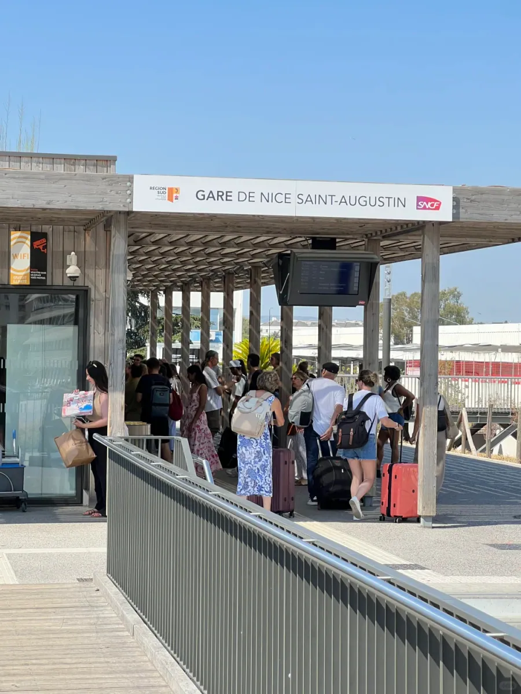

Nice é difícil de pular em uma viagem pelo sul da França. A maioria dos visitantes chega de trem de alta velocidade vindo de Paris, Lyon ou Marselha, fica em algum lugar perto da Promenade des Anglais, passa os dias na cidade antiga, em Èze ou em Mônaco, e voa de volta no fim. É nesse último dia que o problema começa: o Aeroporto de Nice Côte d'Azur (NCE) fica a oeste da cidade, perto no mapa, mas incômodo com bagagem.

Há três formas habituais de sair: o ônibus de aeroporto, o bonde e o trem. Os ônibus param em alguns pontos da cidade e são baratos, mas usam a estrada litorânea, que pode travar no verão; o bonde é mais lento, mas frequente. O trem é o mais rápido e o mais barato dos três — de Nice-Ville, a estação principal, até **Nice Saint-Augustin**, a parada ao lado do aeroporto, são quatro a seis minutos por uma passagem de **€4**.

Este guia segue o trajeto da nota original: compre o bilhete e passe pelas catracas em Nice-Ville, viaje quatro a seis minutos, caminhe de Saint-Augustin até o Terminal 1 e termine com o bonde gratuito entre os dois terminais. Sem táxi e sem precisar entender os anúncios em francês.

## 1. Por que o trem

O litoral de Nice faz uma curva, o aeroporto foi construído atrás das praias ocidentais, e a ferrovia passa rente à borda norte do campo de aviação. Foi assim que Saint-Augustin, antes uma parada suburbana comum, se tornou a estação de fato do aeroporto: fica a apenas 300–400 metros do terminal e foi reconstruída nos últimos anos para dar conta do movimento.

A primeira vantagem é que **o trem não fica no trânsito**. A estrada da cidade até o aeroporto engarrafa no horário de pico e durante a temporada de verão, e os ônibus atrasam dez minutos com frequência. O trem tem a própria via, e quatro a seis minutos significam quatro a seis minutos. A segunda vantagem é o preço: €4 é competitivo em comparação com um táxi e com os serviços de ônibus dedicados ao aeroporto.

Uma terceira vantagem é fácil de passar despercebida: **uma estação é mais simples do que um terminal de aeroporto**. Nice-Ville é a estação principal da cidade, com as plataformas começando logo atrás do saguão; escaneie o código, caminhe até a plataforma, entre, e tudo leva alguns minutos. No outro extremo, você sai de Saint-Augustin, atravessa um caminho curto e uma rua, e está na porta do Terminal 1. Sem filas longas e sem precisar chegar duas horas antes.

O trem tem limites, porém. Ele chega a Saint-Augustin, mas não ao Terminal 2; os serviços ficam mais espaçados à noite; e algumas mudanças de plataforma envolvem uma passarela. Isso está coberto abaixo.

## 2. Comprando o bilhete e passando pelas catracas

Nice-Ville é a estação principal da cidade e bastante fotogênica: paredes de pedra clara, janelas em arco, algumas palmeiras do lado de fora e uma placa com os dizeres “Nice Ville”. Do centro, pegue o bonde ou um ônibus até a região de Jean Médecin e caminhe dez minutos, ou pegue um táxi até a porta se as malas estiverem pesadas.

Há três formas de comprar. A mais simples é a máquina de bilhetes dentro da estação: a tela muda para o inglês, você escolhe Nice Saint-Augustin, paga com cartão ou moedas, e o bilhete é impresso. A segunda é o **SNCF Connect**, o aplicativo oficial da companhia ferroviária nacional francesa, que emite um bilhete eletrônico em francês ou inglês. A terceira é a **Omio**, que tem interface em chinês e é mais fácil para quem não está habituado aos sistemas de reserva franceses; os preços costumam ser iguais aos do site oficial e às vezes um pouco mais altos.

O que você recebe é um bilhete eletrônico, e o código QR no celular basta — **não é preciso retirar papel**. A entrada de Nice-Ville é uma fileira de catracas automáticas: aproxime o código do leitor, a catraca abre e você passa. Se não ler, geralmente há um funcionário por perto, e mostrar a página do pedido funciona igualmente bem.

Não se apresse para descer a uma plataforma imediatamente. As telas no saguão mostram “Départs / Departures”, listando cada trem, seu destino, horário de partida e plataforma (voie). Nice identifica suas plataformas com letras — A, B, C — e a tela mostra a letra em uma caixa. **Confira a plataforma antes de se mover**, porque trens no mesmo sentido às vezes partem de vias diferentes.

Um detalhe é fácil de perder: **confira o sentido**. Saint-Augustin fica a oeste de Nice, então só os trens em direção a Cannes, Grasse e Marselha param lá; os trens para Menton e Ventimiglia seguem a leste e nunca chegam ao aeroporto. O destino na tela diz qual é qual, e uma olhada antes de embarcar evita uma conversa incômoda depois.

## 3. Quatro a seis minutos

O salto de Nice a Saint-Augustin é um dos mais curtos da linha litorânea. O trem sai de Nice-Ville e corre pelo interior em relação à costa, chegando a Saint-Augustin quase de imediato, **sem parada intermediária** — quatro a seis minutos no total, curto o bastante para você mal se acomodar antes de ser hora de descer.

O material rodante varia. Às vezes é um TER de um andar, às vezes um de dois andares. Os de dois andares têm uma escada no vestíbulo, então, com bagagem, é mais fácil ficar no nível inferior do que arrastar a mala escada acima. Dentro há assentos azuis estofados, pequenas mesas junto à janela e bagageiros superiores; **qualquer assento livre é seu**, já que um bilhete de segunda classe não tem reserva e não precisa de uma.

Durante quatro a seis minutos, o trem atravessa os subúrbios ocidentais. Do lado de fora da janela vêm quarteirões densos de apartamentos, depois uma área de trilhos e prédios baixos de oficinas, e por fim a pista do aeroporto e os telhados dos terminais. Quando você vir aeronaves, comece a se preparar para descer.

A frequência é outro motivo para gostar desta linha. De Nice-Ville, **o primeiro trem é às 05:33 e o último às 22:42**, e durante o dia passa um trem **aproximadamente a cada 10 a 20 minutos**, então não é preciso chegar cedo — as plataformas começam atrás do saguão e dez minutos na estação são suficientes. Os horários que exigem atenção são o início da manhã e o fim da noite. Para um voo que parte antes das 07:00, o trem das 05:33 leva você a Saint-Augustin por volta das 05:40, o que é suficiente com a caminhada e o check-in; qualquer coisa mais cedo significa táxi. Quem pousar depois das 22:42 deve planejar táxi ou ônibus de aeroporto, em vez de contar com o último trem.

## 4. A caminhada de Saint-Augustin ao Terminal 1

Saint-Augustin é uma estação nova. Cercas verdes, placas cinzas com o nome e um grande painel do lado de fora com os dizeres “Votre nouvelle gare de Nice Saint-Augustin” indicam uma reforma recente. Na chegada, não procure uma saída imediatamente: caminhe no fluxo até o fim da plataforma e procure “Sortie / Exit” e o símbolo de avião.

Algumas plataformas exigem uma passarela para sair. A passarela tem escadas e elevador, e, com uma mala grande, vale a pena esperar pelo elevador. Da passarela, você vê a estação inteira: alguns trilhos, a fiação aérea e os prédios do aeroporto ao longe, o que torna a direção óbvia.

Lá fora, as placas são claras. Um painel cinza-escuro diz “Av. Me Maurice Slama” e “Sortie / Exit”, com **Bus**, **Tramway** e **Aéroport** embaixo e uma seta apontando em frente. Siga o símbolo de avião e você estará a caminho do terminal.

Em seguida vem uma passagem coberta com piso claro permeável, arbustos baixos e cercas de arame dos dois lados. Não é longa, e no fim há um lance de escadas e uma torre de elevador de vidro; para chegar ao Terminal 1, você desce por ali e passa sob a passarela para pegar a calçada em direção ao aeroporto.

As escadas e a torre do elevador são a única parte da caminhada que exige uma decisão. Quem tem bagagem pesada, carrinho de bebê ou mobilidade reduzida deve pegar o elevador; ele é pequeno, e na alta temporada você pode esperar uma ou duas viagens. As escadas não são íngremes, mas uma mala pesada torna o esforço grande.

Passar pelo prédio da estação é um bom momento para fixar a direção na cabeça: a nova entrada é uma fileira de coberturas de aço branco, o painel com o nome diz “Gare de Nice Saint-Augustin”, e geralmente há passageiros esperando do lado de fora. É também daqui que você embarca na volta — caminhe desde o aeroporto, e ver essa placa significa que você chegou.

Lá fora fica um painel azul-escuro: “Votre nouvelle gare de Nice Saint-Augustin”, com “Entrée” e uma seta apontando à direita, e ao longo da base os logotipos do Estado francês, da SNCF Gares & Connexions, da região Provença-Alpes-Costa Azul e da cidade de Nice. Um carrinho de bagagem do aeroporto costuma ficar estacionado em frente, o que resume a relação entre os dois.

Um pouco mais adiante vem a única travessia de rua da caminhada. Há um semáforo e uma faixa de pedestres, e do outro lado ficam as faixas de desembarque do aeroporto e a fachada de vidro do Terminal 1. **Da saída da estação até a porta do terminal são cerca de 300–400 metros, ou 8 a 12 minutos a pé**; com malas grandes, passo mais lento ou uma parada para fotos, reserve quinze minutos.

Do outro lado da rua fica a área de desembarque do Terminal 1. “Terminal 1” está escrito acima da parede de vidro, táxis e ônibus de aeroporto param do lado de fora, e as portas dão para o saguão de check-in. A essa altura, contando desde Nice-Ville, mal passou meia hora.

Há um problema prático nesta caminhada: **há muito pouca sombra**. Tirando a cobertura do lado de fora da estação e o trecho curto sob a passarela, a maior parte fica sob o sol direto. O sol de verão em Nice é forte, então um chapéu e protetor solar importam mais do que qualquer outra coisa ao meio-dia, e vale levar uma garrafa de água, especialmente com mala.

Na volta, basta fazer o inverso: saia das chegadas do Terminal 1, caminhe pela faixa de desembarque até a faixa de pedestres, atravesse, procure as coberturas brancas de “Gare de Nice Saint-Augustin” e depois suba as escadas ou pegue o elevador até a plataforma. Reserve dez a quinze minutos para a caminhada nesse sentido também, porque a bagagem e a orientação consomem tempo; se o seu bilhete indica um trem específico, coloque a caminhada antes do horário de partida, não depois.

## 5. O bonde gratuito do Terminal 1 ao Terminal 2

Se o seu voo parte do Terminal 2, chegar ao Terminal 1 não é o fim. O Terminal 2 fica do outro lado do aeroporto, ir a pé significaria um longo desvio, e o certo é pegar o bonde gratuito do aeroporto do lado de fora do Terminal 1: **linha 2** (algumas fontes a identificam como linha B). Leva dois a três minutos, passa **aproximadamente a cada dois minutos** e não custa nada.

A parada fica na diagonal das portas do Terminal 1. A placa é explícita: uma seta verde aponta para “Quai en face / Opposite Platform”, ou seja, a plataforma do outro lado da rua; abaixo, o símbolo do bonde traz um “2” e um “B”, depois “Vers / To: Terminal 2” e as palavras “Liaison gratuite / Free connection”.

A plataforma tem cobertura e bancos, e o painel informa quantos minutos faltam para o próximo serviço. Quando o bonde chega, leia o painel na frente: os serviços que mostram “AÉROPORT” são os bondes da linha 2 em direção ao aeroporto, com o Terminal 2 a duas paradas. Se você embarcar por engano em um que vai para a cidade, desça na próxima parada e volte — custa tempo, não dinheiro.

No Terminal 2, desça e siga as placas “Départs / Departures” para dentro do terminal, usando as telas para encontrar sua ilha de check-in e a segurança. Na volta, inverta a sequência: bonde do Terminal 2 ao Terminal 1, travessia da faixa de desembarque, caminhada pela calçada até Saint-Augustin e trem de volta a Nice.

O bonde circula nos dois sentidos e com tanta frequência que o horário quase não importa: quando um sai, o próximo geralmente já está indicado. Entre as duas paradas do aeroporto, não há bilhete para comprar nem para validar — você simplesmente embarca. Se o seu grupo estiver dividido entre os terminais, marcar encontro na parada de bonde do Terminal 1 é bem mais fácil do que se procurar dentro dos prédios.

Os horários, tarifas e conexões aqui vêm do relato de uma viajante em outubro de 2026; horários de trem, tarifas e plataformas de bonde estão sujeitos às informações do dia no local e no site da operadora. Dois últimos pontos: o bilhete indica um trem específico, mas, segundo a nota original, outros serviços às vezes são aceitos, então confirme com a equipe na plataforma em caso de dúvida; e essa caminhada de 300–400 metros é realmente exposta ao sol, então não a trate como um passeio tranquilo.

## Links relacionados

- **Neste site**: [França (FR)](/country/FR)
- **Wikipedia**: [Aeroporto de Nice Côte d'Azur](https://en.wikipedia.org/wiki/Nice_C%C3%B4te_d%27Azur_Airport)
- **Baidu Baike**: [Aeroporto de Nice Côte d'Azur](https://baike.baidu.com/item/%E5%B0%BC%E6%96%AF%E8%93%9D%E8%89%B2%E6%B5%B7%E5%B2%B8%E6%9C%BA%E5%9C%BA)
