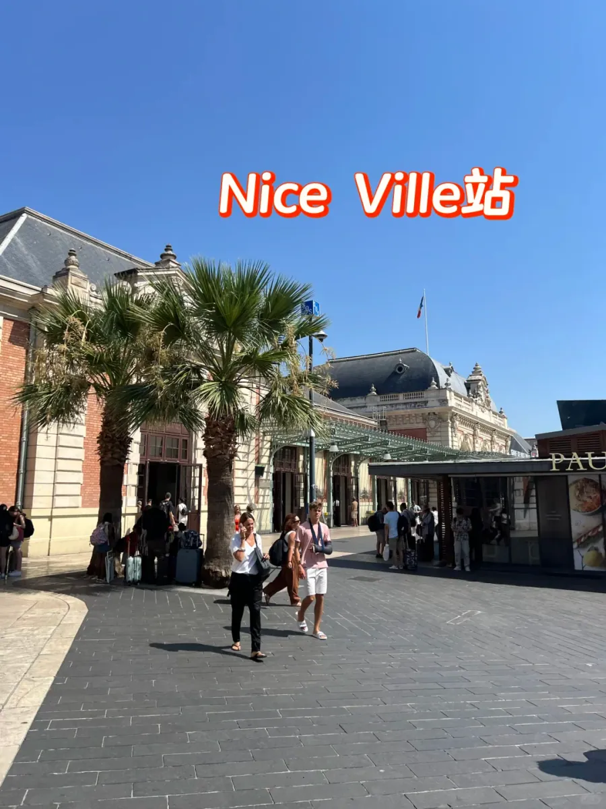
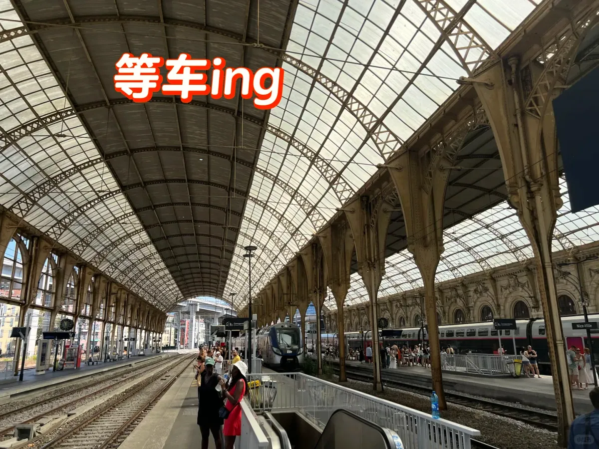

Nisa este greu de ocolit într-o călătorie prin sudul Franței. Cei mai mulți vizitatori sosesc cu trenul de mare viteză de la Paris, Lyon sau Marseille, stau undeva aproape de Promenade des Anglais, își petrec zilele în orașul vechi, în Èze sau în Monaco și pleacă cu avionul la final. Ultima zi este cea în care încep necazurile: Aeroportul Nice Côte d'Azur (NCE) se află la vest de oraș, aproape pe hartă, dar incomod cu bagaje.

Există trei variante obișnuite: autobuzul de aeroport, tramvaiul și trenul. Autobuzele opresc în câteva puncte din oraș și sunt ieftine, dar folosesc șoseaua de coastă, care se blochează vara; tramvaiul este mai lent, dar circulă des. Trenul este cel mai rapid și cel mai ieftin dintre cele trei — de la Nice-Ville, gara principală, la **Nice Saint-Augustin**, stația de lângă aeroport, durează patru până la șase minute, pentru un bilet simplu de **4 €**.

Acest ghid urmează ruta din nota originală: cumperi un bilet și treci de porțile de la Nice-Ville, călătorești patru până la șase minute, mergi pe jos de la Saint-Augustin la Terminalul 1 și închei cu tramvaiul gratuit între cele două terminale. Fără taxi și fără nevoia de a înțelege anunțurile în franceză.

## 1. De ce trenul

Linia de coastă de la Nisa face o curbă, aeroportul a fost construit în spatele plajelor din vest, iar calea ferată trece întâmplător pe lângă marginea nordică a terenului de aviație. Așa a ajuns Saint-Augustin, cândva o simplă haltă suburbană, să fie gara de facto a aeroportului: se află la doar 300–400 de metri de terminal și a fost reconstruită în ultimii ani pentru a face față traficului.

Primul avantaj este că **trenul nu stă în trafic**. Drumul din oraș spre aeroport se aglomerează la orele de vârf și pe toată durata sezonului estival, iar autobuzele întârzie în mod obișnuit cu zece minute. Trenul are propria cale, iar patru până la șase minute înseamnă patru până la șase minute. Al doilea avantaj este prețul: 4 € se compară bine cu un taxi și cu serviciile dedicate de autobuz spre aeroport.

Un al treilea avantaj este ușor de trecut cu vederea: **o gară este mai simplă decât un terminal de aeroport**. Nice-Ville este gara principală a orașului, cu peroanele care încep imediat în spatele sălii centrale; scanezi codul, mergi la peron, urci, iar totul durează câteva minute. La celălalt capăt părăsești Saint-Augustin, traversezi o alee scurtă și un drum, și ești la ușa Terminalului 1. Fără cozi lungi și fără nevoia de a ajunge cu două ore mai devreme.

Trenul are totuși și limite. Ajunge la Saint-Augustin, dar nu la Terminalul 2; cursele se răresc seara; iar unele schimbări de peron implică o pasarelă. Acestea sunt tratate mai jos.

## 2. Cumperi un bilet și treci de porți

Nice-Ville este gara principală a orașului și una fotogenică: ziduri de piatră deschisă la culoare, ferestre în arc, câțiva palmieri afară și un panou cu inscripția „Nice Ville”. Din centru, ia tramvaiul sau un autobuz până în zona Jean Médecin și mergi zece minute pe jos, sau ia un taxi până la ușă dacă bagajele sunt grele.

Există trei modalități de a cumpăra. Cea mai simplă este automatul de bilete din gară: ecranul comută pe engleză, alegi Nice Saint-Augustin, plătești cu cardul sau cu monede, iar biletul se tipărește. A doua este **SNCF Connect**, aplicația oficială a căilor ferate naționale franceze, care emite un bilet electronic în franceză sau engleză. A treia este **Omio**, care are o interfață în chineză și este mai ușor de folosit pentru cine nu e obișnuit cu sistemele de rezervare franceze; prețurile corespund de obicei celor de pe site-ul oficial și sunt ocazional puțin mai mari.

Ce primești este un bilet electronic, iar codul QR de pe telefon este suficient — **nu trebuie să ridici un bilet pe hârtie**. Intrarea la Nice-Ville este un șir de porți automate: ții codul aproape de cititor, poarta se deschide și ai trecut. Dacă nu îl citește, de obicei este un angajat prin apropiere, iar arătarea paginii comenzii funcționează la fel de bine.

Nu te grăbi să cobori imediat la un peron. Ecranele din sala centrală afișează „Départs / Departures”, listând fiecare tren, destinația, ora plecării și peronul (voie). Nisa își desemnează peroanele cu litere — A, B, C —, iar ecranul arată litera într-un chenar. **Verifică peronul înainte să te miști**, pentru că trenurile în aceeași direcție pleacă uneori de pe linii diferite.

Un detaliu este ușor de ratat: **verifică direcția**. Saint-Augustin se află la vest de Nisa, așa că doar trenurile spre Cannes, Grasse și Marseille opresc acolo; trenurile spre Menton și Ventimiglia merg spre est și nu ajung niciodată la aeroport. Destinația de pe ecran îți spune care e care, iar o privire înainte de îmbarcare economisește o conversație stânjenitoare mai târziu.

## 3. Patru până la șase minute

Saltul de la Nisa la Saint-Augustin este unul dintre cele mai scurte de pe linia de coastă. Trenul pleacă din Nice-Ville și merge în interiorul țărmului, ajungând la Saint-Augustin aproape imediat, cu **nicio oprire intermediară** — patru până la șase minute în total, atât de puțin încât abia te-ai așezat și deja trebuie să cobori.

Materialul rulant variază. Uneori este un TER cu un singur nivel, alteori unul cu etaj. Cele cu etaj au o scară în vestibul, așa că, cu bagaje, este mai ușor să rămâi la nivelul inferior decât să târăști valiza sus. În interior sunt scaune tapițate albastre, mese mici lângă fereastră și rafturi de bagaje deasupra; **orice loc liber este al tău**, întrucât un bilet la clasa a doua nu include rezervare și nici nu are nevoie de una.

Timp de patru până la șase minute trenul străbate suburbiile din vest. Pe fereastră apar blocuri dese de locuințe, apoi o întindere de linii ferate și clădiri joase de ateliere și, în final, pista aeroportului și acoperișurile terminalelor. Când vezi avioane, începe să te pregătești de coborâre.

Frecvența este un alt motiv să îndrăgești această linie. De la Nice-Ville, **primul tren pleacă la 05:33, iar ultimul la 22:42**, iar în timpul zilei circulă un tren **cam la fiecare 10 până la 20 de minute**, așa că nu e nevoie să ajungi devreme — peroanele încep în spatele sălii centrale, iar zece minute în gară sunt suficiente. Orele care necesită atenție sunt dimineața devreme și seara târziu. Pentru un zbor care pleacă înainte de 07:00, trenul de 05:33 te duce la Saint-Augustin în jur de 05:40, ceea ce este exact suficient ținând cont de mersul pe jos și de check-in; orice mai devreme înseamnă taxi. Cine aterizează după 22:42 ar trebui să se bazeze pe un taxi sau pe autobuzul de aeroport, nu pe ultimul tren.

## 4. Drumul pe jos de la Saint-Augustin la Terminalul 1

Saint-Augustin este o gară nouă. Gardul verde, panourile gri cu numele și un panou mare afară cu inscripția „Votre nouvelle gare de Nice Saint-Augustin” indică toate o reconstrucție recentă. La sosire, nu căuta imediat o ieșire: mergi cu fluxul până la capătul peronului și ridică privirea după „Sortie / Exit” și simbolul avionului.

Unele peroane necesită o pasarelă pentru ieșire. Pasarela are scări și un lift, iar cu o valiză mare liftul merită așteptarea. De pe pasarelă se vede toată gara: câteva linii, firele de contact de deasupra și clădirile aeroportului în depărtare, ceea ce face direcția evidentă.

Afară, indicatoarele sunt clare. Un panou gri închis afișează „Av. Me Maurice Slama” și „Sortie / Exit”, cu **Bus**, **Tramway** și **Aéroport** dedesubt și o săgeată care arată înainte. Urmează simbolul avionului și ești pe drumul spre terminal.

Urmează o alee acoperită cu o suprafață permeabilă de culoare deschisă, tufe joase și gard de sârmă pe ambele părți. Nu este lungă, iar la capătul ei se află o scară și un turn de lift din sticlă; pentru a ajunge la Terminalul 1 cobori aici și treci pe sub pasarelă, pentru a continua pe trotuarul spre aeroport.

Treptele și turnul de lift sunt singura parte a drumului care cere o decizie. Oricine are bagaje grele, un cărucior pentru copii sau mobilitate redusă ar trebui să ia liftul; este mic, iar în sezonul de vârf s-ar putea să aștepți una sau două curse. Scările nu sunt abrupte, dar o valiză grea le face obositoare.

Trecerea pe lângă clădirea gării este un moment bun pentru a-ți fixa direcția în minte: noua intrare este un șir de copertine albe de oțel, panoul cu numele afișează „Gare de Nice Saint-Augustin”, iar afară de obicei așteaptă pasageri. Tot aici urci și la întoarcere — vii pe jos de la aeroport, iar faptul că vezi acel panou înseamnă că ai ajuns.

Afară se află un panou albastru închis: „Votre nouvelle gare de Nice Saint-Augustin”, cu „Entrée” și o săgeată care arată spre dreapta, iar de-a lungul marginii de jos logo-urile statului francez, SNCF Gares & Connexions, regiunii Provence-Alpes-Côte d'Azur și orașului Nisa. În fața lui este adesea parcat un cărucior de bagaje de aeroport, ceea ce rezumă relația dintre cele două.

Puțin mai încolo apare singura traversare de drum a traseului. Există un semafor și o trecere de pietoni, iar pe partea cealaltă sunt benzile de îmbarcare ale aeroportului și fațada de sticlă a Terminalului 1. **De la ieșirea din gară până la ușa terminalului sunt aproximativ 300–400 de metri, adică 8 până la 12 minute de mers pe jos**; cu valize mari, cu un pas mai lent sau cu o oprire pentru fotografii, lasă cincisprezece.

Dincolo de drum se află zona de îmbarcare a Terminalului 1. Deasupra peretelui de sticlă scrie „Terminal 1”, taxisurile și autobuzele de aeroport opresc afară, iar ușile dau în sala de check-in. Până în acest moment, socotind de la Nice-Ville, a trecut de-abia o jumătate de oră.

Drumul pe jos are o singură problemă practică: **este foarte puțin umbră**. În afară de copertina din fața gării și scurta porțiune de sub pasarelă, cea mai mare parte este în plin soare. Soarele de vară de la Nisa este puternic, așa că la amiază o pălărie și cremă de protecție solară contează mai mult decât orice, iar o sticlă de apă merită cărată, mai ales cu o valiză.

La întoarcere, pur și simplu inversează traseul: ieși din sosirile Terminalului 1, mergi de-a lungul benzii de îmbarcare până la trecerea de pietoni, traversează, caută copertinele albe ale gării „Gare de Nice Saint-Augustin”, apoi urcă pe scări sau cu liftul la peron. Rezervă zece până la cincisprezece minute și pentru drumul în această direcție, fiindcă bagajele și orientarea consumă din timp; dacă biletul tău indică un anumit tren, pune drumul înainte de ora plecării, nu după ea.

## 5. Tramvaiul gratuit de la Terminalul 1 la Terminalul 2

Dacă zborul tău pleacă de la Terminalul 2, ajungerea la Terminalul 1 nu este finalul. Terminalul 2 este în cealaltă parte a aeroportului, mersul pe jos ar însemna un ocol lung, iar soluția potrivită este tramvaiul gratuit al aeroportului din fața Terminalului 1: **linia 2** (unele surse o numesc linia B). Durează două până la trei minute, circulă **cam la fiecare două minute** și nu costă nimic.

Stația este în diagonală față de ușile Terminalului 1. Panoul este explicit: o săgeată verde indică „Quai en face / Opposite Platform”, adică peronul de pe cealaltă parte a drumului; dedesubt simbolul tramvaiului poartă un „2” și un „B”, apoi „Vers / To: Terminal 2” și cuvintele „Liaison gratuite / Free connection”.

Peronul are o copertină și bănci, iar afișajul îți spune câte minute mai sunt până la următoarea cursă. Când sosește tramvaiul, citește afișajul din față: cursele care afișează „AÉROPORT” sunt tramvaiele liniei 2 care merg spre aeroport, cu Terminalul 2 la două stații distanță. Dacă te urci din greșeală într-unul care merge spre oraș, coboară la următoarea stație și întoarce-te — costă timp, nu bani.

La Terminalul 2, coboară și urmează indicatoarele „Départs / Departures” în terminal, folosind ecranele pentru a-ți găsi insula de check-in și securitatea. La întoarcere, inversează succesiunea: tramvaiul de la Terminalul 2 la Terminalul 1, traversarea benzii de îmbarcare, trotuarul până la Saint-Augustin și trenul înapoi în Nisa.

Tramvaiul circulă în ambele direcții și atât de des încât orarul aproape nu contează: până pleacă unul, următorul este de obicei deja afișat. Între cele două stații ale aeroportului nu ai niciun bilet de cumpărat și niciunul de verificat — pur și simplu urci. Dacă grupul tău este împărțit între terminale, întâlnirea la stația de tramvai de la Terminalul 1 este mult mai simplă decât să vă căutați unii pe alții în interiorul clădirilor.

Orele, tarifele și legăturile de aici provin din relatarea unui călător din octombrie 2026; orele trenurilor, tarifele și peroanele tramvaiului depind de informațiile zilei, de la fața locului și de pe site-ul operatorului. Două ultime precizări: biletul indică un anumit tren, dar, potrivit notei originale, uneori sunt acceptate și alte curse, așa că întreabă personalul de pe peron dacă nu ești sigur; iar drumul de 300–400 de metri este într-adevăr expus, așa că nu îl trata ca pe o plimbare lejeră.

## Linkuri utile

- **Pe acest site**: [Franța (FR)](/country/FR)
- **Wikipedia**: [Nice Côte d'Azur Airport](https://en.wikipedia.org/wiki/Nice_C%C3%B4te_d%27Azur_Airport)
- **Baidu Baike**: [Nice Côte d'Azur Airport](https://baike.baidu.com/item/%E5%B0%BC%E6%96%AF%E8%93%9D%E8%89%B2%E6%B5%B7%E5%B2%B8%E6%9C%BA%E5%9C%BA)
