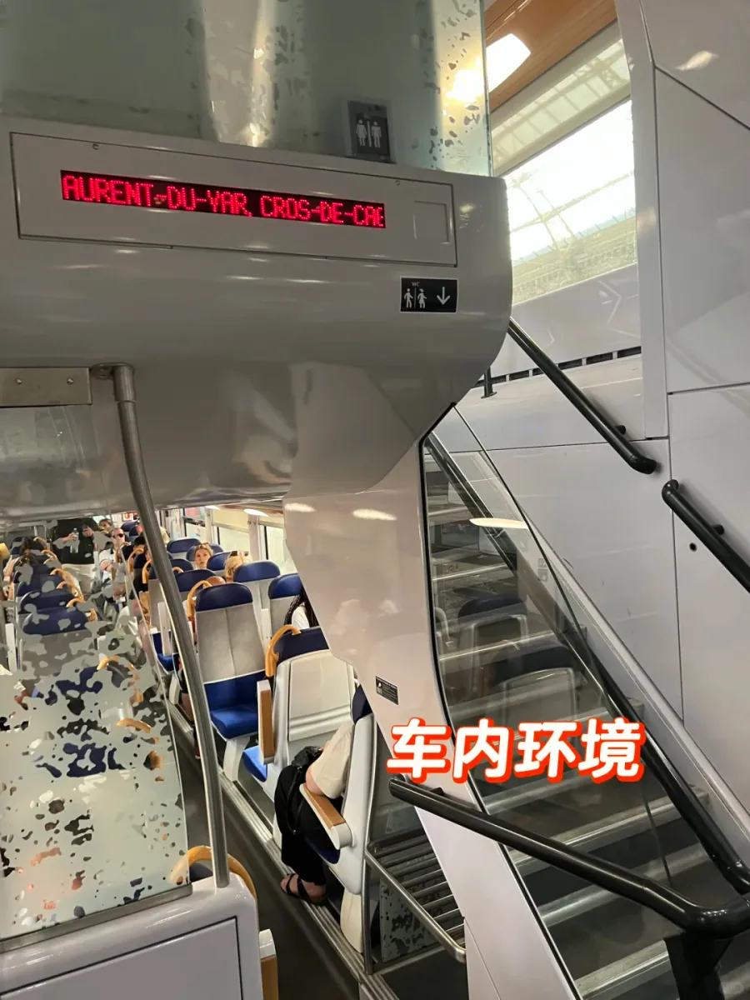
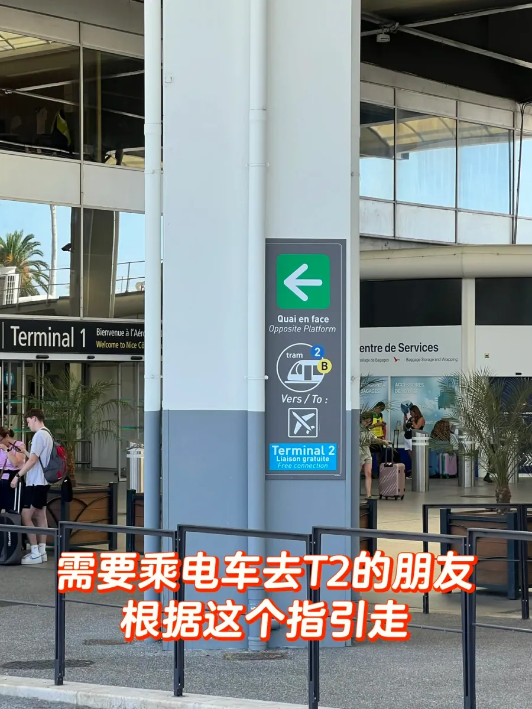

Ниццу трудно обойти стороной в поездке по югу Франции. Большинство гостей приезжают на скоростном поезде из Парижа, Лиона или Марселя, останавливаются где-нибудь у Английской набережной, проводят дни в старом городе, Эзе или Монако и улетают в конце. Именно в последний день и начинаются сложности: аэропорт Ницца — Лазурный Берег (NCE) находится к западу от города — близко на карте, но неудобно с багажом.

Обычно есть три способа добраться: аэропортовый автобус, трамвай и поезд. Автобусы останавливаются в нескольких точках города и дешевы, но идут по прибрежной дороге, которая летом встаёт; трамвай медленнее, но ходит часто. Поезд — самый быстрый и дешёвый из трёх: от Ниццы-Виль, главного вокзала, до **Ниццы Сен-Огюстен**, остановки рядом с аэропортом, — четыре-шесть минут при разовом тарифе **€4**.

Этот гид повторяет маршрут из исходной заметки: купить билет и пройти через турникеты на Ницце-Виль, проехать четыре-шесть минут, дойти от Сен-Огюстен до терминала 1 и завершить бесплатным трамваем между двумя терминалами. Без такси и без необходимости понимать французские объявления.

## 1. Почему поезд

Береговая линия в Ницце изгибается, аэропорт построили за западными пляжами, а железная дорога проходит по северному краю лётного поля. Так Сен-Огюстен, когда-то обычная пригородная остановка, стал фактической станцией аэропорта: до терминала всего 300–400 метров, и в последние годы его перестроили, чтобы справиться с потоком.

Первое преимущество — **поезд не стоит в пробках**. Дорога из города в аэропорт встаёт в час пик и в течение всего летнего сезона, а автобусы регулярно опаздывают на десять минут. У поезда своя колея, и четыре-шесть минут означают четыре-шесть минут. Второе преимущество — цена: €4 выгодно смотрятся и на фоне такси, и на фоне специальных аэропортовых автобусов.

Третье преимущество легко упустить: **вокзал проще, чем терминал аэропорта**. Ницца-Виль — главный вокзал города, платформы начинаются сразу за вестибюлем: отсканируйте код, дойдите до платформы, садитесь — и всё занимает несколько минут. На другом конце вы выходите из Сен-Огюстен, проходите короткую дорожку и одну улицу, и вы у дверей терминала 1. Никаких длинных очередей и необходимости приезжать за два часа.

Но у поезда есть ограничения. Он доходит до Сен-Огюстен, но не до терминала 2; вечером рейсов меньше; а некоторые переходы между платформами требуют пешеходного моста. Об этом ниже.

## 2. Покупка билета и проход через турникеты

Ницца-Виль — главный вокзал города и очень фотогеничный: светлые каменные стены, арочные окна, несколько пальм снаружи и вывеска «Nice Ville». Из центра доезжайте на трамвае или автобусе до района Жан Медсен и идите пешком десять минут; если багаж тяжёлый, возьмите такси до двери.

Купить билет можно тремя способами. Проще всего — в автомате на вокзале: экран переключается на английский, вы выбираете Nice Saint-Augustin, платите картой или монетами, и билет печатается. Второй — **SNCF Connect**, официальное приложение французских железных дорог, которое выпускает электронный билет на французском или английском. Третий — **Omio** с китайским интерфейсом, что проще для тех, кто не привык к французским системам бронирования; цены обычно совпадают с официальным сайтом, иногда немного выше.

Вы получаете электронный билет, и QR-кода в телефоне достаточно — **бумажный билет брать не нужно**. На входе Ниццы-Виль стоят автоматические турникеты: поднесите код к считывателю, створки откроются, и вы прошли. Если код не читается, рядом обычно есть сотрудник, а показать страницу заказа тоже подходит.

Не спешите сразу спускаться на платформу. Экраны в вестибюле показывают «Départs / Departures», перечисляя каждый поезд, его направление, время отправления и платформу (voie). В Ницце платформы обозначают буквами — A, B, C, — и на экране буква стоит в рамке. **Проверьте платформу, прежде чем идти**, потому что поезда одного направления иногда отправляются с разных путей.

Одну деталь легко упустить: **проверьте направление**. Сен-Огюстен находится к западу от Ниццы, поэтому там останавливаются только поезда в сторону Канн, Грасса и Марселя; поезда в сторону Ментоны и Вентимильи идут на восток и в аэропорт не заходят. Направление на экране подскажет, где какое, и один взгляд перед посадкой избавит от неловкого разговора потом.

## 3. Четыре-шесть минут

Перегон из Ниццы в Сен-Огюстен — один из самых коротких на прибрежной линии. Поезд выходит с Ниццы-Виль и идёт по суше в стороне от берега, достигая Сен-Огюстен почти сразу, **без промежуточных остановок**: четыре-шесть минут всего — так мало, что вы едва успеваете устроиться, как уже пора выходить.

Подвижной состав бывает разным. Иногда это одноэтажный TER, иногда двухэтажный. У двухэтажных в тамбуре есть лестница, поэтому с багажом проще остаться на нижнем уровне, чем тащить чемодан наверх. Внутри синие мягкие кресла, маленькие столики у окна и полки для багажа над головой; **любое свободное место ваше**, поскольку билет второго класса не включает брони и не требует её.

Четыре-шесть минут поезд идёт через западные пригороды. За окном проплывают плотные жилые кварталы, затем раскинувшиеся железнодорожные пути и низкие мастерские, и наконец взлётная полоса аэропорта и крыши терминалов. Увидев самолёты, начинайте готовиться к выходу.

Частота — ещё одна причина любить эту линию. С Ниццы-Виль **первый поезд в 05:33, последний в 22:42**, а днём поезда ходят **примерно каждые 10–20 минут**, поэтому приезжать заранее не нужно: платформы начинаются за вестибюлем, и десяти минут на вокзале вполне достаточно. Продумать стоит раннее утро и поздний вечер. На рейс, улетающий до 07:00, поезд в 05:33 доставит вас в Сен-Огюстен около 05:40 — этого едва хватает с учётом пешей прогулки и регистрации; всё более раннее означает такси. Тем, кто прилетает после 22:42, стоит рассчитывать на такси или аэропортовый автобус, а не на последний поезд.

## 4. Пешая дорога от Сен-Огюстен до терминала 1

Сен-Огюстен — новая станция. Зелёный забор, серые таблички с названием и большой щит снаружи с надписью «Votre nouvelle gare de Nice Saint-Augustin» указывают на недавнюю реконструкцию. По прибытии не ищите выход сразу: идите со всеми к концу платформы и поднимите взгляд в поисках «Sortie / Exit» и символа самолёта.

С некоторых платформ выходить приходится через пешеходный мост. На мосту есть лестница и лифт, и с большим чемоданом лифта стоит подождать. С моста видна вся станция: несколько путей, контактные провода и здания аэропорта вдали, что делает направление очевидным.

Снаружи указатели понятные. На тёмно-серой панели написано «Av. Me Maurice Slama» и «Sortie / Exit», ниже — **Bus**, **Tramway** и **Aéroport** со стрелкой вперёд. Идите по символу самолёта — и вы движетесь к терминалу.

Дальше начинается крытая дорожка со светлым проницаемым покрытием, низкими кустами и сетчатым ограждением по обеим сторонам. Она недлинная, а в конце — лестница и стеклянная лифтовая башня; чтобы попасть в терминал 1, спуститесь здесь и пройдите под пешеходным мостом, выйдя на тротуар в сторону аэропорта.

Лестница и лифтовая башня — единственное место на маршруте, где нужно принять решение. С тяжёлым багажом, коляской или ограниченной подвижностью стоит воспользоваться лифтом; он небольшой, и в высокий сезон, возможно, придётся пропустить одну-две поездки. Лестница не крутая, но с тяжёлым чемоданом она требует усилий.

Проходя мимо здания вокзала, хорошо запомнить направление: новый вход — это ряд белых стальных навесов, на табло написано «Gare de Nice Saint-Augustin», и снаружи обычно ждут пассажиры. Отсюда же вы будете садиться на обратном пути: дойдите от аэропорта, и увиденная вывеска означает, что вы на месте.

Снаружи стоит тёмно-синий щит: «Votre nouvelle gare de Nice Saint-Augustin» с надписью «Entrée» и стрелкой вправо, а внизу — логотипы французского государства, SNCF Gares & Connexions, региона Прованс — Альпы — Лазурный Берег и города Ниццы. Перед ним часто стоит аэропортовая багажная тележка, что лучше всего описывает отношения между двумя местами.

Чуть дальше — единственный дорожный переход на всём пути. Там есть светофор и зебра, а на другой стороне — полосы высадки аэропорта и стеклянный фасад терминала 1. **От выхода со станции до двери терминала около 300–400 метров, или 8–12 минут пешком**; с большими чемоданами, неспешным шагом или остановкой на фото закладывайте пятнадцать.

Через дорогу — зона высадки терминала 1. Над стеклянной стеной написано «Terminal 1», снаружи останавливаются такси и аэропортовые автобусы, а двери ведут в зал регистрации. К этому моменту от Ниццы-Виль прошло едва ли полчаса.

У этой прогулки есть одна практическая проблема: **здесь почти нет тени**. Кроме навеса у станции и короткого отрезка под пешеходным мостом, большая часть пути проходит под открытым солнцем. Летнее солнце в Ницце сильное, поэтому в полдень шляпа и солнцезащитный крем важнее всего остального, а бутылка воды стоит того, чтобы её нести, особенно с чемоданом.

На обратном пути просто повторите всё в обратном порядке: выйдите из прилёта терминала 1, идите вдоль полосы высадки до зебры, перейдите, найдите белые навесы «Gare de Nice Saint-Augustin», затем поднимитесь по лестнице или на лифте на платформу. В эту сторону тоже закладывайте десять-пятнадцать минут: багаж и поиск дороги съедают время; если в билете указан конкретный поезд, рассчитывайте прогулку до времени отправления, а не после.

## 5. Бесплатный трамвай от терминала 1 до терминала 2

Если ваш рейс вылетает из терминала 2, терминалом 1 дело не заканчивается. Терминал 2 находится на другой стороне аэропорта, пешком пришлось бы делать большой крюк, и правильный ход — бесплатный аэропортовый трамвай снаружи терминала 1: **линия 2** (в некоторых источниках — линия B). Поездка занимает две-три минуты, трамвай ходит **примерно каждые две минуты** и ничего не стоит.

Остановка находится по диагонали от дверей терминала 1. Указатель недвусмысленный: зелёная стрелка указывает на «Quai en face / Opposite Platform», то есть платформу на другой стороне дороги; ниже символ трамвая с «2» и «B», затем «Vers / To: Terminal 2» и слова «Liaison gratuite / Free connection».

На платформе есть навес и скамейки, а табло показывает, сколько минут до следующего трамвая. Когда трамвай приходит, прочитайте надпись на лобовом табло: вагоны с надписью «AÉROPORT» — это трамваи линии 2 в сторону аэропорта, до терминала 2 две остановки. Если по ошибке сядете в вагон, идущий в город, выйдите на следующей остановке и вернитесь — это стоит времени, но не денег.

В терминале 2 выйдите и идите по указателям «Départs / Departures» в терминал, а по экранам найдите свою регистрационную зону и досмотр. В обратную сторону порядок обратный: трамвай от терминала 2 до терминала 1, через полосу высадки, по тротуару до Сен-Огюстен и поезд назад в Ниццу.

Трамвай ходит в обоих направлениях и так часто, что расписание почти не имеет значения: пока один уезжает, на табло обычно уже показан следующий. Между двумя остановками аэропорта не нужно покупать билет, и его никто не проверяет — просто садитесь. Если ваша группа разделилась между терминалами, встретиться на трамвайной остановке у терминала 1 гораздо проще, чем искать друг друга внутри зданий.

Время, тарифы и пересадки здесь взяты из рассказа путешественника в октябре 2026 года; расписание поездов, тарифы и трамвайные платформы зависят от информации на месте и на сайте оператора в конкретный день. Два последних замечания: в билете указан конкретный поезд, но, по исходной заметке, иногда принимают и другие, поэтому при сомнениях уточните у сотрудников на платформе; и те 300–400 метров действительно проходят под открытым небом, так что не считайте это лёгкой прогулкой.

## Связанные ссылки

- **На этом сайте**: [Франция (FR)](/country/FR)
- **Википедия**: [Аэропорт Ницца — Лазурный Берег](https://en.wikipedia.org/wiki/Nice_C%C3%B4te_d%27Azur_Airport)
- **Байду Байкэ**: [Аэропорт Ницца — Лазурный Берег](https://baike.baidu.com/item/%E5%B0%BC%E6%96%AF%E8%93%9D%E8%89%B2%E6%B5%B7%E5%B2%B8%E6%9C%BA%E5%9C%BA)
