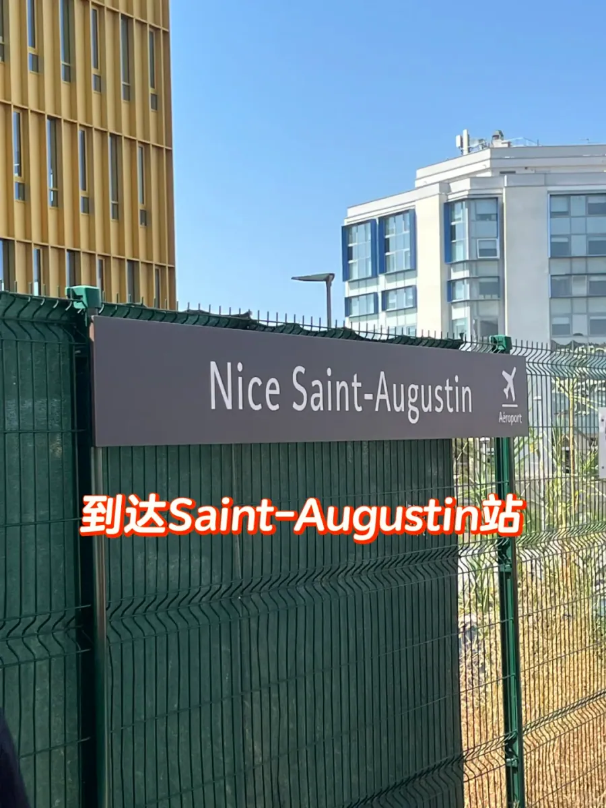

Nice ni vigumu kuipuuza katika safari ya kusini mwa Ufaransa. Wageni wengi hufika kwa treni ya mwendo kasi kutoka Paris, Lyon au Marseille, hukaa mahali karibu na Promenade des Anglais, hutumia siku zao kwenye mji wa kale, Èze au Monaco, na huruka nyumbani mwishoni. Siku hiyo ya mwisho ndipo shida huanza: Uwanja wa Ndege wa Nice Côte d'Azur (NCE) upo magharibi mwa mji, karibu kwenye ramani lakini mgumu ukiwa na mizigo.

Kuna njia tatu za kawaida za kutoka: basi la uwanja wa ndege, tramu na treni. Mabasi husimama katika maeneo machache mjini na ni ya bei nafuu, lakini hutumia barabara ya pwani, ambayo inaweza kukwama wakati wa kiangazi; tramu ni ya polepole zaidi lakini huja mara kwa mara. Treni ni ya haraka zaidi na ya bei nafuu zaidi kati ya hizo tatu — kutoka Nice-Ville, kituo kikuu, hadi **Nice Saint-Augustin**, kituo kilicho kando ya uwanja wa ndege, huchukua dakika nne hadi sita kwa nauli moja ya **€4**.

Mwongozo huu unafuata njia iliyo kwenye noti ya awali: nunua tikiti na upite lango la ukaguzi huko Nice-Ville, safiri dakika nne hadi sita, tembea kutoka Saint-Augustin hadi Terminal 1, na umalize kwa tramu ya bure kati ya vituo viwili. Hakuna teksi, na hakuna haja ya kuelewa matangazo ya Kifaransa.

## 1. Kwa nini treni

Ufuo wa Nice umepinda, uwanja wa ndege ulijengwa nyuma ya fuo za magharibi, na reli kwa bahati inapita kwa ukaribu kando ya ukingo wa kaskazini wa uwanja wa ndege. Ndiyo jinsi Saint-Augustin, iliyokuwa kituo cha kawaida cha mijini, ilivyokuwa kituo cha uwanja wa ndege kwa vitendo: kiko mita 300–400 tu kutoka terminal, na kimejengwa upya katika miaka ya karibuni ili kuhimili idadi ya abiria.

Faida ya kwanza ni kwamba **treni haikwamii kwenye msongamano wa magari**. Barabara kutoka mjini hadi uwanjani hupanga foleni wakati wa kilele cha msongamano na katika msimu wa kiangazi, na mabasi kwa kawaida huchelewa kwa dakika kumi. Treni ina njia yake yenyewe, na dakika nne hadi sita inamaanisha dakika nne hadi sita. Faida ya pili ni bei: €4 ni nafuu ukilinganisha na teksi na huduma maalum za mabasi ya uwanja wa ndege.

Faida ya tatu ni rahisi kuipuuza: **kituo cha treni ni rahisi zaidi kuliko terminal ya uwanja wa ndege**. Nice-Ville ni kituo kikuu cha mji, na majukwaa huanza mara moja nyuma ya ukumbi; changanua msimbo wako, tembea hadi jukwaani, panda, na jambo lote huchukua dakika chache. Upande wa pili unaondoka Saint-Augustin, unavuka njia fupi na barabara moja, na umefika mlangoni pa Terminal 1. Hakuna foleni ndefu, na hakuna haja ya kufika saa mbili mapema.

Hata hivyo, treni ina mipaka yake. Inafika Saint-Augustin lakini si Terminal 2; huduma hupungua jioni; na mabadiliko ya baadhi ya majukwaa huhusisha daraja la miguu. Mambo hayo yamefafanuliwa hapa chini.

## 2. Kununua tikiti na kupita lango

Nice-Ville ni kituo kikuu cha mji na ni kizuri kwa picha: kuta za mawe yaliyofifia, madirisha ya matao, michikichi michache nje na bango linalosoma "Nice Ville". Kutoka katikati, panda tramu au basi hadi eneo la Jean Médecin na utembee dakika kumi, au chukua teksi hadi mlangoni ikiwa mizigo ni mizito.

Kuna njia tatu za kununua. Rahisi zaidi ni mashine ya tikiti iliyo ndani ya kituo: skrini hubadilika kuwa Kiingereza, unachagua Nice Saint-Augustin, unalipa kwa kadi au sarafu, na tikiti huchapishwa. Ya pili ni **SNCF Connect**, programu rasmi ya shirika la reli la taifa la Ufaransa, inayotoa tikiti ya kielektroniki kwa Kifaransa au Kiingereza. Ya tatu ni **Omio**, iliyo na kiolesura cha Kichina na rahisi kwa yeyote asiyefahamu mifumo ya uhifadhi wa Kifaransa; bei kwa kawaida hulingana na tovuti rasmi na mara kwa mara huwa juu kidogo.

Unachopata ni tikiti ya kielektroniki, na msimbo wa QR kwenye simu yako unatosha — **hakuna haja ya kuchukua tikiti ya karatasi**. Kiingilio cha Nice-Ville ni safu ya lango za kiotomatiki: shikilia msimbo karibu na kisomaji, lango linafunguka, na umepita. Ikiwa halitasoma, kwa kawaida kuna mfanyakazi karibu, na kuonyesha ukurasa wa oda kunafanya kazi vile vile.

Usikimbilie jukwaani mara moja. Skrini zilizo kwenye ukumbi zinaonyesha "Départs / Departures", zikiorodhesha kila treni, mwisho wake, muda wa kuondoka na jukwaa (voie). Nice hutumia herufi kwa majukwaa yake — A, B, C — na skrini inaonyesha herufi ndani ya kisanduku. **Angalia jukwaa kabla ya kuondoka**, kwa sababu treni zinazoelekea upande huo huo wakati mwingine huondoka kutoka njia tofauti.

Jambo moja ni rahisi kulikosa: **angalia mwelekeo**. Saint-Augustin iko magharibi mwa Nice, kwa hiyo ni treni zinazoelekea Cannes, Grasse na Marseille tu zinazosimama hapo; treni zinazoelekea Menton na Ventimiglia hutembea kuelekea mashariki na hazifiki uwanjani kamwe. Mwisho ulio kwenye skrini unakuambia ipi ni ipi, na kutazama mara moja kabla ya kupanda kunaokoa mazungumzo yasiyofurahisha baadaye.

## 3. Dakika nne hadi sita

Safari fupi kutoka Nice hadi Saint-Augustin ni mojawapo ya fupi zaidi kwenye reli ya pwani. Treni inaondoka Nice-Ville na kutembea upande wa ndani wa ufuo, ikifika Saint-Augustin karibu mara moja, **bila kituo cha kati** — dakika nne hadi sita kwa jumla, muda mfupi wa kutosha kwamba hujatulia vizuri kabla ya wakati wa kushuka.

Magari ya treni hutofautiana. Wakati mwingine ni TER ya ghorofa moja, wakati mwingine ya ghorofa mbili. Za ghorofa mbili zina ngazi kwenye kibanda cha kuingia, kwa hiyo ukiwa na mizigo ni rahisi kubaki ghorofa ya chini kuliko kuburuta sanduku juu. Ndani kuna viti vya bluu vilivyotandikwa, meza ndogo kando ya dirisha na rafu za mizigo juu; **kiti chochote kilicho huru ni chako**, kwa kuwa tikiti ya daraja la pili haina uhifadhi na haihitaji.

Kwa dakika nne hadi sita treni inapita katika vitongoji vya magharibi. Nje ya dirisha kuna majengo marefu ya ghorofa yaliyoshikana, kisha eneo la njia za reli na majengo ya chini ya warsha, na hatimaye uwanja wa kuruka na paa za vituo vya ndege. Unapoona ndege, anza kujiandaa kushuka.

Mara ngapi treni huja ni sababu nyingine ya kuipenda njia hii. Kutoka Nice-Ville **treni ya kwanza ni saa 05:33 na ya mwisho saa 22:42**, na mchana treni huja **takriban kila dakika 10 hadi 20**, kwa hiyo hakuna haja ya kufika mapema — majukwaa huanza nyuma ya ukumbi na dakika kumi kituoni zinatosha. Nyakati zinazohitaji mawazo ni asubuhi mapema na jioni kuchelewa. Kwa ndege inayoondoka kabla ya 07:00, treni ya 05:33 inakufikisha Saint-Augustin karibu 05:40, muda unaotosha kwa matembezi na kujiandikisha; chochote cha mapema zaidi kinamaanisha teksi. Yeyote atakayetua baada ya 22:42 anapaswa kupanga teksi au basi la uwanja wa ndege badala ya kutegemea treni ya mwisho.

## 4. Matembezi kutoka Saint-Augustin hadi Terminal 1

Saint-Augustin ni kituo kipya. Uzio wa kijani, mabango ya kijivu ya jina na ubao mkubwa nje unaosoma "Votre nouvelle gare de Nice Saint-Augustin" vyote vinaonyesha ujenzi mpya wa hivi karibuni. Unapofika, usitafute njia ya kutoka mara moja: tembea pamoja na mtiririko hadi mwisho wa jukwaa na utazame juu kutafuta "Sortie / Exit" na alama ya ndege.

Baadhi ya majukwaa huhitaji daraja la miguu ili kutoka. Daraja lina ngazi na lifti, na ukiwa na sanduku kubwa lifti inafaa kusubiriwa. Kutoka darajani unaweza kuona kituo chote: njia chache za reli, waya za juu, na majengo ya uwanja wa ndege kwa mbali, jambo linalofanya mwelekeo uwe wazi.

Nje, mabango ni wazi. Bango la kijivu kizito linasoma "Av. Me Maurice Slama" na "Sortie / Exit", na chini yake kuna **Bus**, **Tramway** na **Aéroport** pamoja na mshale unaoelekea mbele. Fuata alama ya ndege na unaelekea kituoni.

Kisha kunakuja njia ya kupita yenye paa, sakafu yake ya rangi isiyokolea inayopitisha maji, vichaka vifupi na uzio wa waya pande zote mbili. Si ndefu, na mwishoni kuna ngazi na mnara wa lifti wa kioo; kufikia Terminal 1 unashuka hapa na kupita chini ya daraja la miguu ili kufuata barabara ya miguu kuelekea uwanjani.

Ngazi na mnara wa lifti ni sehemu pekee ya matembezi inayohitaji uamuzi. Yeyote aliye na mizigo mizito, kigari cha mtoto au uwezo mdogo wa kutembea anapaswa kutumia lifti; ni ndogo, na katika msimu wa shughuli nyingi unaweza kusubiri safari moja au mbili. Ngazi si zenye mwinuko mkubwa, lakini sanduku zito huzifanya kuwa kazi ngumu.

Kupita jengo la kituo ni wakati mzuri wa kuthibitisha mwelekeo akilini mwako: kiingilio kipya ni safu ya paa ndogo za chuma nyeupe, ubao wa jina unasoma "Gare de Nice Saint-Augustin", na kwa kawaida kuna abiria wakisubiri nje. Hapa pia ndipo unapopanda treni ukirudi — tembea kutoka uwanjani, na kuona bango hilo kunamaanisha umefika.

Nje kuna ubao wa bluu iliyokolea: "Votre nouvelle gare de Nice Saint-Augustin", pamoja na "Entrée" na mshale unaoelekea kulia, na kwa chini kuna nembo za taifa la Ufaransa, SNCF Gares & Connexions, mkoa wa Provence-Alpes-Côte d'Azur na mji wa Nice. Mara nyingi kigari cha mizigo cha uwanja wa ndege huegeshwa mbele yake, jambo linalofupisha uhusiano kati ya hivyo viwili.

Mbele kidogo kunakuja kivuko pekee cha barabara katika matembezi haya. Kuna taa za barabara na kivuko cha punda milia, na upande wa pili kuna njia za kupeleka abiria za uwanja wa ndege na ukuta wa kioo wa Terminal 1. **Kutoka mlango wa kituo hadi mlango wa terminal ni kama mita 300–400, au dakika 8 hadi 12 kwa miguu**; ukiwa na masanduku makubwa, mwendo wa polepole au kusimama kupiga picha, tenga dakika kumi na tano.

Ng'ambo ya barabara kuna eneo la kupeleka abiria la Terminal 1. "Terminal 1" imeandikwa juu ya ukuta wa kioo, teksi na mabasi ya uwanja wa ndege husimama nje, na milango hufungukia ndani ya ukumbi wa kujiandikisha. Kufikia hapa, ukihesabu kutoka Nice-Ville, bado kumepita muda usiozidi nusu saa.

Kuna tatizo moja la kivitendo katika matembezi haya: **kuna kivuli kidogo sana**. Mbali na paa lililo nje ya kituo na sehemu fupi chini ya daraja la miguu, sehemu kubwa iko kwenye jua kali. Jua la kiangazi la Nice ni kali, kwa hiyo kofia na krimu ya kuzuia jua ni muhimu kuliko kitu kingine chochote adhuhuri, na chupa ya maji inafaa kubebwa, hasa ukiwa na sanduku.

Ukirudi, fanya kinyume chake: toka eneo la kuwasili la Terminal 1, tembea kando ya njia ya kupeleka abiria hadi kivuko cha punda milia, vuka, tafuta paa ndogo nyeupe za "Gare de Nice Saint-Augustin", kisha panda ngazi au lifti hadi jukwaani. Tenga dakika kumi hadi kumi na tano kwa matembezi upande huo pia, kwa kuwa mizigo na kutafuta njia hula muda; ikiwa tikiti yako inataja treni mahususi, weka matembezi kabla ya muda wa kuondoka badala ya baada yake.

## 5. Tramu ya bure kutoka Terminal 1 hadi Terminal 2

Ikiwa ndege yako inaondoka kutoka Terminal 2, kufika Terminal 1 si mwisho wa safari. Terminal 2 kiko upande wa pili wa uwanja wa ndege, kutembea kutamaanisha mzunguko mrefu, na hatua sahihi ni tramu ya bure ya uwanja wa ndege iliyo nje ya Terminal 1: **mstari wa 2** (vyanzo vingine huiita mstari wa B). Inachukua dakika mbili hadi tatu, huja **karibu kila dakika mbili**, na haigharimu kitu.

Kituo kiko upande wa pili wa barabara, kinyume cha milango ya Terminal 1. Bango ni wazi: mshale wa kijani unaelekeza "Quai en face / Opposite Platform", kumaanisha jukwaa lililo upande wa pili wa barabara; chini yake alama ya tramu ina "2" na "B", kisha "Vers / To: Terminal 2" na maneno "Liaison gratuite / Free connection".

Jukwaa lina paa na madawati, na kionyeshi kinakuambia dakika ngapi hadi huduma ijayo. Tramu inapofika, soma kionyeshi kilicho mbele: huduma zinazoonyesha "AÉROPORT" ni tramu za mstari wa 2 zinazoelekea uwanja wa ndege, na Terminal 2 ni vituo viwili mbele. Ikiwa kwa makosa utapanda moja inayoelekea mjini, shuka kwenye kituo kinachofuata na urudi — inagharimu muda, si pesa.

Kwenye Terminal 2, shuka na fuata mabango ya "Départs / Departures" kuingia terminal, ukitumia skrini kupata eneo lako la kujiandikisha na ukaguzi wa usalama. Ukirudi nyumbani, fanya mfululizo kinyume: tramu kutoka Terminal 2 hadi Terminal 1, kuvuka njia ya kupeleka abiria, kando ya barabara ya miguu hadi Saint-Augustin, na treni kurudi Nice.

Tramu hutembea pande zote mbili na mara nyingi kiasi kwamba ratiba haina umuhimu sana: wakati moja inaondoka, inayofuata kwa kawaida tayari inaonyeshwa. Kati ya vituo viwili vya uwanja wa ndege hakuna tikiti ya kununua wala ya kukaguliwa — unapanda tu. Ikiwa kundi lenu limegawanyika kati ya vituo, kukutana kwenye kituo cha tramu cha Terminal 1 ni rahisi zaidi kuliko kutafutana ndani ya majengo.

Nyakati, nauli na miunganisho hapa zinatoka kwenye maelezo ya msafiri wa Oktoba 2026; nyakati za treni, nauli na majukwaa ya tramu hutegemea taarifa ya siku hiyo uwanjani na kwenye tovuti ya mwendeshaji. Mambo mawili ya mwisho: tikiti hutaja treni mahususi, lakini kulingana na noti ya awali huduma nyingine wakati mwingine hukubaliwa, kwa hiyo uliza wafanyakazi kwenye jukwaa ikiwa huna uhakika; na matembezi hayo ya mita 300–400 kweli yako wazi kwa jua, kwa hiyo usiyachukulie kama matembezi ya starehe.

## Viungo vinavyohusiana

- **Kwenye tovuti hii**: [Ufaransa (FR)](/country/FR)
- **Wikipedia**: [Nice Côte d'Azur Airport](https://en.wikipedia.org/wiki/Nice_C%C3%B4te_d%27Azur_Airport)
- **Baidu Baike**: [Nice Côte d'Azur Airport](https://baike.baidu.com/item/%E5%B0%BC%E6%96%AF%E8%93%9D%E8%89%B2%E6%B5%B7%E5%B2%B8%E6%9C%BA%E5%9C%BA)
