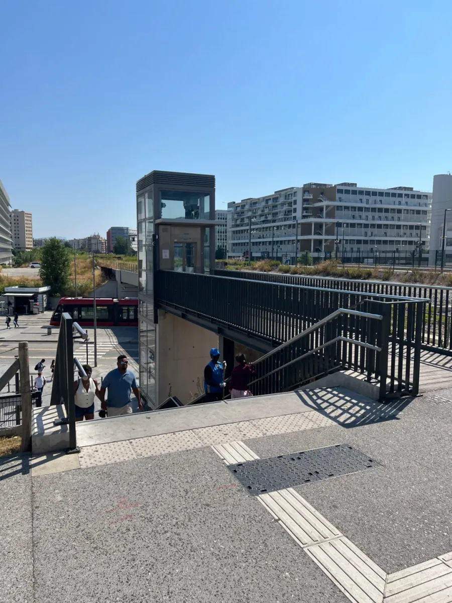

นีซเป็นเมืองที่ข้ามได้ยากในการเดินทางผ่านภาคใต้ของฝรั่งเศส ผู้มาเยือนส่วนใหญ่มาถึงด้วยรถไฟความเร็วสูงจากปารีส ลียง หรือมาร์แซย์ พักใกล้ Promenade des Anglais ใช้เวลาในย่านเมืองเก่า แอซ หรือโมนาโก และบินออกในตอนท้าย วันที่สุดท้ายนี่เองที่ปัญหเริ่มต้น: ท่าอากาศยานนีซโกตดาซูร์ (NCE) อยู่ทางตะวันตกของเมือง ใกล้เมื่อมองบนแผนที่ แต่ลำบากเมื่อมีสัมภาระ

มีวิธีออกสามวิธีตามปกติ: รถบัสสนามบิน รถราง และรถไฟ รถบัสจอดไม่กี่จุดในเมืองและราคาถูก แต่ใช้ถนนเลียบชายฝั่งซึ่งอาจติดขัดในฤดูร้อน; รถรางช้ากว่าแต่ถี่ รถไฟเร็วและถูกที่สุดในสามวิธี — จาก Nice-Ville สถานีหลัก ไป **Nice Saint-Augustin** ป้ายข้างสนามบิน ใช้เวลาสี่ถึงหกนาทีในราคา **€4**

คู่มือนี้ตามเส้นทางในบันทึกต้นฉบับ: ซื้อตั๋วและผ่านประตูที่ Nice-Ville นั่งสี่ถึงหกนาที เดินจาก Saint-Augustin ไปอาคารผู้โดยสาร 1 และจบด้วยรถรางฟรีระหว่างสองอาคารผู้โดยสาร ไม่ต้องใช้แท็กซี่ และไม่ต้องเข้าใจประกาศภาษาฝรั่งเศส

## 1. ทำไมต้องรถไฟ

แนวชายฝั่งที่นีซโค้ง สนามบินถูกสร้างด้านหลังหาดฝั่งตะวันตก และทางรถไฟบังเอิญเฉียดผ่านขอบเหนือของลานบิน นั่นคือวิธีที่ Saint-Augustin ซึ่งเคยเป็นป้ายชานเมืองธรรมดา กลายเป็นสถานีโดยพฤตินัยของสนามบิน: ห่างจากอาคารผู้โดยสารเพียง 300–400 เมตร และถูกสร้างใหม่ในไม่กี่ปีที่ผ่านมาเพื่อรองรับปริมาณผู้โดยสาร

ข้อดีข้อแรกคือ **รถไฟไม่ติดการจราจร** ถนนจากเมืองไปสนามบินติดคิวในชั่วโมงเร่งด่วนและตลอดฤดูร้อน และรถบัสมักมาช้าสิบนาที รถไฟมีรางของตัวเอง และสี่ถึงหกนาทีก็คือสี่ถึงหกนาที ข้อดีข้อที่สองคือราคา: €4 เทียบได้ดีกับแท็กซี่และบริการรถบัสสนามบินโดยเฉพาะ

ข้อดีข้อที่สามที่มองข้ามได้ง่าย: **สถานีเรียบง่ายกว่าอาคารผู้โดยสารสนามบิน** Nice-Ville เป็นสถานีหลักของเมือง ชานชาลาเริ่มต้นหลังโถงผู้โดยสารทันที สแกนโค้ด เดินไปชานชาลา ขึ้นรถ ทั้งหมดใช้เวลาไม่กี่นาที ที่ปลายทางคุณออกจาก Saint-Augustin ข้ามทางเดินสั้น ๆ กับถนนหนึ่งสาย ก็ถึงประตูอาคารผู้โดยสาร 1 ไม่มีคิวยาว และไม่ต้องมาถึงก่อนสองชั่วโมง

แต่รถไฟก็มีข้อจำกัด ถึง Saint-Augustin แต่ไม่ถึงอาคารผู้โดยสาร 2; เที่ยวช่วงเย็นลดลง; และการเปลี่ยนชานชาลาบางครั้งต้องข้ามสะพานลอย เรื่องเหล่านี้ครอบคลุมด้านล่าง

## 2. ซื้อตั๋วและผ่านประตู

Nice-Ville เป็นสถานีหลักของเมืองและสวยเหมาะถ่ายรูป: กำแพงหินสีอ่อน หน้าต่างโค้ง ต้นปาล์มไม่กี่ต้นด้านนอก และป้ายที่เขียนว่า "Nice Ville" จากใจกลางเมือง ให้นั่งรถรางหรือรถบัสไปย่าน Jean Médecin แล้วเดินสิบนาที หรือเรียกแท็กซี่ถึงประตูหากกระเป๋าหนัก

มีสามวิธีซื้อ วิธีง่ายที่สุดคือเครื่องขายตั๋วในสถานี: จอเปลี่ยนเป็นภาษาอังกฤษ คุณเลือก Nice Saint-Augustin ชำระด้วยบัตรหรือเหรียญ แล้วตั๋วพิมพ์ออกมา วิธีที่สองคือ **SNCF Connect** แอปทางการของการรถไฟแห่งชาติฝรั่งเศส ซึ่งออก e-ticket เป็นภาษาฝรั่งเศสหรืออังกฤษ วิธีที่สามคือ **Omio** ซึ่งมีหน้าจอภาษาจีนและง่ายสำหรับผู้ไม่คุ้นเคยกับระบบจองของฝรั่งเศส; ราคามักตรงกับเว็บไซต์ทางการและบางครั้งสูงกว่าเล็กน้อย

สิ่งที่คุณได้คือ e-ticket และ QR code ในโทรศัพท์ก็เพียงพอ — **ไม่ต้องรับตั๋วกระดาษ** ทางเข้า Nice-Ville เป็นแถวประตูอัตโนมัติ: วางโค้ดที่ตัวอ่าน ประตูเปิด แล้วคุณก็ผ่าน หากอ่านไม่ได้ ปกติมีเจ้าหน้าที่อยู่ใกล้ ๆ และการแสดงหน้าคำสั่งซื้อก็ใช้ได้เช่นกัน

อย่ารีบลงไปที่ชานชาลาทันที จอในโถงแสดง "Départs / Departures" ระบุแต่ละขบวน จุดหมาย เวลาออก และชานชาลา (voie) Nice ใช้ตัวอักษรแทนชานชาลา — A, B, C — และจอแสดงตัวอักษรในกรอบ **ตรวจชานชาลาก่อนเคลื่อนที่** เพราะรถไฟทิศเดียวกันบางครั้งออกจากรางต่างกัน

รายละเอียดหนึ่งที่มองข้ามง่าย: **ตรวจทิศทาง** Saint-Augustin อยู่ทางตะวันตกของนีซ ดังนั้นมีเพียงรถไฟไปกานน์ กราสส์ และมาร์แซย์ที่จอดที่นั่น; รถไฟไปม็องตงและเวนติมิเกลียวิ่งตะวันออกและไม่ถึงสนามบิน จุดหมายบนจอบอกว่าอันไหนเป็นอันไหน และการเหลือบดูก่อนขึ้นรถช่วยเลี่ยงบทสนทนาที่น่าอึดอัดภายหลัง

## 3. สี่ถึงหกนาที

การเดินทางจากนีซไป Saint-Augustin เป็นหนึ่งในระยะที่สั้นที่สุดบนสายเลียบชายฝั่ง รถไฟออกจาก Nice-Ville และวิ่งด้านในของแนวชายฝั่ง ถึง Saint-Augustin แทบจะทันที โดย **ไม่จอดกลางทาง** — รวมสี่ถึงหกนาที สั้นพอที่คุณแทบจะยังไม่ทันนั่งก็ถึงเวลาลง

ขบวนรถแตกต่างกัน บางครั้งเป็น TER ชั้นเดียว บางครั้งเป็นสองชั้น รถสองชั้นมีบันไดในโถงทางเข้า เมื่อมีสัมภาระจึงง่ายกว่าที่จะอยู่ชั้นล่างแทนที่จะลากกระเป๋าขึ้นไป ภายในมีที่นั่งบุสีน้ำเงิน โต๊ะเล็กข้างหน้าต่าง และชั้นวางสัมภาระเหนือศีรษะ; **ที่นั่งว่างใดก็เป็นของคุณ** เพราะตั๋วชั้นสองไม่มีการจองและไม่จำเป็นต้องจอง

สี่ถึงหกนาทีรถไฟวิ่งผ่านชานเมืองฝั่งตะวันตก นอกหน้าต่างเป็นอาคารอพาร์ตเมนต์หนาแน่น แล้วเป็นลานรางรถไฟและอาคารโรงงานเตี้ย ๆ และสุดท้ายเป็นรันเวย์สนามบินกับหลังคาอาคารผู้โดยสาร เมื่อเห็นเครื่องบิน ให้เริ่มเตรียมตัวลง

ความถี่เป็นอีกเหตุผลที่ชอบสายนี้ จาก Nice-Ville **รถเที่ยวแรกเวลา 05:33 และเที่ยวสุดท้าย 22:42** และช่วงกลางวันมีรถ **ประมาณทุก 10 ถึง 20 นาที** จึงไม่จำเป็นต้องมาถึงแต่เช้า — ชานชาลาเริ่มหลังโถงผู้โดยสารและสิบนาทีที่สถานีก็เพียงพอ เวลาที่ต้องคิดคือเช้าตรู่และค่ำ สำหรับเที่ยวบินที่ออกก่อน 07:00 รถ 05:33 พาคุณถึง Saint-Augustin ประมาณ 05:40 ซึ่งเพียงพอดีเมื่อรวมทางเดินและเช็คอิน; เร็วกว่านั้นต้องใช้แท็กซี่ ใครก็ตามที่ลงจอดหลัง 22:42 ควรวางแผนใช้แท็กซี่หรือรถบัสสนามบินแทนการพึ่งรถเที่ยวสุดท้าย

## 4. ทางเดินจาก Saint-Augustin ไปอาคารผู้โดยสาร 1

Saint-Augustin เป็นสถานีใหม่ รั้วสีเขียว ป้ายชื่อสีเทา และป้ายใหญ่ด้านนอกที่เขียนว่า "Votre nouvelle gare de Nice Saint-Augustin" ล้วนชี้ถึงการสร้างใหม่เมื่อไม่นานมานี้ เมื่อมาถึง อย่ารีบหาทางออก: เดินตามกระแสไปจนสุดชานชาลาแล้วเงยมองหา "Sortie / Exit" กับสัญลักษณ์เครื่องบิน

บางชานชาลาต้องข้ามสะพานลอยเพื่อออก สะพานมีบันไดและลิฟต์ และเมื่อมีกระเป๋าใบใหญ่ ลิฟต์คุ้มค่าที่จะรอ จากสะพานคุณเห็นสถานีทั้งหมด: รางไม่กี่ราง สายไฟฟ้าเหนือศีรษะ และอาคารสนามบินในระยะไกล ซึ่งทำให้ทิศทางชัดเจน

ด้านนอกป้ายชัดเจน แผงสีเทาเข้มเขียนว่า "Av. Me Maurice Slama" และ "Sortie / Exit" พร้อม **Bus**, **Tramway** และ **Aéroport** ด้านล่างและลูกศรชี้ไปข้างหน้า ตามสัญลักษณ์เครื่องบินแล้วคุณกำลังมุ่งไปอาคารผู้โดยสาร

ถัดมาคือทางเดินมีหลังคาพื้นผิวโปร่งแสงสีอ่อน พุ่มไม้เตี้ย และรั้วลวดทั้งสองข้าง ไม่ยาว และที่ปลายมีบันไดกับหออลิฟต์กระจก; เพื่อไปอาคารผู้โดยสาร 1 คุณลงไปตรงนี้และลอดใต้สะพานลอยเพื่อขึ้นทางเดินเท้าไปสนามบิน

บันไดกับหออลิฟต์เป็นส่วนเดียวของทางเดินที่ต้องตัดสินใจ ผู้มีสัมภาระหนัก รถเข็นเด็ก หรือการเคลื่อนไหวจำกัดควรใช้ลิฟต์; ลิฟต์เล็กและในฤดูกาลท่องเที่ยวอาจต้องรอหนึ่งหรือสองรอบ บันไดไม่ชัน แต่กระเป๋าหนักทำให้ยาก

การผ่านอาคารสถานีเป็นจังหวะดีที่จะกำหนดทิศทางในใจ: ทางเข้าใหม่เป็นแถวหลังคาเหล็กสีขาว ป้ายชื่อเขียนว่า "Gare de Nice Saint-Augustin" และปกติมีผู้โดยสารรอด้านนอก นี่คือจุดที่คุณขึ้นรถขากลับด้วย — เดินมาจากสนามบิน และการเห็นป้ายนั้นหมายถึงคุณมาถึงแล้ว

ด้านนอกมีป้ายสีน้ำเงินเข้ม: "Votre nouvelle gare de Nice Saint-Augustin" พร้อม "Entrée" และลูกศรชี้ขวา และด้านล่างเป็นโลโก้ของรัฐฝรั่งเศส, SNCF Gares & Connexions, แคว้นพรอว็องซ์-อาลป์-โกตดาซูร์ และเมืองนีซ มักมีรถเข็นสัมภาระสนามบินจอดอยู่หน้าป้าย ซึ่งสรุปความสัมพันธ์ของทั้งสองแห่งได้ดี

อีกเล็กน้อยถึงจุดข้ามถนนเดียวของทางเดิน มีสัญญาณไฟและทางม้าลาย และฝั่งตรงข้ามเป็นเลนส่งผู้โดยสารของสนามบินกับด้านหน้ากระจกของอาคารผู้โดยสาร 1 **จากทางออกสถานีถึงประตูอาคารผู้โดยสารประมาณ 300–400 เมตร หรือ 8 ถึง 12 นาทีเดิน**; หากมีกระเป๋าใหญ่ เดินช้า หรือแวะถ่ายรูป ให้เผื่อสิบห้านาที

ข้ามถนนคือพื้นที่ส่งผู้โดยสารของอาคารผู้โดยสาร 1 มีคำว่า "Terminal 1" เหนือผนังกระจก แท็กซี่และรถบัสสนามบินจอดด้านนอก และประตูเปิดเข้าสู่โถงเช็คอิน ถึงจุดนี้ นับจาก Nice-Ville ยังไม่ถึงครึ่งชั่วโมงด้วยซ้ำ

มีปัญหาปฏิบัติหนึ่งของทางเดินนี้: **มีร่มเงาน้อยมาก** นอกจากหลังคาด้านนอกสถานีและช่วงสั้น ๆ ใต้สะพานลอย ส่วนใหญ่ที่เหลืออยู่กลางแดดเต็มที่ แดดฤดูร้อนที่นีซแรงมาก หมวกและครีมกันแดดจึงสำคัญกว่าสิ่งอื่นในเวลาเที่ยง และควรพกน้ำติดตัว โดยเฉพาะเมื่อมีกระเป๋า

ขากลับก็ย้อนกลับง่าย ๆ: ออกจากผู้โดยสารขาเข้าอาคารผู้โดยสาร 1 เดินเลียบเลนส่งผู้โดยสารไปทางม้าลาย ข้ามถนน มองหาหลังคาเหล็กสีขาวของ "Gare de Nice Saint-Augustin" แล้วขึ้นบันไดหรือลิฟต์ไปชานชาลา เผื่อเวลาสิบถึงสิบห้านาทีสำหรับทางเดินในทิศนั้นด้วย เพราะสัมภาระและการหาทางกินเวลา; หากตั๋วระบุขบวนใดขบวนหนึ่ง ควรเผื่อทางเดินก่อนเวลาออก ไม่ใช่หลังเวลา

## 5. รถรางฟรีจากอาคารผู้โดยสาร 1 ไปอาคารผู้โดยสาร 2

หากเที่ยวบินของคุณออกจากอาคารผู้โดยสาร 2 การถึงอาคารผู้โดยสาร 1 ยังไม่จบ อาคารผู้โดยสาร 2 อยู่อีกฟากของสนามบิน การเดินจะอ้อมไกลมาก และสิ่งที่ถูกต้องคือรถรางสนามบินฟรีด้านนอกอาคารผู้โดยสาร 1: **สาย 2** (บางแหล่งเรียกว่าสาย B) ใช้เวลาสองถึงสามนาที วิ่ง **ประมาณทุกสองนาที** และไม่มีค่าใช้จ่าย

ป้ายอยู่ตรงข้ามทแยงกับประตูอาคารผู้โดยสาร 1 ป้ายชัดเจน: ลูกศรสีเขียวชี้ไปที่ "Quai en face / Opposite Platform" หมายถึงชานชาลาอีกฝั่งของถนน; ด้านล่างสัญลักษณ์รถรางมีเลข "2" และ "B" แล้ว "Vers / To: Terminal 2" และคำว่า "Liaison gratuite / Free connection"

ชานชาลามีหลังคาและม้านั่ง และจอบอกว่าอีกกี่นาทีถึงเที่ยวถัดไป เมื่อรถรางมา อ่านจอที่ด้านหน้า: ขบวนที่แสดง "AÉROPORT" คือรถรางสาย 2 ที่มุ่งไปสนามบิน โดย Terminal 2 อยู่ห่างสองป้าย หากขึ้นผิดไปทางเข้าเมือง ให้ลงป้ายถัดไปแล้วกลับมา — เสียเวลา ไม่เสียเงิน

ที่อาคารผู้โดยสาร 2 ลงรถแล้วตามป้าย "Départs / Departures" เข้าสู่อาคาร ใช้จอหาเกาะเช็คอินและการตรวจความปลอดภัย ขากลับย้อนลำดับ: รถรางจากอาคารผู้โดยสาร 2 ไปอาคารผู้โดยสาร 1 ข้ามเลนส่งผู้โดยสาร เดินเลียบทางเท้าไป Saint-Augustin แล้วนั่งรถไฟกลับนีซ

รถรางวิ่งทั้งสองทิศทางและถี่มากจนตารางเวลาแทบไม่สำคัญ: ก่อนขบวนหนึ่งออก ขบวนถัดไปมักแสดงแล้ว ระหว่างสองป้ายสนามบินไม่มีตั๋วให้ซื้อและไม่มีให้ตรวจ — ขึ้นได้เลย หากคณะของคุณแยกกันอยู่คนละอาคาร การนัดพบที่ป้ายรถรางอาคารผู้โดยสาร 1 ง่ายกว่าการตามหากันในอาคารมาก

เวลา ค่าโดยสาร และการเชื่อมต่อที่นี่มาจากบันทึกของนักเดินทางในเดือนตุลาคม 2026; เวลารถไฟ ค่าโดยสาร และชานชาลารถรางเป็นไปตามข้อมูลในวันนั้นทั้งหน้างานและบนเว็บไซต์ของผู้ให้บริการ สองจุดสุดท้าย: ตั๋วระบุขบวนเฉพาะ แต่ตามบันทึกต้นฉบับ บางครั้งก็รับขบวนอื่น จึงควรสอบถามเจ้าหน้าที่บนชานชาลาหากไม่แน่ใจ; และทางเดิน 300–400 เมตรนั้นโล่งจริง ๆ จึงไม่ควรคิดว่าเป็นการเดินเล่นสบาย ๆ

## ลิงก์ที่เกี่ยวข้อง

- **ในเว็บไซต์นี้**: [ฝรั่งเศส (FR)](/country/FR)
- **Wikipedia**: [ท่าอากาศยานนีซโกตดาซูร์](https://en.wikipedia.org/wiki/Nice_C%C3%B4te_d%27Azur_Airport)
- **Baidu Baike**: [ท่าอากาศยานนีซโกตดาซูร์](https://baike.baidu.com/item/%E5%B0%BC%E6%96%AF%E8%93%9D%E8%89%B2%E6%B5%B7%E5%B2%B8%E6%9C%BA%E5%9C%BA)
