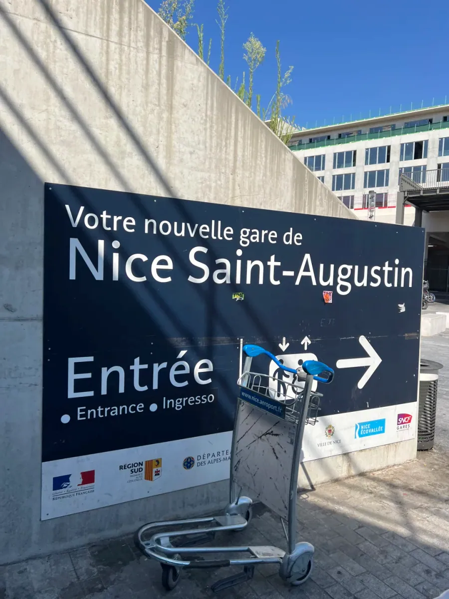
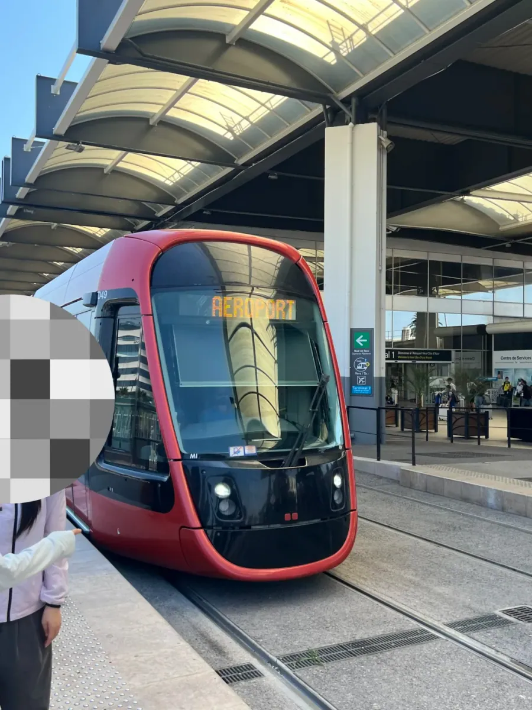

Güney Fransa gezisinde Nice'i atlamak zor. Ziyaretçilerin çoğu Paris, Lyon veya Marsilya'dan hızlı trenle gelir, Promenade des Anglais civarında kalır, günlerini eski şehirde, Èze veya Monako'da geçirir ve sonunda uçakla ayrılır. Sorun tam o son günde başlar: Nice Côte d'Azur Havalimanı (NCE) şehrin batısında; haritada yakın ama bagajla zahmetli.

Olağan üç çıkış yolu var: havalimanı otobüsü, tramvay ve tren. Otobüsler şehirde birkaç noktada durur ve ucuzdur, ama yazın kilitlenebilen sahil yolunu kullanırlar; tramvay daha yavaş ama sıktır. Tren üçü arasında en hızlı ve en ucuzu — ana istasyon Nice-Ville'den havalimanının yanındaki durak **Nice Saint-Augustin**'e dört ila altı dakika, tek yön ücret **4 €**.

Bu rehber orijinal nottaki güzergâhı izliyor: Nice-Ville'de bilet alıp turnikelerden geçin, dört ila altı dakika gidin, Saint-Augustin'den Terminal 1'e yürüyün ve iki terminal arasındaki ücretsiz tramvayla bitirin. Taksi yok ve Fransızca anonsları anlamanız da gerekmiyor.

## 1. Neden tren

Nice'te kıyı kıvrılıyor, havalimanı batı plajlarının arkasına inşa edilmiş ve demiryolu tesadüfen havalimanının kuzey kenarından sıyırıp geçiyor. Saint-Augustin, bir zamanlar sıradan bir banliyö durağıyken havalimanının fiilî istasyonu böyle oldu: terminalden yalnızca 300–400 metre uzakta ve son yıllarda artan trafiği karşılamak için yeniden inşa edildi.

İlk avantaj, **trenin trafikte kalmaması**. Şehirden havalimanına giden yol yoğun saatlerde ve yaz sezonu boyunca kuyruk olur, otobüsler rutin olarak on dakika gecikir. Trenin kendi rayı var ve dört ila altı dakika, dört ila altı dakika demektir. İkinci avantaj fiyat: 4 €, taksiye ve özel havalimanı otobüsü hizmetlerine göre iyi.

Üçüncü bir avantajı gözden kaçırmak kolay: **bir istasyon, havalimanı terminalinden daha basittir**. Nice-Ville şehrin ana istasyonu, platformlar hemen salonun arkasında başlıyor; kodunuzu okutun, platforma yürüyün, binin, hepsi birkaç dakika sürer. Diğer uçta Saint-Augustin'den çıkıp kısa bir yolu ve tek bir caddeyi geçersiniz, Terminal 1'in kapısındasınız. Uzun kuyruk yok ve iki saat erken gelmeniz gerekmiyor.

Yine de trenin sınırları var. Saint-Augustin'e ulaşıyor ama Terminal 2'ye değil; akşamları seferler seyreliyor; bazı peron değişiklikleri üst geçit gerektiriyor. Bunlar aşağıda ele alınıyor.

## 2. Bilet almak ve turnikelerden geçmek

Nice-Ville şehrin ana istasyonu ve fotojenik: açık renk taş duvarlar, kemerli pencereler, dışarıda birkaç palmiye ve “Nice Ville” yazan bir tabela. Merkezden tramvay veya otobüsle Jean Médecin bölgesine gidip on dakika yürüyün ya da bagajlar ağırsa kapıya taksiyle gelin.

Bilet almanın üç yolu var. En basiti istasyon içindeki bilet makinesi: ekran İngilizceye geçiyor, Nice Saint-Augustin'i seçiyorsunuz, kart veya bozuk parayla ödüyorsunuz ve bilet basılıyor. İkincisi **SNCF Connect**, Fransız ulusal demiryolunun resmî uygulaması; Fransızca veya İngilizce e-bilet düzenliyor. Üçüncüsü **Omio**, Çince arayüzüyle Fransız rezervasyon sistemlerine alışkın olmayanlar için daha kolay; fiyatlar genellikle resmî siteyle aynı, ara sıra biraz daha yüksek.

Elinize geçen şey bir e-bilet ve telefonunuzdaki QR kodu yeterli — **kâğıt almanız gerekmiyor**. Nice-Ville'de giriş bir sıra otomatik turnike: kodu okuyucuya tutun, turnike açılır ve geçersiniz. Okumazsa yakında genellikle bir görevli olur ve sipariş sayfasını göstermek de aynı işi görür.

Hemen bir platforma inmek için acele etmeyin. Salondaki ekranlar “Départs / Departures” gösteriyor; her treni, varış noktasını, kalkış saatini ve platformu (voie) listeliyor. Nice platformlarını harflerle adlandırıyor — A, B, C — ve ekran harfi bir kutuda gösteriyor. **Hareket etmeden önce platformu kontrol edin**, çünkü aynı yöndeki trenler bazen farklı raylardan kalkıyor.

Bir ayrıntıyı kaçırmak kolay: **yönü kontrol edin**. Saint-Augustin Nice'in batısında, bu yüzden yalnızca Cannes, Grasse ve Marsilya yönündeki trenler orada duruyor; Menton ve Ventimiglia yönündeki trenler doğuya gider ve havalimanına hiç ulaşmaz. Ekrandaki varış noktası hangisinin hangisi olduğunu söyler ve binmeden önce bir bakış sonradan yaşanacak tatsız bir konuşmayı önler.

## 3. Dört ila altı dakika

Nice'ten Saint-Augustin'e atlama, kıyı hattındaki en kısa mesafelerden biri. Tren Nice-Ville'den ayrılıp kıyı şeridinin iç tarafından gidiyor ve neredeyse hemen Saint-Augustin'e ulaşıyor, **ara durak yok** — toplam dört ila altı dakika, yerleşemeden inme zamanı geliyor.

Araçlar değişiyor. Bazen tek katlı bir TER, bazen çift katlı. Çift katlılarda giriş holünde merdiven var, bu yüzden bagajla valizi yukarı taşımak yerine alt katta kalmak daha kolay. İçeride mavi döşemeli koltuklar, pencerenin yanında küçük masalar ve üstte bagaj rafları var; **her boş koltuk sizindir**, çünkü ikinci sınıf bilet rezervasyon taşımaz ve gerektirmez.

Dört ila altı dakika boyunca tren batı banliyölerinden geçiyor. Pencerenin dışında önce yoğun apartman blokları, sonra yayılmış raylar ve alçak atölye binaları, en sonunda havalimanı pisti ve terminallerin çatıları görünüyor. Uçakları gördüğünüzde inmeye hazırlanmaya başlayın.

Sıklık da bu hattı sevmenin bir başka nedeni. Nice-Ville'den **ilk tren 05.33'te, son tren 22.42'de** ve gün içinde tren **yaklaşık 10–20 dakikada bir** kalkıyor, bu yüzden erken gelmeniz gerekmiyor — platformlar salonun hemen arkasında başlıyor ve istasyonda on dakika fazlasıyla yeter. Düşünülmesi gereken saatler sabah erken ve akşam geç. 07.00'den önce kalkan bir uçuş için 05.33 sizi Saint-Augustin'e yaklaşık 05.40'ta götürür; yürüyüş ve check-in ile bu ancak yeter. Daha erkeni taksi demek. 22.42'den sonra inenler son trene güvenmek yerine taksi veya havalimanı otobüsü planlamalı.

## 4. Saint-Augustin'den Terminal 1'e yürüyüş

Saint-Augustin yeni bir istasyon. Yeşil çitler, gri isim tabelaları ve dışarıdaki “Votre nouvelle gare de Nice Saint-Augustin” yazan büyük bir pano yakın zamanda yeniden inşa edildiğini gösteriyor. Vardığınızda hemen çıkış aramayın: akışla birlikte platformun sonuna yürüyün ve “Sortie / Exit” ile uçak simgesini arayın.

Bazı platformlardan çıkmak için üst geçit gerekiyor. Geçitte merdiven ve asansör var; büyük bir valizle asansör beklemeye değer. Geçitten tüm istasyonu görüyorsunuz: birkaç ray, havai teller ve uzakta havalimanı binaları; bu da yönü bariz kılıyor.

Dışarıda tabelalar net. Koyu gri bir panelde “Av. Me Maurice Slama” ve “Sortie / Exit” yazıyor; altında **Bus**, **Tramway** ve **Aéroport** ile ileriyi gösteren bir ok var. Uçak simgesini izleyin, terminale gidiyorsunuz.

Ardından açık renk geçirimli yüzeyli, iki yanında alçak çalılar ve tel çit olan kapalı bir yürüyüş yolu geliyor. Uzun değil ve sonunda bir merdiven ile cam asansör kulesi var; Terminal 1'e ulaşmak için buradan inip üst geçidin altından geçerek havalimanına doğru kaldırıma çıkıyorsunuz.

Merdivenler ve asansör kulesi, yürüyüşün karar gerektiren tek kısmı. Ağır bagajı, bebek arabası veya hareket kısıtı olan herkes asansörü kullanmalı; küçük ve yoğun sezonda bir iki sefer bekleyebilirsiniz. Merdivenler dik değil, ama ağır bir valiz onları zorlu hale getiriyor.

İstasyon binasının yanından geçmek, yönü zihninizde sabitlemek için iyi bir an: yeni giriş bir sıra beyaz çelik kanopi, isim panosunda “Gare de Nice Saint-Augustin” yazıyor ve dışarıda genellikle yolcular bekliyor. Dönüşte de buradan bineceksiniz — havalimanından yürüyün, o tabelayı görmek vardığınız anlamına gelir.

Dışarıda koyu mavi bir pano duruyor: “Votre nouvelle gare de Nice Saint-Augustin”, “Entrée” ve sağı gösteren bir ok; alt sırada Fransız devletinin, SNCF Gares & Connexions'ın, Provence-Alpes-Côte d'Azur bölgesinin ve Nice şehrinin logoları. Önünde sık sık bir havalimanı bagaj arabası park eder; bu da ikisi arasındaki ilişkiyi özetler.

Biraz ileride yürüyüşün tek cadde geçişi geliyor. Bir sinyal ve yaya geçidi var; karşı tarafta havalimanının indirme-bindirme şeritleri ve Terminal 1'in cam cephesi. **İstasyon çıkışından terminal kapısına yaklaşık 300–400 metre, yani yürüyerek 8–12 dakika**; büyük valizlerle, daha yavaş bir tempoyla veya fotoğraf için durarak on beş dakika bırakın.

Caddenin karşısı Terminal 1 indirme-bindirme alanı. Cam duvarın üstünde “Terminal 1” yazıyor, dışarıda taksiler ve havalimanı otobüsleri duruyor ve kapılar check-in salonuna açılıyor. Bu noktada, Nice-Ville'den sayarsak, henüz yarım saat geçmiş.

Bu yürüyüşün tek pratik sorunu: **çok az gölge var**. İstasyon dışındaki kanopi ve üst geçidin altındaki kısa bölüm dışında çoğu tam güneş altında. Nice'in yaz güneşi güçlü, bu yüzden öğle vakti şapka ve güneş kremi her şeyden önemli; özellikle valizle bir şişe su taşımaya değer.

Dönüşte sadece tersini yapın: Terminal 1 varışlarından çıkın, indirme-bindirme şeridi boyunca yaya geçidine yürüyün, karşıya geçin, “Gare de Nice Saint-Augustin”in beyaz kanopilerini arayın, sonra merdiven veya asansörle platforma çıkın. Bu yönde de yürüyüş için on ila on beş dakika bırakın, çünkü bagaj ve yol bulma süreyi yer; biletiniz belirli bir treni adlandırıyorsa yürüyüşü kalkış saatinden sonraya değil öncesine koyun.

## 5. Terminal 1'den Terminal 2'ye ücretsiz tramvay

Uçuşunuz Terminal 2'den kalkıyorsa Terminal 1'e ulaşmak işin sonu değil. Terminal 2 havalimanının diğer tarafında, yürümek uzun bir dolambaç demek ve doğru hamle Terminal 1 dışındaki ücretsiz havalimanı tramvayı: **2. hat** (bazı kaynaklar B hattı diyor). İki ila üç dakika sürüyor, **yaklaşık iki dakikada bir** çalışıyor ve hiçbir ücreti yok.

Durak, Terminal 1 kapılarının çapraz karşısında. Tabela açık: yeşil bir ok “Quai en face / Opposite Platform”u, yani yolun diğer tarafındaki peronu gösteriyor; altında tramvay simgesi “2” ve “B” taşıyor, ardından “Vers / To: Terminal 2” ve “Liaison gratuite / Free connection” yazıyor.

Peronda kanopi ve banklar var; ekran sonraki seferin kaç dakika sonra olduğunu söylüyor. Tramvay geldiğinde önündeki ekranı okuyun: “AÉROPORT” gösteren seferler havalimanına giden 2. hat tramvayları ve Terminal 2 iki durak ötede. Yanlışlıkla şehre giden birine binerseniz bir sonraki durakta inip geri dönün — zamana mal olur, paraya değil.

Terminal 2'de inin ve “Départs / Departures” tabelalarını izleyerek terminale girin; check-in adanızı ve güvenliği bulmak için ekranları kullanın. Eve dönerken sırayı tersine çevirin: Terminal 2'den Terminal 1'e tramvay, indirme-bindirme şeridinin karşısına, kaldırım boyunca Saint-Augustin'e ve Nice'e dönüş treni.

Tramvay iki yönde ve o kadar sık çalışıyor ki tarife neredeyse önemsiz: biri kalktığında genellikle sonraki zaten görünüyor. İki havalimanı durağı arasında alınacak bilet de kontrol edilecek bilet de yok — sadece binersiniz. Grubunuz terminaller arasında bölündüyse Terminal 1 tramvay durağında buluşmak, binaların içinde birbirinizi bulmaktan çok daha kolay.

Buradaki saatler, ücretler ve bağlantılar Ekim 2026'daki bir gezgin anlatısından; tren saatleri, ücretler ve tramvay peronları o gün yerindeki ve işletmenin web sitesindeki bilgilere tabidir. Son iki nokta: bilet belirli bir treni adlandırıyor, ama orijinal nota göre bazen diğer seferler de kabul ediliyor, emin değilseniz perondaki görevlilere sorun; ve o 300–400 metrelik yürüyüş gerçekten açıkta, bu yüzden onu hafif bir gezinti gibi görmeyin.

## İlgili bağlantılar

- **Bu sitede**: [Fransa (FR)](/country/FR)
- **Wikipedia**: [Nice Côte d'Azur Havalimanı](https://en.wikipedia.org/wiki/Nice_C%C3%B4te_d%27Azur_Airport)
- **Baidu Baike**: [Nice Côte d'Azur Havalimanı](https://baike.baidu.com/item/%E5%B0%BC%E6%96%AF%E8%93%9D%E8%89%B2%E6%B5%B7%E5%B2%B8%E6%9C%BA%E5%9C%BA)
