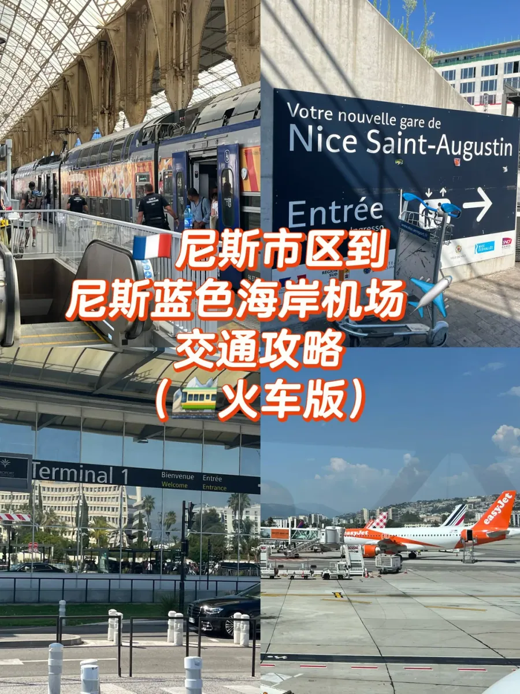

尼斯是南法旅行繞不開的一站。多數人從巴黎、里昂或馬賽坐高鐵過來，住在英國人漫步大道附近，白天去老城、埃茲或摩納哥，最後一天再從尼斯飛走。問題就出在這最後一天：尼斯藍色海岸機場（NCE）在市區西邊，直線距離不遠，但拖著行李換乘並不輕鬆。

常見的選擇有三種：機場巴士、電車，以及火車。巴士站在市區幾處，票價不貴，但走濱海道路，夏天堵起來沒譜；電車慢一些，勝在班次密；火車最快，也最便宜——從尼斯主站 Nice-Ville 到機場旁的 **Nice Saint-Augustin** 只要四到六分鐘，單程 **4 歐元**。

這篇攻略按原筆記的實走順序整理：在 Nice-Ville 買票進站、坐四到六分鐘的車、在 Saint-Augustin 下車走到 T1，最後說清楚 T1 到 T2 怎麼坐免費電車。全程不需要叫車，也不需要看懂法語廣播。

## 一、為什麼選火車

尼斯的海岸線是彎的，機場建在西邊的海灘後面，鐵路正好從機場北側掠過。這讓 Saint-Augustin 這個小站成了事實上的「機場站」——它原本只是沿線的一個普通通勤站，後來因為離航廈只有三四百米，被重新修成了現在的樣子。

坐火車的第一個好處是**不堵車**。尼斯市區到機場的公路在早晚高峰和夏天旅遊季都會排隊，巴士晚點十幾分鐘很常見；火車走的是自己的軌道，四到六分鐘就是四到六分鐘。第二個好處是便宜：4 歐元的單程票，比叫車便宜一個數量級，也比機場巴士的機場專線划算。

第三個好處常被忽略：**火車站的進出比機場航廈簡單**。Nice-Ville 是尼斯的主站，站臺從大廳後面就開始，刷碼進站、走到站臺、上車，一共幾分鐘；下車之後從 Saint-Augustin 走出去，穿過一條小路和一條馬路，就到 T1 的門口。整個過程沒有長隊，也不需要提前兩小時。

當然，火車也有它的邊界：它只到 Saint-Augustin，不到 T2；車次在晚上會變稀；站臺之間有時要過天橋。這些在後面幾節都會講到。

## 二、在 Nice-Ville 買票與進站

Nice-Ville 是尼斯的主站，也是一座很上鏡的建築：淺色的石砌外牆、拱形的窗，門前種著幾棵棕櫚樹，站牌上寫著「Nice Ville」。從市區過來，可以坐電車或公交到 Jean Médecin 一帶，再步行十分鐘；行李多就直接叫車到站門口。

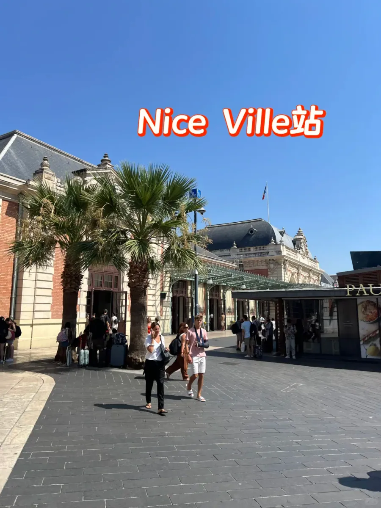

買票有三種方式。最直接的是站內的自動售票機：螢幕可以切英文，選目的地 Nice Saint-Augustin，投幣或刷卡，出票。第二種是 **SNCF Connect**——法國國鐵的官方 App，註冊後可以直接買電子票，介面是法文或英文。第三種是 **Omio**，有中文介面，操作對不熟悉法國鐵路的人更友好，價格通常和官網一致，偶爾略高一點。

買好之後會收到電子票，二維碼存在手機裡就行，**不需要換紙質票**。Nice-Ville 的進站口是一排自動閘機，把二維碼對著掃描口刷一下，閘門就開了；如果刷不過，旁邊通常有工作人員，把訂單頁面給他看也可以。

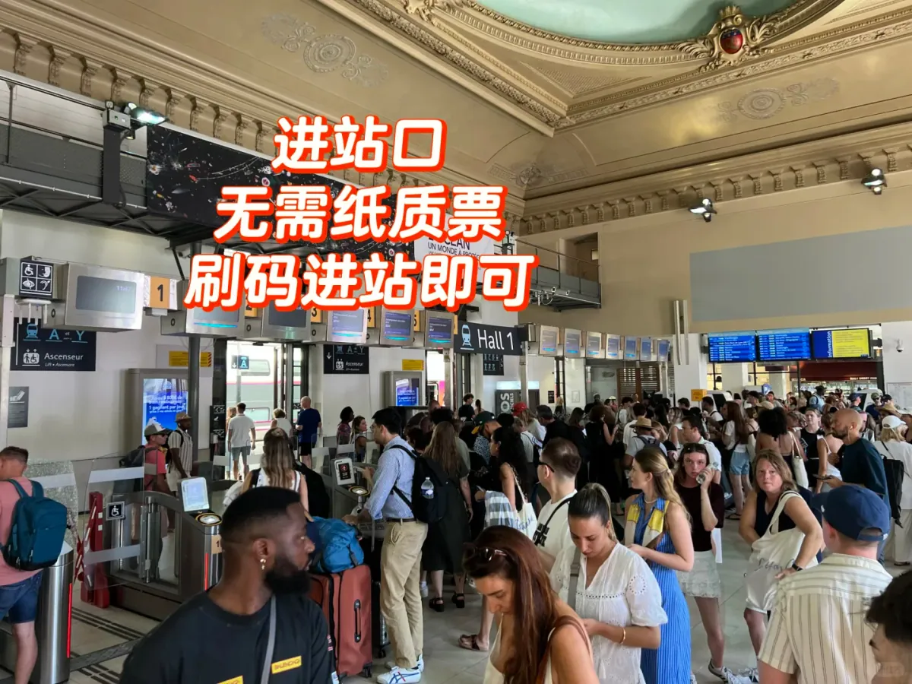

進站之後先別急著下站臺。大廳裡有幾塊顯示屏，寫著「Départs / Departures」，一列列車次、終點站、發車時間和站臺號（Voie）。尼斯的站臺用字母編號，螢幕上會寫成 A、B、C 這樣的單字母，有時帶一個方框。**先確認站臺號再走**，因為同一個方向的車有時會停在不同的股道。

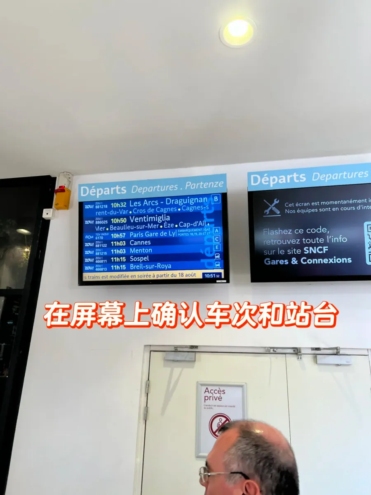

還有一個容易忽略的細節：**看清方向**。Saint-Augustin 在尼斯西邊，只有開往 Cannes、Grasse、Marseille 方向的列車才會經過；開往 Menton、Ventimiglia 的車往東走，根本不到機場。螢幕上的終點站是判斷依據，上車前多看一眼，比上車後再問人省事。

## 三、四到六分鐘的車程

尼斯到 Saint-Augustin 這一段，是整條濱海線上最短的區間之一。列車開出 Nice-Ville 之後沿著海岸線的內側走，很快就到 Saint-Augustin，**中途沒有其他停靠站**，全程四到六分鐘——短到剛把行李放好、坐下，就該下車了。

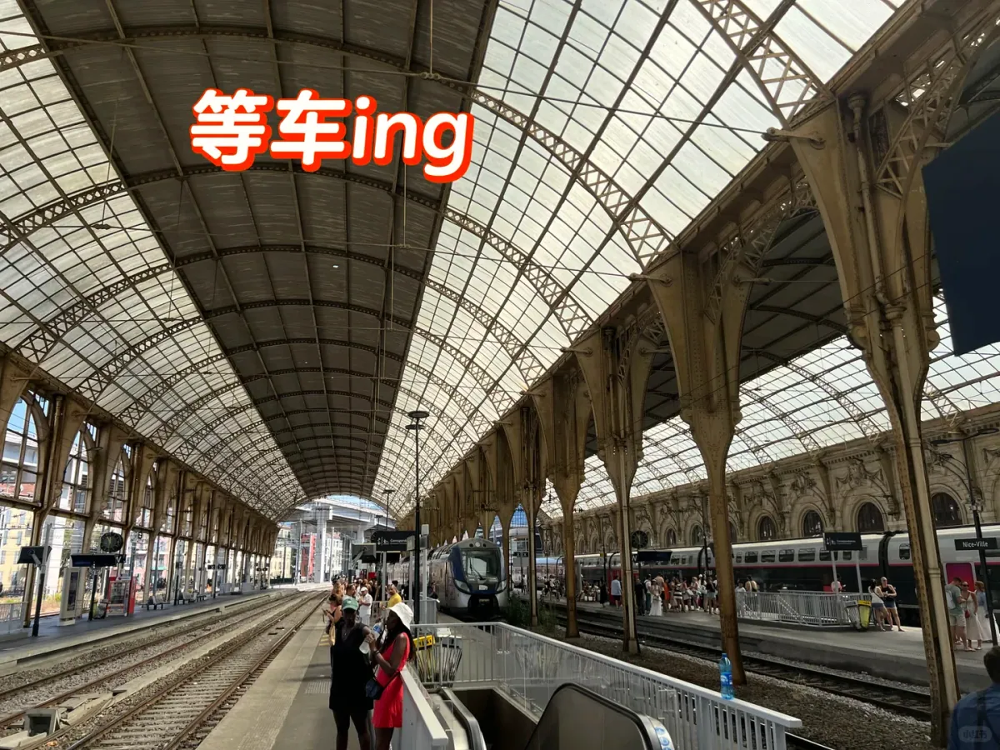

車型不固定，有時是單層的 TER，有時是雙層車。雙層車的門廳裡有一段樓梯，行李多的話就在下層找位置，別硬把箱子搬上去。車廂裡是藍色絨布座椅，靠窗有小桌板，座位上方有行李架；**空座位都可以坐**，二等座票不指定座位，也不需要額外訂座。

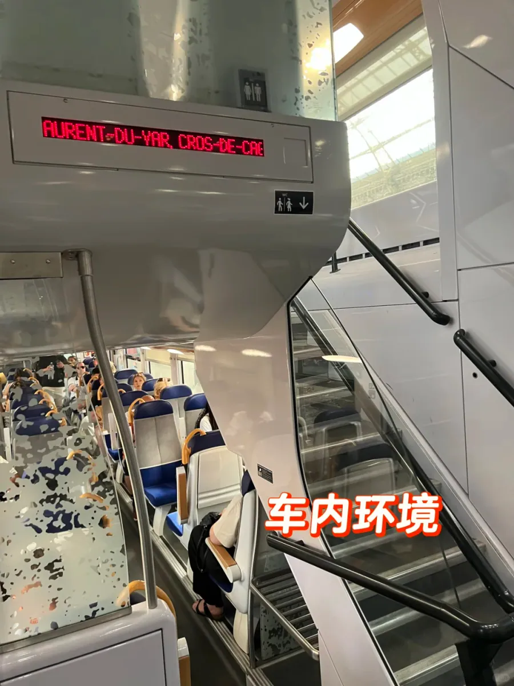

四到六分鐘的車程裡，列車會經過尼斯的西郊。窗外先是密集的住宅樓，然後是一片鐵路股道和低矮的廠房，最後能看到機場的跑道和航廈的屋頂。看到飛機，就說明該準備下車了。

班次密度是這條線的另一個優點。從 Nice-Ville 出發，**首班車 05:33，末班車 22:42**，白天**大約每 10–20 分鐘就有一班**，所以不需要提前很久到站——Nice-Ville 的站臺就在大廳後面，提前十分鐘進站綽綽有餘。真正要留意的是清晨和深夜：07:00 之前起飛的航班，坐 05:33 那班車到 Saint-Augustin 是五點四十左右，加上步行和值機，時間剛好夠用；再早的航班就只能叫車。22:42 之後落地的人，同樣要考慮計程車或機場巴士，別把希望寄託在末班車上。

## 四、Saint-Augustin 到 T1 的步行

Saint-Augustin 是一座新站。綠色的圍欄、灰色的站牌、站房外的「Votre nouvelle gare de Nice Saint-Augustin」大牌子，都在提醒你這是近年重建的車站。下車之後不用急著找出口，先跟著人流走到站臺盡頭，再抬頭找「Sortie / Exit」和飛機圖示。

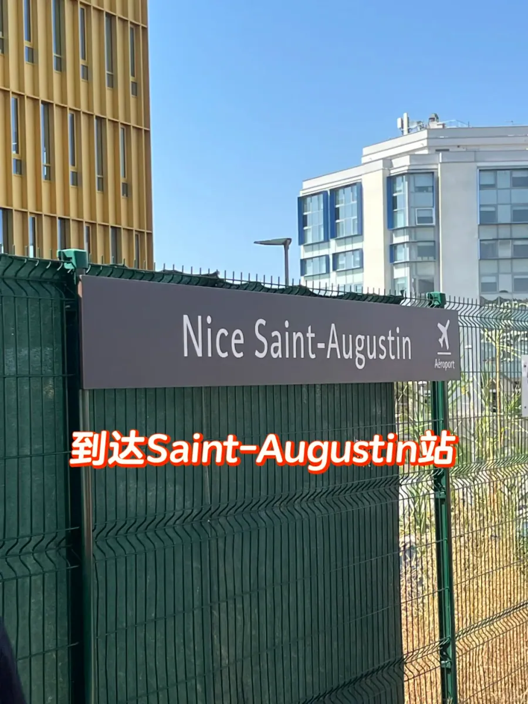

有些站臺出站需要先過一座人行天橋。天橋有樓梯，也有電梯——拖著大箱子的話，等電梯比硬搬樓梯省力得多。站在天橋上能看到整個站場：幾條股道、接觸網、遠處的航廈，方向一目瞭然。

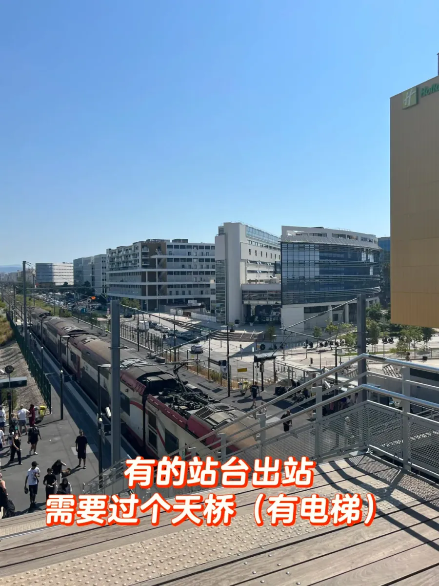

出站之後的指示牌很明確：一塊深灰色的牌子上寫著「Av. Me Maurice Slama」「Sortie / Exit」，下面依次是 **Bus**、**Tramway**、**Aéroport** 三個圖示，配一個向上的箭頭。跟著飛機圖示走，就是去航廈的方向。

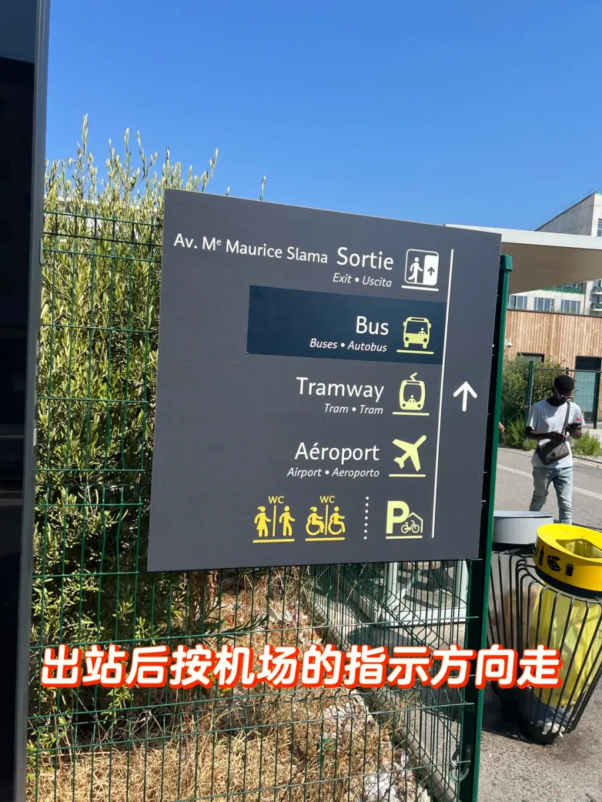

接下來是一條帶頂棚的通道，地面鋪著淺色的透水磚，兩側是低矮的灌木和鐵絲網。通道不長，走到盡頭會看到一組臺階和一座玻璃電梯塔；如果要去 T1，從這裡下去、穿過天橋下的空間，就接上了通往機場的人行道。

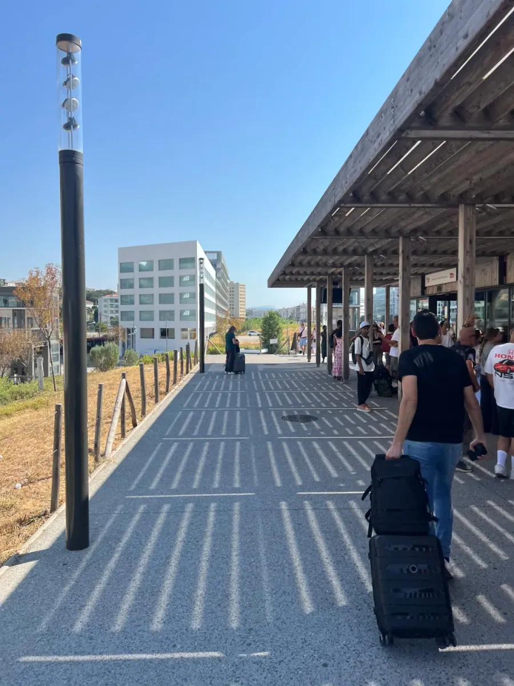

臺階和電梯塔是這一段唯一需要動點腦筋的地方。帶大件行李、推嬰兒車或腿腳不便的旅客，直接用電梯；電梯不大，旺季可能要等一兩趟。走樓梯的話，臺階不算陡，但箱子重的時候還是費勁。

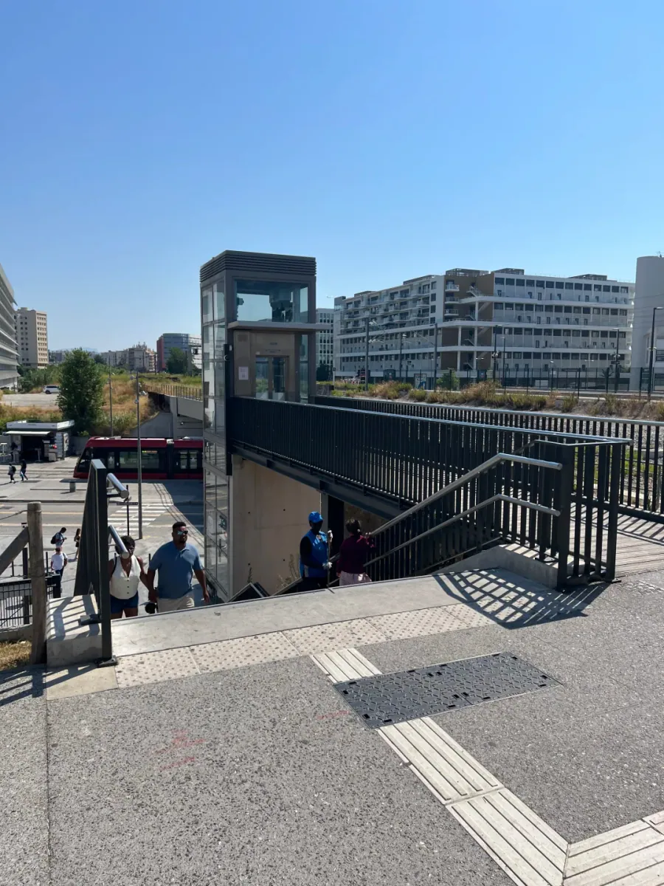

從站房前經過時，可以順便確認一下方向：新站的入口是一排白色的鋼結構雨棚，站名牌上寫著「Gare de Nice Saint-Augustin」，門口常有旅客在等車或看手機。這裡也是回程時的上車點——從機場走回來，看到這塊牌子就說明到了。

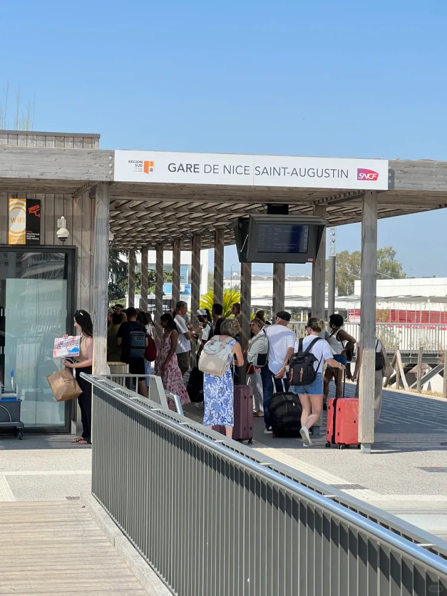

站房外立著一塊深藍色的牌子：「Votre nouvelle gare de Nice Saint-Augustin」，下面寫著「Entrée」，配一個向右的箭頭，底部是法國國家鐵路、SNCF Gares & Connexions、普羅旺斯-阿爾卑斯-藍色海岸大區和尼斯市的標誌。牌子前常停著一輛機場的行李推車，算是這座車站和機場關係的最好註腳。

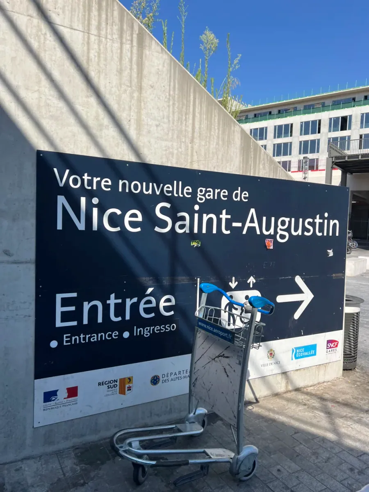

再往前，就是這段步行裡唯一需要過馬路的地方。路口有訊號燈和斑馬線，對面是機場的落客車道和 T1 的玻璃幕牆。**從出站到走進 T1，大約三四百米，走八到十二分鐘**；箱子大、走得慢，或者在路上停下來拍照，就按十五分鐘算。

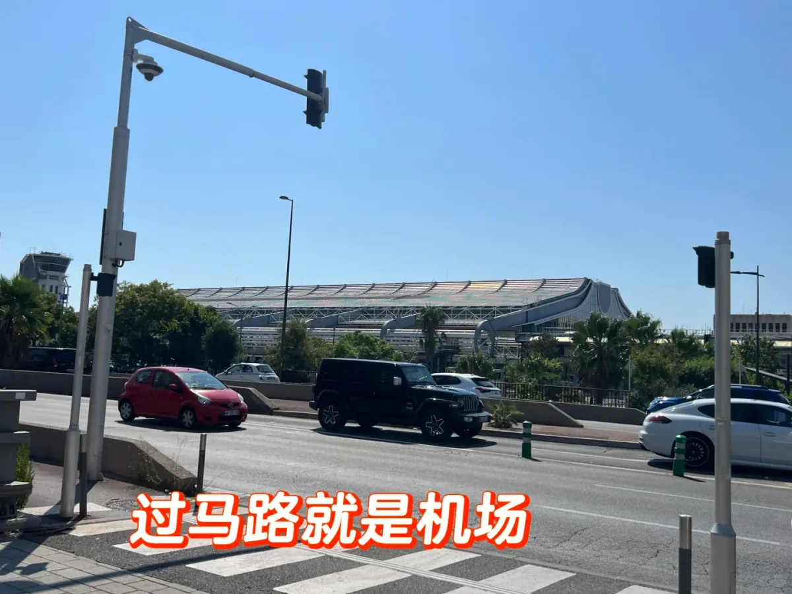

過完馬路就是 T1 的落客區。玻璃幕牆上方寫著「Terminal 1」，門口有計程車和機場巴士的停靠點，進門就是值機大廳。到這裡，從 Nice-Ville 出發算起，通常只過了半小時左右。

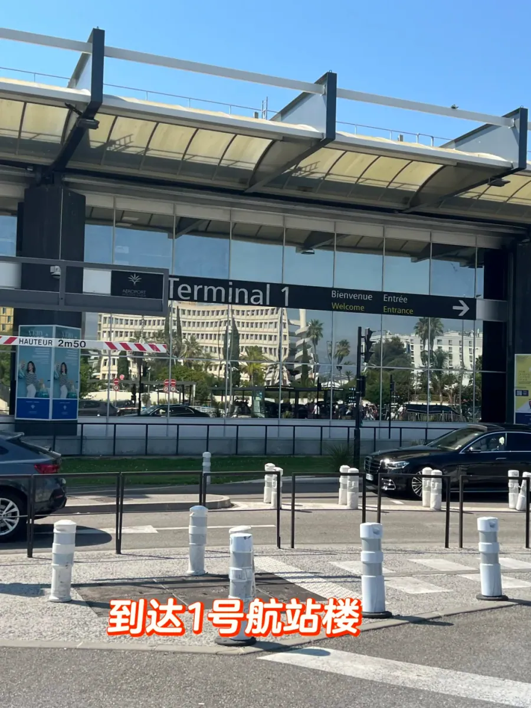

這段路有一個實際的問題：**遮陰很少**。除了站外的頂棚和天橋下的一小段，大部分路程都在太陽底下。尼斯的夏天日照很強，中午走這一趟，帽子和防曬霜比什麼都實用；帶一瓶水也有必要，尤其是拖著箱子的時候。

回程時把順序倒過來就行：從 T1 的到達層出來，沿著落客車道走到斑馬線，過馬路後找「Gare de Nice Saint-Augustin」的白色雨棚，再上臺階或坐電梯到站臺。回程的步行同樣要留出十到十五分鐘，因為取行李、找路都會耽誤時間；如果買的是指定車次的票，最好把這段步行算在發車時間之前，而不是之後。

## 五、T1 到 T2 的免費電車

如果你的航班從 T2 出發，走到 T1 還不算完。T2 在機場的另一側，步行要繞很大一圈，正確的做法是在 T1 門口坐機場的免費電車：**2 號線（部分資料寫作 B 線）**，從 T1 到 T2 只要兩三分鐘，**大約每兩分鐘一班**，而且免費。

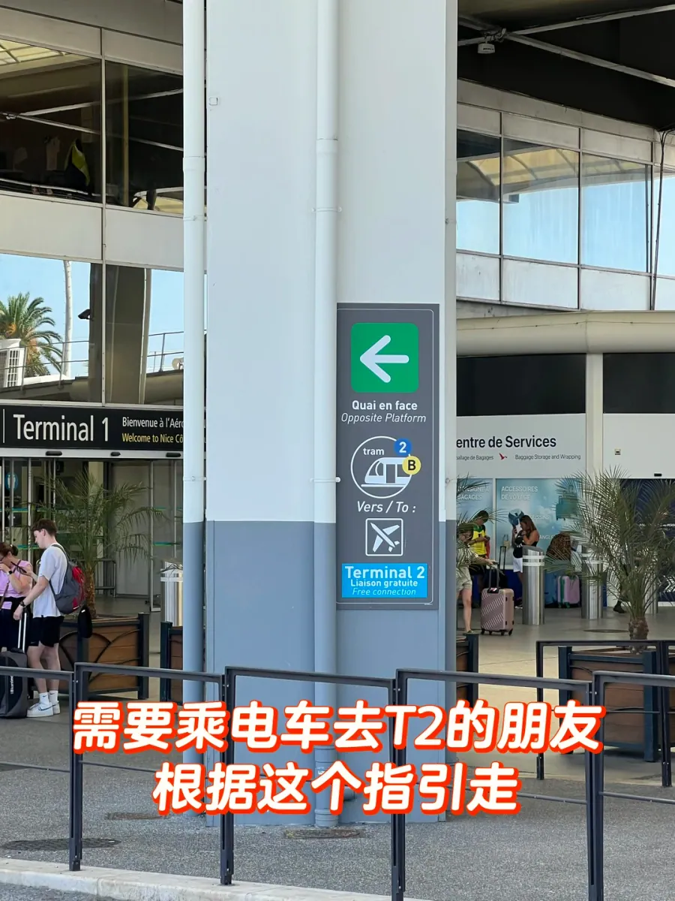

電車站就在 T1 門外的斜對面。指示牌上寫得很清楚：綠色的箭頭指向「Quai en face / Opposite Platform」，也就是馬路對面的站臺；下面畫著電車圖示，標著「2」和「B」，再下面一行是「Vers / To: Terminal 2」，並註明「Liaison gratuite / Free connection」——免費換乘。

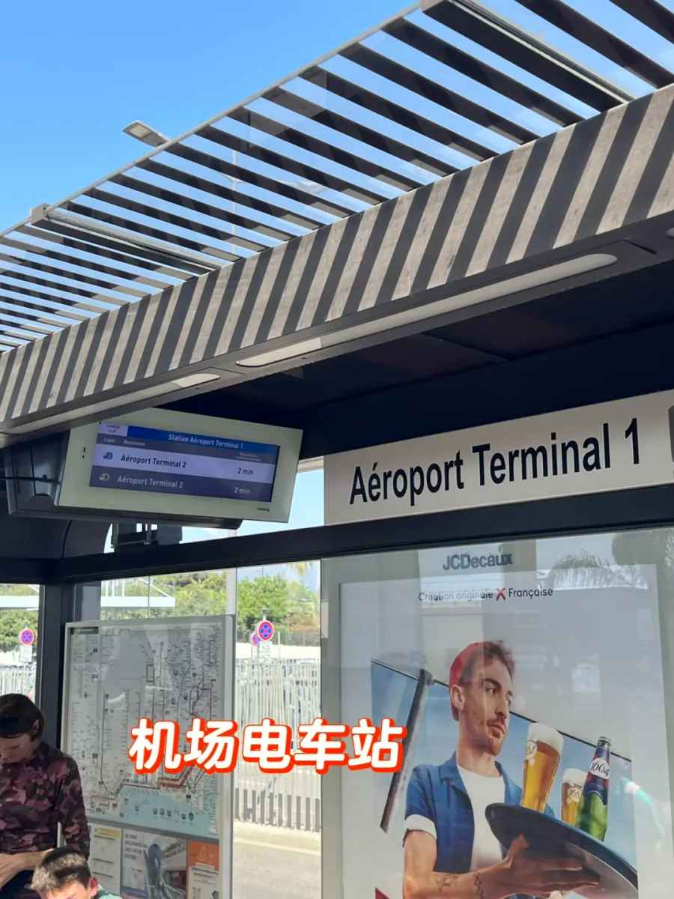

站臺上有頂棚和長椅，顯示屏會告訴你下一班車還有幾分鐘。車來的時候注意看車頭的顯示屏：寫著「AÉROPORT」的是開往機場方向的 2 號線，坐兩站就到 T2；如果坐上了開往市區的車，也不用慌，在下一站下車換回來就行，只是要多花時間。

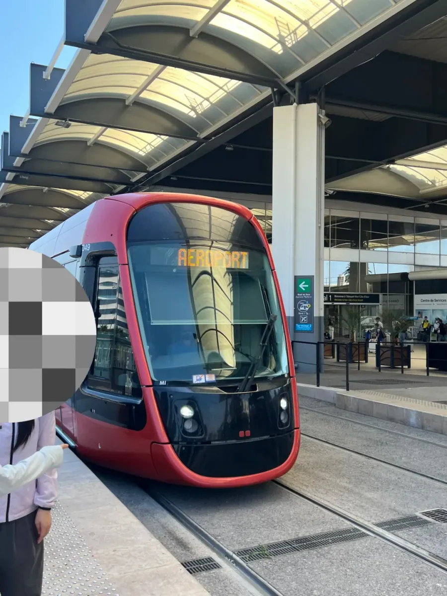

到了 T2，下車跟著「Départs / Departures」的牌子走進航廈即可，值機島和安檢口跟著螢幕上的指示走。回程時順序反過來：從 T2 坐電車到 T1，穿過落客車道，沿人行道走回 Saint-Augustin，再坐火車回尼斯市區。

這條免費電車是雙向執行的，班次密到幾乎不用看時刻表：車剛走，下一班的燈往往已經亮了。機場內部這兩站之間不賣票、不查票，上車就走；如果同行的人分住在兩個航廈，約在 T1 的電車站碰頭，比在航廈裡找路方便得多。

以上時刻、票價與換乘方式來自 2026 年 10 月一位旅客的實走記錄，列車時刻、票價與電車站臺以現場與官網當日資訊為準。最後提醒兩點：買票時雖然要選具體車次，但據原筆記的經驗，其他車次有時也能坐，不確定的話在站臺問一下工作人員；以及那三四百米的步行真的挺曬，別把它當成一段輕鬆的散步。

## 相關連結

- **本站頁面**：[法國（FR）](/tw/country/FR)
- **維基百科**：[尼斯藍色海岸機場](https://zh.wikipedia.org/wiki/%E5%B0%BC%E6%96%AF%E8%93%9D%E8%89%B2%E6%B5%B7%E5%B2%B8%E6%9C%BA%E5%9C%BA)
