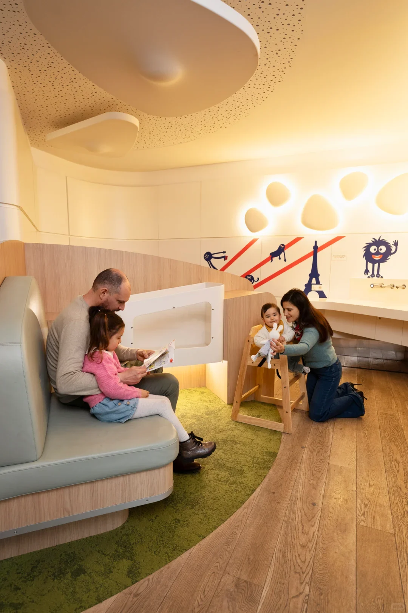

**Letiště Paris Charles de Gaulle (CDG)** je největší mezinárodní letiště Francie a jeden z klíčových leteckých uzlů Evropy — s Paříží se zde poprvé setká většina návštěvníků. Leží v Roissy asi 25 km severovýchodně od Paříže, zabírá zhruba 30 kilometrů čtverečních a má **210 nástupních bran** — nejvíce ze všech letišť na světě.

Tento průvodce prochází **uspořádání terminálů**, **dopravu po letišti**, **úschovnu zavazadel**, **banky a směnárny**, **vrácení DPH**, **odpočinkové zóny a salonky**, **Wi-Fi a nabíjení**, **SIM karty** i **bezbariérové a rodinné vybavení** — služby, o kterých stojí za to vědět ještě před přistáním.

## 1. Terminály a jejich podlaží

### Tři terminály a sedm dílčích terminálů uvnitř T2

CDG má **tři terminály: 1, 2 a 3**. **T2 je ten hlavní**, rozdělený na **sedm bloků — T2A, T2B, T2C, T2D, T2E, T2F a T2G** — uspořádaných symetricky podél jižní strany letiště, a zahrnuje také pier K a dva satelity L a M; využívají jej především **Air France a její partneři ze SkyTeamu**. **T3 leží na severu**, je malý a jednoduchý a odbavuje jen některé nízkonákladové dopravce.

T1 stojí na severozápadě: kruhová budova ve tvaru létajícího talíře, druhý hlavní terminál, který využívají hlavně členové aliancí **Star Alliance a oneworld**.

### Co dělá které podlaží T1

T1 rozkládá odbavení, odlety, přílety i stravování do devíti úrovní, takže správně zvolené podlaží ušetří spoustu chození:

| Úroveň | Účel | Co zde najdete |
| --- | --- | --- |
| 1 | Dopravní úroveň | Vláček CDGVAL, restaurace, několik odbavovacích přepážek |
| 2 | Odbavovací úroveň | Odbavovací přepážky, výstup taxíků, autobusové nádraží |
| 3 | Odlety | Bezpečnostní kontrola, pasová kontrola, obchody duty free |
| 4 | Přílety | Zavazadlové pásy |
| 5–7 | Parkování | Parkoviště |
| 8 | Stravování | Restaurace, kanceláře |
| 9 | Vyhlídka | Vyhlídková terasa |

### Které aerolinky používají který terminál

Rozdělení mezi T1, T2 a T3 je značné a uvnitř T2 potřebujete znát i dílčí terminál (například China Eastern je v T2E a Hainan Airlines v T2A). Kód terminálu si vždy zkontrolujte na palubní vstupence:

| Terminál | Hlavní aerolinky (podle původního zdroje) |
| --- | --- |
| T1 | Air China, EVA Air, China Airlines, United, Lufthansa, ANA, Eurowings, Qatar Airways, Turkish Airlines, Singapore Airlines, SWISS, SAS, Norwegian, LOT, Aegean |
| T2 | China Eastern (T2E), China Southern (T2E), Hainan Airlines (T2A), Cathay Pacific (T2A), Air France (T2E, T2F), British Airways (T2A), American Airlines (T2A), Delta (T2E), Air Canada (T2A), Japan Airlines (T2E), Korean Air (T2E), Emirates (T2C), Aeroflot (T2C), Finnair (T2D), Alitalia (T2F), KLM (T2F), Ukraine International (T2D), easyJet (T2D) |
| T3 | Hlavně španělské linky, například Vueling, a také charterové a sezónní lety do Středomoří |

Přiřazení terminálů se mění (Germanwings i Alitalia z původního seznamu mezitím zanikly nebo se sloučily), proto si je pro den cesty ověřte u své aerolinky a na letišti.

## 2. Pohyb po letišti: CDGVAL a kyvadlové autobusy

Terminály CDG jsou od sebe daleko a na přejezd mezi nimi je někdy potřeba vozidlo. K dispozici jsou dvě: **bezplatný kyvadlový vláček CDGVAL** (nazývaný také RoissyVal) a **kyvadlové autobusy Navette**, které jezdí mezi T1, T2, T3 a parkovišti.

Přestože jsou terminály dost daleko od sebe, uspořádání je logické a většina značek už obsahuje čínštinu, takže stačí se jimi řídit. Při přestupu mezi terminály si nechte 20–30 minut — cesta CDGVALem trvá jen pár minut, ale čekání a chůze ne.

## 3. Úschovna zavazadel

Pokud chcete nejdřív vidět Paříž nebo máte dlouhý přestup, nechte zavazadla na letišti:

- **Kde:** v **hale nádraží TGV v Terminálu 2**, nedaleko hotelu Sheraton;
- **Zabezpečení:** rentgenová kontrola a nepřetržitý kamerový dohled;
- **Ceny:** flexibilní, za hodinu nebo za den;
- **Další služby:** úschova speciálních či cenných předmětů, možnost ubytovat domácí mazlíčky, balení zavazadel a doručení do hotelu;
- **Jazyky:** vícejazyčný personál.

## 4. Banky a směnárny

- **Každý terminál má směnárny** (Global Exchange a další), které obchodují s eury i cizí měnou; najdete je ve veřejné části i v celním prostoru, u odbavovacích hal a u bran.
- **Bankomaty** jsou rozmístěny po terminálech pro výběry hotovosti a běžné transakce — v příletové hale i u bran.

- Upozorňujeme, že **většina bank si za výběry v zahraničí účtuje poplatky**, proto si před cestou ověřte poplatky a limity své banky. Směnárny na letišti málokdy překonají kurz ve městě, proto směňujte jen tolik, kolik potřebujete na dopravu a pro případ nouze.

## 5. Vrácení DPH (détaxe)

Obyvatelé mimo EU (ve věku 16 let a více, kteří ve Francii nebo v EU pobývají méně než šest měsíců) mohou požádat o vrácení DPH u nákupů od **100,01 € včetně DPH ve stejném obchodě ve stejný den**. Přineste si **pas, veškeré zboží, formulář tax free a účtenku**; zboží musí být nepoužité a v původním obalu.

Ověřovací místa na CDG:

| Terminál | Kde žádat |
| --- | --- |
| T1 | O jedno podlaží pod úrovní CDGVAL |
| T2A / T2B / T2C / T2D | Odletová úroveň, u brány 6 |
| T2E | Odletová úroveň, u brány 4 |
| T2F / T3 | Příletová úroveň |

Postup a místa, kde se lidé nejčastěji spletou:

1. Vyžádejte si v obchodě formulář tax free (vezměte si pas) a poté naskenujte jeho čárový kód v **samoobslužném terminálu PABLO** — zelená obrazovka „OK Bordereau validé“ je celním razítkem;
2. **Udělejte to ještě před odbavením a podáním zavazadel**, protože celníci mohou chtít nepoužité zboží vidět;
3. Francouzské formuláře lze ověřit pouze v těchto terminálech; **zboží zakoupené v jiných zemích EU musí orazítkovat celní přepážka**;
4. Ověření platí **tři měsíce plus aktuální měsíc** od data nákupu a vrácení peněz obvykle dorazí 6–8 týdnů po ověření.

## 6. Odpočinkové zóny a salonky

- **Bezplatné odpočinkové zóny:** letiště poskytuje bezplatné prostory k sezení pro odpočinek před letem nebo během přestupu; pokud nemáte hotel nebo chcete ušetřit, můžete tam i přespat. Bývají obvykle u nejvzdálenějších bran — stačí sledovat značky.
- **Placená odpočinková zóna:** uvnitř bezplatné části je samostatná placená zóna, kde si můžete odpočinout a dát sprchu.
- **Salonky:** cestující v business a první třídě a členové elitních programů aerolinek mohou využívat salonky; cestující v ekonomické třídě obvykle mohou za vstup zaplatit.
- **Pracovní zóny:** sdílené pracovní prostory v terminálech se stoly, zásuvkami a dobrým osvětlením.
- **Pozorování letadel:** z některých odpočinkových zón je přímý výhled na vzletovou a přistávací dráhu.
- **Kouření:** ve všech terminálech jsou vyhrazené prostory pro kuřáky.

## 7. Wi-Fi, nabíjení a SIM karty

- **Bezplatné Wi-Fi:** pokrývá všechny terminály; připojte se k síti **„WIFI-AIRPORT“** a jste online.
- **Nabíjení:** hledejte stanice **ChargeBox**, které jsou zdarma k použití v odletových halách za bezpečnostní kontrolou v hlavních terminálech (Terminál 1; T2D; haly L a M terminálu T2E; Terminál 3).

- **SIM karty:** v každém terminálu jsou přepážky **Relay, Fnac a Orange**, které prodávají místní SIM karty a příslušenství, s vícejazyčným personálem a aktivací na místě — koupíte, vložíte a funguje. Běžnou turistickou volbou je Orange Holiday (například 100 GB / 5G za přibližně 49,99 €), k dostání přímo na přepážce.

Přepážky a otevírací doba:

| Přepážka | Umístění | Otevírací doba |
| --- | --- | --- |
| Orange SIM karta | T1, úroveň 5 (přílety) | 06:00–20:30 |
| Orange SIM karta | T2E, úroveň 0 (za bezpečnostní kontrolou) | 06:00–21:00 |
| Relay | T2E, úroveň 0 (před bezpečnostní kontrolou) | 06:00–22:00 |
| Fnac | T1, úroveň 3 (před bezpečnostní kontrolou) | 06:00–21:00 |

## 8. Bezbariérový přístup a vybavení pro rodiny

**Asistence (cestující se zdravotním postižením):**

- Terminály poskytují asistenci cestujícím se zdravotním postižením — objednejte ji u své aerolinky nebo cestovní kanceláře **nejméně 48 hodin** před odletem;
- Srazová místa jsou uvnitř i vně terminálů a najdete tam invalidní vozíky a kočárky k samoobslužnému použití;
- Moderní bezbariérové přebalovací a převlékací místnosti slouží rodinám s dětmi i cestujícím s postižením;
- T2E a T2F mají každý vlastní **prostor pro psy**, kde asistenční psi najdou pohodlné a bezpečné místo.

**Vybavení pro rodiny:**

- Bezplatné služby pro cestující s miminky a malými dětmi;
- Přebalovací pulty a toalety uzpůsobené malým dětem;
- Některé terminály mají **dětské pokoje** s kompletním vybavením pro péči o miminka, včetně ohřívačů lahví a postýlek.

## Související odkazy

- **Na tomto webu**: [Letiště Paris Charles de Gaulle (CDG)](/airport/CDG), [Francie (FR)](/country/FR)
- **Wikipedia**: [Letiště Charles de Gaulle](https://en.wikipedia.org/wiki/Paris_Charles_de_Gaulle_Airport)
- **Baidu Baike**: [Letiště Charles de Gaulle](https://baike.baidu.com/item/%E5%B7%B4%E9%BB%8E%E5%A4%8F%E5%B0%94%C2%B7%E6%88%B4%E9%AB%98%E4%B9%90%E6%9C%BA%E5%9C%BA)
