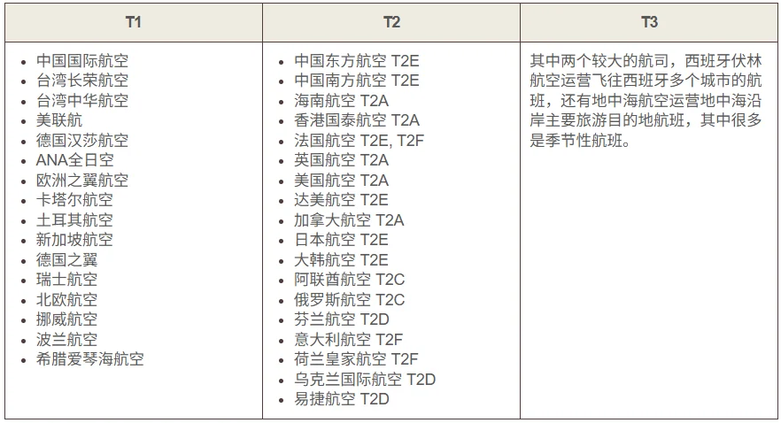
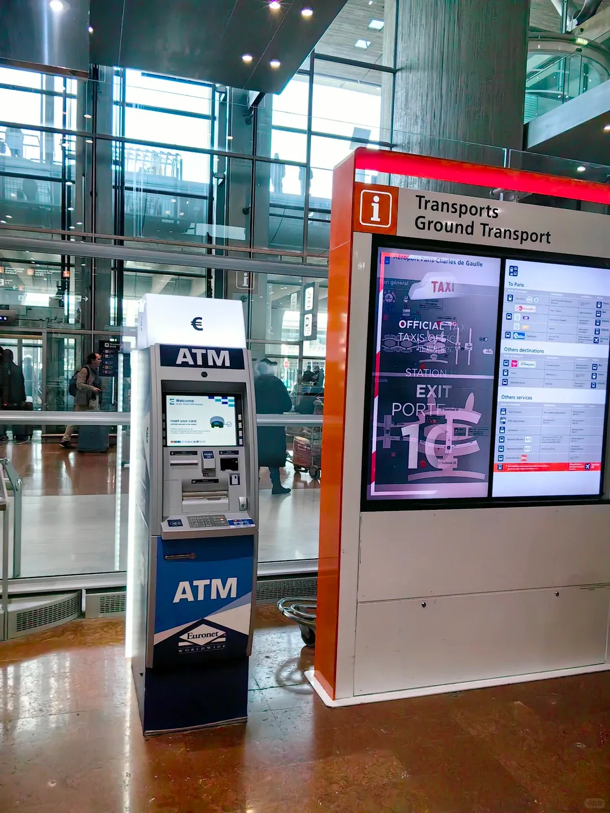

Como el mayor aeropuerto internacional de Francia y uno de los centros de aviación clave de Europa, **el Charles de Gaulle de París (CDG)** es donde la mayoría de los visitantes conoce por primera vez la ciudad. Está en Roissy, a unos 25 km al noreste de París, ocupa unos 30 kilómetros cuadrados y tiene **210 puertas**, más que cualquier otro aeropuerto del mundo.

Esta guía repasa la **distribución de las terminales**, el **transporte dentro del aeropuerto**, la **consigna**, los **bancos y el cambio de divisas**, las **devoluciones de impuestos**, las **zonas de descanso y las salas VIP**, el **wifi y la carga**, las **tarjetas SIM** y la **accesibilidad y los servicios familiares**: los servicios que conviene conocer antes de aterrizar.

## 1. Las terminales y sus plantas

### Tres terminales y siete subterminales dentro de la T2

El CDG tiene **tres terminales: 1, 2 y 3**. **La T2 es la principal**, dividida en **siete bloques (T2A, T2B, T2C, T2D, T2E, T2F y T2G)** dispuestos de forma simétrica a lo largo del lado sur del aeropuerto, e incluye además el muelle K y los dos satélites L y M; la usan sobre todo **Air France y sus socios de SkyTeam**. **La T3 está al norte**, es pequeña y sencilla, y solo atiende a algunas aerolíneas de bajo coste.

La T1 está al noroeste: un edificio circular en forma de platillo volante, la otra terminal principal, usada sobre todo por miembros de las alianzas **Star Alliance y oneworld**.

### Qué hace cada planta de la T1

La T1 reparte facturación, salidas, llegadas y restauración en nueve niveles, así que elegir bien la planta ahorra mucho paseo:

| Nivel | Función | Qué hay |
| --- | --- | --- |
| 1 | Nivel de transporte | Tren CDGVAL, restaurantes, algunos mostradores de facturación |
| 2 | Nivel de facturación | Mostradores de facturación, zona de taxis, estación de autobuses |
| 3 | Salidas | Seguridad, control de fronteras, tiendas libres de impuestos |
| 4 | Llegadas | Cintas de equipaje |
| 5–7 | Aparcamiento | Aparcamientos |
| 8 | Restauración | Restaurantes, oficinas |
| 9 | Observación | Terraza mirador |

### Qué aerolíneas usan cada terminal

El reparto entre T1, T2 y T3 es considerable, y dentro de la T2 también hay que saber la subterminal (Air China Eastern está en la T2E, por ejemplo, y Hainan Airlines en la T2A). Comprueba siempre el código de terminal en tu tarjeta de embarque:

| Terminal | Aerolíneas principales (del material original) |
| --- | --- |
| T1 | Air China, EVA Air, China Airlines, United, Lufthansa, ANA, Eurowings, Qatar Airways, Turkish Airlines, Singapore Airlines, SWISS, SAS, Norwegian, LOT, Aegean |
| T2 | China Eastern (T2E), China Southern (T2E), Hainan Airlines (T2A), Cathay Pacific (T2A), Air France (T2E, T2F), British Airways (T2A), American Airlines (T2A), Delta (T2E), Air Canada (T2A), Japan Airlines (T2E), Korean Air (T2E), Emirates (T2C), Aeroflot (T2C), Finnair (T2D), Alitalia (T2F), KLM (T2F), Ukraine International (T2D), easyJet (T2D) |
| T3 | Sobre todo rutas españolas como Vueling, además de chárteres y servicios estacionales del Mediterráneo |

Las asignaciones de terminal cambian (Germanwings y Alitalia, en la lista original, han cesado o se han fusionado desde entonces), así que confírmalo con tu aerolínea y con el aeropuerto el día en que viajes.

## 2. Moverse dentro del aeropuerto: CDGVAL y autobuses lanzadera

Las terminales del CDG están muy separadas, y cruzar el aeropuerto a veces requiere un vehículo. Hay dos: el **tren lanzadera gratuito CDGVAL** (también llamado RoissyVal) y los **autobuses lanzadera Navette**, que circulan entre la T1, la T2, la T3 y los aparcamientos.

Aunque las terminales están bastante separadas, la distribución es lógica, y la mayoría de los carteles ya llevan chino, así que seguirlos basta. Calcula 20–30 minutos al cambiar de terminal: un trayecto en CDGVAL tarda minutos, pero esperar y caminar no.

## 3. Consigna

Si quieres ver París primero o tienes una escala larga, deja las maletas:

- **Dónde:** en el **vestíbulo de la estación TGV de la Terminal 2**, cerca del hotel Sheraton;
- **Seguridad:** control por rayos X y videovigilancia permanente;
- **Precio:** flexible, por horas o por días;
- **Extras:** almacenamiento de objetos especiales o valiosos, servicio para mascotas, además de envoltura de equipaje y entrega en el hotel;
- **Idiomas:** personal multilingüe.

## 4. Bancos y cambio de divisas

- **Todas las terminales tienen mostradores de cambio de divisas** (Global Exchange y otros) que operan con euros y divisas; están tanto en la zona pública como en la de aduanas, cerca de los vestíbulos de facturación y de las puertas.
- **Los cajeros automáticos** están repartidos por las terminales para retirar efectivo y hacer operaciones cotidianas: en el vestíbulo de llegadas y cerca de las puertas.

- Ten en cuenta que **la mayoría de los bancos cobran por retirar en el extranjero**, así que comprueba las comisiones y los límites de tu banco antes de viajar. Los mostradores de cambio del aeropuerto rara vez superan a la ciudad en tipo de cambio, así que cambia solo lo que necesites para el transporte y las emergencias.

## 5. Devoluciones de impuestos (détaxe)

Los residentes fuera de la UE (mayores de 16 años, que permanezcan en Francia o en la UE menos de seis meses) pueden recuperar el IVA de compras de **100,01 € o más, con IVA incluido, en la misma tienda y el mismo día**. Lleva **pasaporte, toda la mercancía, el formulario de tax free y el recibo**; la mercancía debe estar sin usar y en su embalaje original.

Los puntos de validación del CDG:

| Terminal | Dónde reclamar |
| --- | --- |
| T1 | Un nivel por debajo del nivel del CDGVAL |
| T2A / T2B / T2C / T2D | Nivel de salidas, cerca de la puerta 6 |
| T2E | Nivel de salidas, cerca de la puerta 4 |
| T2F / T3 | Nivel de llegadas |

El proceso, y las partes en las que la gente se equivoca:

1. Pide el formulario de tax free en la tienda (lleva el pasaporte) y luego escanea su código de barras en un **terminal de autoservicio PABLO**: una pantalla verde de “OK Bordereau validé” es el sello de aduanas;
2. **Hazlo antes de facturar o de entregar las maletas**, porque la aduana puede querer ver la mercancía sin usar;
3. Los formularios franceses solo se pueden validar en las máquinas; **la mercancía comprada en otros países de la UE debe sellarse en un mostrador de aduanas**;
4. La validación es válida **tres meses más el mes en curso** desde la fecha de compra, y las devoluciones llegan normalmente 6–8 semanas después de la validación.

## 6. Zonas de descanso y salas VIP

- **Zonas de descanso gratuitas:** el aeropuerto ofrece zonas de asientos gratuitas para relajarse antes de un vuelo o durante una conexión; si no tienes hotel o quieres ahorrar, también puedes pasar la noche allí. Suelen estar cerca de las puertas más lejanas: sigue las indicaciones.
- **Zona de descanso de pago:** dentro de la zona gratuita hay un espacio de pago separado donde descansar y ducharte.
- **Salas VIP:** los pasajeros de business y primera clase y los miembros de élite de las aerolíneas pueden usar las salas; los pasajeros de turista normalmente pueden entrar pagando.
- **Zonas de trabajo:** espacios de trabajo compartidos en las terminales, con mesas, enchufes e iluminación decente.
- **Observación de aviones:** algunas zonas de descanso dan directamente a la pista.
- **Fumar:** todas las terminales tienen zonas designadas para fumar.

## 7. Wifi, carga y tarjetas SIM

- **Wifi gratuito:** cubre todas las terminales; conéctate a la red **“WIFI-AIRPORT”** y listo.
- **Carga:** busca las estaciones **ChargeBox**, gratuitas en los vestíbulos de salidas tras el control de seguridad de las terminales principales (Terminal 1; T2D; las salas L y M de la T2E; Terminal 3).

- **Tarjetas SIM:** todas las terminales tienen mostradores de **Relay, Fnac y Orange** que venden SIM locales y accesorios, con personal multilingüe y activación en la tienda: la compras y la pones. La opción turística habitual es Orange Holiday (por ejemplo, 100 GB / 5G por unos 49,99 €), disponible en el mostrador.

Mostradores y horarios:

| Mostrador | Ubicación | Horario |
| --- | --- | --- |
| Orange SIM Card | T1, nivel 5 (llegadas) | 06:00–20:30 |
| Orange SIM Card | T2E, nivel 0 (tras la seguridad) | 06:00–21:00 |
| Relay | T2E, nivel 0 (antes de la seguridad) | 06:00–22:00 |
| Fnac | T1, nivel 3 (antes de la seguridad) | 06:00–21:00 |

## 8. Accesibilidad y servicios familiares

**Asistencia (PWD):**

- Las terminales ofrecen asistencia a pasajeros con discapacidad: reserva con tu aerolínea o agencia de viajes **al menos 48 horas** antes de la salida;
- Hay puntos de encuentro dentro y fuera de las terminales, con sillas de ruedas y carritos de autoservicio;
- Cambiadores modernos y accesibles cubren a familias con niños y a viajeros con discapacidad;
- La T2E y la T2F tienen cada una una **zona para perros**, que da a los perros de asistencia un espacio cómodo y seguro.

**Servicios familiares:**

- Servicios gratuitos para viajeros con bebés o niños pequeños;
- Zonas de cambiador y aseos diseñados para niños pequeños;
- Algunas terminales tienen **salas para bebés** con equipo de lactancia completo, incluidos calientabiberones y cunas.

## Enlaces relacionados

- **En este sitio**: [Aeropuerto Charles de Gaulle de París (CDG)](/airport/CDG), [Francia (FR)](/country/FR)
- **Wikipedia**: [Aeropuerto Charles de Gaulle](https://en.wikipedia.org/wiki/Paris_Charles_de_Gaulle_Airport)
- **Baidu Baike**: [Aeropuerto Charles de Gaulle](https://baike.baidu.com/item/%E5%B7%B4%E9%BB%8E%E5%A4%8F%E5%B0%94%C2%B7%E6%88%B4%E9%AB%98%E4%B9%90%E6%9C%BA%E5%9C%BA)
