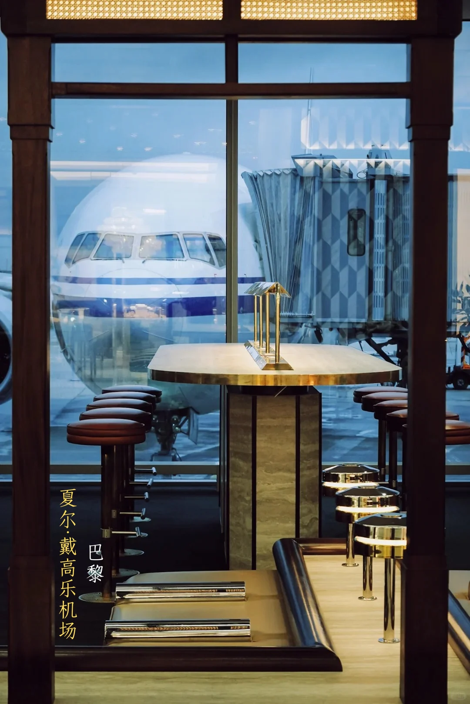

作为法国最大的国际机场和欧洲重要的航空枢纽，**巴黎夏尔·戴高乐机场**（CDG）是旅行者抵达浪漫之都的第一站。机场位于巴黎东北约 25 公里处的鲁瓦西（Roissy），占地约 30 平方公里，拥有 **210 个登机口**——按登机口数量计算居世界首位。

这份指南按**航站楼分布**、**机场内部交通**、**行李寄存**、**银行与货币兑换**、**退税**、**休闲与休息区**、**Wi-Fi 与充电**、**SIM 卡**、**无障碍与家庭设施**几块整理，落地前值得知道的服务一次说清。

## 一、航站楼与楼层分布

### 三座航站楼，T2 里还有七个子楼

戴高乐机场有 **T1、T2、T3 三座航站楼**。**T2 是主航站楼**，又被分成 **T2A、T2B、T2C、T2D、T2E、T2F、T2G 七个区块**，沿机场南侧呈波浪形对称排列，还包括 K 指廊与 L、M 两个卫星厅，主要供**法国航空及其天合联盟伙伴**使用。**T3 位于机场北部**，规模小、结构简单，只有部分低成本航司在这里运营。

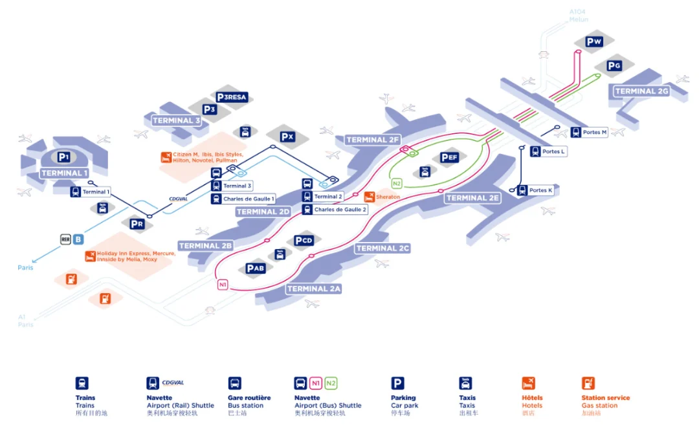

T1 位于机场西北方向，是一座飞碟形的圆形建筑，作为两座主航站楼之一，主要提供给**星空联盟、寰宇一家等航空联盟**的成员航司使用。

### T1 各楼层功能

T1 把值机、出发、到达和餐饮分布在九个楼层里，找对楼层能省下不少来回：

| 楼层 | 功能定位 | 主要设施 |
| --- | --- | --- |
| 1 层 | 交通层 | CDGVAL 轨道捷运系统、餐厅，以及少量值机柜台 |
| 2 层 | 值机层 | 值机柜台、出租车落客点、公共汽车站 |
| 3 层 | 出发层 | 安检区、边检区、免税店 |
| 4 层 | 到达层 | 行李转盘 |
| 5–7 层 | 停车层 | 停车场 |
| 8 层 | 餐饮层 | 餐厅、办公区 |
| 9 层 | 瞭望层 | 瞭望台 |

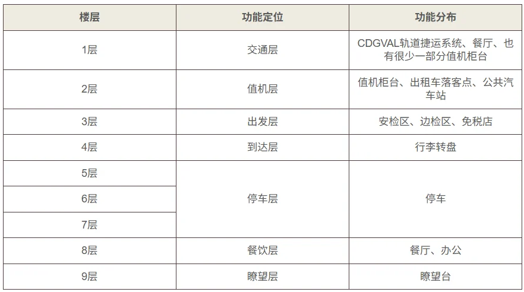

### 各航站楼主要航空公司

T1、T2、T3 的航司分布差异很大，T2 还要再细看到子楼（例如中国东方航空在 T2E、海南航空在 T2A），出发前务必核对登机牌上的航站楼编号：

| 航站楼 | 主要航空公司（原资料整理） |
| --- | --- |
| T1 | 中国国际航空、长荣航空、中华航空、美联航、汉莎航空、全日空（ANA）、欧洲之翼、卡塔尔航空、土耳其航空、新加坡航空、瑞士航空、北欧航空、挪威航空、波兰航空、爱琴海航空 |
| T2 | 中国东方航空（T2E）、中国南方航空（T2E）、海南航空（T2A）、国泰航空（T2A）、法国航空（T2E、T2F）、英国航空（T2A）、美国航空（T2A）、达美航空（T2E）、加拿大航空（T2A）、日本航空（T2E）、大韩航空（T2E）、阿联酋航空（T2C）、俄罗斯航空（T2C）、芬兰航空（T2D）、意大利航空（T2F）、荷兰皇家航空（T2F）、乌克兰国际航空（T2D）、易捷航空（T2D） |
| T3 | 以伏林航空等西班牙方向航线、地中海方向的包机与季节性航线为主 |

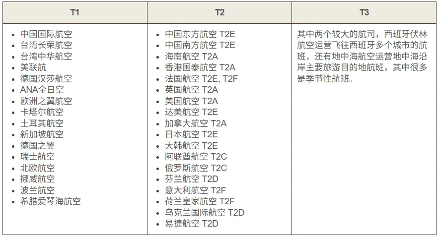

航站楼与航司的对应关系时有调整（原资料中的德国之翼、意大利航空等已停运或并入其他公司），出行前请以航司与机场当日公布的信息为准。

## 二、机场内部交通：CDGVAL 与穿梭巴士

戴高乐机场各个航站楼距离较远，在机场内部通行有时需要借助交通工具，主要有两种：**免费轻轨 CDGVAL**（也称 RoissyVal）和**穿梭巴士（Navette）**，两者都在 T1、T2、T3 与各停车场之间穿梭。

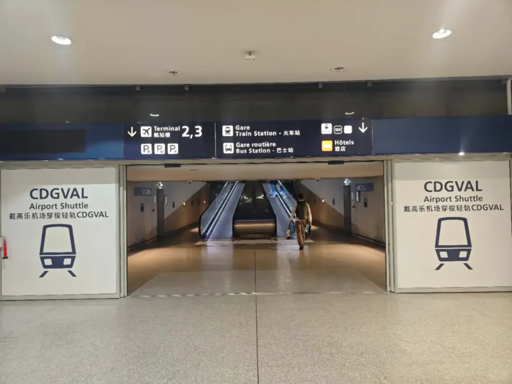

几个航站楼虽然相隔有一定距离，但机场布局清晰，指示牌大多配有中文，沿着牌子走完全不用担心迷路。换航站楼时留出 20–30 分钟比较稳妥——CDGVAL 一站几分钟，但候车与步行的时间也要算进去。

## 三、行李寄存

落地后想先逛巴黎、或者中转时间很长，可以把行李存起来：

- **位置**：位于戴高乐 **2 号航站楼的 TGV 车站换乘大厅**（2 号航站楼换乘大厅），靠近喜来登（Sheraton）酒店；
- **安全**：配备 X 光筛查与永久视频监控；
- **计费**：按小时或按天灵活计费，按需选择；
- **附加服务**：可寄存特殊行李与贵重物品，宠物寄存友好，另提供行李打包、酒店运送等额外服务；
- **语言**：提供多语言接待，沟通无障碍。

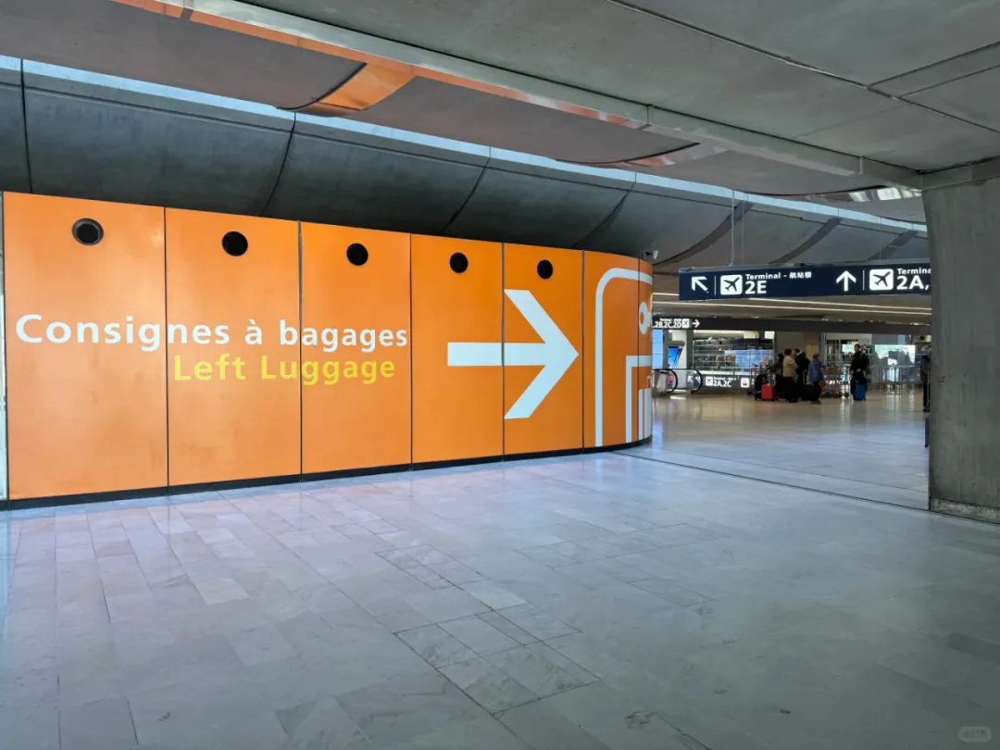

## 四、银行与货币兑换

- 戴高乐机场的**所有航站楼都设有货币兑换点**（Global Exchange 等），可进行欧元与外币交易；兑换点分布在公共区和海关区内，靠近值机大厅与登机口。
- **ATM 与自动取款机**遍布航站楼，可以提取现金或办理日常交易；到达大厅、各登机口附近都能找到。

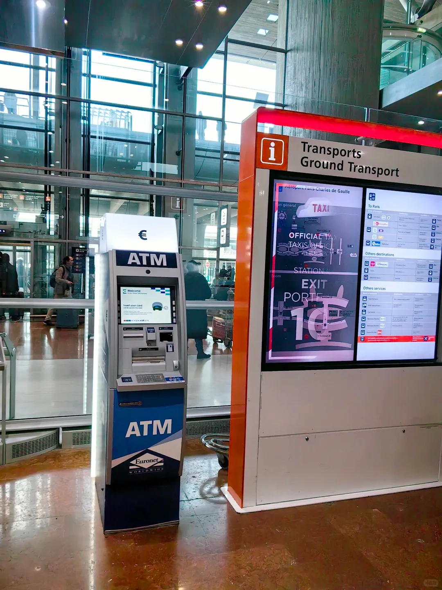

- 需要留意的是，**多数银行的境外取款会收取手续费**，出发前向自己的银行确认取款费率与限额很重要；在机场兑换点换汇，汇率通常也不如市区划算，建议只换够交通与应急用的现金。

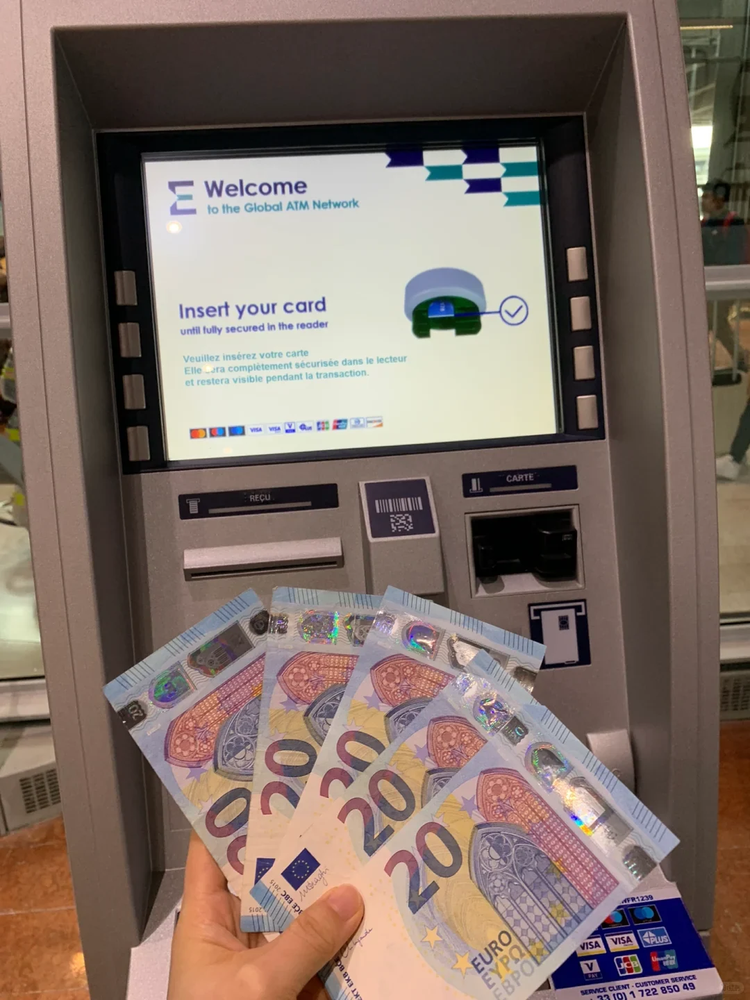

## 五、退税（Détaxe）

非欧盟居民（16 岁以上、在法国/欧盟境内停留不超过 6 个月）在法国购物，**在同一家商店同一天消费满 100.01 欧元（含税）**即可申请退还增值税。办理时随身携带**护照、所有退税商品、退税单及对应的购物小票**，商品要保持未使用、包装完整。

戴高乐机场的退税验证点分布在各航站楼：

| 航站楼 | 退税点位置 |
| --- | --- |
| T1 | CDGVAL（机场内线）层的下一层 |
| T2A／T2B／T2C／T2D | 出发层（Departure Level）6 号门附近 |
| T2E | 出发层 4 号门附近 |
| T2F／T3 | 到达层（Arrival Level） |

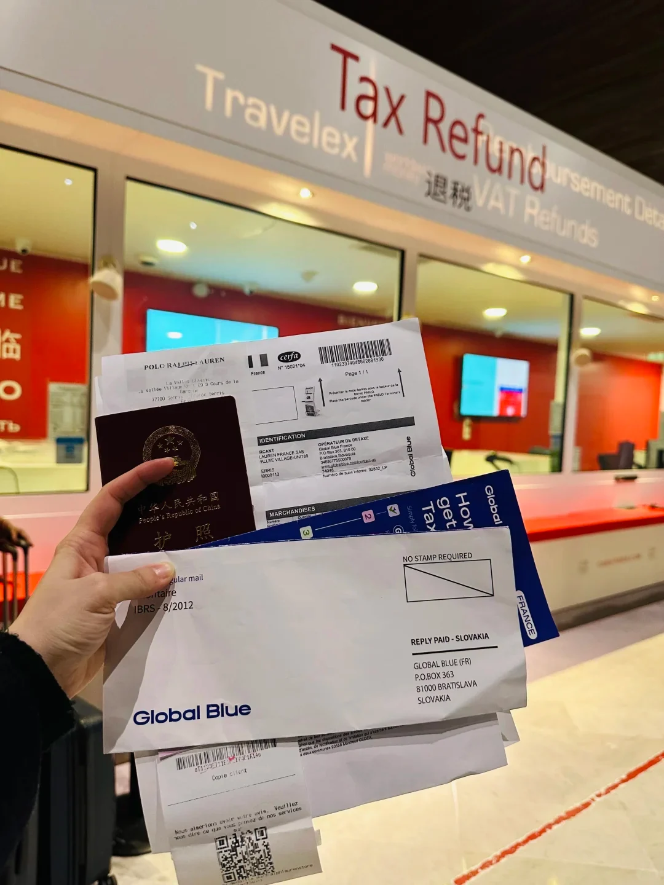

办理流程与要点：

1. 在店里索取退税单（带好护照），离境前在 **PABLO 自助退税机**上扫描退税单条码，屏幕显示绿色「OK Bordereau validé」即等于海关盖章；
2. **一定要在办理登机、托运行李之前**完成验证，因为海关可能要查看未使用的商品；
3. 法国退税单只能通过自助机验证；**在其他欧盟国家购买的商品，要到海关退税窗口人工办理**；
4. 退税单需在**购买月份起 3 个月加当月内**完成验证，退税款通常在验证后 6–8 周退回卡上。

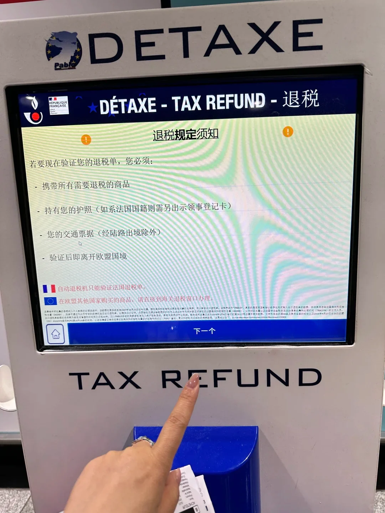

## 六、休闲场所与休息区

- **免费休息区**：机场设有免费休息区，航班前或转机期间可以放松片刻；没有订到酒店或想省钱的话，也可以在这里过夜。它们通常在最远的登机口附近，沿着机场指示牌就能找到。
- **付费休息区**：免费休息区里还设有一处单独的收费休息区，可以休息并淋浴。
- **贵宾休息室**：乘坐商务舱、头等舱的旅客或航司高级会员可以使用；经济舱旅客也可以付费进入。
- **工作区**：航站楼内设有共享办公区，配备桌子、电源插座与合适的照明。
- **看飞机**：部分休息区可以直接俯瞰跑道，看飞机起降。
- **吸烟区**：所有航站楼均设有专用吸烟区。

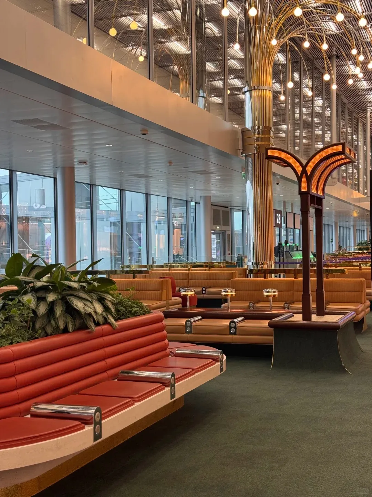

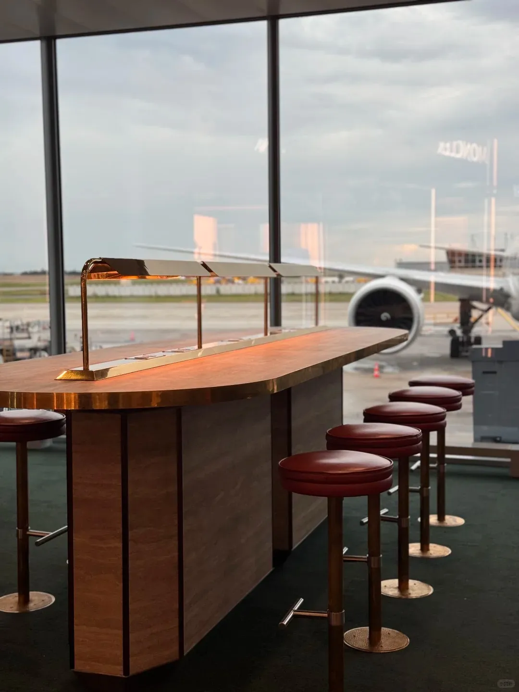

## 七、Wi-Fi、充电与 SIM 卡

- **免费 Wi-Fi**：机场提供覆盖各航站楼的 Wi-Fi，连接 **「WIFI-AIRPORT」** 网络即可自动接入。
- **充电**：航站楼设有名为 **ChargeBox** 的安全充电站，主要航站楼的安检后出发大厅（1 号航站楼、2D、2E 的 L 厅与 M 厅、3 号航站楼）免费使用。

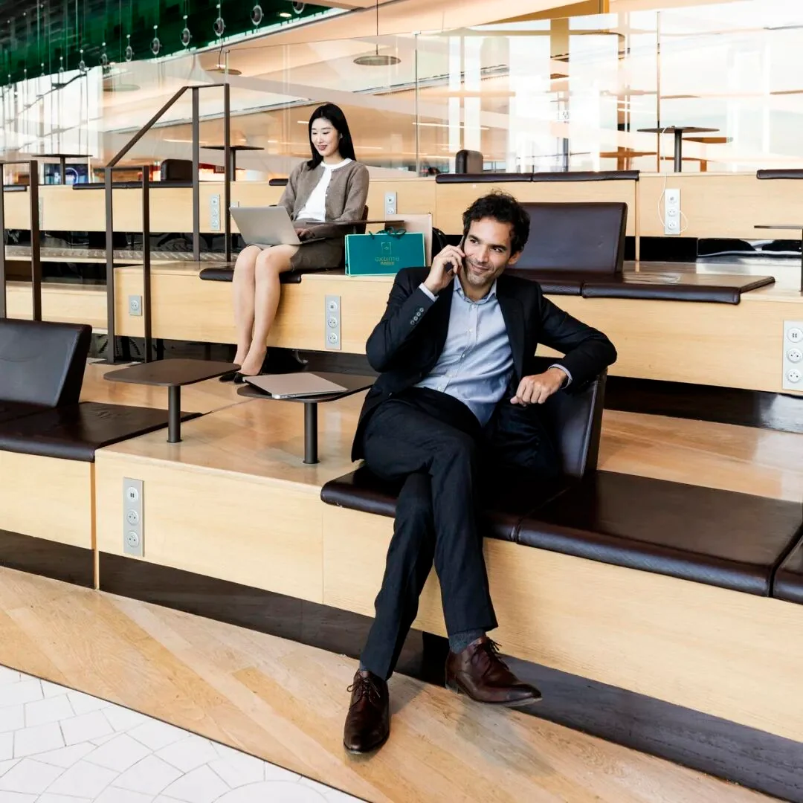

- **SIM 卡**：各航站楼都设有 **Relay、Fnac 和 Orange** 柜台，可以买到本地 SIM 卡或其他电子配件，工作人员提供多语言服务，现场激活、即买即插即用。常见的游客卡是 Orange Holiday（例如 100GB / 5G 约 49.99 欧），柜台可直接办理。

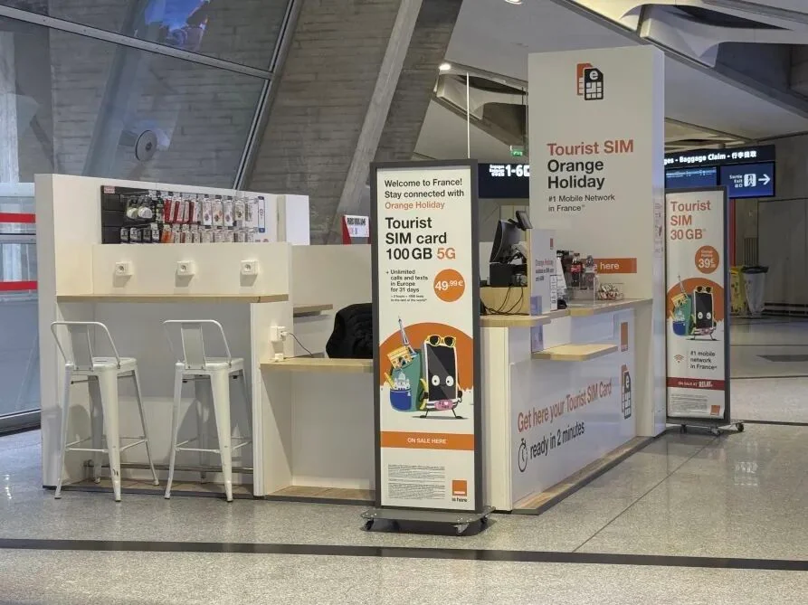

常用柜台与营业时间：

| 柜台 | 位置 | 营业时间 |
| --- | --- | --- |
| Orange SIM Card | T1，五层（到达区） | 06:00–20:30 |
| Orange SIM Card | T2E，零层（安检后） | 06:00–21:00 |
| Relay | T2E，零层（安检前） | 06:00–22:00 |
| Fnac | T1，三层（安检前） | 06:00–21:00 |

## 八、无障碍服务与家庭设施

**无障碍（PWD）服务**：

- 航站楼提供残疾旅客协助服务，请在出发前**至少 48 小时**联系航空公司或旅行社预订；
- 航站楼内外均设有集合点，并提供自助轮椅与婴儿车；
- 配备现代化、无障碍的更衣室，满足带儿童家庭与残障人士的需求；
- T2E 与 T2F 航站楼设了两处**犬区**，为陪同乘客的狗狗提供舒适与安全的空间。

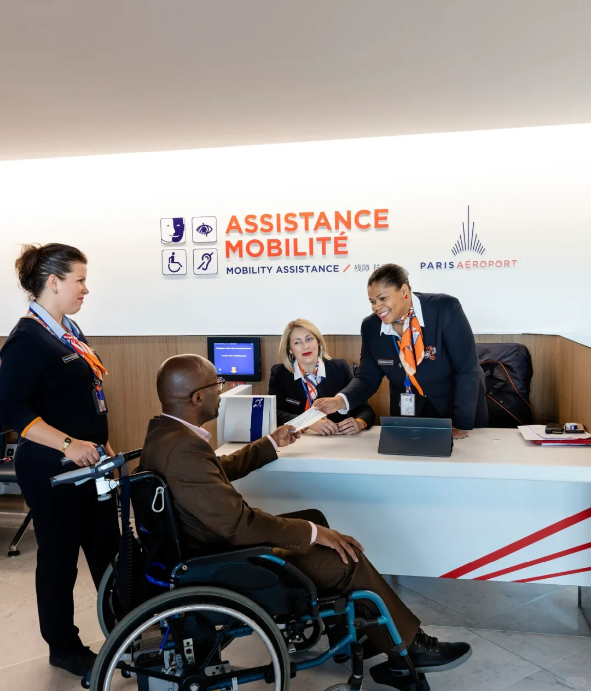

**家庭设施**：

- 为携带婴儿或儿童的旅客提供免费服务；
- 设有婴儿换尿布区，以及为幼儿设计的厕所；
- 部分航站楼的**婴儿休息室**提供全套婴儿护理设备，包括奶瓶加热器和摇篮。

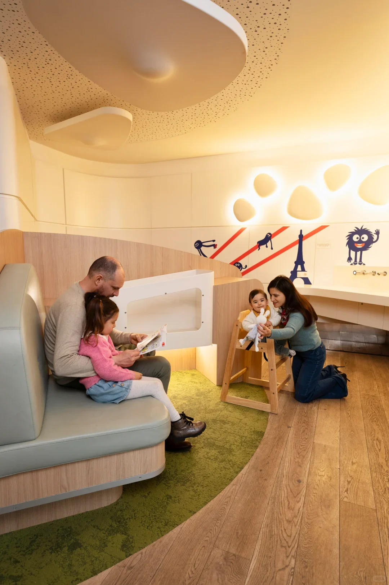

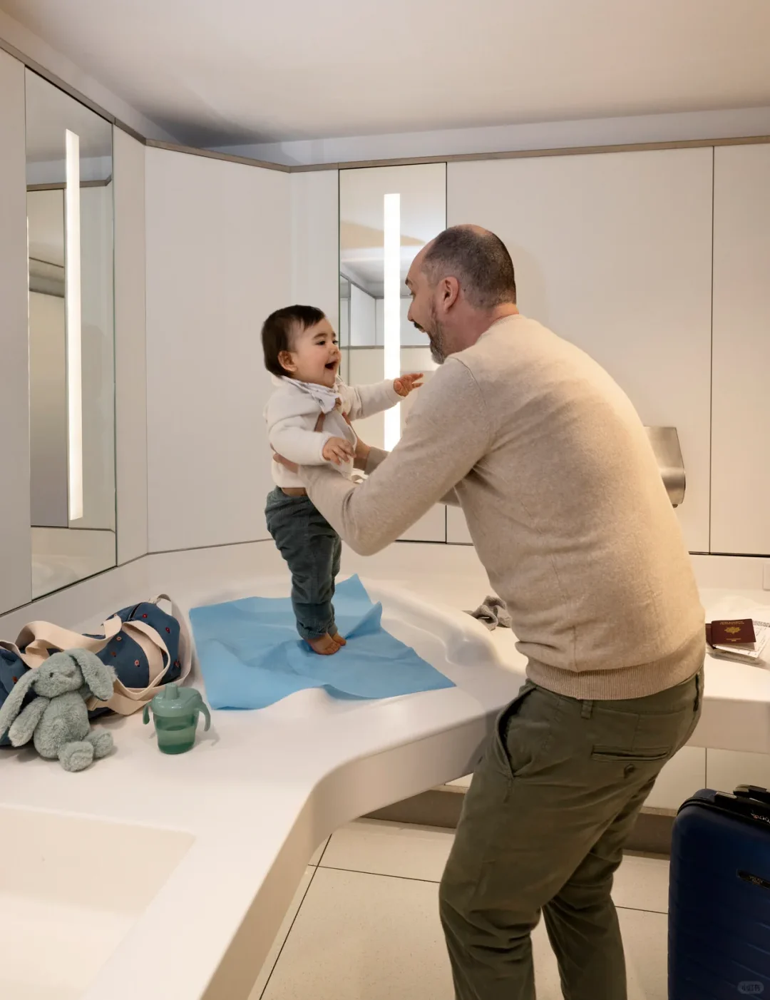

## 相关链接

- **本站页面**：[巴黎戴高乐机场（CDG）](/zh/airport/CDG)、[法国（FR）](/zh/country/FR)
- **维基百科**：[巴黎夏尔·戴高乐机场](https://zh.wikipedia.org/wiki/%E5%B7%B4%E9%BB%8E%E5%A4%8F%E5%B0%94%C2%B7%E6%88%B4%E9%AB%98%E4%B9%90%E6%9C%BA%E5%9C%BA)
- **百度百科**：[巴黎夏尔·戴高乐机场](https://baike.baidu.com/item/%E5%B7%B4%E9%BB%8E%E5%A4%8F%E5%B0%94%C2%B7%E6%88%B4%E9%AB%98%E4%B9%90%E6%9C%BA%E5%9C%BA)
