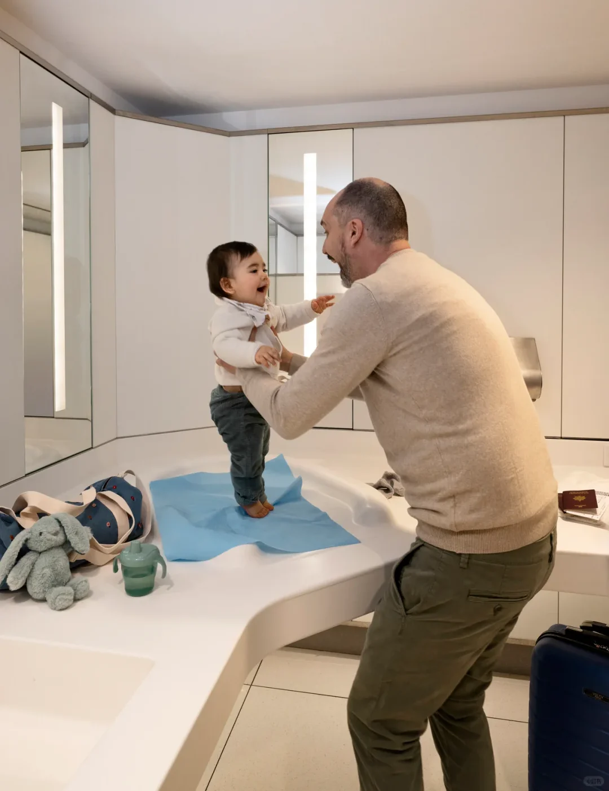

Als de grootste internationale luchthaven van Frankrijk en een van de belangrijkste luchtvaartknooppunten van Europa is **Parijs Charles de Gaulle (CDG)** de plek waar de meeste bezoekers de stad voor het eerst leren kennen. De luchthaven ligt in Roissy, ongeveer 25 km ten noordoosten van Parijs, beslaat zo'n 30 vierkante kilometer en heeft **210 gates** — meer dan welke andere luchthaven ter wereld.

Deze gids behandelt de **indeling van de terminals**, **vervoer binnen de luchthaven**, **bagageopslag**, **banken en geldwissel**, **btw-teruggave**, **rustplaatsen en lounges**, **wifi en opladen**, **simkaarten** en **voorzieningen voor toegankelijkheid en gezinnen** — de diensten die je wilt kennen voordat je landt.

## 1. Terminals en hun verdiepingen

### Drie terminals, en zeven subterminals binnen T2

CDG heeft **drie terminals: 1, 2 en 3**. **T2 is de belangrijkste**, verdeeld in **zeven blokken — T2A, T2B, T2C, T2D, T2E, T2F en T2G** — symmetrisch gerangschikt langs de zuidkant van de luchthaven, en omvat ook pier K en de twee satellieten L en M; hij wordt vooral gebruikt door **Air France en zijn SkyTeam-partners**. **T3 ligt in het noorden**, klein en eenvoudig, en bedient alleen enkele lowcostmaatschappijen.

T1 ligt in het noordwesten: een rond gebouw in de vorm van een vliegende schotel, de andere grote terminal, vooral gebruikt door leden van de allianties **Star Alliance en oneworld**.

### Wat elke verdieping van T1 doet

T1 verdeelt check-in, vertrek, aankomst en horeca over negen niveaus, dus de juiste verdieping kiezen scheelt veel lopen:

| Niveau | Functie | Wat er is |
| --- | --- | --- |
| 1 | Vervoersniveau | CDGVAL-trein, restaurants, enkele check-inbalies |
| 2 | Check-inniveau | Check-inbalies, taxistandplaats, busstation |
| 3 | Vertrek | Beveiliging, grenscontrole, taxfreeshops |
| 4 | Aankomst | Bagagebanden |
| 5–7 | Parkeren | Parkeerterreinen |
| 8 | Horeca | Restaurants, kantoren |
| 9 | Uitzicht | Uitkijkterras |

### Welke maatschappijen welke terminal gebruiken

Het onderscheid tussen T1, T2 en T3 is groot, en binnen T2 moet je ook de subterminal kennen (China Eastern zit bijvoorbeeld op T2E, en Hainan Airlines op T2A). Controleer altijd de terminalcode op je instapkaart:

| Terminal | Belangrijkste maatschappijen (uit het oorspronkelijke materiaal) |
| --- | --- |
| T1 | Air China, EVA Air, China Airlines, United, Lufthansa, ANA, Eurowings, Qatar Airways, Turkish Airlines, Singapore Airlines, SWISS, SAS, Norwegian, LOT, Aegean |
| T2 | China Eastern (T2E), China Southern (T2E), Hainan Airlines (T2A), Cathay Pacific (T2A), Air France (T2E, T2F), British Airways (T2A), American Airlines (T2A), Delta (T2E), Air Canada (T2A), Japan Airlines (T2E), Korean Air (T2E), Emirates (T2C), Aeroflot (T2C), Finnair (T2D), Alitalia (T2F), KLM (T2F), Ukraine International (T2D), easyJet (T2D) |
| T3 | Vooral Spaanse routes zoals Vueling, plus charter- en seizoensdiensten naar de Middellandse Zee |

Terminaltoewijzingen veranderen (Germanwings en Alitalia uit de oorspronkelijke lijst zijn inmiddels gestopt of gefuseerd), dus bevestig je terminal bij je maatschappij en de luchthaven voor de dag van je reis.

## 2. Je verplaatsen binnen de luchthaven: CDGVAL en shuttle bussen

De terminals van CDG liggen ver uit elkaar, en om de luchthaven over te steken is soms een voertuig nodig. Er zijn er twee: de **gratis CDGVAL-shuttletrein** (ook wel RoissyVal genoemd) en de **Navette-shuttle bussen**, die beide rijden tussen T1, T2, T3 en de parkeerterreinen.

Hoewel de terminals behoorlijk ver uit elkaar liggen, is de indeling logisch, en de meeste borden zijn nu ook in het Chinees, dus ze volgen is genoeg. Reken 20–30 minuten bij het wisselen van terminal — een ritje met de CDGVAL duurt een paar minuten, maar wachten en lopen niet.

## 3. Bagageopslag

Als je eerst Parijs wilt zien, of een lange overstap hebt, laat je je bagage achter:

- **Waar:** in de **stationshal van het TGV-station van terminal 2**, bij het Sheraton-hotel;
- **Beveiliging:** röntgencontrole en permanent cameratoezicht;
- **Prijs:** flexibel, per uur of per dag;
- **Extra's:** opslag voor bijzondere of waardevolle spullen, faciliteiten voor huisdieren, plus bagage inpakken en bezorging bij je hotel;
- **Talen:** meertalig personeel.

## 4. Banken en geldwissel

- **Elke terminal heeft wisselkantoren** (Global Exchange en andere) voor euro's en vreemde valuta; ze liggen zowel in het openbare als in het douanegebied, bij de check-inhallen en de gates.
- **Geldautomaten** staan verspreid over de terminals voor contant geld en dagelijkse transacties — in de aankomsthal en bij de gates.

- Let op: **de meeste banken rekenen kosten voor opnames in het buitenland**, dus controleer de kosten en limieten van je eigen bank voordat je reist. Wisselkantoren op de luchthaven bieden zelden een betere koers dan de stad, dus wissel alleen wat je nodig hebt voor vervoer en noodgevallen.

## 5. Btw-teruggave (détaxe)

Inwoners van buiten de EU (16 jaar of ouder, die minder dan zes maanden in Frankrijk of de EU verblijven) kunnen btw terugvragen op aankopen van **€100,01 of meer, inclusief btw, in dezelfde winkel op dezelfde dag**. Neem je **paspoort, alle goederen, het taxfreeformulier en de kassabon** mee; de goederen moeten ongebruikt en in de originele verpakking zijn.

De validatiepunten op CDG:

| Terminal | Waar je de teruggave aanvraagt |
| --- | --- |
| T1 | Eén niveau onder het CDGVAL-niveau |
| T2A / T2B / T2C / T2D | Vertrekniveau, bij gate 6 |
| T2E | Vertrekniveau, bij gate 4 |
| T2F / T3 | Aankomstniveau |

Het proces, en de onderdelen waar het vaak misgaat:

1. Vraag in de winkel om het taxfreeformulier (neem je paspoort mee) en scan de barcode bij een **PABLO-zelfbedieningsterminal** — een groen scherm "OK Bordereau validé" is de douanestempel;
2. **Doe dit voordat je incheckt of je bagage afgeeft**, want de douane wil de ongebruikte goederen mogelijk zien;
3. Franse formulieren kunnen alleen bij de machines worden gevalideerd; **goederen die je in andere EU-landen hebt gekocht, moeten bij een douanebalie worden afgestempeld**;
4. De validatie is geldig voor **drie maanden plus de lopende maand** vanaf de aankoopdatum, en de terugbetaling komt meestal 6–8 weken na de validatie binnen.

## 6. Rustplaatsen en lounges

- **Gratis rustplaatsen:** de luchthaven biedt gratis zitplaatsen om te ontspannen voor een vlucht of tijdens een overstap; als je geen hotel hebt of wilt besparen, kun je er ook de nacht doorbrengen. Ze liggen meestal bij de verste gates — volg de borden.
- **Betaalde rustruimte:** binnen het gratis gebied is er een aparte betaalde zone waar je kunt rusten en douchen.
- **Lounges:** business- en firstclasspassagiers en elite-leden van maatschappijen kunnen gebruikmaken van de lounges; economypassagiers kunnen meestal tegen betaling naar binnen.
- **Werkplekken:** gedeelde werkruimtes in de terminals, met bureaus, stopcontacten en goede verlichting.
- **Vliegtuigen kijken:** sommige rustplaatsen kijken direct uit op de landingsbaan.
- **Roken:** alle terminals hebben aangewezen rookzones.

## 7. Wifi, opladen en simkaarten

- **Gratis wifi:** dekt elke terminal; maak verbinding met het netwerk **"WIFI-AIRPORT"** en je bent online.
- **Opladen:** zoek de **ChargeBox**-stations, gratis te gebruiken in de vertrekhallen na de beveiliging van de grote terminals (terminal 1; T2D; de halls L en M van T2E; terminal 3).

- **Simkaarten:** elke terminal heeft **Relay-, Fnac- en Orange**-balies die lokale simkaarten en accessoires verkopen, met meertalig personeel en activatie in de winkel — kopen en insteken. De gangbare optie voor toeristen is Orange Holiday (bijvoorbeeld 100 GB / 5G voor ongeveer €49,99), verkrijgbaar aan de balie.

Balies en openingstijden:

| Balie | Locatie | Openingstijden |
| --- | --- | --- |
| Orange SIM Card | T1, niveau 5 (aankomst) | 06:00–20:30 |
| Orange SIM Card | T2E, niveau 0 (na de beveiliging) | 06:00–21:00 |
| Relay | T2E, niveau 0 (voor de beveiliging) | 06:00–22:00 |
| Fnac | T1, niveau 3 (voor de beveiliging) | 06:00–21:00 |

## 8. Toegankelijkheid en voorzieningen voor gezinnen

**Assistentie (PWD):**

- De terminals bieden assistentie voor passagiers met een beperking — boek dit bij je maatschappij of reisbureau **minimaal 48 uur** voor vertrek;
- Ontmoetingspunten liggen binnen en buiten de terminals, met zelfbedieningsrolstoelen en kinderwagens;
- Moderne, toegankelijke verschoonruimtes voor gezinnen met kinderen en reizigers met een beperking;
- T2E en T2F hebben elk een **hondenruimte**, waar assistentiehonden een comfortabele, veilige plek hebben.

**Voorzieningen voor gezinnen:**

- Gratis diensten voor reizigers met baby's of kleine kinderen;
- Verschoonruimtes en toiletten die op jonge kinderen zijn ingericht;
- Sommige terminals hebben **babykamers** met volledige verzorgingsapparatuur, waaronder flessenwarmers en ledikantjes.

## Gerelateerde links

- **Op deze site**: [Luchthaven Parijs Charles de Gaulle (CDG)](/airport/CDG), [Frankrijk (FR)](/country/FR)
- **Wikipedia**: [Luchthaven Charles de Gaulle](https://en.wikipedia.org/wiki/Paris_Charles_de_Gaulle_Airport)
- **Baidu Baike**: [Luchthaven Charles de Gaulle](https://baike.baidu.com/item/%E5%B7%B4%E9%BB%8E%E5%A4%8F%E5%B0%94%C2%B7%E6%88%B4%E9%AB%98%E4%B9%90%E6%9C%BA%E5%9C%BA)
