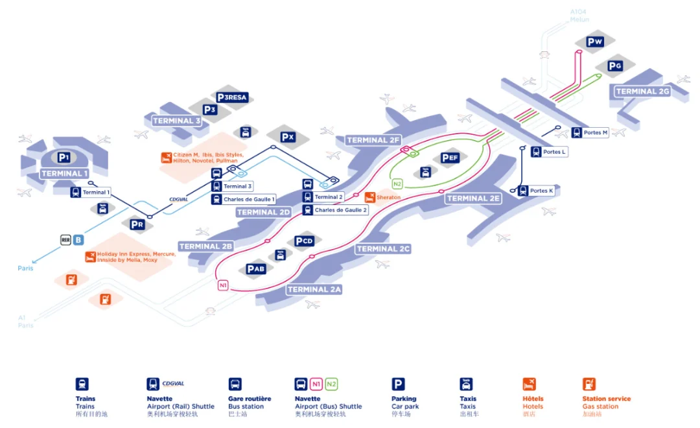
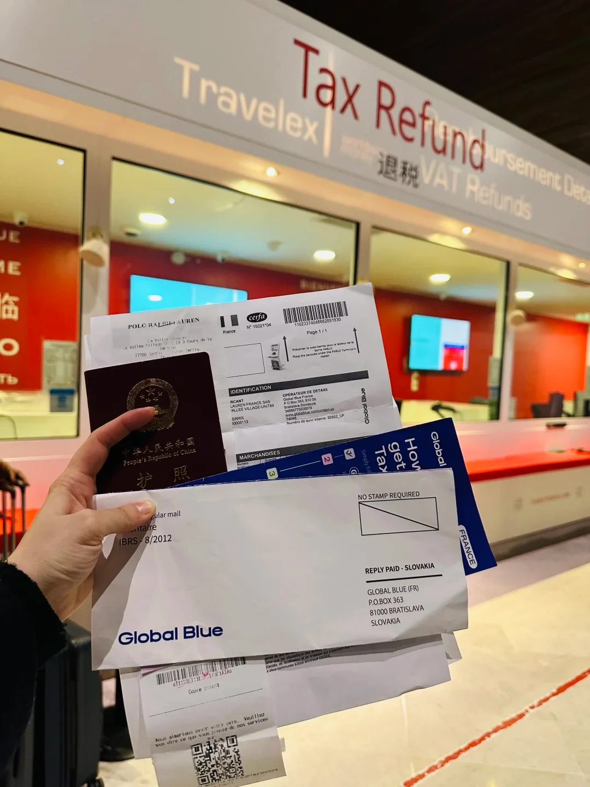

Jako największy międzynarodowy port lotniczy Francji i jeden z kluczowych węzłów lotniczych Europy, **Paryż Charles de Gaulle (CDG)** to miejsce, w którym większość odwiedzających po raz pierwszy styka się z miastem. Leży w Roissy, około 25 km na północny wschód od Paryża, zajmuje około 30 kilometrów kwadratowych i ma **210 bramek** — najwięcej ze wszystkich lotnisk na świecie.

Ten przewodnik omawia **układ terminali**, **transport wewnątrz lotniska**, **przechowalnię bagażu**, **banki i kantory**, **zwrot podatku**, **strefy odpoczynku i salony**, **Wi-Fi i ładowanie urządzeń**, **karty SIM** oraz **udogodnienia dla osób z niepełnosprawnościami i rodzin** — usługi, o których warto wiedzieć przed lądowaniem.

## 1. Terminale i ich poziomy

### Trzy terminale i siedem podterminali w obrębie T2

CDG ma **trzy terminale: 1, 2 i 3**. **T2 jest głównym**, podzielonym na **siedem bloków — T2A, T2B, T2C, T2D, T2E, T2F i T2G** — rozmieszczonych symetrycznie wzdłuż południowej strony lotniska; obejmuje on także pirs K oraz dwa satelity L i M. Korzystają z niego głównie **Air France i jej partnerzy ze SkyTeam**. **T3 leży na północy**, jest mały i prosty, i obsługuje tylko niektóre tanie linie lotnicze.

T1 znajduje się na północnym zachodzie: okrągły budynek w kształcie latającego spodka, drugi główny terminal, obsługiwany przede wszystkim przez członków sojuszy **Star Alliance i oneworld**.

### Do czego służy każdy poziom T1

T1 rozkłada odprawę, odloty, przyloty i gastronomię na dziewięciu poziomach, więc wybór właściwego poziomu oszczędza sporo chodzenia:

| Poziom | Przeznaczenie | Co się tam znajduje |
| --- | --- | --- |
| 1 | Poziom transportu | Pociąg CDGVAL, restauracje, kilka stanowisk odprawy |
| 2 | Poziom odprawy | Stanowiska odprawy, podjazd taksówek, dworzec autobusowy |
| 3 | Odloty | Kontrola bezpieczeństwa, kontrola graniczna, sklepy duty-free |
| 4 | Przyloty | Taśmy bagażowe |
| 5–7 | Parkingi | Parkingi |
| 8 | Gastronomia | Restauracje, biura |
| 9 | Widokowy | Taras widokowy |

### Które linie lotnicze korzystają z którego terminala

Podział między T1, T2 i T3 jest znaczny, a w obrębie T2 trzeba jeszcze znać podterminal (na przykład Air China Eastern jest w T2E, a Hainan Airlines w T2A). Zawsze sprawdź kod terminala na karcie pokładowej:

| Terminal | Główne linie lotnicze (z materiału źródłowego) |
| --- | --- |
| T1 | Air China, EVA Air, China Airlines, United, Lufthansa, ANA, Eurowings, Qatar Airways, Turkish Airlines, Singapore Airlines, SWISS, SAS, Norwegian, LOT, Aegean |
| T2 | China Eastern (T2E), China Southern (T2E), Hainan Airlines (T2A), Cathay Pacific (T2A), Air France (T2E, T2F), British Airways (T2A), American Airlines (T2A), Delta (T2E), Air Canada (T2A), Japan Airlines (T2E), Korean Air (T2E), Emirates (T2C), Aeroflot (T2C), Finnair (T2D), Alitalia (T2F), KLM (T2F), Ukraine International (T2D), easyJet (T2D) |
| T3 | Głównie trasy hiszpańskie, takie jak Vueling, a także czartery i sezonowe połączenia śródziemnomorskie |

Przypisania terminali się zmieniają (Germanwings i Alitalia z pierwotnej listy już zakończyły działalność lub połączyły się), więc potwierdź je u swojej linii lotniczej i na lotnisku w dniu podróży.

## 2. Poruszanie się po lotnisku: CDGVAL i autobusy wahadłowe

Terminale CDG są daleko od siebie, a przejazd przez lotnisko czasem wymaga pojazdu. Są dwa: **bezpłatny pociąg wahadłowy CDGVAL** (zwany także RoissyVal) i **autobusy wahadłowe Navette**, które kursują między T1, T2, T3 i parkingami.

Choć terminale dzieli spory dystans, układ jest logiczny, a większość znaków ma teraz także chiński, więc wystarczy za nimi podążać. Przy zmianie terminala zaplanuj 20–30 minut — przejazd CDGVAL zajmuje kilka minut, ale czekanie i chodzenie już nie.

## 3. Przechowalnia bagażu

Jeśli chcesz najpierw zobaczyć Paryż albo masz długą przesiadkę, zostaw bagaże:

- **Gdzie:** w **hali dworca TGV terminalu 2**, obok hotelu Sheraton;
- **Bezpieczeństwo:** prześwietlanie rentgenowskie i stały monitoring wideo;
- **Ceny:** elastyczne, za godzinę lub za dobę;
- **Dodatki:** przechowywanie przedmiotów specjalnych lub wartościowych, udogodnienia dla zwierząt oraz pakowanie bagażu i dostawa do hotelu;
- **Języki:** wielojęzyczny personel.

## 4. Banki i kantory

- **Każdy terminal ma kantory** (Global Exchange i inne) obsługujące euro i waluty obce; znajdują się zarówno w strefie publicznej, jak i w strefie celnej, w pobliżu hal odprawy i bramek.
- **Bankomaty** są rozsiane po terminalach i służą do wypłaty gotówki i codziennych transakcji — w hali przylotów i przy bramkach.

- Pamiętaj, że **większość banków pobiera opłaty za wypłaty zagraniczne**, więc przed wyjazdem sprawdź prowizje i limity swojego banku. Kantory na lotnisku rzadko mają lepszy kurs niż miasto, więc wymieniaj tylko tyle, ile potrzebujesz na transport i sytuacje awaryjne.

## 5. Zwrot podatku (détaxe)

Osoby niebędące rezydentami UE (w wieku 16 lat lub więcej, przebywające we Francji lub w UE krócej niż sześć miesięcy) mogą odzyskać VAT od zakupów o wartości **100,01 euro lub więcej, z VAT, w tym samym sklepie tego samego dnia**. Weź **paszport, wszystkie towary, formularz tax-free i paragon**; towary muszą być nieużywane i w oryginalnym opakowaniu.

Punkty potwierdzenia na CDG:

| Terminal | Gdzie się ubiegać |
| --- | --- |
| T1 | Jeden poziom poniżej poziomu CDGVAL |
| T2A / T2B / T2C / T2D | Poziom odlotów, przy bramce 6 |
| T2E | Poziom odlotów, przy bramce 4 |
| T2F / T3 | Poziom przylotów |

Proces i miejsca, w których ludzie najczęściej popełniają błędy:

1. Poproś o formularz tax-free w sklepie (weź paszport), a następnie zeskanuj jego kod kreskowy w **samoobsługowym terminalu PABLO** — zielony ekran "OK Bordereau validé" to pieczęć celna;
2. **Zrób to przed odprawą lub nadaniem bagażu**, ponieważ celnicy mogą chcieć zobaczyć nieużywane towary;
3. Francuskie formularze można potwierdzić tylko w automatach; **towary kupione w innych krajach UE muszą zostać ostemplowane przy stanowisku celnym**;
4. Potwierdzenie jest ważne **trzy miesiące plus bieżący miesiąc** od daty zakupu, a zwroty zwykle przychodzą 6–8 tygodni po potwierdzeniu.

## 6. Strefy odpoczynku i salony

- **Bezpłatne strefy odpoczynku:** lotnisko udostępnia darmowe miejsca do siedzenia, gdzie można odpocząć przed lotem lub w trakcie przesiadki; jeśli nie masz hotelu lub chcesz zaoszczędzić, możesz tam również spędzić noc. Zwykle znajdują się przy najdalszych bramkach — podążaj za znakami.
- **Płatna strefa odpoczynku:** wewnątrz bezpłatnej strefy znajduje się osobna płatna część, gdzie można odpocząć i wziąć prysznic.
- **Salony:** pasażerowie klas biznes i pierwszej oraz członkowie programów lojalnościowych linii lotniczych mogą korzystać z salonów; pasażerowie klasy ekonomicznej zwykle mogą wejść za opłatą.
- **Strefy pracy:** wspólne przestrzenie robocze w terminalach, z biurkami, gniazdkami zasilania i dobrym oświetleniem.
- **Obserwacja samolotów:** niektóre strefy odpoczynku wychodzą bezpośrednio na pas startowy.
- **Palenie:** wszystkie terminale mają wyznaczone miejsca do palenia.

## 7. Wi-Fi, ładowanie i karty SIM

- **Bezpłatne Wi-Fi:** obejmuje każdy terminal; połącz się z siecią **"WIFI-AIRPORT"** i jesteś online.
- **Ładowanie:** szukaj stacji **ChargeBox**, bezpłatnych w halach odlotów głównych terminali za kontrolą bezpieczeństwa (terminal 1; T2D; hale L i M w T2E; terminal 3).

- **Karty SIM:** każdy terminal ma stanowiska **Relay, Fnac i Orange** sprzedające lokalne karty SIM i akcesoria, z wielojęzycznym personelem i aktywacją w sklepie — kupujesz i wkładasz. Popularna opcja turystyczna to Orange Holiday (na przykład 100 GB / 5G za około 49,99 euro), dostępna przy ladzie.

Stanowiska i godziny otwarcia:

| Stanowisko | Lokalizacja | Godziny |
| --- | --- | --- |
| Orange SIM Card | T1, poziom 5 (przyloty) | 06:00–20:30 |
| Orange SIM Card | T2E, poziom 0 (za kontrolą bezpieczeństwa) | 06:00–21:00 |
| Relay | T2E, poziom 0 (przed kontrolą bezpieczeństwa) | 06:00–22:00 |
| Fnac | T1, poziom 3 (przed kontrolą bezpieczeństwa) | 06:00–21:00 |

## 8. Udogodnienia dla osób z niepełnosprawnościami i rodzin

**Pomoc (PWD):**

- Terminale zapewniają pomoc pasażerom z niepełnosprawnościami — zgłoś ją u swojej linii lotniczej lub w biurze podróży **co najmniej 48 godzin** przed odlotem;
- Punkty spotkań znajdują się wewnątrz i na zewnątrz terminali, z samoobsługowymi wózkami inwalidzkimi i wózkami dziecięcymi;
- Nowoczesne, dostępne przebieralnie obejmują rodziny z dziećmi i podróżnych z niepełnosprawnościami;
- T2E i T2F mają po **strefie dla psów**, zapewniającej psom asystującym wygodne i bezpieczne miejsce.

**Udogodnienia dla rodzin:**

- Bezpłatne usługi dla podróżnych z niemowlętami lub małymi dziećmi;
- Miejsca do przewijania i toalety przystosowane do małych dzieci;
- Niektóre terminale mają **pokoje dla niemowląt** z pełnym wyposażeniem do opieki, w tym podgrzewaczami do butelek i łóżeczkami.

## Powiązane linki

- **Na tej stronie**: [Port lotniczy Paryż Charles de Gaulle (CDG)](/airport/CDG), [Francja (FR)](/country/FR)
- **Wikipedia**: [Port lotniczy Charles de Gaulle](https://en.wikipedia.org/wiki/Paris_Charles_de_Gaulle_Airport)
- **Baidu Baike**: [Port lotniczy Charles de Gaulle](https://baike.baidu.com/item/%E5%B7%B4%E9%BB%8E%E5%A4%8F%E5%B0%94%C2%B7%E6%88%B4%E9%AB%98%E4%B9%90%E6%9C%BA%E5%9C%BA)
