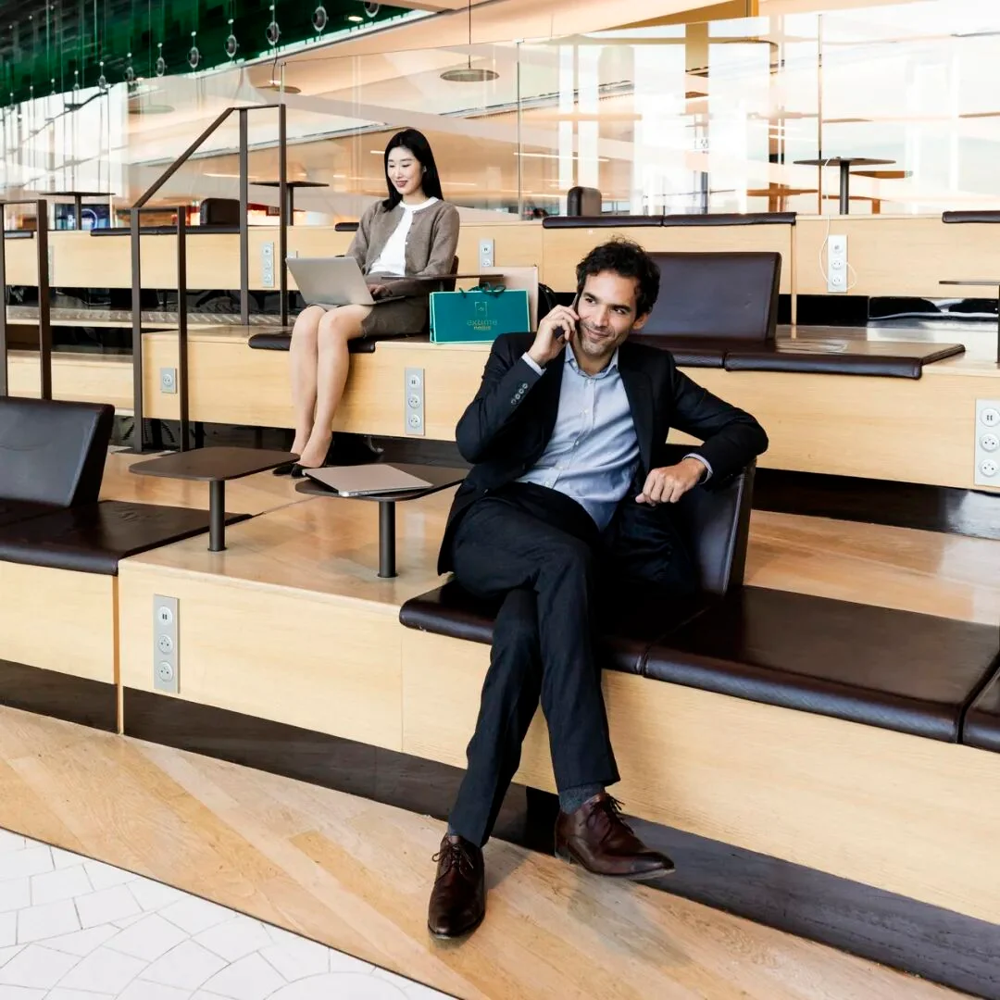
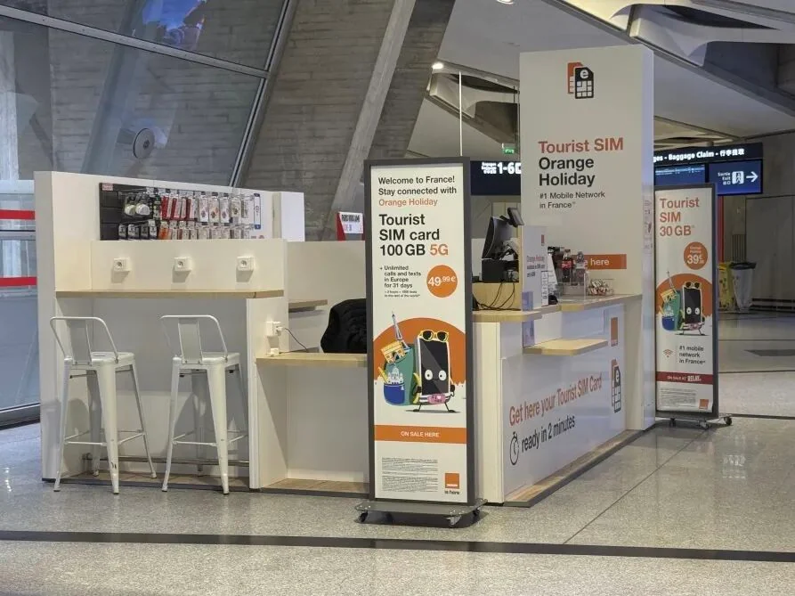

Fiind cel mai mare aeroport internațional din Franța și unul dintre hub-urile aviatice principale ale Europei, **Paris Charles de Gaulle (CDG)** este locul unde majoritatea vizitatorilor fac primul contact cu orașul. Se află la Roissy, la circa 25 km nord-est de Paris, se întinde pe aproximativ 30 de kilometri pătrați și are **210 porți de îmbarcare** — mai multe decât orice alt aeroport din lume.

Acest ghid parcurge **amplasarea terminalelor**, **transportul în interiorul aeroportului**, **consigna de bagaje**, **băncile și schimbul valutar**, **rambursările de TVA**, **zonele de odihnă și saloanele**, **Wi-Fi și încărcarea**, **cartelele SIM** și **facilitățile pentru persoane cu dizabilități și familii** — serviciile care merită cunoscute înainte de a ateriza.

## 1. Terminalele și nivelurile lor

### Trei terminale și șapte subterminale în interiorul T2

CDG are **trei terminale: 1, 2 și 3**. **T2 este principalul**, împărțit în **șapte blocuri — T2A, T2B, T2C, T2D, T2E, T2F și T2G** — dispuse simetric de-a lungul laturii sudice a aeroportului; include de asemenea brațul K și cele două satelite L și M și este folosit în principal de **Air France și partenerii săi SkyTeam**. **T3 este în nord**, mic și simplu, și deservește doar câteva companii low-cost.

T1 se află în nord-vest: o clădire circulară, în formă de farfurie zburătoare, celălalt terminal principal, folosit în principal de membrii alianțelor **Star Alliance și oneworld**.

### Ce rol are fiecare nivel din T1

T1 distribuie check-in-ul, plecările, sosirile și restaurantele pe nouă niveluri, așa că alegerea nivelului potrivit economisește mult mers pe jos:

| Nivel | Funcție | Ce se află acolo |
| --- | --- | --- |
| 1 | Nivel de transport | Trenul CDGVAL, restaurante, câteva ghișee de check-in |
| 2 | Nivel de check-in | Ghișee de check-in, debarcare taxi, stație de autobuz |
| 3 | Plecări | Control de securitate, control de frontieră, magazine duty-free |
| 4 | Sosiri | Carusele de bagaje |
| 5–7 | Parcare | Parcări |
| 8 | Restaurante | Restaurante, birouri |
| 9 | Observare | Terasă de observare |

### Ce companii aeriene folosesc fiecare terminal

Împărțirea între T1, T2 și T3 este importantă, iar în interiorul T2 trebuie să știți și subterminalul (Air China Eastern este la T2E, de exemplu, iar Hainan Airlines la T2A). Verificați întotdeauna codul terminalului de pe cartea de îmbarcare:

| Terminal | Companii aeriene principale (din materialul original) |
| --- | --- |
| T1 | Air China, EVA Air, China Airlines, United, Lufthansa, ANA, Eurowings, Qatar Airways, Turkish Airlines, Singapore Airlines, SWISS, SAS, Norwegian, LOT, Aegean |
| T2 | China Eastern (T2E), China Southern (T2E), Hainan Airlines (T2A), Cathay Pacific (T2A), Air France (T2E, T2F), British Airways (T2A), American Airlines (T2A), Delta (T2E), Air Canada (T2A), Japan Airlines (T2E), Korean Air (T2E), Emirates (T2C), Aeroflot (T2C), Finnair (T2D), Alitalia (T2F), KLM (T2F), Ukraine International (T2D), easyJet (T2D) |
| T3 | În principal rute spaniole precum Vueling, plus servicii charter și sezoniere în Mediterana |

Atribuirile de terminal se schimbă (Germanwings și Alitalia din lista originală și-au încetat între timp activitatea sau au fuzionat), așa că confirmați cu compania aeriană și cu aeroportul pentru ziua în care călătoriți.

## 2. Deplasarea în interiorul aeroportului: CDGVAL și autobuzele navetă

Terminalele CDG sunt departe unul de altul, iar traversarea aeroportului necesită uneori un vehicul. Există două: **trenul navetă gratuit CDGVAL** (numit și RoissyVal) și **autobuzele navetă Navette**, ambele circulând între T1, T2, T3 și parcări.

Deși terminalele sunt la o distanță considerabilă, amplasarea este logică, iar majoritatea indicatoarelor au acum și chineză, așa că este suficient să le urmați. Prevedeți 20–30 de minute la schimbarea terminalelor — o cursă CDGVAL durează câteva minute, dar așteptarea și mersul pe jos nu.

## 3. Consigna de bagaje

Dacă vreți să vedeți mai întâi Parisul sau aveți o escală lungă, lăsați bagajele în urmă:

- **Unde:** în **holul gării TGV din Terminalul 2**, lângă hotelul Sheraton;
- **Securitate:** control cu raze X și supraveghere video permanentă;
- **Tarife:** flexibile, la oră sau la zi;
- **Suplimentar:** spații pentru obiecte speciale sau de valoare, facilități pentru animale de companie, plus ambalarea bagajelor și livrarea la hotel;
- **Limbi:** personal poliglot.

## 4. Bănci și schimb valutar

- **Fiecare terminal are birouri de schimb valutar** (Global Exchange și altele) care tranzacționează euro și valută; acestea se află atât în zonele publice, cât și în cele vamale, lângă sălile de check-in și lângă porți.
- **Bancomatele** sunt răspândite prin terminale pentru retrageri de numerar și tranzacții curente — în sala de sosiri și lângă porți.

- Rețineți că **majoritatea băncilor percep comisioane pentru retragerile în străinătate**, așa că verificați comisioanele și limitele băncii dumneavoastră înainte de călătorie. Birourile de schimb din aeroport rareori bat orașul la curs, așa că schimbați doar ce aveți nevoie pentru transport și situații de urgență.

## 5. Rambursarea TVA (détaxe)

Rezidenții din afara UE (cu vârsta de 16 ani sau mai mult, care stau în Franța sau în UE mai puțin de șase luni) pot recupera TVA-ul pentru achiziții de **100,01 € sau mai mult, cu TVA inclus, în același magazin, în aceeași zi**. Aveți la dumneavoastră **pașaportul, toate produsele, formularul tax-free și bonul**; produsele trebuie să fie nefolosite și în ambalajul original.

Punctele de validare din CDG:

| Terminal | Unde se depune |
| --- | --- |
| T1 | Un nivel sub nivelul CDGVAL |
| T2A / T2B / T2C / T2D | Nivelul de plecări, lângă poarta 6 |
| T2E | Nivelul de plecări, lângă poarta 4 |
| T2F / T3 | Nivelul de sosiri |

Procesul și părțile pe care oamenii le greșesc:

1. Cereți formularul tax-free în magazin (luați pașaportul), apoi scanați codul de bare la un **terminal self-service PABLO** — un ecran verde „OK Bordereau validé” reprezintă ștampila vamală;
2. **Faceți asta înainte de check-in sau de predarea bagajelor**, pentru că vama poate dori să vadă produsele nefolosite;
3. Formularele franceze pot fi validate doar la automate; **produsele cumpărate în alte țări UE trebuie ștampilate la un ghișeu vamal**;
4. Validarea este valabilă **trei luni plus luna curentă** de la data achiziției, iar rambursările ajung de obicei la 6–8 săptămâni după validare.

## 6. Zone de odihnă și saloane

- **Zone de odihnă gratuite:** aeroportul pune la dispoziție zone gratuite cu locuri pe scaun pentru relaxare înainte de un zbor sau în timpul unei escale; dacă nu aveți hotel sau vreți să economisiți, puteți petrece și noaptea acolo. Sunt de obicei lângă porțile cele mai îndepărtate — urmați indicatoarele.
- **Zonă de odihnă contra cost:** în interiorul zonei gratuite există o zonă separată, contra cost, unde vă puteți odihni și face duș.
- **Saloane:** pasagerii de la business și first class și membrii de elită ai companiilor aeriene pot folosi saloanele; pasagerii de la economy pot de obicei plăti pentru a intra.
- **Zone de lucru:** spații de lucru partajate în terminale, cu birouri, prize de curent și iluminare decentă.
- **Observarea avioanelor:** unele zone de odihnă au vedere directă spre pista de decolare-aterizare.
- **Fumat:** toate terminalele au zone pentru fumători.

## 7. Wi-Fi, încărcare și cartele SIM

- **Wi-Fi gratuit:** acoperă fiecare terminal; conectați-vă la rețeaua **„WIFI-AIRPORT”** și sunteți online.
- **Încărcare:** căutați stațiile **ChargeBox**, gratuite în sălile de plecări de după controlul de securitate din terminalele principale (Terminalul 1; T2D; sălile L și M din T2E; Terminalul 3).

- **Cartele SIM:** fiecare terminal are ghișee **Relay, Fnac și Orange** care vând cartele SIM locale și accesorii, cu personal poliglot și activare în magazin — o cumpărați și o introduceți. Opțiunea obișnuită pentru turiști este Orange Holiday (de exemplu 100 GB / 5G la aproximativ 49,99 €), disponibilă la ghișeu.

Ghișee și program de funcționare:

| Ghișeu | Locație | Program |
| --- | --- | --- |
| Orange SIM Card | T1, nivelul 5 (sosiri) | 06:00–20:30 |
| Orange SIM Card | T2E, nivelul 0 (după securitate) | 06:00–21:00 |
| Relay | T2E, nivelul 0 (înainte de securitate) | 06:00–22:00 |
| Fnac | T1, nivelul 3 (înainte de securitate) | 06:00–21:00 |

## 8. Facilități pentru persoane cu dizabilități și familii

**Asistență pentru persoane cu dizabilități (PWD):**

- Terminalele oferă asistență pentru pasagerii cu dizabilități — rezervați cu compania aeriană sau agenția de voiaj **cu cel puțin 48 de ore** înainte de plecare;
- Punctele de întâlnire sunt în interiorul și în exteriorul terminalelor, cu scaune rulante și cărucioare disponibile în regim self-service;
- Camere de schimb moderne și accesibile, pentru familiile cu copii și călătorii cu dizabilități;
- T2E și T2F au fiecare o **zonă pentru câini**, oferind câinilor utilitari un spațiu confortabil și sigur.

**Facilități pentru familii:**

- Servicii gratuite pentru călătorii cu bebeluși sau copii mici;
- Zone pentru schimbat bebeluși și toalete concepute pentru copii mici;
- Unele terminale au **camere pentru bebeluși** cu echipament complet de îngrijire, inclusiv încălzitoare de biberoane și pătuțuri.

## Linkuri conexe

- **Pe acest site**: [Aeroportul Paris Charles de Gaulle (CDG)](/airport/CDG), [Franța (FR)](/country/FR)
- **Wikipedia**: [Aeroportul Charles de Gaulle](https://en.wikipedia.org/wiki/Paris_Charles_de_Gaulle_Airport)
- **Baidu Baike**: [Aeroportul Charles de Gaulle](https://baike.baidu.com/item/%E5%B7%B4%E9%BB%8E%E5%A4%8F%E5%B0%94%C2%B7%E6%88%B4%E9%AB%98%E4%B9%90%E6%9C%BA%E5%9C%BA)
