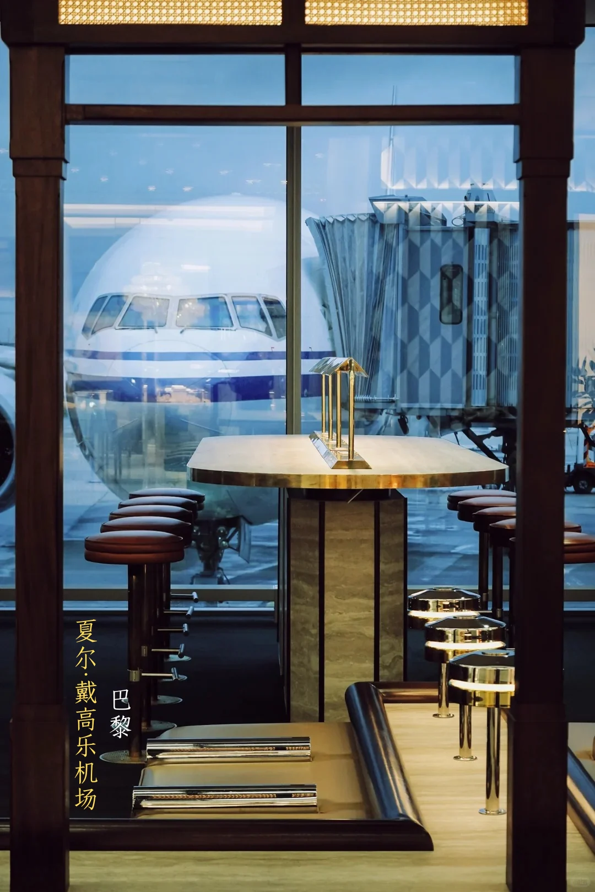
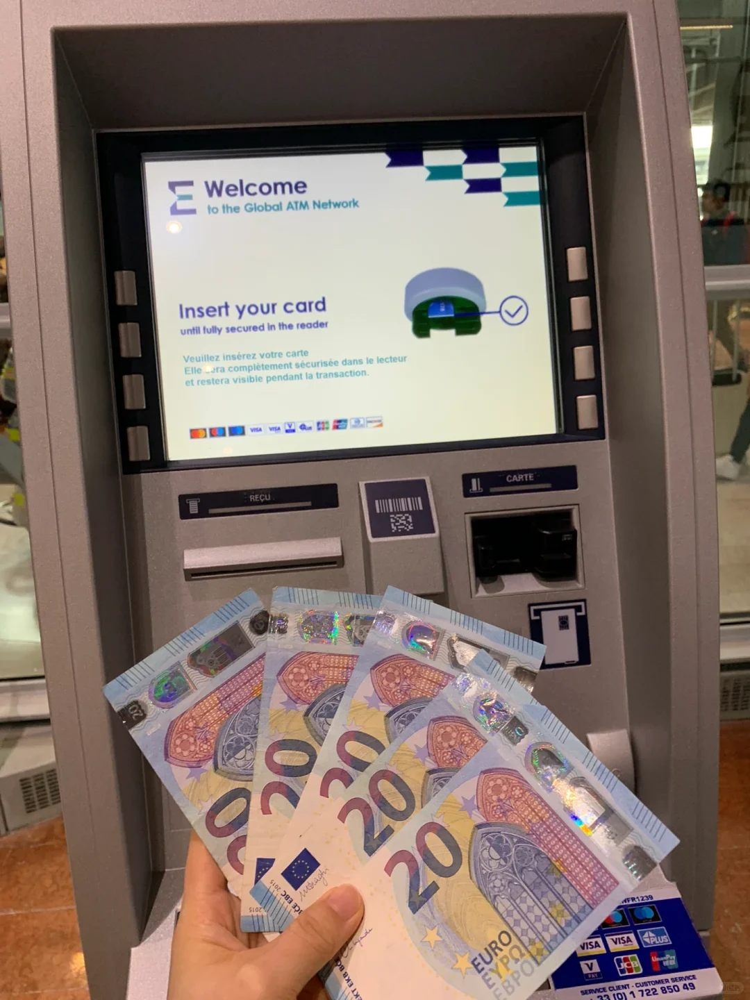

Как крупнейший международный аэропорт Франции и один из ключевых авиационных узлов Европы, **аэропорт Париж-Шарль-де-Голль (CDG)** — это место, где большинство гостей впервые знакомятся с городом. Он расположен в Руасси, примерно в 25 км к северо-востоку от Парижа, занимает около 30 квадратных километров и имеет **210 выходов** — больше, чем любой другой аэропорт мира.

Этот гид последовательно разбирает **устройство терминалов**, **транспорт внутри аэропорта**, **камеры хранения**, **банки и обмен валюты**, **возврат налога**, **зоны отдыха и залы ожидания**, **Wi-Fi и зарядку**, **SIM-карты**, а также **доступность и семейные удобства** — услуги, о которых стоит знать до посадки.

## 1. Терминалы и их этажи

### Три терминала и семь субтерминалов внутри T2

В CDG **три терминала: 1, 2 и 3**. **T2 — главный**, он делится на **семь блоков — T2A, T2B, T2C, T2D, T2E, T2F и T2G**, — симметрично расположенных вдоль южной стороны аэропорта, и включает также пирс K и два сателлита L и M; им пользуются в основном **Air France и её партнёры по SkyTeam**. **T3 находится на севере**, он небольшой и простой и обслуживает только некоторые лоукостеры.

T1 расположен на северо-западе: круглое здание в форме летающей тарелки, второй главный терминал, которым пользуются в основном члены альянсов **Star Alliance и oneworld**.

### Что находится на каждом этаже T1

В T1 регистрация, вылет, прилёт и рестораны распределены по девяти уровням, поэтому правильный выбор этажа экономит много ходьбы:

| Уровень | Назначение | Что там |
| --- | --- | --- |
| 1 | Транспортный уровень | Поезд CDGVAL, рестораны, несколько регистрационных стоек |
| 2 | Уровень регистрации | Регистрационные стойки, высадка такси, автобусная станция |
| 3 | Вылет | Досмотр, паспортный контроль, магазины duty-free |
| 4 | Прилёт | Ленты выдачи багажа |
| 5–7 | Парковка | Автостоянки |
| 8 | Рестораны | Рестораны, офисы |
| 9 | Наблюдение | Смотровая площадка |

### Какие авиакомпании в каком терминале

Разделение между T1, T2 и T3 существенное, а внутри T2 нужно знать ещё и субтерминал (например, Air China Eastern — в T2E, а Hainan Airlines — в T2A). Всегда проверяйте код терминала в посадочном талоне:

| Терминал | Основные авиакомпании (по исходным материалам) |
| --- | --- |
| T1 | Air China, EVA Air, China Airlines, United, Lufthansa, ANA, Eurowings, Qatar Airways, Turkish Airlines, Singapore Airlines, SWISS, SAS, Norwegian, LOT, Aegean |
| T2 | China Eastern (T2E), China Southern (T2E), Hainan Airlines (T2A), Cathay Pacific (T2A), Air France (T2E, T2F), British Airways (T2A), American Airlines (T2A), Delta (T2E), Air Canada (T2A), Japan Airlines (T2E), Korean Air (T2E), Emirates (T2C), Aeroflot (T2C), Finnair (T2D), Alitalia (T2F), KLM (T2F), Ukraine International (T2D), easyJet (T2D) |
| T3 | В основном испанские маршруты, например Vueling, а также чартерные и сезонные средиземноморские рейсы |

Распределение по терминалам меняется (Germanwings и Alitalia из исходного списка с тех пор прекратили работу или объединились), поэтому уточняйте у авиакомпании и аэропорта в день поездки.

## 2. Передвижение внутри аэропорта: CDGVAL и шаттлы

Терминалы CDG находятся далеко друг от друга, и иногда, чтобы пересечь аэропорт, нужен транспорт. Его два вида: **бесплатный автоматический поезд CDGVAL** (его также называют RoissyVal) и **шаттлы Navette**, оба курсируют между T1, T2, T3 и парковками.

Хотя терминалы находятся на приличном расстоянии, планировка логична, а большинство указателей теперь дублируются на китайском, так что достаточно идти по ним. При смене терминала закладывайте 20–30 минут: поездка на CDGVAL занимает минуты, а ожидание и ходьба — нет.

## 3. Камеры хранения

Если хотите сначала посмотреть Париж или у вас долгая стыковка, оставьте багаж:

- **Где:** в **вестибюле вокзала TGV терминала 2**, рядом с отелем Sheraton;
- **Безопасность:** рентгеновский контроль и постоянное видеонаблюдение;
- **Тарифы:** гибкие, почасовые или посуточные;
- **Дополнительно:** хранение особых или ценных вещей, размещение с животными, а также упаковка багажа и доставка в отель;
- **Языки:** персонал говорит на нескольких языках.

## 4. Банки и обмен валюты

- **В каждом терминале есть обменные пункты** (Global Exchange и другие), работающие с евро и иностранной валютой; они находятся и в общедоступной зоне, и в таможенной зоне, рядом с залами регистрации и выходами.
- **Банкоматы** распределены по терминалам для снятия наличных и повседневных операций — в зале прилёта и рядом с выходами.

- Учтите, что **большинство банков берут комиссию за снятие за рубежом**, поэтому до поездки проверьте тарифы и лимиты своего банка. Обменные пункты в аэропорту редко выигрывают у города по курсу, поэтому меняйте только то, что нужно на транспорт и непредвиденные расходы.

## 5. Возврат налога (détaxe)

Нерезиденты ЕС (в возрасте 16 лет и старше, находящиеся во Франции или ЕС менее шести месяцев) могут вернуть НДС с покупок на **€100,01 и более с учётом НДС в одном магазине за один день**. Возьмите с собой **паспорт, все товары, форму tax-free и чек**; товары должны быть неиспользованными и в оригинальной упаковке.

Точки подтверждения в CDG:

| Терминал | Где оформлять |
| --- | --- |
| T1 | На один уровень ниже CDGVAL |
| T2A / T2B / T2C / T2D | Уровень вылета, возле выхода 6 |
| T2E | Уровень вылета, возле выхода 4 |
| T2F / T3 | Уровень прилёта |

Процесс и то, в чём чаще всего ошибаются:

1. Попросите форму tax-free в магазине (возьмите паспорт), затем отсканируйте её штрихкод в **терминале самообслуживания PABLO**: зелёный экран «OK Bordereau validé» и есть таможенный штамп;
2. **Сделайте это до регистрации или сдачи багажа**, потому что таможня может захотеть увидеть неиспользованные товары;
3. Французские формы можно подтвердить только в автоматах; **товары, купленные в других странах ЕС, должны получить штамп в таможенном окне**;
4. Подтверждение действительно **три месяца плюс текущий месяц** с даты покупки, а возврат обычно приходит через 6–8 недель после подтверждения.

## 6. Зоны отдыха и залы ожидания

- **Бесплатные зоны отдыха:** аэропорт предоставляет бесплатные зоны с сиденьями, чтобы отдохнуть перед рейсом или во время стыковки; если у вас нет отеля или хотите сэкономить, там можно и переночевать. Обычно они находятся рядом с самыми дальними выходами — идите по указателям.
- **Платная зона отдыха:** внутри бесплатной зоны есть отдельная платная часть, где можно отдохнуть и принять душ.
- **Залы ожидания:** пассажиры бизнес- и первого класса и элитные участники программ авиакомпаний могут пользоваться залами ожидания; пассажиры эконом-класса обычно могут войти за плату.
- **Рабочие зоны:** общие рабочие пространства в терминалах со столами, розетками и хорошим освещением.
- **Наблюдение за самолётами:** из некоторых зон отдыха открывается прямой вид на взлётную полосу.
- **Курение:** во всех терминалах есть отведённые места для курения.

## 7. Wi-Fi, зарядка и SIM-карты

- **Бесплатный Wi-Fi:** покрывает все терминалы; подключитесь к сети **«WIFI-AIRPORT»** — и вы в сети.
- **Зарядка:** ищите станции **ChargeBox**, бесплатные в залах вылета после досмотра в основных терминалах (терминал 1; T2D; залы L и M терминала T2E; терминал 3).

- **SIM-карты:** в каждом терминале есть стойки **Relay, Fnac и Orange**, продающие местные SIM-карты и аксессуары, с многоязычным персоналом и активацией на месте: купите и вставьте. Популярный туристический вариант — Orange Holiday (например, 100 ГБ / 5G примерно за €49,99), продаётся на стойке.

Стойки и часы работы:

| Стойка | Расположение | Часы работы |
| --- | --- | --- |
| Orange SIM Card | T1, уровень 5 (прилёт) | 06:00–20:30 |
| Orange SIM Card | T2E, уровень 0 (после досмотра) | 06:00–21:00 |
| Relay | T2E, уровень 0 (до досмотра) | 06:00–22:00 |
| Fnac | T1, уровень 3 (до досмотра) | 06:00–21:00 |

## 8. Доступность и семейные удобства

**Помощь пассажирам с ограниченными возможностями:**

- Терминалы предоставляют помощь пассажирам с инвалидностью — заказывайте её у авиакомпании или турагента **не менее чем за 48 часов** до вылета;
- Пункты встречи находятся внутри и снаружи терминалов, есть кресла-коляски и прогулочные коляски самообслуживания;
- Современные доступные комнаты для переодевания предусмотрены для семей с детьми и путешественников с инвалидностью;
- В T2E и T2F есть **зоны для собак**, где собаки-поводыри получают комфортное и безопасное место.

**Семейные удобства:**

- Бесплатные услуги для путешественников с младенцами и маленькими детьми;
- Зоны смены подгузников и туалеты, приспособленные для маленьких детей;
- В некоторых терминалах есть **детские комнаты** с полным набором для ухода, включая подогреватели бутылочек и кроватки.

## Связанные ссылки

- **На этом сайте**: [Аэропорт Париж-Шарль-де-Голль (CDG)](/airport/CDG), [Франция (FR)](/country/FR)
- **Википедия**: [Аэропорт Шарль-де-Голль](https://en.wikipedia.org/wiki/Paris_Charles_de_Gaulle_Airport)
- **Байду Байкэ**: [Аэропорт Шарль-де-Голль](https://baike.baidu.com/item/%E5%B7%B4%E9%BB%8E%E5%A4%8F%E5%B0%94%C2%B7%E6%88%B4%E9%AB%98%E4%B9%90%E6%9C%BA%E5%9C%BA)
