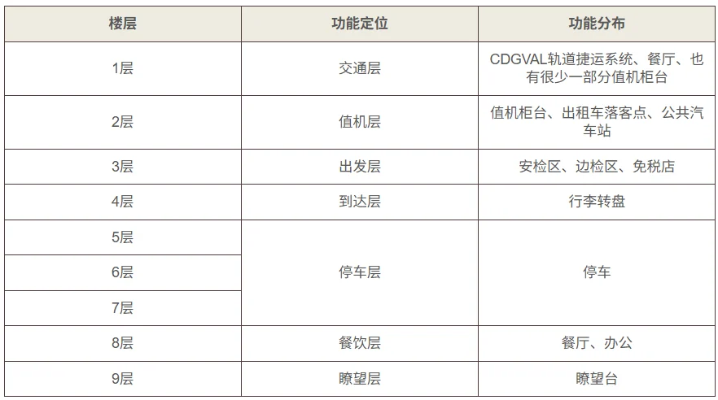
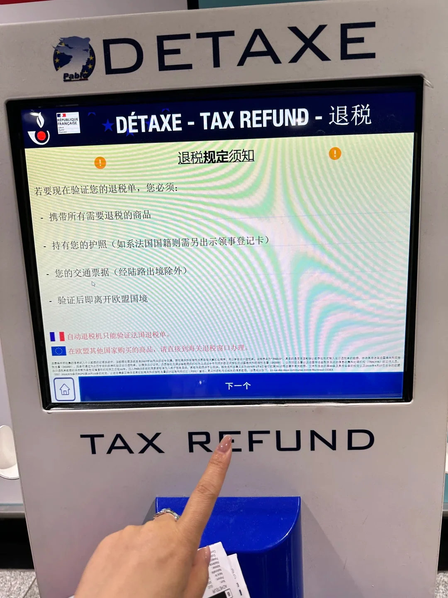
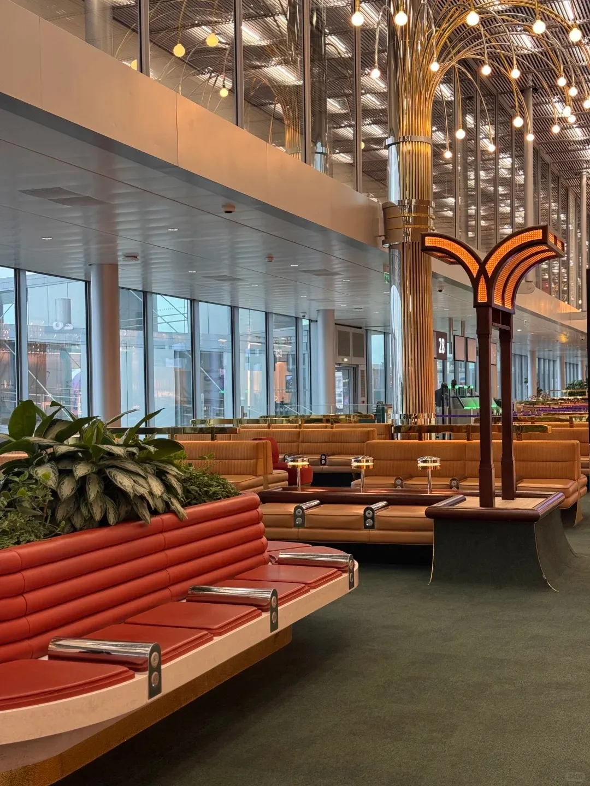
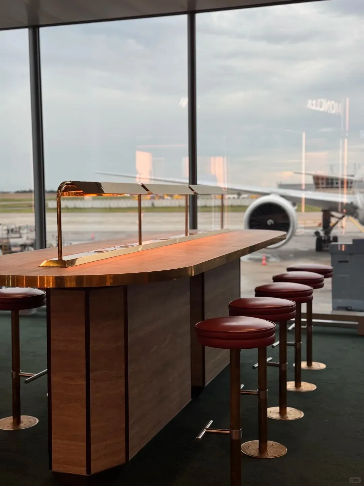

Som Frankrikes största internationella flygplats och en av Europas viktigaste flyghubbar är **Paris Charles de Gaulle (CDG)** där de flesta besökare först möter Paris. Den ligger i Roissy, cirka 25 km nordost om Paris, täcker ungefär 30 kvadratkilometer och har **210 gater** – flest av alla flygplatser i världen.

Den här guiden går igenom **terminalernas layout**, **transporter inne på flygplatsen**, **bagageförvaring**, **banker och växlingskontor**, **momsåterbäring**, **vilområden och lounger**, **wifi och laddning**, **SIM-kort** samt **tillgänglighet och familjefaciliteter** – tjänster som är värda att känna till innan du landar.

## 1. Terminaler och deras våningar

### Tre terminaler och sju delterminaler i T2

CDG har **tre terminaler: 1, 2 och 3**. **T2 är huvudterminalen**, uppdelad i **sju block – T2A, T2B, T2C, T2D, T2E, T2F och T2G** – symmetriskt ordnade längs flygplatsens södra sida, och den omfattar även pir K och de två satelliterna L och M; den används främst av **Air France och dess SkyTeam-partner**. **T3 ligger i norr**, är liten och enkel och tar bara emot vissa lågprisbolag.

T1 ligger i nordväst: en cirkelformad byggnad formad som ett flygande tefat, den andra huvudterminalen, som främst används av medlemmar i allianserna **Star Alliance och oneworld**.

### Vad varje våning i T1 används till

T1 fördelar incheckning, avgångar, ankomster och matställen över nio nivåer, så att välja rätt våning sparar många steg:

| Nivå | Funktion | Vad som finns där |
| --- | --- | --- |
| 1 | Transportnivå | CDGVAL-tåget, restauranger, några incheckningsdiskar |
| 2 | Incheckningsnivå | Incheckningsdiskar, taxinedsläpp, busstation |
| 3 | Avgångar | Säkerhetskontroll, passkontroll, taxfreebutiker |
| 4 | Ankomster | Bagageband |
| 5–7 | Parkering | Parkeringsanläggningar |
| 8 | Mat och dryck | Restauranger, kontor |
| 9 | Utsikt | Utsiktsdäck |

### Vilka flygbolag som använder vilken terminal

Uppdelningen mellan T1, T2 och T3 är betydande, och inom T2 måste du också hålla reda på delterminalen (Air China Eastern ligger till exempel i T2E och Hainan Airlines i T2A). Kontrollera alltid terminalkoden på ditt boardingkort:

| Terminal | Huvudsakliga flygbolag (enligt originalmaterialet) |
| --- | --- |
| T1 | Air China, EVA Air, China Airlines, United, Lufthansa, ANA, Eurowings, Qatar Airways, Turkish Airlines, Singapore Airlines, SWISS, SAS, Norwegian, LOT, Aegean |
| T2 | China Eastern (T2E), China Southern (T2E), Hainan Airlines (T2A), Cathay Pacific (T2A), Air France (T2E, T2F), British Airways (T2A), American Airlines (T2A), Delta (T2E), Air Canada (T2A), Japan Airlines (T2E), Korean Air (T2E), Emirates (T2C), Aeroflot (T2C), Finnair (T2D), Alitalia (T2F), KLM (T2F), Ukraine International (T2D), easyJet (T2D) |
| T3 | Främst spanska rutter som Vueling, samt charter- och säsongstrafik till Medelhavet |

Terminaltilldelningar ändras (Germanwings och Alitalia i originallistan har sedan dess lagts ned eller slagits samman), så bekräfta med ditt flygbolag och flygplatsen för dagen du reser.

## 2. Att ta sig runt på flygplatsen: CDGVAL och shuttlebussar

CDG:s terminaler ligger långt ifrån varandra, och att ta sig över flygplatsen kräver ibland ett fordon. Det finns två: det **kostnadsfria CDGVAL-shuttletåget** (även kallat RoissyVal) och **Navette-shuttlebussarna**, som båda går mellan T1, T2, T3 och parkeringsanläggningarna.

Även om terminalerna ligger en bra bit ifrån varandra är layouten logisk, och de flesta skyltar har nu kinesisk text, så det räcker att följa dem. Räkna med 20–30 minuter när du byter terminal – en tur med CDGVAL tar några minuter, men väntetid och promenader tillkommer.

## 3. Bagageförvaring

Om du vill se Paris först, eller har en lång mellanlandning, kan du lämna väskorna:

- **Var:** i **TGV-stationens hall i terminal 2**, nära Sheraton-hotellet;
- **Säkerhet:** röntgenkontroll och ständig videoövervakning;
- **Priser:** flexibla, per timme eller per dag;
- **Extra:** förvaring av särskilda eller värdefulla föremål, husdjursvänliga faciliteter samt bagageinpackning och leverans till hotell;
- **Språk:** personal som talar flera språk.

## 4. Banker och växlingskontor

- **Varje terminal har växlingskontor** (Global Exchange och andra) som växlar euro och utländsk valuta; de finns både i de allmänna områdena och i tullområdena, nära incheckningshallarna och gaterna.
- **Bankomater** finns utspridda i terminalerna för kontantuttag och vardagliga transaktioner – i ankomsthallen och nära gaterna.

- Observera att **de flesta banker tar ut en avgift för uttag utomlands**, så kontrollera din egen banks avgifter och gränser före resan. Växlingskontoren på flygplatsen har sällan bättre kurs än i staden, så växla bara det du behöver för transport och nödsituationer.

## 5. Momsåterbäring (détaxe)

Personer bosatta utanför EU (16 år eller äldre och som vistas i Frankrike eller EU i mindre än sex månader) kan få tillbaka momsen på köp av **minst 100,01 euro inklusive moms i samma butik samma dag**. Ta med **passet, alla varor, momsåterbäringsformuläret och kvittot**; varorna måste vara oanvända och i originalförpackning.

Valideringsställena på CDG:

| Terminal | Var du ansöker |
| --- | --- |
| T1 | En nivå under CDGVAL-nivån |
| T2A / T2B / T2C / T2D | Avgångsnivån, nära gate 6 |
| T2E | Avgångsnivån, nära gate 4 |
| T2F / T3 | Ankomstnivån |

Så går det till, och det som folk brukar göra fel:

1. Be om momsåterbäringsformuläret i butiken (ta med passet) och skanna sedan streckkoden i en **PABLO-självbetjäningsautomat** – en grön skärm med "OK Bordereau validé" är tullens stämpel;
2. **Gör detta innan du checkar in eller lämnar in väskorna**, eftersom tullen kan vilja se de oanvända varorna;
3. Franska formulär kan bara valideras i maskinerna; **varor som köpts i andra EU-länder måste stämplas vid en tulldisk**;
4. Valideringen gäller i **tre månader plus innevarande månad** från inköpsdatumet, och återbäringen kommer normalt 6–8 veckor efter valideringen.

## 6. Vilområden och lounger

- **Kostnadsfria vilområden:** flygplatsen erbjuder gratis sittområden för att koppla av före ett flyg eller under en mellanlandning; om du inte har något hotell eller vill spara pengar kan du också övernatta där. De ligger vanligtvis nära de mest avlägsna gaterna – följ skyltarna.
- **Betalt vilområde:** inne i det kostnadsfria området finns en separat betalzon där du kan vila och duscha.
- **Lounger:** passagerare i affärsklass och första klass samt flygbolagens elitmedlemmar kan använda loungerna; ekonomipassagerare kan vanligtvis betala för att komma in.
- **Arbetszoner:** delade arbetsytor i terminalerna med skrivbord, eluttag och bra belysning.
- **Flygskådning:** vissa vilområden har direkt utsikt över start- och landningsbanan.
- **Rökning:** alla terminaler har särskilda rökområden.

## 7. Wifi, laddning och SIM-kort

- **Gratis wifi:** finns i alla terminaler; anslut till nätverket **"WIFI-AIRPORT"** så är du uppkopplad.
- **Laddning:** leta efter **ChargeBox**-stationerna, som är gratis att använda i avgångshallarna efter säkerhetskontrollen i huvudterminalerna (terminal 1; T2D; hallarna L och M i T2E; terminal 3).

- **SIM-kort:** varje terminal har **Relay-, Fnac- och Orange**-diskar som säljer lokala SIM-kort och tillbehör, med flerspråkig personal och aktivering i butiken – köp det och sätt i det. Det vanliga turistalternativet är Orange Holiday (till exempel 100 GB / 5G för cirka 49,99 euro), som säljs över disk.

Diskar och öppettider:

| Disk | Plats | Öppettider |
| --- | --- | --- |
| Orange SIM-kort | T1, nivå 5 (ankomster) | 06:00–20:30 |
| Orange SIM-kort | T2E, nivå 0 (efter säkerhetskontrollen) | 06:00–21:00 |
| Relay | T2E, nivå 0 (före säkerhetskontrollen) | 06:00–22:00 |
| Fnac | T1, nivå 3 (före säkerhetskontrollen) | 06:00–21:00 |

## 8. Tillgänglighet och familjefaciliteter

**Assistans (passagerare med funktionsnedsättning):**

- Terminalerna erbjuder assistans för passagerare med funktionsnedsättning – boka med ditt flygbolag eller resebyrå **minst 48 timmar** före avgång;
- Mötesplatser finns både inne i och utanför terminalerna, med självbetjäningsrullstolar och barnvagnar;
- Moderna, tillgängliga skötrum finns för familjer med barn och resenärer med funktionsnedsättning;
- T2E och T2F har var sitt **hundområde**, som ger assistanshundar en bekväm och säker plats.

**Familjefaciliteter:**

- Kostnadsfria tjänster för resenärer med spädbarn eller små barn;
- Skötrum och toaletter anpassade för små barn;
- Vissa terminaler har **bebisrum** med komplett utrustning för spädbarnsskötsel, bland annat flaskvärmare och spjälsängar.

## Relaterade länkar

- **På den här webbplatsen:** [Paris Charles de Gaulle-flygplatsen (CDG)](/airport/CDG), [Frankrike (FR)](/country/FR)
- **Wikipedia:** [Charles de Gaulle-flygplatsen](https://en.wikipedia.org/wiki/Paris_Charles_de_Gaulle_Airport)
- **Baidu Baike:** [Charles de Gaulle-flygplatsen](https://baike.baidu.com/item/%E5%B7%B4%E9%BB%8E%E5%A4%8F%E5%B0%94%C2%B7%E6%88%B4%E9%AB%98%E4%B9%90%E6%9C%BA%E5%9C%BA)
