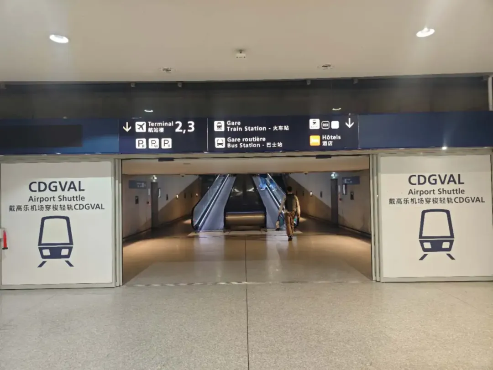
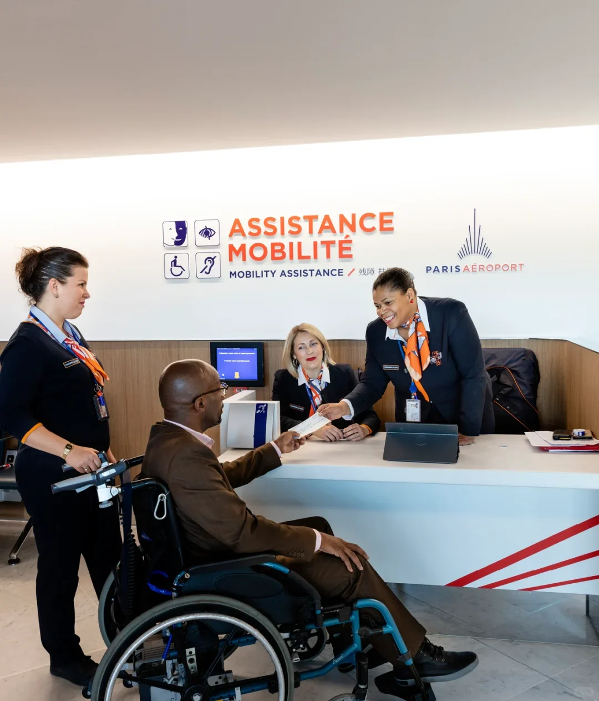

Як найбільший міжнародний аеропорт Франції та один із ключових авіаційних хабів Європи, **аеропорт Париж — Шарль де Голль (CDG)** — це місце, де більшість відвідувачів уперше знайомиться з містом. Він розташований у Руассі, приблизно за 25 км на північний схід від Парижа, займає близько 30 квадратних кілометрів і має **210 виходів на посадку** — найбільше серед усіх аеропортів світу.

Ця стаття розповідає про **розташування терміналів**, **транспорт у межах аеропорту**, **камеру схову**, **банки й обмін валюти**, **повернення податку**, **зони відпочинку та лаунжі**, **Wi-Fi і заряджання**, **SIM-картки**, а також **доступність і зручності для родин** — послуги, про які варто знати до прильоту.

## 1. Термінали та їхні поверхи

### Три термінали й сім субтерміналів у T2

CDG має **три термінали: 1, 2 і 3**. **T2 — головний**, він поділений на **сім блоків — T2A, T2B, T2C, T2D, T2E, T2F і T2G**, — розташованих симетрично вздовж південної сторони аеропорту, а також включає пірс K і два сателіти L і M; його переважно використовують **Air France та її партнери зі SkyTeam**. **T3 розташований на півночі**, він невеликий і простий та обслуговує лише деякі лоукост-авіакомпанії.

T1 розташований на північному заході: кругла будівля у формі літаючої тарілки, другий головний термінал, який переважно використовують авіакомпанії альянсів **Star Alliance і oneworld**.

### Що розташовано на кожному поверсі T1

У T1 реєстрація, виліт, приліт і заклади харчування розподілені між дев’ятьма рівнями, тож правильний вибір поверху економить багато ходьби:

| Рівень | Призначення | Що там є |
| --- | --- | --- |
| 1 | Транспортний рівень | Потяг CDGVAL, ресторани, кілька стійок реєстрації |
| 2 | Рівень реєстрації | Стійки реєстрації, висадка таксі, автобусна станція |
| 3 | Виліт | Огляд безпеки, прикордонний контроль, магазини безмитної торгівлі |
| 4 | Приліт | Стрічки видачі багажу |
| 5–7 | Паркування | Автостоянки |
| 8 | Харчування | Ресторани, офіси |
| 9 | Оглядовий | Оглядовий майданчик |

### Які авіакомпанії використовують який термінал

Розподіл між T1, T2 і T3 суттєвий, а в межах T2 також потрібно знати субтермінал (наприклад, Air China Eastern — у T2E, а Hainan Airlines — у T2A). Завжди перевіряйте код термінала на посадковому талоні:

| Термінал | Основні авіакомпанії (за оригінальним матеріалом) |
| --- | --- |
| T1 | Air China, EVA Air, China Airlines, United, Lufthansa, ANA, Eurowings, Qatar Airways, Turkish Airlines, Singapore Airlines, SWISS, SAS, Norwegian, LOT, Aegean |
| T2 | China Eastern (T2E), China Southern (T2E), Hainan Airlines (T2A), Cathay Pacific (T2A), Air France (T2E, T2F), British Airways (T2A), American Airlines (T2A), Delta (T2E), Air Canada (T2A), Japan Airlines (T2E), Korean Air (T2E), Emirates (T2C), Aeroflot (T2C), Finnair (T2D), Alitalia (T2F), KLM (T2F), Ukraine International (T2D), easyJet (T2D) |
| T3 | Переважно іспанські напрямки, зокрема Vueling, а також чартерні й сезонні середземноморські рейси |

Розподіл за терміналами змінюється (Germanwings і Alitalia з оригінального списку вже припинили діяльність або об’єдналися), тож уточнюйте інформацію в авіакомпанії та аеропорту на день подорожі.

## 2. Пересування аеропортом: CDGVAL і шатл-автобуси

Термінали CDG розташовані далеко один від одного, і для переїзду аеропортом іноді потрібен транспорт. Є два варіанти: **безкоштовний шатл-потяг CDGVAL** (його також називають RoissyVal) і **шатл-автобуси Navette**, які курсують між T1, T2, T3 та автостоянками.

Хоча термінали розташовані досить далеко, схема логічна, а більшість покажчиків тепер мають китайський текст, тож їх достатньо, щоб не заблукати. На перехід між терміналами закладайте 20–30 хвилин: поїздка CDGVAL триває кілька хвилин, а от очікування й піші переходи — ні.

## 3. Камера схову

Якщо ви хочете спершу побачити Париж або у вас довга пересадка, залиште багаж у камері схову:

- **Де:** у вестибюлі станції TGV термінала 2, біля готелю Sheraton;
- **Безпека:** рентгенівський огляд і постійне відеоспостереження;
- **Вартість:** гнучка, погодинна або подобова;
- **Додаткові послуги:** зберігання особливих або цінних речей, умови для тварин, а також упакування багажу й доставка до готелю;
- **Мови:** багатомовний персонал.

## 4. Банки та обмін валюти

- **У кожному терміналі є пункти обміну валют** (Global Exchange та інші), де можна обміняти євро та іноземну валюту; вони розташовані як у загальнодоступній зоні, так і в зоні митного контролю, поблизу реєстраційних залів і виходів на посадку.
- **Банкомати** розміщені по всіх терміналах для зняття готівки та повсякденних операцій — у залі прильоту й біля виходів на посадку.

- Зверніть увагу: **більшість банків стягують комісію за зняття готівки за кордоном**, тож перевірте тарифи й ліміти свого банку перед подорожжю. Обмінні пункти в аеропорту рідко пропонують кращий курс, ніж у місті, тому міняйте лише стільки, скільки потрібно на транспорт і непередбачені витрати.

## 5. Повернення податку (détaxe)

Особи, які не є резидентами ЄС (віком від 16 років, які перебувають у Франції чи ЄС менше шести місяців), можуть повернути ПДВ із покупок на суму **від 100,01 євро включно з ПДВ**, здійснених в одному магазині того самого дня. Візьміть із собою **паспорт, усі товари, форму для повернення податку й чек**; товари мають бути невикористані та в оригінальному пакуванні.

Пункти завірення в CDG:

| Термінал | Де оформлюють |
| --- | --- |
| T1 | На один рівень нижче від рівня CDGVAL |
| T2A / T2B / T2C / T2D | Рівень вильоту, біля виходу 6 |
| T2E | Рівень вильоту, біля виходу 4 |
| T2F / T3 | Рівень прильоту |

Процедура та типові помилки:

1. Попросіть у магазині форму для повернення податку (візьміть паспорт), а потім відскануйте її штрихкод у **терміналі самообслуговування PABLO** — зелене повідомлення «OK Bordereau validé» на екрані означає, що митну печатку поставлено;
2. **Зробіть це до реєстрації або здавання багажу**, адже митники можуть попросити показати невикористані товари;
3. Французькі форми можна завірити лише в автоматах; **товари, куплені в інших країнах ЄС, потрібно завірити в митній стійці**;
4. Завірення дійсне **три місяці плюс поточний місяць** від дати покупки, а відшкодування зазвичай надходить через 6–8 тижнів після завірення.

## 6. Зони відпочинку та лаунжі

- **Безкоштовні зони відпочинку:** в аеропорту є безкоштовні місця, де можна відпочити перед рейсом або під час пересадки; якщо у вас немає готелю чи ви хочете заощадити, там можна й переночувати. Зазвичай вони розташовані біля найвіддаленіших виходів на посадку — орієнтуйтеся за покажчиками.
- **Платна зона відпочинку:** у межах безкоштовної зони є окрема платна зона, де можна відпочити й прийняти душ.
- **Лаунжі:** пасажири бізнес- та першого класу, а також елітні учасники програм авіакомпаній можуть користуватися лаунжами; пасажири економкласу зазвичай можуть увійти за плату.
- **Робочі зони:** спільні робочі простори в терміналах зі столами, розетками й гарним освітленням.
- **Спостереження за літаками:** з деяких зон відпочинку відкривається прямий вид на злітно-посадкову смугу.
- **Куріння:** у всіх терміналах є спеціально відведені місця для куріння.

## 7. Wi-Fi, заряджання та SIM-картки

- **Безкоштовний Wi-Fi:** доступний у кожному терміналі; підключіться до мережі **«WIFI-AIRPORT»**, і ви в мережі.
- **Заряджання:** шукайте станції **ChargeBox**; у зонах вильоту після контролю безпеки головних терміналів вони безкоштовні (термінал 1; T2D; зали L і M термінала T2E; термінал 3).

- **SIM-картки:** у кожному терміналі є стійки **Relay, Fnac і Orange**, де продають місцеві SIM-картки та аксесуари; персонал розмовляє кількома мовами, а активувати картку можна на місці — купуєте й вставляєте. Популярний туристичний варіант — Orange Holiday (наприклад, 100 ГБ / 5G приблизно за €49,99), його продають на стійці.

Стійки та години роботи:

| Стійка | Розташування | Години роботи |
| --- | --- | --- |
| Orange SIM Card | T1, рівень 5 (приліт) | 06:00–20:30 |
| Orange SIM Card | T2E, рівень 0 (після контролю безпеки) | 06:00–21:00 |
| Relay | T2E, рівень 0 (до контролю безпеки) | 06:00–22:00 |
| Fnac | T1, рівень 3 (до контролю безпеки) | 06:00–21:00 |

## 8. Доступність і зручності для родин

**Допомога пасажирам з інвалідністю (PWD):**

- Термінали забезпечують допомогу пасажирам з інвалідністю — замовляйте її в авіакомпанії або турагента **щонайменше за 48 годин** до вильоту;
- Пункти зустрічі розташовані всередині та ззовні терміналів, є візки для самостійного користування й дитячі коляски;
- Сучасні доступні кімнати для переодягання та догляду обладнані для родин із дітьми та мандрівників з інвалідністю;
- У T2E і T2F є окремі **зони для собак**, де собаки-помічники можуть комфортно й безпечно відпочити.

**Зручності для родин:**

- Безкоштовні послуги для мандрівників із немовлятами та малими дітьми;
- Зони для сповивання та туалети, обладнані для малих дітей;
- У деяких терміналах є **дитячі кімнати** з повним набором для догляду за немовлям, зокрема підігрівачами для пляшечок і дитячими ліжками.

## Пов’язані посилання

- **На цьому сайті**: [Аеропорт Париж — Шарль де Голль (CDG)](/airport/CDG), [Франція (FR)](/country/FR)
- **Вікіпедія**: [Аеропорт Шарль де Голль](https://en.wikipedia.org/wiki/Paris_Charles_de_Gaulle_Airport)
- **Baidu Baike**: [Аеропорт Шарль де Голль](https://baike.baidu.com/item/%E5%B7%B4%E9%BB%8E%E5%A4%8F%E5%B0%94%C2%B7%E6%88%B4%E9%AB%98%E4%B9%90%E6%9C%BA%E5%9C%BA)
