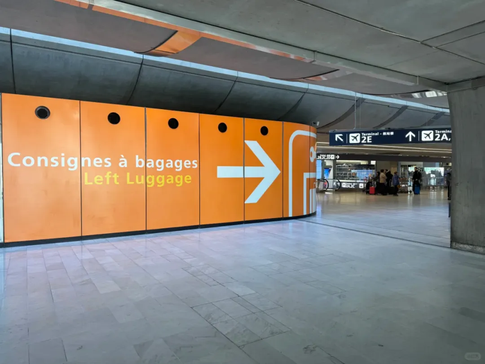

Là sân bay quốc tế lớn nhất nước Pháp và một trong những trung tâm hàng không chính của châu Âu, **Paris Charles de Gaulle (CDG)** là nơi phần lớn du khách lần đầu gặp thành phố. Sân bay nằm ở Roissy, cách Paris khoảng 25 km về phía đông bắc, rộng khoảng 30 km vuông và có **210 cổng** — nhiều nhất trong các sân bay trên thế giới.

Hướng dẫn này đi qua **bố cục nhà ga**, **giao thông trong sân bay**, **gửi hành lý**, **ngân hàng và đổi tiền**, **hoàn thuế**, **khu nghỉ ngơi và phòng chờ**, **Wi-Fi và sạc điện**, **SIM**, và **tiện ích cho người khuyết tật và gia đình** — những dịch vụ đáng biết trước khi hạ cánh.

## 1. Nhà ga và các tầng

### Ba nhà ga, và bảy nhà ga con trong T2

CDG có **ba nhà ga: 1, 2 và 3**. **T2 là nhà ga chính**, chia thành **bảy khối — T2A, T2B, T2C, T2D, T2E, T2F và T2G** — bố trí đối xứng dọc phía nam sân bay, và còn có cầu tàu K cùng hai vệ tinh L và M; chủ yếu do **Air France và các đối tác SkyTeam** sử dụng. **T3 ở phía bắc**, nhỏ và đơn giản, chỉ phục vụ một số hãng giá rẻ.

T1 nằm về phía tây bắc: một tòa nhà hình tròn như đĩa bay, nhà ga chính còn lại, chủ yếu do các thành viên **Star Alliance và oneworld** sử dụng.

### Mỗi tầng của T1 làm gì

T1 trải làm thủ tục, khởi hành, đến và ăn uống trên chín tầng, nên chọn đúng tầng sẽ tiết kiệm rất nhiều việc đi bộ:

| Tầng | Mục đích | Có gì |
| --- | --- | --- |
| 1 | Tầng giao thông | Tàu CDGVAL, nhà hàng, vài quầy làm thủ tục |
| 2 | Tầng làm thủ tục | Quầy làm thủ tục, điểm trả khách taxi, bến xe buýt |
| 3 | Khởi hành | An ninh, kiểm soát biên giới, cửa hàng miễn thuế |
| 4 | Đến | Băng chuyền hành lý |
| 5–7 | Bãi đỗ xe | Bãi đỗ xe |
| 8 | Ăn uống | Nhà hàng, văn phòng |
| 9 | Quan sát | Đài quan sát |

### Hãng nào dùng nhà ga nào

Sự phân chia giữa T1, T2 và T3 khá lớn, và trong T2 bạn còn cần biết nhà ga con (ví dụ China Eastern ở T2E, Hainan Airlines ở T2A). Hãy luôn kiểm tra mã nhà ga trên thẻ lên máy bay:

| Nhà ga | Các hãng chính (từ tư liệu gốc) |
| --- | --- |
| T1 | Air China, EVA Air, China Airlines, United, Lufthansa, ANA, Eurowings, Qatar Airways, Turkish Airlines, Singapore Airlines, SWISS, SAS, Norwegian, LOT, Aegean |
| T2 | China Eastern (T2E), China Southern (T2E), Hainan Airlines (T2A), Cathay Pacific (T2A), Air France (T2E, T2F), British Airways (T2A), American Airlines (T2A), Delta (T2E), Air Canada (T2A), Japan Airlines (T2E), Korean Air (T2E), Emirates (T2C), Aeroflot (T2C), Finnair (T2D), Alitalia (T2F), KLM (T2F), Ukraine International (T2D), easyJet (T2D) |
| T3 | Chủ yếu các tuyến Tây Ban Nha như Vueling, cùng dịch vụ thuê chuyến và theo mùa Địa Trung Hải |

Việc phân bổ nhà ga thay đổi (Germanwings và Alitalia trong danh sách gốc đã ngừng hoạt động hoặc sáp nhập), nên hãy xác nhận với hãng và sân bay cho ngày bạn đi.

## 2. Di chuyển trong sân bay: CDGVAL và xe buýt trung chuyển

Các nhà ga CDG cách xa nhau, và việc đi ngang sân bay đôi khi cần phương tiện. Có hai loại: **tàu trung chuyển CDGVAL miễn phí** (còn gọi RoissyVal) và **xe buýt trung chuyển Navette**, cả hai chạy giữa T1, T2, T3 và các bãi đỗ.

Dù các nhà ga cách nhau khá xa, bố cục vẫn hợp lý, và phần lớn biển nay có tiếng Trung, nên đi theo là đủ. Hãy dành 20–30 phút khi đổi nhà ga — đi CDGVAL chỉ mất vài phút, nhưng chờ và đi bộ thì không.

## 3. Gửi hành lý

Nếu bạn muốn thăm Paris trước, hoặc có chuyến nối dài, hãy gửi hành lý lại:

- **Ở đâu:** tại **sảnh ga TGV của Nhà ga 2**, gần khách sạn Sheraton;
- **An ninh:** soi chiếu X-quang và camera giám sát liên tục;
- **Giá:** linh hoạt, theo giờ hoặc theo ngày;
- **Tiện ích:** gửi đồ đặc biệt hoặc có giá trị, nhận vật nuôi, cùng dịch vụ bọc hành lý và giao đến khách sạn;
- **Ngôn ngữ:** nhân viên đa ngôn ngữ.

## 4. Ngân hàng và đổi tiền

- **Mỗi nhà ga đều có quầy đổi tiền** (Global Exchange và các đơn vị khác) giao dịch euro và ngoại tệ; chúng nằm ở cả khu công cộng và khu hải quan, gần sảnh làm thủ tục và các cổng.
- **ATM** phân bố khắp các nhà ga để rút tiền mặt và giao dịch hàng ngày — trong sảnh đến và gần các cổng.

- Lưu ý **hầu hết ngân hàng thu phí rút tiền ở nước ngoài**, nên hãy kiểm tra phí và hạn mức ngân hàng của bạn trước khi đi. Quầy đổi tiền ở sân bay hiếm khi tốt hơn trong thành phố về tỷ giá, nên chỉ đổi đủ cho giao thông và trường hợp khẩn cấp.

## 5. Hoàn thuế (détaxe)

Cư dân ngoài EU (từ 16 tuổi, lưu trú tại Pháp hoặc EU dưới sáu tháng) có thể yêu cầu hoàn VAT cho hàng mua **từ €100,01 trở lên, đã gồm VAT, trong cùng cửa hàng vào cùng ngày**. Hãy mang **hộ chiếu, toàn bộ hàng, tờ khai miễn thuế và hóa đơn**; hàng phải chưa dùng và còn nguyên bao bì.

Các điểm xác nhận tại CDG:

| Nhà ga | Nơi yêu cầu |
| --- | --- |
| T1 | Cách tầng CDGVAL một tầng |
| T2A / T2B / T2C / T2D | Tầng khởi hành, gần cổng 6 |
| T2E | Tầng khởi hành, gần cổng 4 |
| T2F / T3 | Tầng đến |

Quy trình, và những phần người ta hay làm sai:

1. Hỏi tờ khai miễn thuế tại cửa hàng (mang hộ chiếu), rồi quét mã vạch tại **máy tự phục vụ PABLO** — màn hình xanh “OK Bordereau validé” chính là dấu hải quan;
2. **Làm việc này trước khi làm thủ tục hoặc ký gửi hành lý**, vì hải quan có thể muốn xem hàng chưa dùng;
3. Tờ khai Pháp chỉ được xác nhận tại máy; **hàng mua ở các nước EU khác phải được đóng dấu tại quầy hải quan**;
4. Xác nhận có giá trị **ba tháng cộng tháng hiện tại** kể từ ngày mua, và hoàn thuế thường đến sau 6–8 tuần kể từ khi xác nhận.

## 6. Khu nghỉ ngơi và phòng chờ

- **Khu nghỉ miễn phí:** sân bay cung cấp khu ghế ngồi miễn phí để thư giãn trước chuyến bay hoặc khi trung chuyển; nếu không có khách sạn hoặc muốn tiết kiệm, bạn cũng có thể qua đêm ở đó. Chúng thường ở gần các cổng xa nhất — đi theo biển.
- **Khu nghỉ trả phí:** bên trong khu miễn phí có một khu trả phí riêng để nghỉ và tắm.
- **Phòng chờ:** khách hạng thương gia, hạng nhất và thành viên cao cấp của hãng được dùng phòng chờ; khách phổ thông thường có thể trả phí để vào.
- **Khu làm việc:** không gian làm việc chung trong nhà ga, có bàn, ổ cắm điện và ánh sáng tốt.
- **Ngắm máy bay:** một số khu nghỉ nhìn thẳng ra đường băng.
- **Hút thuốc:** mọi nhà ga đều có khu hút thuốc được chỉ định.

## 7. Wi-Fi, sạc điện và SIM

- **Wi-Fi miễn phí:** phủ mọi nhà ga; kết nối mạng **“WIFI-AIRPORT”** là xong.
- **Sạc điện:** tìm các trạm **ChargeBox**, miễn phí tại sảnh khởi hành sau an ninh của các nhà ga chính (Nhà ga 1; T2D; các sảnh L và M của T2E; Nhà ga 3).

- **SIM:** mọi nhà ga có quầy **Relay, Fnac và Orange** bán SIM địa phương và phụ kiện, nhân viên đa ngôn ngữ và kích hoạt tại cửa hàng — mua và cắm vào là dùng. Lựa chọn phổ biến cho du khách là Orange Holiday (ví dụ 100 GB / 5G khoảng €49,99), có bán tại quầy.

Quầy và giờ mở cửa:

| Quầy | Vị trí | Giờ |
| --- | --- | --- |
| Orange SIM Card | T1, tầng 5 (đến) | 06:00–20:30 |
| Orange SIM Card | T2E, tầng 0 (sau an ninh) | 06:00–21:00 |
| Relay | T2E, tầng 0 (trước an ninh) | 06:00–22:00 |
| Fnac | T1, tầng 3 (trước an ninh) | 06:00–21:00 |

## 8. Tiện ích cho người khuyết tật và gia đình

**Hỗ trợ (PWD):**

- Các nhà ga cung cấp hỗ trợ cho hành khách khuyết tật — hãy đặt với hãng hoặc đại lý du lịch **ít nhất 48 giờ** trước khi khởi hành;
- Điểm hẹn nằm trong và ngoài nhà ga, có xe lăn và xe đẩy tự phục vụ;
- Phòng thay đồ hiện đại, dễ tiếp cận phục vụ gia đình có trẻ nhỏ và du khách khuyết tật;
- T2E và T2F mỗi nơi có **khu cho chó**, dành cho chó hỗ trợ một không gian thoải mái, an toàn.

**Tiện ích gia đình:**

- Dịch vụ miễn phí cho du khách có em bé hoặc trẻ nhỏ;
- Khu thay tã và nhà vệ sinh thiết kế cho trẻ nhỏ;
- Một số nhà ga có **phòng em bé** với đầy đủ thiết bị chăm sóc, gồm máy hâm sữa và cũi.

## Liên kết liên quan

- **Trên trang này**: [Sân bay Paris Charles de Gaulle (CDG)](/airport/CDG), [Pháp (FR)](/country/FR)
- **Wikipedia**: [Sân bay Charles de Gaulle](https://en.wikipedia.org/wiki/Paris_Charles_de_Gaulle_Airport)
- **Baidu Baike**: [Sân bay Charles de Gaulle](https://baike.baidu.com/item/%E5%B7%B4%E9%BB%8E%E5%A4%8F%E5%B0%94%C2%B7%E6%88%B4%E9%AB%98%E4%B9%90%E6%9C%BA%E5%9C%BA)
