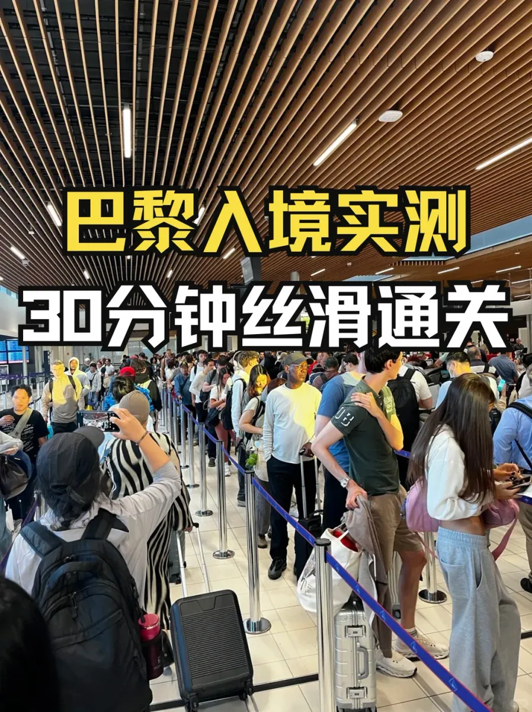

Kedatangan di CDG berjalan satu arah: turun dari pesawat, menyusuri koridor, melewati perbatasan, melewati aula bagasi, dan keluar. Tidak ada yang mengirim Anda kembali. Yang membuat orang ragu adalah bahasa Prancis di tanda — Correspondances, Sortie, Baggages, Contrôle des passeports. Setiap kata terlihat familier; di bawah tanda itu sendiri tetap butuh dua detik. Dua detik tidak berbahaya, kecuali di kerumunan yang bergerak, karena berhenti berpikir adalah cara Anda terdorong ke arah yang salah.

Uraian ini membagi kedatangan menjadi sembilan langkah: tiga tanda, perbatasan dan EES, bagasi dan troli, makanan dan uang tunai, pintu keluar dan kota — dalam urutan kejadiannya, dengan apa yang harus dilakukan dan cara memperbaiki kesalahan.

Satu acuan waktu: pada Agustus 2026 seorang pelancong mengukur sekitar 30 menit dari pintu pesawat ke pintu keluar, meskipun antrean bervariasi sesuai gelombang penerbangan. Sembilan langkah ini bukan janji 30 menit; ini menghilangkan satu keraguan dari setiap tahap.

## 1. Tiga tanda setelah pesawat

**Langkah 1: ikuti kerumunan dan tanda kuning.** Kuning adalah warna penunjuk arah kedatangan CDG: panel gelap tergantung dengan panah dan kata kunci kuning atau putih, terlihat dari jauh. Jangan mencari tanda metro atau taksi; ikuti arus ke percabangan pertama. Jika Anda memiliki penerbangan lain, pastikan apakah bagasi Anda diteruskan: pada satu tiket biasanya ya, pada tiket terpisah Anda harus melewati perbatasan, mengambil bagasi, dan check-in lagi.

**Langkah 2: pelajari tiga kata.** Percabangan mengulanginya, dan mengetahuinya lebih bernilai daripada peta mana pun:

| Prancis | Inggris | Kapan mengikutinya |
| --- | --- | --- |
| Correspondances | Transit | Anda memiliki penerbangan lain dan bagasi diteruskan |
| Sortie / Baggages | Keluar / Bagasi | Anda memasuki Prancis, mengambil bagasi, dan keluar |
| Contrôle des passeports | Kontrol perbatasan | Anda mengantre untuk masuk |

Terminal 1 adalah bangunan melingkar, Terminal 2 terbagi dari A hingga G, dan Terminal 3 berada di utara; untuk berganti terminal naik CDGVAL gratis dan sediakan 30 menit atau lebih.

Bahasa Mandarin yang digunakan adalah aksara Sederhana, di samping bahasa Prancis dan Inggris. Jika rute sementara hanya memiliki dua bahasa Eropa itu, baca piktogramnya: dua sosok berjalan berpisah berarti transit, koper berarti bagasi, sosok di ambang pintu berarti pintu keluar.

## 2. Kontrol perbatasan dan EES

**Langkah 3: bergabung ke antrean.** Pemegang paspor Tiongkok mengikuti jalur non-UE yang ditandai di lokasi. Staf biasanya mengarahkan antrean di kepalanya, jadi ikuti arahan tangan daripada memilih antrean yang tampak lebih pendek. Di jendela, serahkan paspor dan visa Schengen yang berlaku dengan halaman visa terbuka.

Pengunjung jangka pendek melewati registrasi EES: data paspor, citra wajah, dan sidik jari. EES adalah Sistem Masuk/Keluar UE, diperkenalkan bertahap sejak Oktober 2025, menggantikan cap berulang dengan registrasi biometrik; masuk pertama membuat catatan, masuk berikutnya membacanya, dan tidak ada yang diambil dua kali. Pembaca berada di samping meja, dengan diagram — jari di kaca, lihat kamera, tunggu konfirmasi.

Jika salah antrean, staf akan mengirim Anda kembali ke pintu masuk; itu bukan penolakan, hanya antrean kedua. Keluarga biasanya dapat menggunakan jalur keluarga, dan anak di bawah 12 tahun melewati sidik jari tetapi tetap difoto.

**Langkah 4: siapkan jawaban dan dokumen.** Pertanyaannya sederhana: apa yang Anda lakukan di Prancis, berapa lama tinggal, negara lain mana yang dikunjungi, di mana menginap, kapan pergi, berapa uang tunai yang dibawa. Jawaban harus cocok dengan tiket, pemesanan hotel, dan itinerary — mengaku lima hari dengan penerbangan pulang tiga minggu lagi, atau tanpa alamat, akan memicu pertanyaan lanjutan.

Simpan dokumen di bagasi kabin, bukan bagasi tercatat: tiket pulang, pemesanan akomodasi, itinerary, asuransi, dan bukti dana, dengan salinan di ponsel. Mengeluarkan semuanya dari satu kompartemen lebih baik daripada mengosongkan koper di jendela. Jika pertanyaan tidak jelas, tanyakan lagi atau tunjukkan pemesanan.

## 3. Bagasi dan troli

**Langkah 5: ambil bagasi di aula Baggages.** Layar mencantumkan ban berjalan berdasarkan nomor penerbangan; temukan milik Anda dan tunggu di karusel yang benar. Ban kadang dipindahkan, jadi jangan hanya percaya layar pertama. Jika tidak ada yang muncul, periksa papan lagi atau ban di sebelahnya.

**Langkah 6: ambil troli di tempat yang ditandai.** Di aula bagasi CDG, troli berjajar di sepanjang jalur pejalan kaki, dilepas sesuai tanda; beberapa area memerlukan koin, jadi satu atau dua euro layak dibawa. Troli menghemat kerepotan menyeret koper dengan satu tangan, terutama sebelum naik kereta. Jika bagasi hilang, jangan tinggalkan aula: daftarkan di meja bagasi maskapai, dan simpan label bagasi — Anda akan memerlukannya untuk klaim.

## 4. Makanan, uang tunai, dan deklarasi

**Langkah 7: ketahui isi tas Anda.** Ini langkah yang paling sering salah, karena "tersegel" disalahartikan sebagai "diizinkan". Yang penting adalah bahan dan pengolahannya, bukan kemasannya:

| Barang | Diizinkan? | Catatan |
| --- | --- | --- |
| Dendeng sapi | Tidak | Produk daging; UE sangat membatasi daging yang dibawa pelancong non-UE |
| Ikan kering, udang kering, dan makanan laut serupa | Dibatasi | Sebagian makanan laut olahan harus dideklarasikan dan dapat disita |
| Buah olahan | Biasanya ya | Tersegel baik, diproses sepenuhnya, tanpa daging atau susu |
| Uang tunai US$10.000 atau setara | Wajib dideklarasikan | Ajukan deklarasi pada ambang tersebut |

Dendeng sapi dihitung sebagai daging, bukan camilan. Ikan kering, udang kering, dan sebagian makanan laut olahan adalah produk hewani dan masuk dalam pembatasan; apakah sebungkus diizinkan bergantung pada pengolahan dan petugas, jadi lewati jalur merah dan tanyakan. Buah olahan biasanya boleh jika tersegel, diproses sepenuhnya, dan bebas daging serta susu.

Uang tunai memerlukan perhitungan yang sama: **US$10.000 atau setara** adalah ambang deklarasi. Deklarasi bukan denda — lewati jalur merah, sebutkan apa yang dibawa, isi formulir, dan prosesnya beberapa menit. Kesalahan mahal adalah tidak mendeklarasikan.

Satu aturan mendasari semua ini: titik masuk pertama UE adalah tempat imigrasi dan bea cukai berlangsung. Jika Anda transit melalui negara Schengen lain sebelum Prancis, urus makanan dan deklarasi di sana; saat mencapai CDG, bagian itu adalah penerbangan domestik Schengen dan tidak ada bea cukai kedua.

## 5. Pintu keluar, penjemputan, dan kota

**Langkah 8: temui penjemput di pintu keluar.** Pintu keluar CDG dikelompokkan berdasarkan terminal dan lantai kedatangan, dan pintunya bernomor. "Jemput saya di CDG" tidak cukup; kirimkan terminal, aula, dan nomor pintu keluar agar pengemudi dapat berhenti di tempat yang tepat. Titik penjemputan taksi daring juga diatur per terminal.

**Langkah 9: pilih transportasi ke Paris.** Tiga pilihan, tiga fungsi:

| Pilihan | Paling cocok untuk | Perhatikan |
| --- | --- | --- |
| Taksi | Rombongan, bagasi berat, alamat di luar pusat | Gunakan pangkalan resmi; abaikan pengemudi yang menghampiri Anda |
| RER B | Satu atau dua orang menuju kota | Periksa pemberitahuan layanan hari itu untuk pekerjaan rel dan pembatalan |
| CDGVAL | Berganti terminal atau mencapai tempat parkir | Gratis, tetapi tidak masuk ke Paris |

Taksi adalah yang termudah dan yang paling mudah dimanfaatkan. Gunakan pangkalan resmi bertanda, konfirmasikan cara tarif dihitung, dan abaikan siapa pun di dalam terminal yang menawarkan mobil.

RER B berjalan dari stasiun di bawah T2 ke Gare du Nord dan Châtelet dalam sekitar 25–30 menit. Periksa pemberitahuan layanan hari itu lebih dulu — pekerjaan rel, mogok, dan perubahan sementara memengaruhi frekuensi. Dengan bagasi berat, hindari jam sibuk pagi.

Tiket berasal dari mesin atau meja berstaf, dan tarif bandara bukan tiket kota biasa — tiket kota biasa tidak berlaku. Simpan tiket di tangan di kedua gerbang.

CDGVAL berjalan hanya di dalam bandara, menghubungkan T1, T2, T3, dan tempat parkir secara gratis; kereta ini tidak membawa Anda ke kota. Pada larut malam, saat kereta shuttle berhenti, bus menggantikannya — ikuti tanda Navette.

Dalam praktiknya: satu orang dengan satu koper pada siang hari, RER B; tiga atau empat orang dengan koper besar, pangkalan taksi resmi; mendarat pada malam hari dengan anak, transfer yang dipesan sebelumnya.

Sembilan langkah ini bermuara pada dua kesulitan: mengenali tiga kata Prancis di percabangan, dan mengetahui isi tas Anda sebelum bea cukai. Yang pertama diselesaikan oleh teks Mandarin dan piktogram, yang kedua oleh pemeriksaan saat mengemas. Pada Agustus 2026 seorang pelancong melewatinya dalam urutan ini sekitar 30 menit; penerbangan, antrean, dan pemeriksaan acak bervariasi, jadi konfirmasikan prosedur, aturan deklarasi, dan transportasi dengan informasi resmi pada hari itu.

## Tautan terkait

- **Di situs ini**: [Bandara Paris Charles de Gaulle (CDG)](/airport/CDG), [Prancis (FR)](/country/FR)
- **Wikipedia**: [Bandara Paris Charles de Gaulle](https://en.wikipedia.org/wiki/Paris_Charles_de_Gaulle_Airport)
- **Baidu Baike**: [Bandara Paris Charles de Gaulle](https://baike.baidu.com/item/%E5%B7%B4%E9%BB%8E%E5%A4%8F%E5%B0%94%C2%B7%E6%88%B4%E9%AB%98%E4%B9%90%E6%9C%BA%E5%9C%BA)
