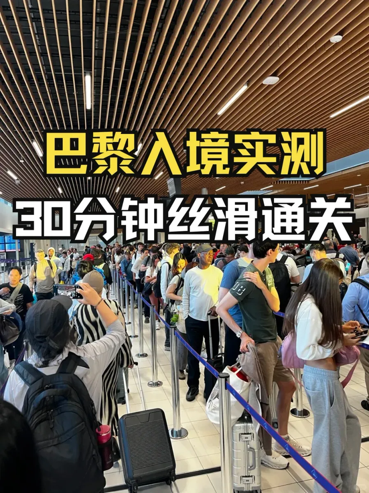

Gli arrivi al CDG vanno in una sola direzione: fuori dall'aereo, lungo il corridoio, attraverso la frontiera, oltre la hall bagagli e fuori. Niente vi rimanda indietro. Quello che fa esitare le persone è il francese delle insegne — Correspondances, Sortie, Baggages, Contrôle des passeports. Ogni parola sembra familiare; sotto l'insegna ci vogliono comunque due secondi. Due secondi sono innocui, tranne che in una folla in movimento, dove fermarsi a pensare è il modo per essere spinti nella direzione sbagliata.

Questo articolo divide l'arrivo in nove passi: le tre insegne, la frontiera e l'EES, bagagli e carrelli, cibo e contanti, l'uscita e la città — nell'ordine in cui accadono, con cosa fare e come rimediare a un errore.

Un riferimento temporale: nell'agosto 2026 un viaggiatore ha misurato circa 30 minuti dalla porta dell'aereo all'uscita, anche se le code variano con il gruppo di voli. I nove passi non promettono 30 minuti; tolgono un'esitazione da ogni fase.

## 1. Tre insegne dopo l'aereo

**Passo 1: seguite la folla e le insegne gialle.** Il giallo è il colore di orientamento del CDG per gli arrivi: pannelli scuri sospesi con frecce e parole chiave gialle o bianche, visibili da lontano. Non cercate un'insegna della metro o dei taxi; seguite il flusso fino al primo bivio. Se avete un altro volo, confermate se i bagagli sono già imbarcati per la destinazione: con un unico biglietto di solito lo sono, con biglietti separati dovete passare la frontiera, ritirarli e fare di nuovo il check-in.

**Passo 2: imparate le tre parole.** Il bivio le ripete, e conoscerle vale più di qualsiasi mappa:

| Francese | Italiano | Quando seguirla |
| --- | --- | --- |
| Correspondances | Corrispondenze | Avete un altro volo e i bagagli sono già imbarcati |
| Sortie / Baggages | Uscita / Bagagli | Entrate in Francia, ritirate i bagagli e uscite |
| Contrôle des passeports | Controllo passaporti | Siete in coda per entrare |

Il Terminal 1 è l'edificio circolare, il Terminal 2 si divide da A a G e il Terminal 3 è a nord; per cambiare terminal prendete il CDGVAL gratuito e calcolate 30 minuti o più.

Il cinese è in caratteri semplificati, accanto a francese e inglese. Dove un percorso temporaneo ha solo le due lingue europee, leggete i pittogrammi: due figure che si separano indicano le corrispondenze, una valigia indica i bagagli, una figura in una porta indica l'uscita.

## 2. Controllo di frontiera ed EES

**Passo 3: mettetevi in coda.** I titolari di passaporto cinese seguono la corsia extra-UE indicata sul posto. Di solito il personale dirige la coda dalla testa, quindi seguite la mano invece di scegliere la fila che sembra più corta. Alla finestra consegnate il passaporto e il visto Schengen valido con la pagina del visto aperta.

I visitatori di breve durata passano per la registrazione EES: dati del passaporto, immagine del viso e impronte digitali. L'EES è l'Entry/Exit System dell'UE, introdotto per fasi da ottobre 2025, che sostituisce i timbri ripetuti con la registrazione biometrica; il primo ingresso crea il record, gli ingressi successivi lo leggono, e nulla viene registrato due volte. Il lettore è accanto al banco, con i diagrammi — le dita sul vetro, guardate la telecamera, aspettate la conferma.

Se vi mettete nella coda sbagliata il personale vi rimanda all'ingresso; non è un rifiuto, solo una seconda coda. Le famiglie di solito possono usare una corsia famiglia, e i minori di 12 anni saltano le impronte ma vengono comunque fotografati.

**Passo 4: tenete pronte risposte e documenti.** Le domande sono semplici: cosa fate in Francia, quanto restate, quali altri paesi visitate, dove alloggiate, quando partite, quanti contanti portate. Le risposte devono corrispondere a biglietto, prenotazione dell'hotel e itinerario — cinque giorni dichiarati contro un volo di ritorno a tre settimane, o nessun indirizzo, invita a domande successive.

Tenete i documenti nel bagaglio a mano, non in una valigia imbarcata: biglietto di ritorno, prenotazione dell'alloggio, itinerario, assicurazione e prova dei fondi, con copie sul telefono. Tirare fuori tutto da uno scomparto batte svuotare una valigia alla finestra. Se una domanda non è chiara, chiedete di ripeterla o mostrate la prenotazione.

## 3. Bagagli e carrelli

**Passo 5: ritirate i bagagli nella hall Baggages.** Gli schermi elencano i nastri per numero di volo; trovate il vostro e aspettate al carosello giusto. I nastri a volte vengono riassegnati, quindi non fidatevi solo del primo schermo. Se non arriva nulla, ricontrollate il tabellone o il nastro accanto.

**Passo 6: prendete un carrello dove indicato.** Nelle hall bagagli del CDG i carrelli sono allineati lungo il passaggio, liberati come indicano le insegne; alcune aree richiedono una moneta, quindi vale la pena avere un euro o due. Un carrello evita la ginnastica con la valigia in una mano, soprattutto prima di un treno. Se manca una valigia, non lasciate la hall: registratela al banco bagagli della compagnia e conservate il talloncino del bagaglio — vi servirà per la denuncia.

## 4. Cibo, contanti e dichiarazioni

**Passo 7: sappiate cosa c'è nella borsa.** È il passo che si sbaglia più spesso, perché “sigillato” viene confuso con “permesso”. Contano l'ingrediente e la lavorazione, non la confezione:

| Articolo | Consentito? | Nota |
| --- | --- | --- |
| Carne secca (beef jerky) | No | Un prodotto a base di carne; l'UE limita severamente la carne portata da viaggiatori extra-UE |
| Pesce essiccato, gamberetti secchi e simili frutti di mare | Limitato | Alcuni prodotti ittici lavorati vanno dichiarati e possono essere sequestrati |
| Frutta conservata | Di solito sì | Ben sigillata, completamente lavorata, senza carne o latticini |
| Contanti per US$10,000 o equivalente | Da dichiarare | Presentate una dichiarazione al superamento della soglia |

Il beef jerky conta come carne, non come snack. Pesce essiccato, gamberetti secchi e alcuni prodotti ittici lavorati sono prodotti animali e rientrano nelle restrizioni; se un pacchetto è consentito dipende dalla lavorazione e dall'agente, quindi passate dal corridoio rosso e chiedete. La frutta conservata di solito va bene se sigillata, completamente lavorata e priva di carne e latticini.

I contanti richiedono lo stesso calcolo: **US$10,000 o l'equivalente** è la soglia per la dichiarazione. Una dichiarazione non è una multa — passate dal corridoio rosso, dite cosa portate, compilate il modulo, e ci vogliono pochi minuti. L'errore costoso è non dichiarare.

Una regola sta sotto tutto questo: il primo punto d'ingresso nell'UE è dove avvengono immigrazione e dogana. Se fate scalo in un altro paese Schengen prima della Francia, gestite cibo e dichiarazioni lì; quando raggiungete il CDG, quella tratta è un volo domestico Schengen e non c'è una seconda dogana.

## 5. Uscita, pick-up e la città

**Passo 8: incontrate chi vi viene a prendere all'uscita.** Le uscite del CDG sono raggruppate per terminal e livello di arrivo, e le porte sono numerate. “Prendimi al CDG” non basta; inviate terminal, hall e numero di uscita così che l'autista possa fermarsi nel posto giusto. Anche i punti di raccolta del ride-hailing sono organizzati per terminal.

**Passo 9: scegliete il trasporto per Parigi.** Tre opzioni, tre compiti:

| Opzione | Ideale per | Attenzione a |
| --- | --- | --- |
| Taxi | Gruppi, bagagli pesanti, indirizzi fuori dal centro | Usate la postazione ufficiale; ignorate gli autisti che vi si avvicinano |
| RER B | Una o due persone dirette in città | Controllate gli avvisi di servizio del giorno per lavori e cancellazioni |
| CDGVAL | Cambiare terminal o raggiungere i parcheggi | Gratuito, ma non va a Parigi |

I taxi sono i più comodi e i più facili per farsi prendere in giro. Usate la postazione ufficiale segnalata, confermate come si calcola la tariffa e ignorate chiunque dentro il terminal vi offra un'auto.

Il RER B parte dalla stazione sotto il T2 per Gare du Nord e Châtelet in circa 25–30 minuti. Controllate prima gli avvisi di servizio del giorno — lavori, scioperi e cambi temporanei influiscono sulla frequenza. Con bagagli pesanti, evitate l'ora di punta del mattino.

I biglietti si prendono dai distributori o dal banco con personale, e la tariffa aeroportuale non è un biglietto urbano — un normale biglietto cittadino non basta. Tenete il biglietto in mano a entrambi i tornelli.

Il CDGVAL viaggia solo dentro l'aeroporto, collegando T1, T2, T3 e i parcheggi gratuitamente; non vi porta in città. A tarda notte, quando il treno navetta si ferma, gli autobus lo sostituiscono — seguite le indicazioni Navette.

In pratica: una persona con una valigia di giorno, RER B; tre o quattro con valigie grandi, la postazione ufficiale dei taxi; atterraggio di notte con bambini, un transfer prenotato.

I nove passi si riducono a due difficoltà: riconoscere le tre parole francesi al bivio e sapere cosa c'è nella borsa prima della dogana. La prima si risolve con il testo in cinese e i pittogrammi, la seconda con un controllo mentre si prepara la valigia. Nell'agosto 2026 un viaggiatore è passato con questo ordine in circa 30 minuti; voli, code e controlli a campione variano, quindi confermate procedura, regole di dichiarazione e trasporti con le informazioni ufficiali il giorno stesso.

## Link correlati

- **Su questo sito**: [Aeroporto di Parigi Charles de Gaulle (CDG)](/airport/CDG), [Francia (FR)](/country/FR)
- **Wikipedia**: [Aeroporto di Parigi Charles de Gaulle](https://en.wikipedia.org/wiki/Paris_Charles_de_Gaulle_Airport)
- **Baidu Baike**: [Aeroporto di Parigi Charles de Gaulle](https://baike.baidu.com/item/%E5%B7%B4%E9%BB%8E%E5%A4%8F%E5%B0%94%C2%B7%E6%88%B4%E9%AB%98%E4%B9%90%E6%9C%BA%E5%9C%BA)
