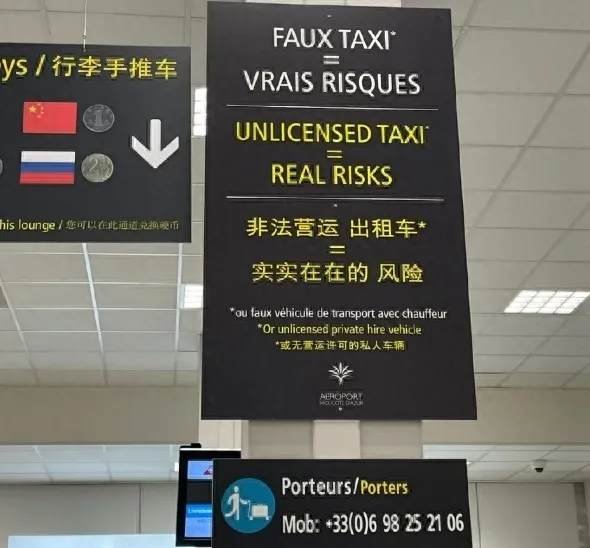
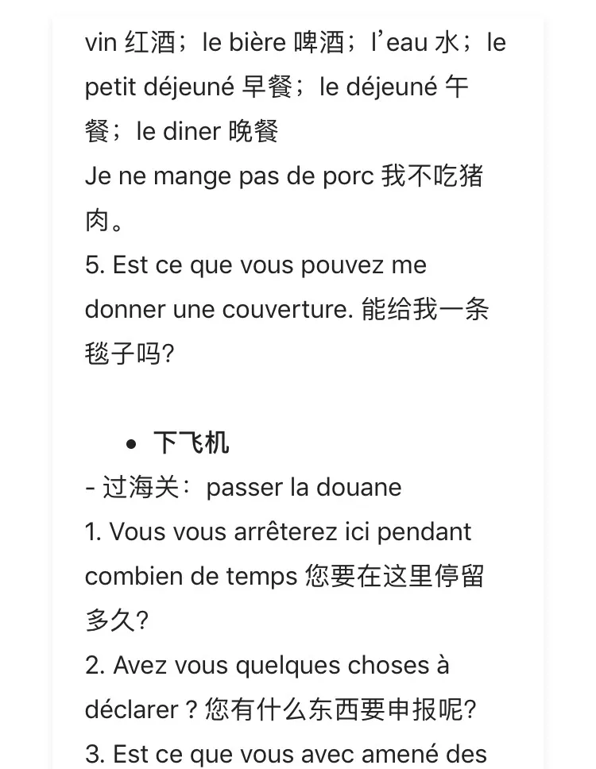

সেমিস্টার শুরু হতে আর বেশি দেরি নেই। ফ্রান্সে প্রথম ভ্রমণে ফ্লাইট বুক করা সহজ অংশ — কঠিন প্রশ্নটা হলো বিমানবন্দর থেকে বেরিয়ে পড়াশোনার শহরে কীভাবে পৌঁছাবেন। লিয়ঁ, বোর্দো, মার্সেই ও স্ত্রাসবুরের মতো শহরে আন্তর্জাতিক ফ্লাইট আছে বটে, কিন্তু চীন থেকে আসা বেশিরভাগ ফ্লাইট নামে **প্যারিস চার্লস দ্য গল (CDG)**-এ।

ভালো খবর হলো, CDG চীনা ভাষাভাষী ভ্রমণকারীদের জন্য অস্বাভাবিক রকম সহজ: বোর্ডিং, চেক-ইন এমনকি টয়লেট পর্যন্ত চীনা ভাষায় লেখা, তাই সাইন অনুসরণ করাই সাধারণত যথেষ্ট। এই গাইডে আছে **আগমনে পথ খোঁজা**, **টার্মিনাল ও রেলস্টেশন**, **পরবর্তী গন্তব্যে যাওয়া** এবং **বিমানবন্দরের জন্য একটি ফরাসি বাক্যতালিকা**।

## 1. আগমনে পথ খোঁজা

### অ্যারাইভাল টানেল: তিনটি সাইনই সব ঠিক করে দেয়

বিমান থেকে নামার পর প্রথম অংশটুকু CDG-র বিখ্যাত "অ্যারাইভাল টানেল" — একটি দীর্ঘ ট্রাভেলেটর, যার উপরের সাইন ইতিমধ্যেই ভিড়কে ভাগ করে দিয়েছে:

- **Correspondances / Transfer** — পরবর্তী ফ্লাইটের জন্য বিমানবন্দরের ভেতরেই থাকছেন;
- **Bagages / Baggage** — ক্যারোসেল থেকে চেক করা লাগেজ নিচ্ছেন;
- **Sortie / Exit** — ব্যাগ নিয়ে কাস্টমস পেরিয়ে বিমানবন্দর ছাড়ছেন।

প্রথমবার আসা মানুষের চিরাচরিত ভুল হলো "Exit" ধরে একেবারে বাইরে চলে যাওয়া এবং কানেক্টিং ফ্লাইট বা ট্রেনের টিকিটের কথা ভুলে যাওয়া। ক্রমটা মনে রাখুন: **আগে ঠিক করুন আপনি কানেক্ট করছেন কি না, তারপর ব্যাগেজ না এক্সিট বাছুন**।

### চীনা সাইনবোর্ড, টয়লেট পর্যন্ত

CDG জুড়ে চীনা ভাষার একটি সম্পূর্ণ ধারা আছে: গেটে লেখা "Embarquement - Boarding - 登机", চেক-ইন এলাকায় "Enregistrement - Check-in - 办理值机手续", এমনকি টয়লেটেও ফরাসি ও ইংরেজির পাশে "洗手间" যোগ করা। কেন্দ্রীয় প্যারিসের সাইনবোর্ডেও প্রায়ই চীনা থাকে, তাই ভাষাই আপনাকে হারিয়ে দেবে না।

### লাইসেন্সহীন ট্যাক্সি থেকে সাবধান — আর সশুল্ক পোর্টার পরিষেবা জেনে রাখুন

বিমানবন্দর জুড়ে চীনা, ইংরেজি ও ফরাসিতে সতর্কবার্তা টাঙানো: **লাইসেন্সহীন ট্যাক্সি সত্যিই ঝুঁকি** (FAUX TAXI = VRAIS RISQUES)। অফিসিয়াল র‍্যাঙ্ক থেকে ট্যাক্সি নিন, বা নির্ধারিত পিক-আপ পয়েন্টে রাইড-হেইলিং গাড়ির সঙ্গে দেখা করুন — নিজে এসে কথা বলা কোনো চালককে কখনো গ্রহণ করবেন না।

অনেক লাগেজ থাকলে বিমানবন্দরের অফিসিয়াল **পোর্টার পরিষেবা (Porteurs / Porters)** ব্যবহার করুন, যাদের ডেস্কে একটি ফোন নম্বর লেখা থাকে এবং ফি নেওয়া হয়। লাগেজ ট্রলিও একইভাবে সশুল্ক, তাই কিছু কয়েন বা চালু ব্যাংক কার্ড হাতের কাছে রাখুন।

## 2. টার্মিনাল, রেলস্টেশন ও বিমানবন্দরের ভেতরে চলাচল

### তিনটি টার্মিনাল, আর T2-এর ভেতরে সাতটি সাব-টার্মিনাল

CDG-তে **তিনটি টার্মিনাল: 1, 2 ও 3**। টার্মিনাল 2 প্রধান এবং **সাতটি সাব-টার্মিনালে — T2A, T2B, T2C, T2D, T2E, T2F ও T2G** — বিভক্ত, পাপড়ির মতো প্রতিসমভাবে সাজানো; টার্মিনাল 1 উত্তর-পশ্চিমে একটি বৃত্তাকার "উড়ন্ত চাকতি"; টার্মিনাল 3 সবচেয়ে ছোট, উত্তরে, এবং বেশিরভাগ লো-কস্ট ও চার্টার এয়ারলাইন সামলায়।

টার্মিনালগুলো কাছাকাছি নয়, তবে বিন্যাস পরিষ্কার: **আপনার ফ্লাইট কোন সাব-টার্মিনাল ব্যবহার করে দেখে নিন** (যেমন বোর্ডিং পাসে T2E) এবং সেদিকেই যান।

### রেলস্টেশন: RER B ও TGV, দুটোই T2-তে

CDG-র স্টেশন টার্মিনাল 2-এর নিচে — **La gare SNCF de l'aéroport Paris-Charles de Gaulle** — টার্মিনাল থেকেই এসকেলেটরে নেমে পৌঁছানো যায়। বিমানবন্দরের নিজস্ব বর্ণনা অনুযায়ী, এটি TGV Sud, Ouest ও Nord নেটওয়ার্কের পাশাপাশি প্রধান Ouigo, Thalys ও Eurostar লাইনের সঙ্গে যুক্ত, আর এখান থেকেই প্যারিসগামী **RER B** ধরা হয়।

| লাইন | কোথায় নিয়ে যায় |
| --- | --- |
| RER B | কেন্দ্রীয় প্যারিস (Gare du Nord, Châtelet ও আরও), প্রায় 25–30 মিনিট |
| TGV Sud / Ouest / Nord | লিয়ঁ, বোর্দো, নঁত, লিল ও ফ্রান্সের বাকি অংশ |
| Ouigo | লিয়ঁ, মার্সেই ও তার পরের দিকে সাশ্রয়ী হাই-স্পিড পরিষেবা |
| Thalys / Eurostar | ব্রাসেলস, আমস্টারডাম ও লন্ডন |

**পারলে উড়ে যাওয়ার আগেই টিকিট কিনে নিন।** স্টেশনে মেশিন ও কর্মীযুক্ত কাউন্টার আছে, কিন্তু ব্যাগ নেওয়া ও প্ল্যাটফর্ম খোঁজা সময় খেয়ে ফেলে, আর পিক পিরিয়ডে একই দিনের টিকিট শেষ হয়ে যায়। **SNCF Connect** (বা sncf.com) চীন থেকেই কাজ করে — ইউরোতে পেমেন্ট করতে পারে এমন কার্ড লাগবে — আর টিকিট সাধারণত ইলেকট্রনিক, গেটে স্ক্যান করা হয়। বিকল্প হিসেবে ফ্রান্সে থাকা কোনো বন্ধুকে দিয়ে কিনতে বলুন।

### CDGVAL: 24 ঘণ্টা চলা বিনামূল্যের শাটল ট্রেন

বিমানবন্দরের ভেতরে টার্মিনাল, কার পার্ক ও রেলস্টেশনের মধ্যে চলাচল **বিনামূল্যের CDGVAL শাটল ট্রেন** (RoissyVal-ও বলা হয়)-এর কাজ। লাইনটি সরল: T1 → কার পার্ক PR → Roissypole (যেখানে টার্মিনাল 3, প্রায় 5 মিনিটের হাঁটা) → কার পার্ক PX → T2, যেখানে শেরাটন হোটেলের পাশে মেইন-লাইন TGV ট্রেন ও RER B ধরা যায়, আছে হোটেল শাটল বাস আর **লাগেজ সংরক্ষণ অফিস**।

**সময়:** ট্রেন প্রতিদিন 04:00–01:00 চলে, আর 01:00–04:00 শাটল বাস তার জায়গা নেয়, তাই সংযোগ কখনো বন্ধ হয় না। স্থানীয় N1 ও N2 শাটল বাসও এটিকে সহায়তা করে, আর টার্মিনালগুলোর মধ্যের ওয়াকওয়ে ভালোভাবে সাইনবোর্ডযুক্ত — হালকা লাগেজ নিয়ে হাঁটা প্রায়ই অপেক্ষার চেয়ে দ্রুত।

## 3. পরবর্তী গন্তব্য: কানেকশন, অর্লি ও প্রদেশ

### 1. CDG-তে কানেক্ট করা

আপনার পরবর্তী ফ্লাইটও যদি CDG থেকে ছাড়ে, তাহলে **বিনামূল্যের CDGVAL ট্রেনে** (উপরে দেখুন) বিমানবন্দরের ভেতরেই টার্মিনাল বদলাবেন। একটি সিদ্ধান্তই গুরুত্বপূর্ণ:

- **ব্যাগ থ্রু-চেক নয় (আলাদা টিকিট):** আপনাকে ইমিগ্রেশন পেরিয়ে লাগেজ নিতে হবে, পরবর্তী ফ্লাইট যে টার্মিনাল থেকে ছাড়ে সেখানে নিয়ে গিয়ে আবার চেক-ইন করতে হবে;
- **ব্যাগ থ্রু-চেক (এক টিকিট):** **Transfer** সাইন ধরে সোজা পরবর্তী ফ্লাইটের টার্মিনাল ও গেটে যান — কিছু তুলতে হবে না।

যেভাবেই হোক, সাইনবোর্ড চীনা ভাষায়, তাই পথ হারাবেন না।

### 2. অর্লি (ORY)-তে যাওয়া

আপনার পরবর্তী ফ্লাইট যদি **প্যারিস অর্লি** থেকে ছাড়ে, মনে রাখবেন দুই বিমানবন্দরের মধ্যে সরাসরি রেল সংযোগ নেই — শহরের ভেতর দিয়ে বদলাতে হয়। বর্তমান বিকল্পগুলো:

- **RER B + Orlyval:** RER B ধরে **Antony**-তে যান, তারপর **Orlyval** স্বয়ংক্রিয় শাটলে বদলে সোজা অর্লির টার্মিনালে; প্রায় 60–90 মিনিট, আর লাগেজ নিয়ে হাঁটার দিক থেকে সবচেয়ে ছোট কানেকশন;
- **RER B + মেট্রো লাইন 14:** শহরে ঢুকে লাইন 14, যা 2024 সালে অর্লি পর্যন্ত বাড়ানো হয়েছে — কেন্দ্র থেকে প্রায় 25 মিনিট;
- **ট্যাক্সি বা প্রাইভেট ট্রান্সফার:** দরজা থেকে দরজা মোটামুটি 45–60 মিনিট, সময় বা লাগেজ নিয়ে চাপ থাকলে সেরা।

মনে রাখবেন, পুরোনো **এয়ার ফ্রান্স কোচ (Le Bus Direct, আগের Les Cars Air France) বন্ধ হয়ে গেছে**; অনলাইনে এখনো ঘোরা "লাইন 3 কোচ"-এর পরামর্শ পুরোনো, তাই বিমানবন্দরে তার জন্য অপেক্ষা করে দাঁড়াবেন না।

### 3. প্রদেশে TGV ধরা

টার্মিনাল 2-এর নিজস্ব **SNCF হাই-স্পিড স্টেশন** আছে, আর আপনার বিশ্ববিদ্যালয়ের শহরে সরাসরি পরিষেবা থাকলে এটাই সহজতম বিকল্প — প্যারিসে ঢুকে ঘোরার দরকার নেই। উপরে বলা মতো আগেই কিনে নিন, আর **যথেষ্ট সময় হাতে রাখুন**, যাতে পথ হারালে, ব্যাগের জন্য বেশি সময় অপেক্ষা করলে বা পিক পিরিয়ডে টিকিট শেষ হয়ে গেলে সমস্যা না হয়।

সরাসরি টিকিট না থাকলে আগে প্যারিসে ঢুকে সঠিক স্টেশন থেকে রওনা দিন: বিমানবন্দরের বাস স্টেশন (Gare routière) Roissypole-এ টার্মিনাল 3-এর পাশে, সেখান থেকে Roissybus-এর মতো রুট শহরে যায়, আর RER B-ও শহরের স্টেশনগুলোতে পৌঁছায়। ভাড়া ও রুট বদলায় — আপনি যে দিনে যাবেন সেই দিনের জন্য Île-de-France Mobilités দেখে নিন।

### 4. প্যারিসের ছয়টি প্রধান রেলস্টেশন

প্যারিসে ছয়টি প্রধান স্টেশন, দেশের প্রতি দিকের জন্য একটি। রওনা দেওয়ার আগে টিকিটে কোনটি লেখা আছে দেখে নিন:

| স্টেশন | প্রধান দিক | মেট্রো / RER |
| --- | --- | --- |
| Gare du Nord | উত্তর ফ্রান্স, বেলজিয়াম, যুক্তরাজ্য (Eurostar) | লাইন 4, 5; RER B, D |
| Gare de l'Est | পূর্ব ফ্রান্স, জার্মানি, লুক্সেমবুর্গ | লাইন 4, 5, 7 |
| Gare de Lyon | দক্ষিণ-পূর্ব ফ্রান্স, সুইজারল্যান্ড, ইতালি | লাইন 1, 14; RER A, D |
| Gare d'Austerlitz | দক্ষিণ-পশ্চিম ফ্রান্স, স্পেন, পর্তুগাল | লাইন 5, 10; RER C |
| Gare Montparnasse | পশ্চিম ফ্রান্স, ব্রতানি | লাইন 4, 6, 12, 13 |
| Gare Saint-Lazare | নরম্যান্ডির দিকে | লাইন 3, 12, 13, 14 |

স্টেশনে কর্মীরা আপনার গন্তব্যের সঠিক ট্রেন জানিয়ে দেবেন — টিকিট কিনে উঠে পড়ুন। ভারী ব্যাগ থাকলে মনে রাখবেন, পুরোনো মেট্রো লাইনগুলোতে (বিশেষ করে লাইন 4) প্রায়ই প্ল্যাটফর্মের মধ্যে সিঁড়ি থাকে, তাই লাগেজ বওয়ার জন্য সময় ধরুন।

## 4. বিমানবন্দরের ফরাসি বাক্যতালিকা

CDG পার হতে ফরাসি জানার দরকার নেই — এই টেবিলগুলো নামা থেকে কাস্টমস পর্যন্ত পুরো পথ ঢেকে দেয়, আর ফোন থেকে পড়ে নেওয়াই সাধারণত যথেষ্ট।

### বিমানবন্দরে আগমন

| বাংলা | ফরাসি |
| --- | --- |
| প্যারিস চার্লস দ্য গল বিমানবন্দর | L'aéroport de Charles de Gaulle |
| বিমানবন্দর | L'aéroport |
| আগমন / প্রস্থান | Arrivées / départs |
| টয়লেট | Toilette |
| টার্মিনাল 1 | Terminal 1 (T1) |
| ব্যাগ চেক-ইন করা | Enregistrer des bagages |
| বোর্ডিং পাস | La carte d'embarquement |
| গেট 1 | Porte 1 |
| ট্যাক্স রিফান্ড | La détaxe |

### চেক-ইন ও নিরাপত্তা

| বাংলা | ফরাসি |
| --- | --- |
| চেক-ইন ডেস্ক | Un guichet d'embarquement |
| আপনার পাসপোর্ট, দয়া করে | Votre passeport, s'il vous plaît |
| আমি জানালার পাশের সিট চাই | Je voudrais avoir un siège du côté hublot, s'il vous plaît |
| আমি আইল সিট চাই | Je voudrais avoir un siège du côté couloir, s'il vous plaît |
| নিরাপত্তা তল্লাশি | Le contrôle de sécurité |
| হ্যান্ড লাগেজ | Le bagage à main |
| চেক করা ব্যাগেজ | Le bagage enregistré |
| একমুখী / রিটার্ন টিকিট | Un billet simple / un billet aller-retour |
| ইকোনমি / বিজনেস ক্লাস | La classe économique / la classe d'affaire |

### বিমানে

| বাংলা | ফরাসি |
| --- | --- |
| অনুগ্রহ করে সিটবেল্ট বেঁধে নিন | Veillez à bien attacher vos ceintures de sécurité |
| সিটবেল্ট / ফ্লাইট অ্যাটেনডেন্ট | La ceinture de sécurité / une hôtesse de l'air |
| আমি কি সিট বদলাতে পারি? | Ce serait possible de changer une place ? |
| আপনার কাছে কী কী পানীয় আছে? | Quelles boissons avez-vous ? |
| আমি একটি কফি চাই | Je voudrais un café |
| কমলার রস / আপেলের রস / কোলা | le jus d'orange / le jus de pomme / le coca |
| ওয়াইন / বিয়ার / পানি | le vin / la bière / l'eau |
| সকালের নাশতা / দুপুরের খাবার / রাতের খাবার | le petit déjeuner / le déjeuner / le dîner |
| আমি শূকরের মাংস খাই না | Je ne mange pas de porc |
| আপনি কি আমাকে একটি কম্বল দিতে পারেন? | Est-ce que vous pouvez me donner une couverture ? |

### বিমান থেকে নামা, কাস্টমস ও ব্যাগেজ

| বাংলা | ফরাসি |
| --- | --- |
| কাস্টমস পার হওয়া | passer la douane |
| আপনি এখানে কতদিন থাকবেন? | Vous vous arrêterez ici pendant combien de temps ? |
| ঘোষণা করার মতো কিছু আছে? | Avez-vous quelques choses à déclarer ? |
| নিষিদ্ধ কিছু আছে? | Avez-vous des choses interdites ? |
| আপনি কোথা থেকে আসছেন? | S'il vous plaît, d'où venez-vous ? |
| আপনার স্যুটকেসগুলো খুলুন। | Veuillez ouvrir vos valises. |
| এটি কী? | Qu'est-ce que c'est ? |
| ঘোষণাপত্র / স্বাস্থ্য / আগমন ফর্ম | la fiche de déclaration / la fiche de déclaration d'hygiène et de santé / la formulaire d'entrée |
| ব্যাগ কোথায় নিতে হয় জানেন? | Est-ce que vous savez où est-ce qu'on récupère les bagages ? |
| ব্যাগেজ রিক্লেইম | la zone de récupération des bagages |
| ট্যাক্সি / বাস / মেট্রো / ট্রেন | le taxi / le bus / le métro / le train |

বাক্যতালিকার মূল স্ক্রিনশটগুলো নিচে আছে, চাইলে ফোনে সেভ করে রাখতে পারেন।

## সম্পর্কিত লিংক

- **এই সাইটে**: [Paris Charles de Gaulle Airport (CDG)](/airport/CDG), [Paris Orly Airport (ORY)](/airport/ORY), [France (FR)](/country/FR)
- **Wikipedia**: [Charles de Gaulle Airport](https://en.wikipedia.org/wiki/Paris_Charles_de_Gaulle_Airport), [Orly Airport](https://en.wikipedia.org/wiki/Paris_Orly_Airport)
- **Baidu Baike**: [Charles de Gaulle Airport](https://baike.baidu.com/item/%E5%B7%B4%E9%BB%8E%E5%A4%8F%E5%B0%94%C2%B7%E6%88%B4%E9%AB%98%E4%B9%90%E6%9C%BA%E5%9C%BA), [Orly Airport](https://baike.baidu.com/item/%E5%B7%B4%E9%BB%8E-%E5%A5%A5%E5%88%A9%E6%9C%BA%E5%9C%BA)
