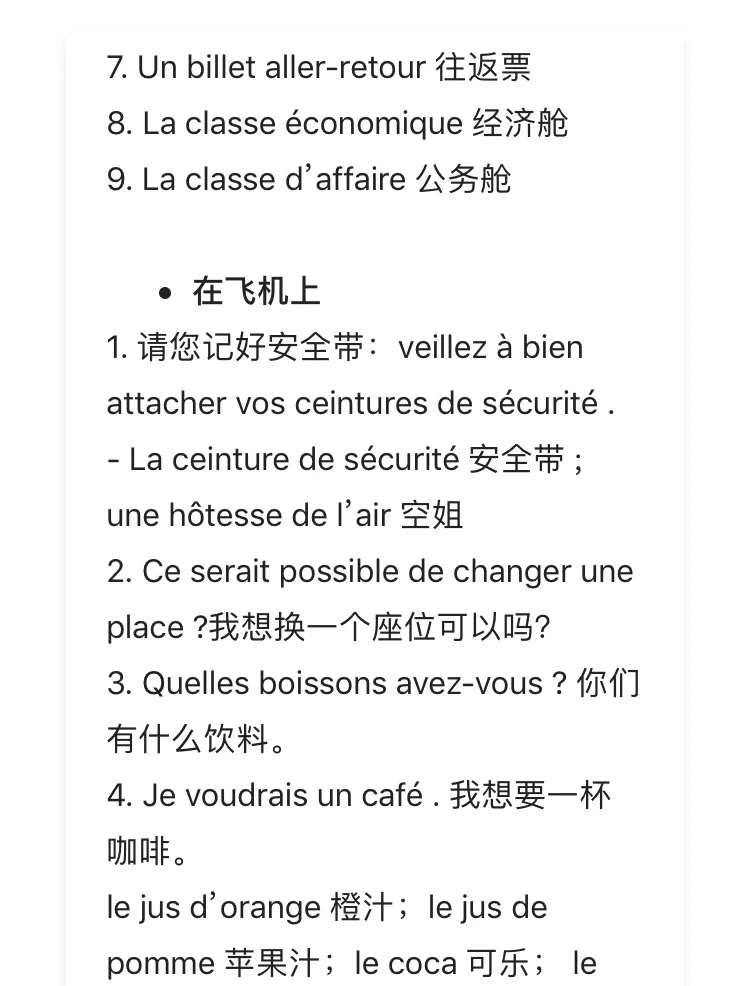
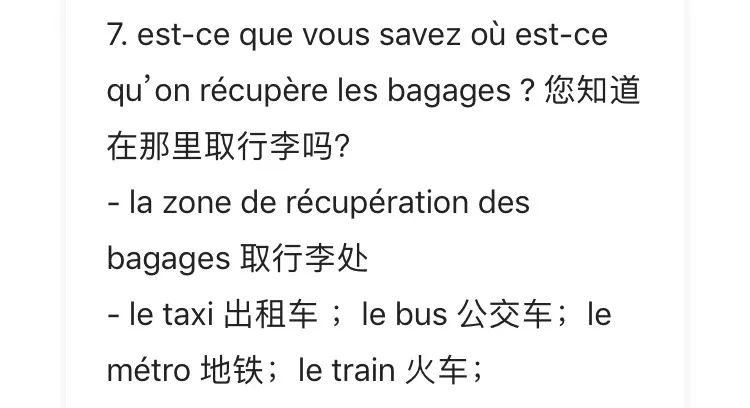

Začátek semestru se blíží. Při první cestě do Francie je rezervace letu tou snadnou částí — těžší otázka zní, jak se dostat z letiště do města, kde budete studovat. Města jako Lyon, Bordeaux, Marseille nebo Štrasburk sice mají mezinárodní lety, ale naprostá většina letů z Číny přistává na **letišti Paris Charles de Gaulle (CDG)**.

Dobrá zpráva je, že CDG je k čínsky mluvícím cestujícím neobvykle vstřícné: nástup, odbavení a dokonce i toalety jsou označeny čínsky, takže obvykle stačí držet se značek. Tento průvodce pokrývá **orientaci při příletu**, **terminály a vlakové nádraží**, **další cestu** a **seznam francouzských frází na letiště**.

## 1. Orientace při příletu

### Příletový tunel: o všem rozhodují tři značky

První úsek po výstupu z letadla je pověstný „příletový tunel“ CDG — dlouhý pohyblivý chodník pod značkou, která už dav za vás roztřídila:

- **Correspondances / Transfer** — zůstáváte na letišti kvůli dalšímu letu;
- **Bagages / Baggage** — vyzvedáváte odbavená zavazadla z pásů;
- **Sortie / Exit** — po vyzvednutí zavazadel a celní kontrole opouštíte letiště.

Klasická chyba začátečníka je jít podle „Exit“ až ven a zapomenout na přestupní let nebo vlakovou jízdenku. Zapamatujte si pořadí: **nejdřív se rozhodněte, zda přestupujete, a teprve pak volte zavazadla, nebo východ**.

### Čínské nápisy až k toaletám

CDG má souvislou čínskou stopu: u bran stojí „Embarquement - Boarding - 登机“, v odbavovací hale „Enregistrement - Check-in - 办理值机手续“ a i toalety přidávají „洗手间“ vedle francouzštiny a angličtiny. Značky v centru Paříže také často nesou čínštinu, takže jazyk není to, co vás ztratí.

### Pozor na nelegální taxíky — a vězte o placené službě nosičů

Po celém letišti visí upozornění v čínštině, angličtině a francouzštině: **nelegální taxíky představují skutečné riziko** (FAUX TAXI = VRAIS RISQUES). Taxík berte na oficiálním stanovišti nebo se sejděte s autem z aplikace na určeném místě vyzvednutí — nikdy nepřijměte řidiče, který k vám přijde sám.

Pokud máte hodně zavazadel, využijte oficiální letištní **službu nosičů (Porteurs / Porters)**; na její přepážce je uvedeno telefonní číslo a služba je placená. Za vozíky na zavazadla se také platí, proto mějte po ruce drobné nebo funkční platební kartu.

## 2. Terminály, vlakové nádraží a pohyb po letišti

### Tři terminály a sedm dílčích terminálů uvnitř T2

CDG má **tři terminály: 1, 2 a 3**. Terminál 2 je hlavní a dělí se na **sedm dílčích terminálů — T2A, T2B, T2C, T2D, T2E, T2F a T2G** — uspořádaných symetricky do tvaru okvětních plátků; Terminál 1 je kruhový „létající talíř“ na severozápadě; Terminál 3 je nejmenší, leží na severu a odbavuje hlavně nízkonákladové a charterové dopravce.

Terminály nejsou blízko sebe, ale uspořádání je přehledné: **zjistěte, který dílčí terminál váš let používá** (například T2E na lepence), a vydejte se tam.

### Vlakové nádraží: RER B i TGV, obojí u T2

Nádraží CDG leží pod Terminálem 2 — **La gare SNCF de l'aéroport Paris-Charles de Gaulle** — a dostanete se k němu eskalátorem přímo z terminálu. Podle popisu samotného letiště navazuje na sítě TGV Sud, Ouest a Nord i na hlavní linky Ouigo, Thalys a Eurostar; zde také nastoupíte na **RER B** do Paříže.

| Linka | Kam vás odveze |
| --- | --- |
| RER B | Centrum Paříže (Gare du Nord, Châtelet a další), asi 25–30 minut |
| TGV Sud / Ouest / Nord | Lyon, Bordeaux, Nantes, Lille a zbytek Francie |
| Ouigo | Levné vysokorychlostní spoje směrem na Lyon, Marseille a dál |
| Thalys / Eurostar | Brusel, Amsterdam a Londýn |

**Jízdenku si pokud možno kupte ještě před odletem.** Na nádraží jsou automaty i obsluhované přepážky, ale vyzvednutí zavazadel a hledání nástupiště zabere čas a ve špičce se jízdenky na tentýž den vyprodají. **SNCF Connect** (nebo sncf.com) funguje i z Číny — budete potřebovat kartu, kterou lze platit v eurech — a jízdenky jsou obvykle elektronické, skenované u turniketu. Případně můžete požádat kamaráda, který už ve Francii je.

### CDGVAL: bezplatný kyvadlový vláček, který jezdí 24 hodin

Přesun mezi terminály, parkovišti a vlakovým nádražím uvnitř letiště obstarává **bezplatný kyvadlový vláček CDGVAL** (nazývaný také RoissyVal). Linka je jednoduchá: T1 → parkoviště PR → Roissypole (kde je Terminál 3, asi 5 minut pěšky) → parkoviště PX → T2, kde můžete přestoupit na dálkové vlaky TGV a RER B, vedle hotelu Sheraton, hotelových shuttlebusů a **úschovny zavazadel**.

**Provozní doba:** vláček jezdí denně od 04:00 do 01:00 a od 01:00 do 04:00 ho nahrazuje kyvadlový autobus, takže spojení nikdy nekončí. Doplňují ho místní autobusy N1 a N2 a pěší chodby mezi terminály jsou dobře značené — s lehkými zavazadly bývá chůze často rychlejší než čekání.

## 3. Další cesta: přestupy, Orly a regiony

### 1. Přestup na CDG

Pokud váš další let odlétá také z CDG, stačí se přesunout mezi terminály uvnitř letiště **bezplatným vláčkem CDGVAL** (viz výše). Důležité je jedno rozhodnutí:

- **Zavazadla neodbavená až do cíle (samostatné letenky):** musíte projít imigrační kontrolou, vyzvednout zavazadla, přenést je do terminálu, odkud odlétá další let, a znovu se odbavit;
- **Zavazadla odbavená až do cíle (jedna letenka):** jděte podle značek **Transfer** přímo k terminálu a bráně dalšího letu — nic vyzvedávat nemusíte.

Tak jako tak jsou značky v čínštině, takže se neztratíte.

### 2. Cesta na Orly (ORY)

Pokud váš navazující let odlétá z **pařížského Orly**, vězte, že mezi oběma letišti neexistuje přímé železniční spojení — přestupujete po městské straně. Aktuální možnosti:

- **RER B + Orlyval:** jeďte RER B do **Antony** a přestupte na automatický vláček **Orlyval**, který jede přímo k terminálům Orly; kolem 60–90 minut a nejkratší spojení na přenášení zavazadel;
- **RER B + metro linka 14:** do města a poté linkou 14, která byla v roce 2024 prodloužena až na Orly — z centra asi 25 minut;
- **Taxík nebo soukromý transfer:** od dveří ke dveřím zhruba za 45–60 minut, nejlepší volba, když je málo času nebo máte hodně zavazadel.

Vezměte na vědomí, že starý autobus Air France (**Le Bus Direct**, dříve Les Cars Air France) **už nejezdí**; rada o „autobusu linky 3“, která stále koluje na internetu, je zastaralá, takže na něj na letišti nečekejte.

### 3. Vysokorychlostním vlakem do regionů

Terminál 2 má vlastní **vysokorychlostní nádraží SNCF**; pokud do vašeho univerzitního města jezdí přímý spoj, je to nejjednodušší varianta — bez zajížďky do Paříže. Kupujte předem, jak je popsáno výše, a **nechte si dost času**, pro případ že se ztratíte, budete dlouho čekat na zavazadla nebo narazíte na vyprodáno ve špičce.

Pokud přímý spoj není, jeďte nejdřív do Paříže a vyrazte ze správného nádraží: autobusové nádraží letiště (Gare routière) je v Roissypole vedle Terminálu 3 a jezdí odtud do města spoje jako Roissybus; do městských nádraží se dostanete i RER B. Jízdné a trasy se mění — pro den cesty si je ověřte u Île-de-France Mobilités.

### 4. Šest hlavních nádraží v Paříži

Paříž má šest hlavních nádraží, každé pro jeden směr po zemi. Než vyrazíte, zkontrolujte, které z nich máte vytištěné na jízdence:

| Nádraží | Hlavní směr | Metro / RER |
| --- | --- | --- |
| Gare du Nord | Severní Francie, Belgie, Spojené království (Eurostar) | Linky 4, 5; RER B, D |
| Gare de l'Est | Východní Francie, Německo, Lucembursko | Linky 4, 5, 7 |
| Gare de Lyon | Jihovýchodní Francie, Švýcarsko, Itálie | Linky 1, 14; RER A, D |
| Gare d'Austerlitz | Jihozápadní Francie, Španělsko, Portugalsko | Linky 5, 10; RER C |
| Gare Montparnasse | Západní Francie, Bretaň | Linky 4, 6, 12, 13 |
| Gare Saint-Lazare | Směr Normandie | Linky 3, 12, 13, 14 |

Na nádraží vám personál řekne přesné odjezdy do vaší destinace — kupte jízdenku a nastupte. S těžkými zavazadly počítejte s tím, že starší linky metra (zejména linka 4) často znamenají schody mezi nástupišti, takže si na nošení zavazadel nechte čas.

## 4. Seznam francouzských frází na letiště

Francouzštinu na CDG nepotřebujete — tyto tabulky pokrývají celou cestu od přistání po celnici a obvykle stačí si je přečíst z telefonu.

### Přílet na letiště

| Česky | Francouzsky |
| --- | --- |
| Letiště Paris Charles de Gaulle | L'aéroport de Charles de Gaulle |
| Letiště | L'aéroport |
| Přílety / odlety | Arrivées / départs |
| Toalety | Toilette |
| Terminál 1 | Terminal 1 (T1) |
| Odbavit zavazadla | Enregistrer des bagages |
| Palubní vstupenka | La carte d'embarquement |
| Brána 1 | Porte 1 |
| Vrácení DPH | La détaxe |

### Odbavení a bezpečnostní kontrola

| Česky | Francouzsky |
| --- | --- |
| Odbavovací přepážka | Un guichet d'embarquement |
| Váš pas, prosím | Votre passeport, s'il vous plaît |
| Chtěl bych místo u okna | Je voudrais avoir un siège du côté hublot, s'il vous plaît |
| Chtěl bych místo u uličky | Je voudrais avoir un siège du côté couloir, s'il vous plaît |
| Bezpečnostní kontrola | Le contrôle de sécurité |
| Příruční zavazadlo | Le bagage à main |
| Odbavené zavazadlo | Le bagage enregistré |
| Jednosměrná / zpáteční jízdenka | Un billet simple / un billet aller-retour |
| Ekonomická / obchodní třída | La classe économique / la classe d'affaire |

### Na palubě

| Česky | Francouzsky |
| --- | --- |
| Prosím, připoutejte se | Veillez à bien attacher vos ceintures de sécurité |
| Bezpečnostní pás / letuška | La ceinture de sécurité / une hôtesse de l'air |
| Mohl bych si vyměnit místo? | Ce serait possible de changer une place ? |
| Jaké nápoje máte? | Quelles boissons avez-vous ? |
| Chtěl bych kávu | Je voudrais un café |
| Pomerančový džus / jablečný džus / cola | le jus d'orange / le jus de pomme / le coca |
| Víno / pivo / voda | le vin / la bière / l'eau |
| Snídaně / oběd / večeře | le petit déjeuner / le déjeuner / le dîner |
| Nejím vepřové | Je ne mange pas de porc |
| Mohl byste mi dát deku? | Est-ce que vous pouvez me donner une couverture ? |

### Výstup z letadla, celnice a zavazadla

| Česky | Francouzsky |
| --- | --- |
| Procházet celní kontrolou | passer la douane |
| Jak dlouho tady zůstanete? | Vous vous arrêterez ici pendant combien de temps ? |
| Máte něco k prohlášení? | Avez-vous quelques choses à déclarer ? |
| Máte nějaké zakázané předměty? | Avez-vous des choses interdites ? |
| Odkud jste? | S'il vous plaît, d'où venez-vous ? |
| Otevřete prosím své kufry. | Veuillez ouvrir vos valises. |
| Co je to? | Qu'est-ce que c'est ? |
| Celní prohlášení / zdravotní prohlášení / příjezdový formulář | la fiche de déclaration / la fiche de déclaration d'hygiène et de santé / la formulaire d'entrée |
| Víte, kde se vyzvedávají zavazadla? | Est-ce que vous savez où est-ce qu'on récupère les bagages ? |
| Výdej zavazadel | la zone de récupération des bagages |
| Taxík / autobus / metro / vlak | le taxi / le bus / le métro / le train |

Původní screenshoty seznamu frází najdete níže, pokud si je raději uložíte do telefonu.

## Související odkazy

- **Na tomto webu**: [Letiště Paris Charles de Gaulle (CDG)](/airport/CDG), [Letiště Paris Orly (ORY)](/airport/ORY), [Francie (FR)](/country/FR)
- **Wikipedia**: [Letiště Charles de Gaulle](https://en.wikipedia.org/wiki/Paris_Charles_de_Gaulle_Airport), [Letiště Orly](https://en.wikipedia.org/wiki/Paris_Orly_Airport)
- **Baidu Baike**: [Letiště Charles de Gaulle](https://baike.baidu.com/item/%E5%B7%B4%E9%BB%8E%E5%A4%8F%E5%B0%94%C2%B7%E6%88%B4%E9%AB%98%E4%B9%90%E6%9C%BA%E5%9C%BA), [Letiště Orly](https://baike.baidu.com/item/%E5%B7%B4%E9%BB%8E-%E5%A5%A5%E5%88%A9%E6%9C%BA%E5%9C%BA)
