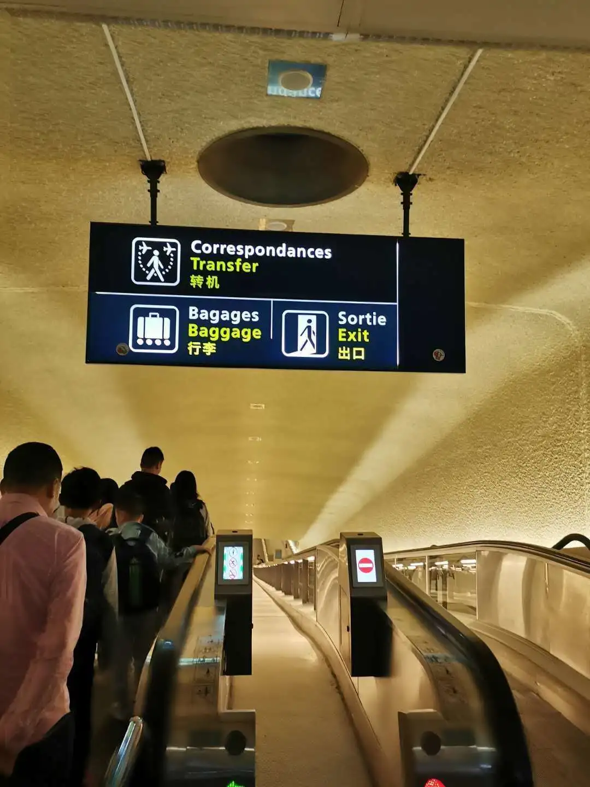

La rentrée approche. Pour un premier voyage en France, réserver le vol est la partie facile — la question plus difficile est comment sortir de l'aéroport et rejoindre la ville où vous allez étudier. Des villes comme Lyon, Bordeaux, Marseille et Strasbourg ont bien des vols internationaux, mais la grande majorité des vols en provenance de Chine atterrissent à **Paris Charles de Gaulle (CDG)**.

La bonne nouvelle, c'est que CDG est particulièrement accueillant pour les voyageurs sinophones : embarquement, enregistrement et même toilettes sont signalés en chinois, si bien que suivre les panneaux suffit généralement. Ce guide couvre **l'orientation à l'arrivée**, **les terminaux et la gare ferroviaire**, **la poursuite du voyage** et **une liste de phrases françaises pour l'aéroport**.

## 1. S'orienter à l'arrivée

### Le tunnel d'arrivée : trois panneaux décident de tout

La première portion après avoir quitté l'avion est le célèbre « tunnel d'arrivée » de CDG — un long tapis roulant sous un panneau qui a déjà trié la foule pour vous :

- **Correspondances / Transfer** — rester dans l'aéroport pour votre prochain vol ;
- **Bagages / Baggage** — récupérer les bagages enregistrés sur les carrousels ;
- **Sortie / Exit** — quitter l'aéroport après avoir récupéré vos bagages et passé la douane.

L'erreur classique du premier voyage est de suivre « Exit » jusqu'à la sortie et d'oublier un vol de correspondance ou un billet de train. Retenez l'ordre : **décidez d'abord si vous êtes en correspondance, choisissez ensuite bagages ou sortie**.

### Une signalisation en chinois, jusqu'aux toilettes

CDG déploie un parcours complet en chinois : les portes portent « Embarquement - Boarding - 登机 », la zone d'enregistrement indique « Enregistrement - Check-in - 办理值机手续 », et même les toilettes ajoutent « 洗手间 » à côté du français et de l'anglais. Les panneaux du centre de Paris comportent souvent du chinois aussi : ce n'est pas la langue qui vous fera vous perdre.

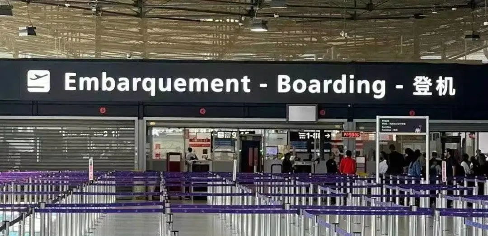

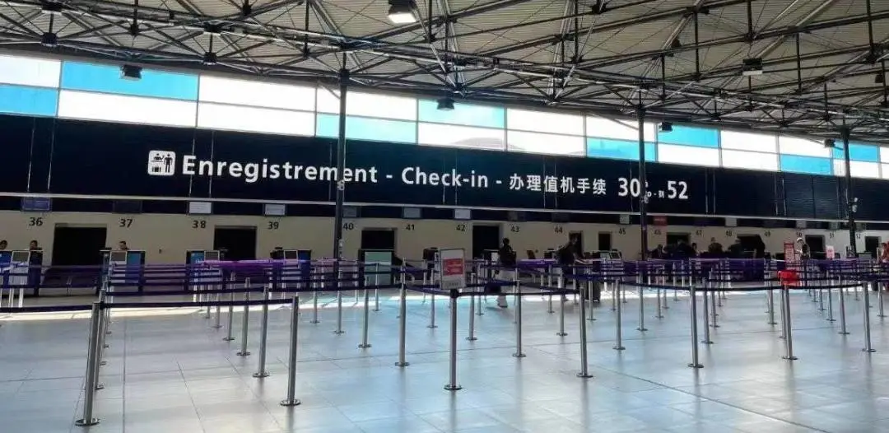

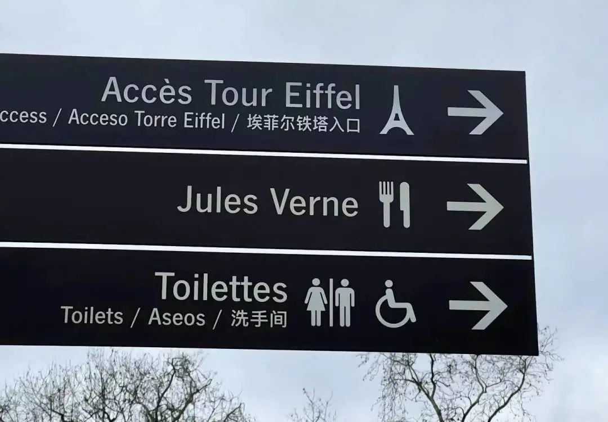

### Attention aux taxis non autorisés — et pensez au service de porteurs payant

Des avertissements sont affichés dans tout l'aéroport, en chinois, anglais et français : **les taxis non autorisés sont de vrais risques** (FAUX TAXI = VRAIS RISQUES). Prenez un taxi à la station officielle, ou retrouvez un VTC au point de prise en charge désigné — n'acceptez jamais un chauffeur qui vous aborde.

Avec beaucoup de bagages, utilisez le **service de porteurs officiel de l'aéroport (Porteurs / Porters)**, dont le comptoir affiche un numéro de téléphone et facture une prestation. Les chariots à bagages sont également payants : gardez des pièces ou une carte bancaire en état de marche à portée de main.

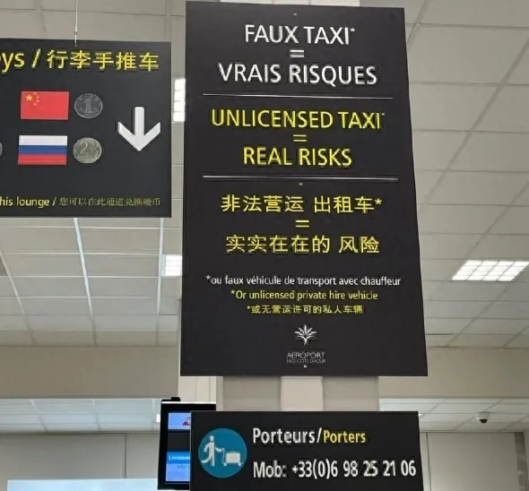

## 2. Terminaux, gare ferroviaire et déplacements dans l'aéroport

### Trois terminaux et sept modules à l'intérieur du T2

CDG compte **trois terminaux : 1, 2 et 3**. Le terminal 2 est le principal et se divise en **sept modules — T2A, T2B, T2C, T2D, T2E, T2F et T2G** — disposés symétriquement en forme de pétales ; le terminal 1 est une « soucoupe volante » circulaire au nord-ouest ; le terminal 3 est le plus petit, au nord, et traite surtout les compagnies low cost et charter.

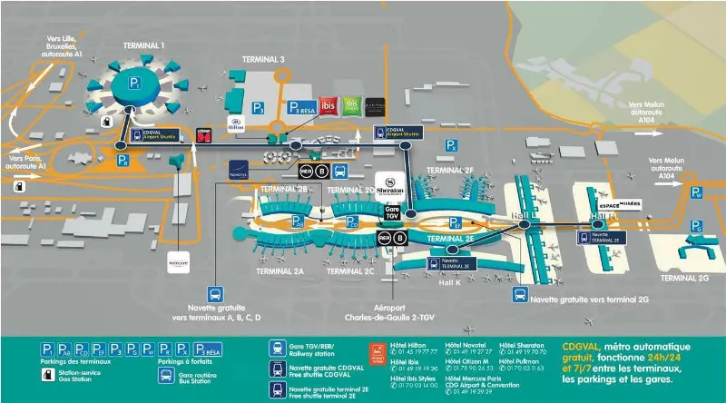

Les terminaux ne sont pas proches, mais l'organisation est claire : **vérifiez quel satellite utilise votre vol** (par exemple T2E sur votre carte d'embarquement) et dirigez-vous là-bas.

### La gare ferroviaire : RER B et TGV, tous deux au T2

La gare de CDG se trouve sous le terminal 2 — **la gare SNCF de l'aéroport Paris-Charles de Gaulle** — accessible par escalator directement depuis le terminal. Selon la description de l'aéroport, elle relie les réseaux TGV Sud, Ouest et Nord ainsi que les principales lignes Ouigo, Thalys et Eurostar, et c'est là que vous prenez le **RER B** vers Paris.

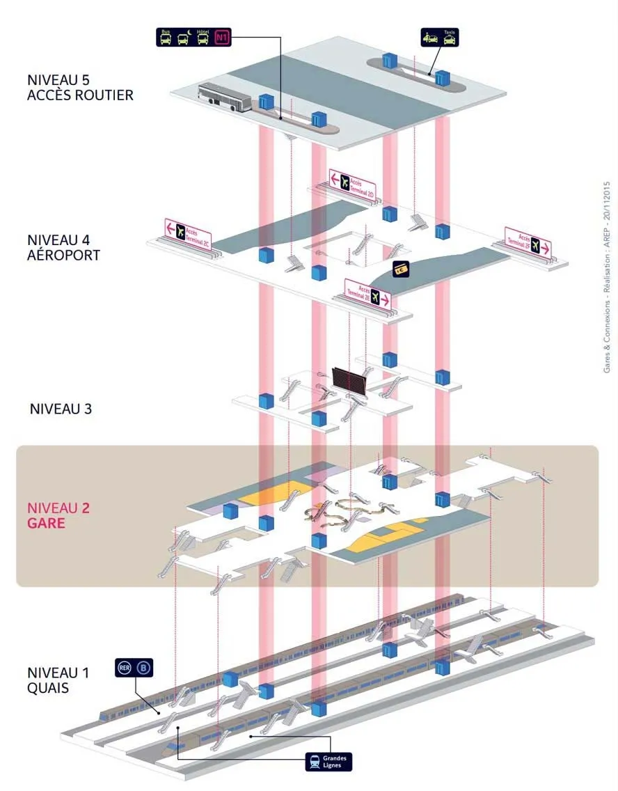

| Ligne | Où elle vous emmène |
| --- | --- |
| RER B | Centre de Paris (gare du Nord, Châtelet et plus), environ 25–30 minutes |
| TGV Sud / Ouest / Nord | Lyon, Bordeaux, Nantes, Lille et le reste de la France |
| Ouigo | Services à grande vitesse économiques vers Lyon, Marseille et au-delà |
| Thalys / Eurostar | Bruxelles, Amsterdam et Londres |

**Achetez votre billet avant de prendre l'avion si possible.** La gare dispose de distributeurs et de comptoirs avec personnel, mais récupérer les bagages et trouver le quai prend du temps, et en période de pointe les billets du jour s'épuisent. **SNCF Connect** (ou sncf.com) fonctionne depuis la Chine — il vous faut une carte capable de payer en euros — et les billets sont généralement électroniques, scannés au portique. Vous pouvez aussi demander à un ami déjà en France de l'acheter pour vous.

### CDGVAL : le train-navette gratuit qui circule 24 heures sur 24

Se déplacer entre les terminaux, les parkings et la gare ferroviaire à l'intérieur de l'aéroport est la mission du **train-navette gratuit CDGVAL** (aussi appelé RoissyVal). La ligne est simple : T1 → parking PR → Roissypole (où se trouve le terminal 3, à environ 5 minutes à pied) → parking PX → T2, où vous pouvez changer pour les trains TGV grandes lignes et le RER B, à côté de l'hôtel Sheraton, des navettes d'hôtels et de la **consigne à bagages**.

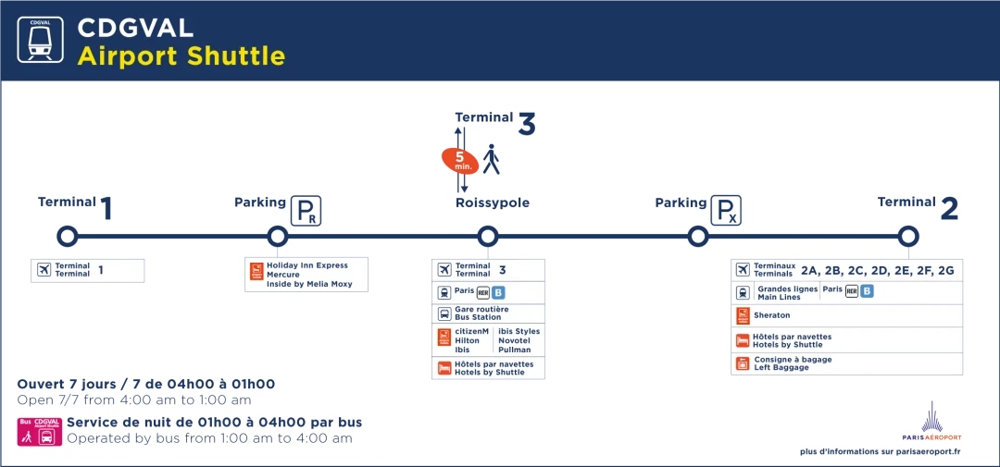

**Horaires :** le train circule de 04:00 à 01:00 tous les jours, et un bus navette assure la liaison de 01:00 à 04:00 : le lien ne ferme jamais. Les bus de nuit N1 et N2 le complètent, et les passerelles entre les terminaux sont bien signalées — avec des bagages légers, marcher est souvent plus rapide qu'attendre.

## 3. Poursuivre le voyage : correspondances, Orly et la province

### 1. Correspondance à CDG

Si votre prochain vol part aussi de CDG, vous changez simplement de terminal à l'intérieur de l'aéroport avec le **train CDGVAL gratuit** (voir ci-dessus). Une décision compte :

- **Bagages non enregistrés jusqu'à destination (billets séparés) :** vous devez passer l'immigration, récupérer vos bagages, les emmener au terminal de départ de votre prochain vol et vous enregistrer de nouveau ;
- **Bagages enregistrés jusqu'à destination (un seul billet) :** suivez les panneaux **Transfer** directement jusqu'au terminal et à la porte du prochain vol — inutile de récupérer quoi que ce soit.

Dans les deux cas, la signalisation est en chinois : vous ne vous perdrez pas.

### 2. Rejoindre Orly (ORY)

Si votre vol suivant part de **Paris Orly**, sachez qu'il n'existe pas de liaison ferroviaire directe entre les deux aéroports — le changement se fait côté ville. Les options actuelles :

- **RER B + Orlyval :** prenez le RER B jusqu'à **Antony**, puis l'**Orlyval**, navette automatique, jusqu'aux terminaux d'Orly ; environ 60–90 minutes, et la correspondance la plus courte à parcourir avec des bagages ;
- **RER B + métro ligne 14 :** entrez dans Paris, puis prenez la ligne 14, prolongée jusqu'à Orly en 2024 — environ 25 minutes depuis le centre ;
- **Taxi ou transfert privé :** de porte à porte en 45 à 60 minutes environ, la meilleure option quand le temps ou les bagages manquent.

Sachez que l'ancien **car Air France (Le Bus Direct, autrefois Les Cars Air France) a cessé son activité** ; les conseils sur le « car de la ligne 3 » qui circulent encore en ligne sont périmés, n'attendez donc pas son passage à l'aéroport.

### 3. Prendre le TGV vers la province

Le terminal 2 dispose de sa propre **gare SNCF à grande vitesse**, et si votre ville universitaire est desservie en direct, c'est l'option la plus simple — aucun détour par Paris. Achetez à l'avance comme indiqué plus haut et **laissez beaucoup de marge**, au cas où vous vous perdriez, attendriez trop longtemps vos bagages ou tomberiez sur une rupture de stock en période de pointe.

S'il n'y a pas de billet direct, allez d'abord dans Paris et partez de la bonne gare : la gare routière de l'aéroport se trouve à Roissypole, à côté du terminal 3, avec des lignes comme le Roissybus vers la ville, et le RER B rejoint aussi les gares parisiennes. Tarifs et itinéraires changent — consultez Île-de-France Mobilités pour le jour de votre voyage.

### 4. Les six grandes gares de Paris

Paris compte six grandes gares, une par direction du pays. Vérifiez laquelle est imprimée sur votre billet avant de partir :

| Gare | Direction principale | Métro / RER |
| --- | --- | --- |
| Gare du Nord | Nord de la France, Belgique, Royaume-Uni (Eurostar) | Lignes 4, 5 ; RER B, D |
| Gare de l'Est | Est de la France, Allemagne, Luxembourg | Lignes 4, 5, 7 |
| Gare de Lyon | Sud-est de la France, Suisse, Italie | Lignes 1, 14 ; RER A, D |
| Gare d'Austerlitz | Sud-ouest de la France, Espagne, Portugal | Lignes 5, 10 ; RER C |
| Gare Montparnasse | Ouest de la France, Bretagne | Lignes 4, 6, 12, 13 |
| Gare Saint-Lazare | Vers la Normandie | Lignes 3, 12, 13, 14 |

En gare, le personnel vous indiquera les départs exacts pour votre destination — achetez le billet et embarquez. Avec des bagages lourds, gardez à l'esprit que les lignes de métro les plus anciennes (la ligne 4 en particulier) imposent souvent des escaliers entre les quais : prévoyez du temps pour porter les bagages.

## 4. Liste de phrases françaises pour l'aéroport

Vous n'avez pas besoin de français pour traverser CDG — ces tableaux couvrent tout le parcours de l'atterrissage à la douane, et les lire sur votre téléphone suffit généralement.

### Arriver à l'aéroport

| Anglais | Français |
| --- | --- |
| Paris Charles de Gaulle Airport | L'aéroport de Charles de Gaulle |
| Airport | L'aéroport |
| Arrivals / departures | Arrivées / départs |
| Toilets | Toilette |
| Terminal 1 | Terminal 1 (T1) |
| To check in baggage | Enregistrer des bagages |
| Boarding pass | La carte d'embarquement |
| Gate 1 | Porte 1 |
| Tax refund | La détaxe |

### Enregistrement et sécurité

| Anglais | Français |
| --- | --- |
| Check-in desk | Un guichet d'embarquement |
| Your passport, please | Votre passeport, s'il vous plaît |
| I would like a window seat | Je voudrais avoir un siège du côté hublot, s'il vous plaît |
| I would like an aisle seat | Je voudrais avoir un siège du côté couloir, s'il vous plaît |
| Security check | Le contrôle de sécurité |
| Hand luggage | Le bagage à main |
| Checked baggage | Le bagage enregistré |
| One-way / return ticket | Un billet simple / un billet aller-retour |
| Economy / business class | La classe économique / la classe d'affaire |

### À bord

| Anglais | Français |
| --- | --- |
| Please fasten your seat belts | Veillez à bien attacher vos ceintures de sécurité |
| Seat belt / flight attendant | La ceinture de sécurité / une hôtesse de l'air |
| Could I change seats? | Ce serait possible de changer une place ? |
| What drinks do you have? | Quelles boissons avez-vous ? |
| I would like a coffee | Je voudrais un café |
| Orange juice / apple juice / cola | le jus d'orange / le jus de pomme / le coca |
| Wine / beer / water | le vin / la bière / l'eau |
| Breakfast / lunch / dinner | le petit déjeuner / le déjeuner / le dîner |
| I don't eat pork | Je ne mange pas de porc |
| Could you give me a blanket? | Est-ce que vous pouvez me donner une couverture ? |

### Quitter l'avion, la douane et les bagages

| Anglais | Français |
| --- | --- |
| Going through customs | passer la douane |
| How long are you staying here? | Vous vous arrêterez ici pendant combien de temps ? |
| Do you have anything to declare? | Avez-vous quelques choses à déclarer ? |
| Do you have any prohibited items? | Avez-vous des choses interdites ? |
| Where are you from? | S'il vous plaît, d'où venez-vous ? |
| Please open your suitcases. | Veuillez ouvrir vos valises. |
| What is this? | Qu'est-ce que c'est ? |
| Declaration / health / arrival form | la fiche de déclaration / la fiche de déclaration d'hygiène et de santé / la formulaire d'entrée |
| Do you know where to collect the baggage? | Est-ce que vous savez où est-ce qu'on récupère les bagages ? |
| Baggage reclaim | la zone de récupération des bagages |
| Taxi / bus / metro / train | le taxi / le bus / le métro / le train |

Les captures d'écran originales de la liste de phrases figurent ci-dessous si vous préférez les enregistrer sur votre téléphone.

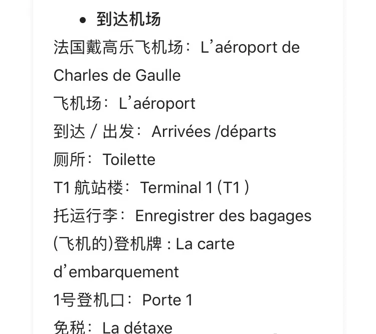

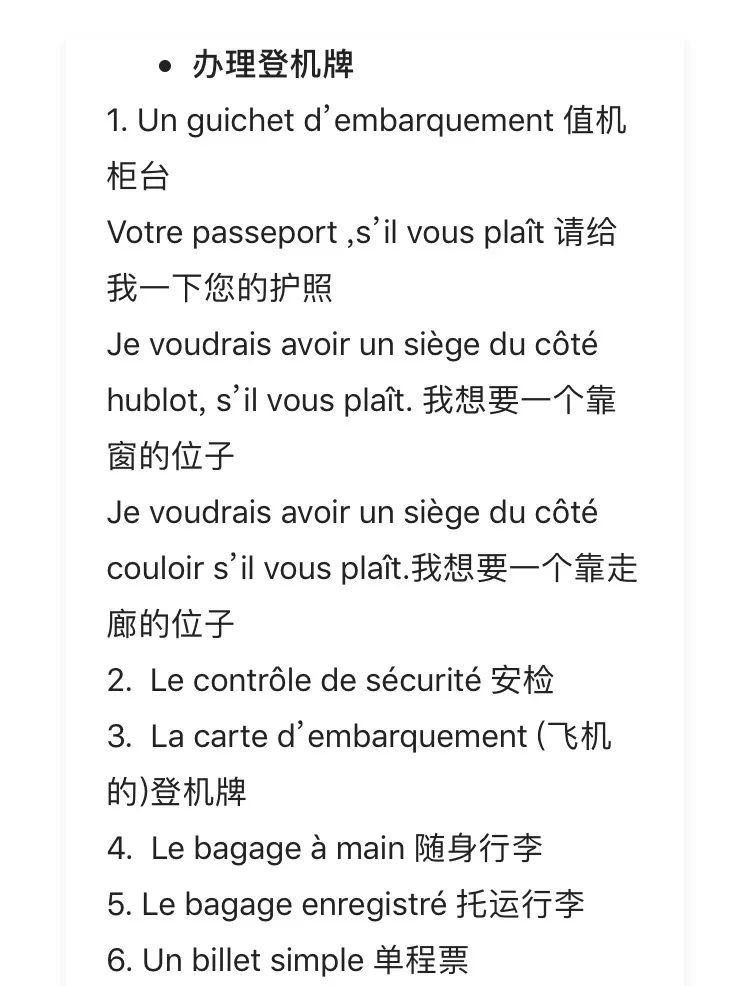

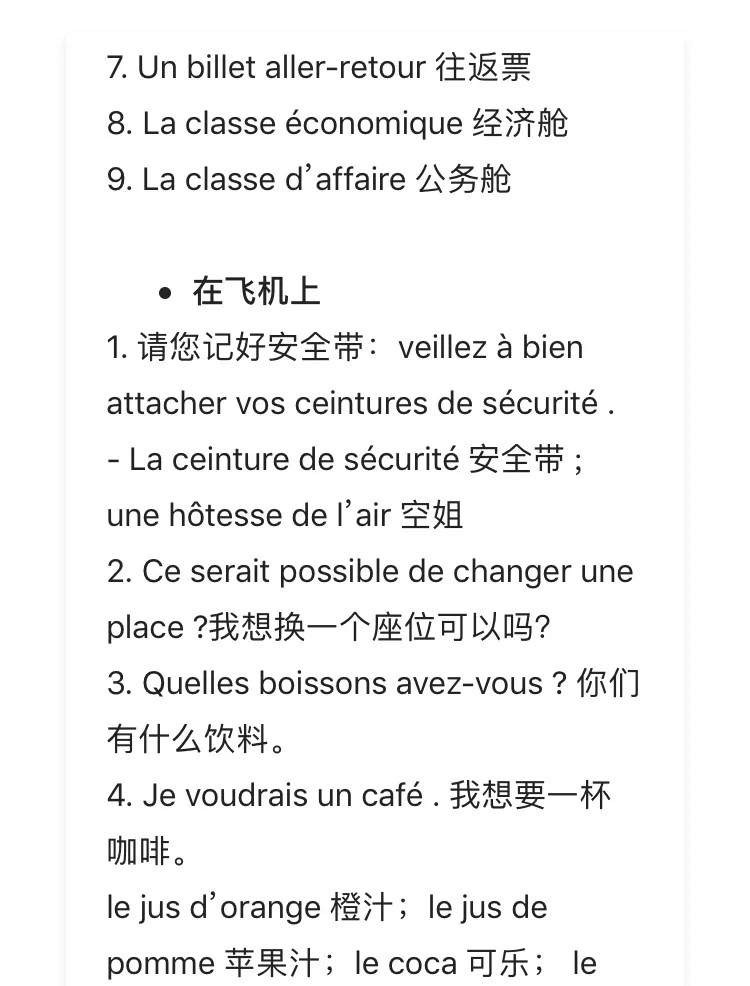

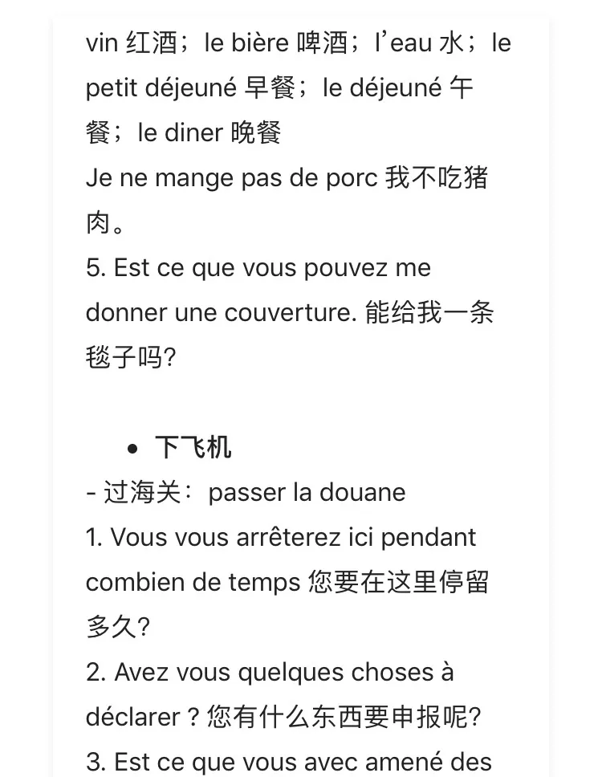

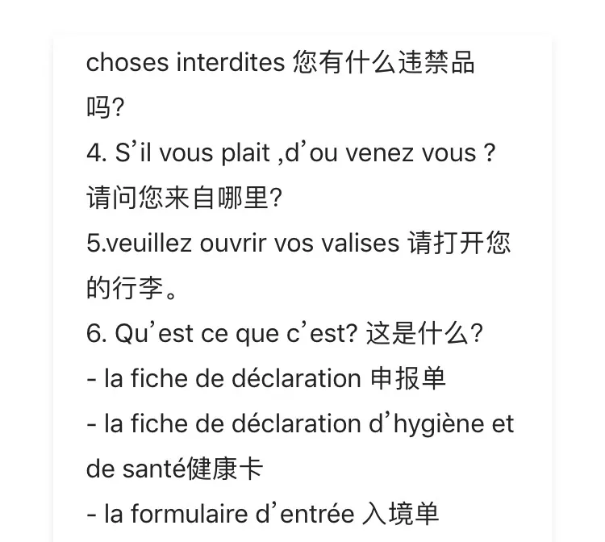

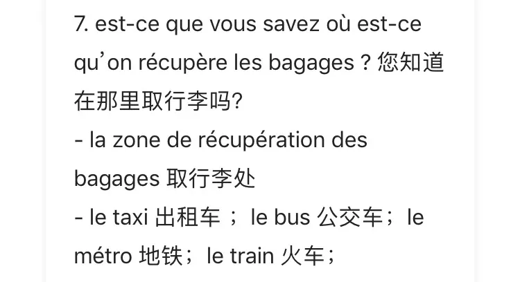

## Liens utiles

- **Sur ce site :** [Aéroport Paris Charles de Gaulle (CDG)](/airport/CDG), [Aéroport Paris Orly (ORY)](/airport/ORY), [France (FR)](/country/FR)
- **Wikipédia :** [Aéroport Paris Charles de Gaulle](https://en.wikipedia.org/wiki/Paris_Charles_de_Gaulle_Airport), [Aéroport Paris Orly](https://en.wikipedia.org/wiki/Paris_Orly_Airport)
- **Baidu Baike :** [Aéroport Paris Charles de Gaulle](https://baike.baidu.com/item/%E5%B7%B4%E9%BB%8E%E5%A4%8F%E5%B0%94%C2%B7%E6%88%B4%E9%AB%98%E4%B9%90%E6%9C%BA%E5%9C%BA), [Aéroport Paris Orly](https://baike.baidu.com/item/%E5%B7%B4%E9%BB%8E-%E5%A5%A5%E5%88%A9%E6%9C%BA%E5%9C%BA)
