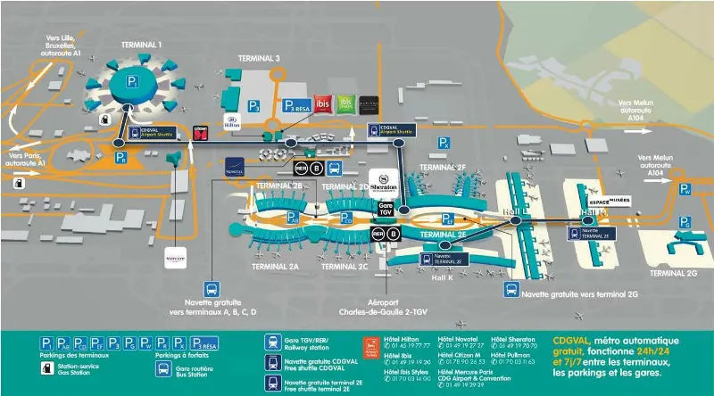
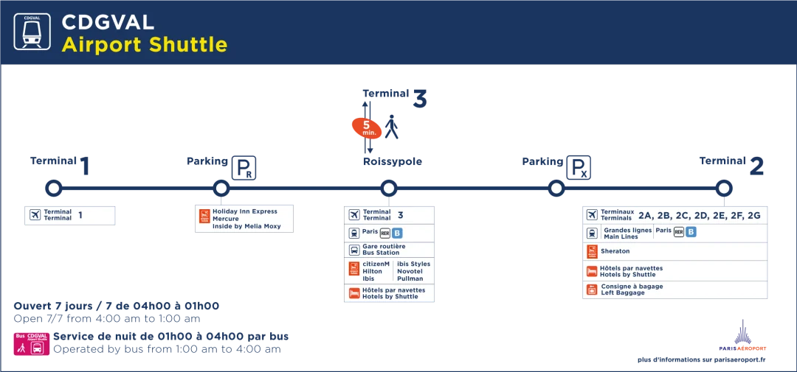
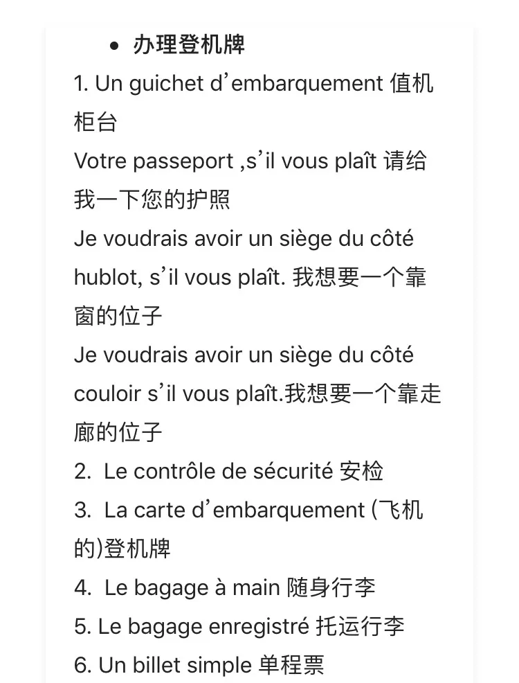

Musim kuliah hampir tiba. Untuk perjalanan pertama ke Prancis, memesan penerbangan adalah bagian yang mudah — pertanyaan yang lebih sulit adalah bagaimana keluar dari bandara dan menuju kota tempat Anda akan belajar. Kota seperti Lyon, Bordeaux, Marseille, dan Strasbourg memang memiliki penerbangan internasional, tetapi sebagian besar penerbangan dari Tiongkok mendarat di **Paris Charles de Gaulle (CDG)**.

Kabar baiknya, CDG luar biasa ramah bagi pelancong berbahasa Mandarin: boarding, check-in, bahkan toilet bertanda bahasa Mandarin, jadi mengikuti tanda biasanya sudah cukup. Panduan ini membahas **cara menemukan jalan saat tiba**, **terminal dan stasiun kereta**, **perjalanan lanjutan**, dan **daftar frasa Prancis untuk bandara**.

## 1. Menemukan jalan saat tiba

### Terowongan kedatangan: tiga tanda menentukan segalanya

Bagian pertama setelah Anda meninggalkan pesawat adalah "terowongan kedatangan" CDG yang terkenal — travelator panjang di bawah tanda yang sudah memilah kerumunan untuk Anda:

- **Correspondances / Transfer** — tetap di dalam bandara untuk penerbangan berikutnya;
- **Bagages / Baggage** — mengambil bagasi tercatat dari karusel;
- **Sortie / Exit** — meninggalkan bandara setelah mengambil bagasi dan melewati bea cukai.

Kesalahan klasik pendatang pertama adalah mengikuti "Exit" sampai keluar dan melupakan penerbangan sambungan atau tiket kereta. Ingat urutannya: **tentukan dulu apakah Anda transit, baru pilih bagasi atau keluar**.

### Papan tanda Mandarin, sampai ke toilet

CDG memiliki jalur bahasa Mandarin yang lengkap: gerbang bertanda "Embarquement - Boarding - 登机", area check-in bertuliskan "Enregistrement - Check-in - 办理值机手续", dan bahkan toilet menambahkan "洗手间" di samping bahasa Prancis dan Inggris. Tanda di pusat kota Paris juga sering memuat bahasa Mandarin, jadi bahasa bukan hal yang akan membuat Anda tersesat.

### Waspadai taksi tidak resmi — dan kenali layanan porter berbayar

Peringatan dipasang di seluruh bandara, dalam bahasa Mandarin, Inggris, dan Prancis: **taksi tidak resmi adalah risiko nyata** (FAUX TAXI = VRAIS RISQUES). Naik taksi dari pangkalan resmi, atau temui mobil taksi daring di titik penjemputan yang ditentukan — jangan pernah menerima pengemudi yang menghampiri Anda.

Dengan banyak bagasi, gunakan **layanan porter (Porteurs / Porters)** resmi bandara, yang mejanya mencantumkan nomor telepon dan mengenakan biaya. Troli bagasi juga berbayar, jadi simpan beberapa koin atau kartu bank yang berfungsi.

## 2. Terminal, stasiun kereta, dan berkeliling bandara

### Tiga terminal, dan tujuh subterminal di dalam T2

CDG memiliki **tiga terminal: 1, 2, dan 3**. Terminal 2 adalah yang utama dan terbagi menjadi **tujuh subterminal — T2A, T2B, T2C, T2D, T2E, T2F, dan T2G** — tersusun simetris dalam pola kelopak; Terminal 1 adalah "piring terbang" melingkar di barat laut; Terminal 3 paling kecil, di utara, dan sebagian besar menangani maskapai bertarif murah dan carter.

Terminal-terminalnya tidak berdekatan, tetapi tata letaknya jelas: **periksa subterminal mana yang dipakai penerbangan Anda** (misalnya T2E di boarding pass) dan menuju ke sana.

### Stasiun kereta: RER B dan TGV, keduanya di T2

Stasiun CDG berada di bawah Terminal 2 — **La gare SNCF de l'aéroport Paris-Charles de Gaulle** — dicapai dengan eskalator langsung dari terminal. Menurut deskripsi bandara sendiri, stasiun ini terhubung ke jaringan TGV Sud, Ouest, dan Nord serta jalur utama Ouigo, Thalys, dan Eurostar, dan di sinilah Anda mengambil **RER B** ke Paris.

| Jalur | Tujuan |
| --- | --- |
| RER B | Pusat Paris (Gare du Nord, Châtelet, dan lainnya), sekitar 25–30 menit |
| TGV Sud / Ouest / Nord | Lyon, Bordeaux, Nantes, Lille, dan seluruh Prancis |
| Ouigo | Layanan cepat bertarif murah menuju Lyon, Marseille, dan seterusnya |
| Thalys / Eurostar | Brussels, Amsterdam, dan London |

**Beli tiket sebelum terbang jika bisa.** Ada mesin dan meja berstaf di stasiun, tetapi mengambil bagasi dan mencari peron memakan waktu, dan pada periode puncak tiket hari yang sama habis. **SNCF Connect** (atau sncf.com) berfungsi dari Tiongkok — Anda memerlukan kartu yang dapat membayar dalam euro — dan tiket biasanya elektronik, dipindai di gerbang. Alternatifnya, minta teman yang sudah di Prancis membelikannya.

### CDGVAL: kereta shuttle gratis yang beroperasi 24 jam

Berpindah antara terminal, tempat parkir, dan stasiun kereta di dalam bandara adalah tugas **kereta shuttle gratis CDGVAL** (juga disebut RoissyVal). Jalurnya sederhana: T1 → parkir PR → Roissypole (tempat Terminal 3 berada, sekitar 5 menit berjalan kaki) → parkir PX → T2, tempat Anda dapat berganti ke kereta utama TGV dan RER B, di samping hotel Sheraton, bus shuttle hotel, dan **kantor titip bagasi**.

**Jam:** kereta berjalan 04:00–01:00 setiap hari, dan bus shuttle melayani 01:00–04:00, jadi sambungannya tidak pernah tutup. Bus shuttle lokal N1 dan N2 melengkapinya, dan jalur pejalan kaki antarterminal bertanda baik — dengan bagasi ringan, berjalan kaki sering lebih cepat daripada menunggu.

## 3. Perjalanan lanjutan: transit, Orly, dan daerah

### 1. Transit di CDG

Jika penerbangan berikutnya juga berangkat dari CDG, Anda cukup berganti terminal di dalam bandara dengan **kereta CDGVAL gratis** (lihat di atas). Satu keputusan penting:

- **Bagasi tidak diteruskan (tiket terpisah):** Anda harus melewati imigrasi, mengambil bagasi, membawanya ke terminal keberangkatan penerbangan berikutnya, dan check-in lagi;
- **Bagasi diteruskan (satu tiket):** ikuti tanda **Transfer** langsung ke terminal dan gerbang penerbangan berikutnya — tidak perlu mengambil apa pun.

Bagaimanapun, tandanya berbahasa Mandarin, jadi Anda tidak akan tersesat.

### 2. Menuju Orly (ORY)

Jika penerbangan lanjutan Anda berangkat dari **Paris Orly**, perhatikan bahwa tidak ada sambungan rel langsung antara kedua bandara — Anda berganti di sisi kota. Pilihan saat ini:

- **RER B + Orlyval:** naik RER B ke **Antony**, lalu berganti ke shuttle otomatis **Orlyval** langsung ke terminal Orly; sekitar 60–90 menit, dan sambungan terpendek untuk berjalan dengan bagasi;
- **RER B + Metro jalur 14:** masuk ke kota, lalu jalur 14, yang diperpanjang ke Orly pada 2024 — sekitar 25 menit dari pusat;
- **Taksi atau transfer pribadi:** pintu ke pintu dalam sekitar 45–60 menit, terbaik saat waktu atau bagasi terbatas.

Ketahuilah bahwa **bus Air France lama (Le Bus Direct, dulu Les Cars Air France) sudah berhenti beroperasi**; saran "bus jalur 3" yang masih beredar online sudah kedaluwarsa, jadi jangan menunggunya di bandara.

### 3. Naik TGV ke daerah

Terminal 2 memiliki **stasiun cepat SNCF** sendiri, dan jika kota universitas Anda memiliki layanan langsung, ini pilihan paling sederhana — tanpa memutar ke Paris. Beli lebih awal seperti dijelaskan di atas, dan **sisakan banyak waktu**, jika Anda tersesat, terlalu lama menunggu bagasi, atau kehabisan tiket pada periode puncak.

Jika tidak ada tiket langsung, pergi ke Paris lebih dulu dan berangkat dari stasiun yang tepat: stasiun bus bandara (Gare routière) berada di Roissypole di samping Terminal 3, dengan rute seperti Roissybus ke kota, dan RER B juga mencapai stasiun-stasiun kota. Tarif dan rute berubah — periksa Île-de-France Mobilités untuk hari perjalanan Anda.

### 4. Enam stasiun kereta utama di Paris

Paris memiliki enam stasiun utama, satu untuk setiap arah negara. Periksa stasiun mana yang tercetak di tiket Anda sebelum berangkat:

| Stasiun | Arah utama | Metro / RER |
| --- | --- | --- |
| Gare du Nord | Prancis utara, Belgia, Inggris (Eurostar) | Jalur 4, 5; RER B, D |
| Gare de l'Est | Prancis timur, Jerman, Luksemburg | Jalur 4, 5, 7 |
| Gare de Lyon | Prancis tenggara, Swiss, Italia | Jalur 1, 14; RER A, D |
| Gare d'Austerlitz | Prancis barat daya, Spanyol, Portugal | Jalur 5, 10; RER C |
| Gare Montparnasse | Prancis barat, Bretagne | Jalur 4, 6, 12, 13 |
| Gare Saint-Lazare | Menuju Normandia | Jalur 3, 12, 13, 14 |

Di stasiun, staf akan memberi tahu keberangkatan tepat untuk tujuan Anda — beli tiket dan naik. Dengan bagasi berat, ingat bahwa jalur metro yang lebih tua (terutama jalur 4) sering berarti tangga antarperson, jadi sediakan waktu untuk membawa bagasi.

## 4. Daftar frasa Prancis bandara

Anda tidak perlu bahasa Prancis untuk melewati CDG — tabel ini mencakup seluruh rute dari mendarat hingga bea cukai, dan membacanya dari ponsel biasanya sudah cukup.

### Tiba di bandara

| Indonesia | Prancis |
| --- | --- |
| Bandara Paris Charles de Gaulle | L'aéroport de Charles de Gaulle |
| Bandara | L'aéroport |
| Kedatangan / keberangkatan | Arrivées / départs |
| Toilet | Toilette |
| Terminal 1 | Terminal 1 (T1) |
| Check-in bagasi | Enregistrer des bagages |
| Boarding pass | La carte d'embarquement |
| Gerbang 1 | Porte 1 |
| Pengembalian pajak | La détaxe |

### Check-in dan keamanan

| Indonesia | Prancis |
| --- | --- |
| Meja check-in | Un guichet d'embarquement |
| Paspor Anda, tolong | Votre passeport, s'il vous plaît |
| Saya ingin kursi dekat jendela | Je voudrais avoir un siège du côté hublot, s'il vous plaît |
| Saya ingin kursi dekat lorong | Je voudrais avoir un siège du côté couloir, s'il vous plaît |
| Pemeriksaan keamanan | Le contrôle de sécurité |
| Bagasi kabin | Le bagage à main |
| Bagasi tercatat | Le bagage enregistré |
| Tiket sekali jalan / pulang-pergi | Un billet simple / un billet aller-retour |
| Kelas ekonomi / bisnis | La classe économique / la classe d'affaire |

### Di dalam pesawat

| Indonesia | Prancis |
| --- | --- |
| Mohon kencangkan sabuk pengaman Anda | Veillez à bien attacher vos ceintures de sécurité |
| Sabuk pengaman / pramugari | La ceinture de sécurité / une hôtesse de l'air |
| Bolehkah saya berganti tempat duduk? | Ce serait possible de changer une place ? |
| Minuman apa yang tersedia? | Quelles boissons avez-vous ? |
| Saya ingin kopi | Je voudrais un café |
| Jus jeruk / jus apel / cola | le jus d'orange / le jus de pomme / le coca |
| Anggur / bir / air | le vin / la bière / l'eau |
| Sarapan / makan siang / makan malam | le petit déjeuner / le déjeuner / le dîner |
| Saya tidak makan babi | Je ne mange pas de porc |
| Bisakah Anda memberi saya selimut? | Est-ce que vous pouvez me donner une couverture ? |

### Meninggalkan pesawat, bea cukai, dan bagasi

| Indonesia | Prancis |
| --- | --- |
| Melewati bea cukai | passer la douane |
| Berapa lama Anda tinggal di sini? | Vous vous arrêterez ici pendant combien de temps ? |
| Apakah Anda memiliki sesuatu untuk dideklarasikan? | Avez-vous quelques choses à déclarer ? |
| Apakah Anda membawa barang terlarang? | Avez-vous des choses interdites ? |
| Anda dari mana? | S'il vous plaît, d'où venez-vous ? |
| Silakan buka koper Anda. | Veuillez ouvrir vos valises. |
| Apa ini? | Qu'est-ce que c'est ? |
| Formulir deklarasi / kesehatan / kedatangan | la fiche de déclaration / la fiche de déclaration d'hygiène et de santé / la formulaire d'entrée |
| Apakah Anda tahu di mana mengambil bagasi? | Est-ce que vous savez où est-ce qu'on récupère les bagages ? |
| Pengambilan bagasi | la zone de récupération des bagages |
| Taksi / bus / metro / kereta | le taxi / le bus / le métro / le train |

Tangkapan layar asli daftar frasa ada di bawah jika Anda ingin menyimpannya di ponsel.

## Tautan terkait

- **Di situs ini**: [Bandara Paris Charles de Gaulle (CDG)](/airport/CDG), [Bandara Paris Orly (ORY)](/airport/ORY), [Prancis (FR)](/country/FR)
- **Wikipedia**: [Bandara Charles de Gaulle](https://en.wikipedia.org/wiki/Paris_Charles_de_Gaulle_Airport), [Bandara Orly](https://en.wikipedia.org/wiki/Paris_Orly_Airport)
- **Baidu Baike**: [Bandara Charles de Gaulle](https://baike.baidu.com/item/%E5%B7%B4%E9%BB%8E%E5%A4%8F%E5%B0%94%C2%B7%E6%88%B4%E9%AB%98%E4%B9%90%E6%9C%BA%E5%9C%BA), [Bandara Orly](https://baike.baidu.com/item/%E5%B7%B4%E9%BB%8E-%E5%A5%A5%E5%88%A9%E6%9C%BA%E5%9C%BA)
