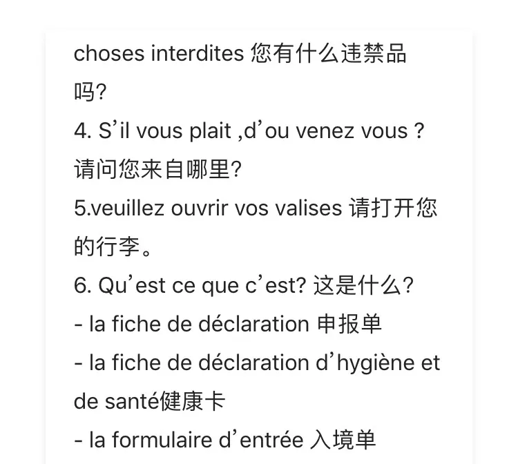

学期が近づいてきました。初めてのフランス旅行では、航空券の予約は簡単な部分です。難しいのは、空港を出て、留学する街までどうやって行くかです。リヨン、ボルドー、マルセイユ、ストラスブールなどの都市にも国際線はありますが、中国からの便の大半は**パリ＝シャルル・ド・ゴール空港 (CDG)** に着陸します。

よい知らせは、CDGが中国語を話す旅行者にとても優しいことです。搭乗、チェックイン、トイレに至るまで中国語で表示されているので、看板に従えばたいてい事足ります。このガイドでは、**到着後の道案内**、**ターミナルと鉄道駅**、**その後の移動**、**空港で使うフランス語フレーズ集**を扱います。

## 1. 到着後の道案内

### 到着トンネル：3つの看板がすべてを決める

航空機を降りて最初の区間が、CDGで有名な「到着トンネル」です。長い動く歩道の上に、すでに人々を振り分けてくれる看板があります。

- **Correspondances / Transfer** — 次の便のために空港内にとどまります。
- **Bagages / Baggage** — ターンテーブルで受託手荷物を受け取ります。
- **Sortie / Exit** — 荷物を受け取り、税関を通過して空港を出ます。

初めての人がやりがちな典型的な間違いは、「Exit」に従ってそのまま外へ出てしまい、乗り継ぎ便や電車の切符のことを忘れることです。順番を覚えてください。**まず乗り継ぎかどうかを決め、それから手荷物か出口かを選ぶ**のです。

### 中国語の案内表示、トイレまで

CDGには中国語の案内が一通り揃っています。ゲートには「Embarquement - Boarding - 登机」、チェックインエリアには「Enregistrement - Check-in - 办理值机手续」、トイレにもフランス語と英語に加えて「洗手间」と書かれています。パリ中心部の看板にも中国語が併記されていることが多く、言葉のせいで道に迷うことはありません。

### 無許可タクシーに注意 — 有料ポーターサービスも知っておく

空港内には中国語、英語、フランス語で注意書きが貼られています。**無許可タクシーは実際の危険**です（FAUX TAXI = VRAIS RISQUES）。タクシーは公式の乗り場から乗るか、配車サービスは指定の乗車場所で待ち合わせ、自分に声をかけてくる運転手には決して乗らないでください。

荷物が多い場合は、空港公式の**ポーターサービス（Porteurs / Porters）**を利用しましょう。カウンターに電話番号が表示され、料金がかかります。荷物カートも有料なので、硬貨か使える銀行カードを手元に用意しておいてください。

## 2. ターミナル、鉄道駅、空港内の移動

### 3つのターミナルと、T2内の7つのサブターミナル

CDGには**ターミナル1、2、3の3つ**があります。ターミナル2が中心で、**T2A、T2B、T2C、T2D、T2E、T2F、T2Gの7つのサブターミナル**に分かれ、花びらのように対称に配置されています。ターミナル1は北西にある円形の「空飛ぶ円盤」、ターミナル3は最も小さく北側にあり、主に格安航空会社とチャーター便を扱います。

ターミナル同士は近くありませんが、配置は明確です。**自分の便がどのサブターミナルを使うか**（たとえば搭乗券にT2Eと書かれている）を確認して、そこへ向かいましょう。

### 鉄道駅：RER BとTGVはどちらもT2

CDGの駅はターミナル2の下にあり、**La gare SNCF de l'aéroport Paris-Charles de Gaulle** といいます。ターミナルからエスカレーターで直接行けます。空港の説明によれば、TGV南・西・北の各ネットワークに加え、Ouigo、タリス、ユーロスターの主要路線にも接続し、パリ市内へ向かう**RER B**もここから乗ります。

| 路線 | 行き先 |
| --- | --- |
| RER B | パリ中心部（パリ北駅、シャトレなど）、約25〜30分 |
| TGV Sud / Ouest / Nord | リヨン、ボルドー、ナント、リール、フランス各地 |
| Ouigo | リヨン、マルセイユ方面などの格安高速列車 |
| タリス / ユーロスター | ブリュッセル、アムステルダム、ロンドン |

**できれば搭乗前に切符を買っておきましょう。** 駅にも券売機と有人カウンターがありますが、荷物の受け取りとホーム探しに時間がかかり、繁忙期は当日券が売り切れます。**SNCF Connect**（またはsncf.com）は中国からも利用でき（ユーロで支払えるカードが必要です）、切符は通常電子式で、改札でスキャンします。フランスにいる友人に買ってもらうのも手です。

### CDGVAL：24時間運行の無料シャトル列車

空港内でターミナル、駐車場、鉄道駅の間を移動するのは、**無料のCDGVALシャトル列車**（RoissyValとも呼ばれます）の役目です。路線は単純です。T1 → PR駐車場 → ロワシポール（ターミナル3があり、徒歩約5分） → PX駐車場 → T2。T2では幹線のTGVとRER Bに乗り換えられ、シェラトンホテル、ホテル送迎バス、**手荷物預かり所**が隣接しています。

**運行時間：** 列車は毎日04:00〜01:00に運行し、01:00〜04:00はシャトルバスが代替するため、連絡は途切れません。市内バスのN1・N2も補完しており、ターミナル間の連絡通路には十分な案内があります。荷物が軽ければ、待つより歩くほうが速いことが多いです。

## 3. その後の移動：乗り継ぎ、オルリー、地方都市へ

### 1. CDGでの乗り継ぎ

次の便もCDGから出る場合、空港内で**無料のCDGVAL列車**に乗ってターミナルを移動するだけです（上記参照）。重要な判断が一つあります。

- **荷物がスルーチェックインされていない場合（別々の航空券）：** 入国審査を通り、荷物を受け取り、次の便が出るターミナルへ運び、再度チェックインする必要があります。
- **荷物がスルーチェックインされている場合（1枚の航空券）：** **Transfer**の看板に従って次の便のターミナルとゲートへ直行します。荷物を受け取る必要はありません。

どちらの場合も案内表示は中国語なので、道に迷うことはありません。

### 2. オルリー (ORY) への移動

次の便が**パリ＝オルリー空港**から出る場合、2つの空港を直接結ぶ鉄道はなく、市内側で乗り換えることになります。現在の選択肢は次のとおりです。

- **RER B ＋ Orlyval：** RER Bで**アントニー**まで行き、**Orlyval**自動シャトルに乗り換えてオルリーのターミナルへ直行します。約60〜90分で、荷物を持って歩く距離が最も短い経路です。
- **RER B ＋メトロ14号線：** 市内へ出て14号線に乗ります。14号線は2024年にオルリーまで延伸され、中心部から約25分です。
- **タクシーまたは専用送迎：** ドアツードアで約45〜60分です。時間や荷物に余裕がないときに最適です。

かつての**エールフランスのコーチ（Le Bus Direct、旧Les Cars Air France）は運航を終了している**ことに注意してください。ネット上に残る「3号線バス」の案内は古い情報なので、空港で待たないようにしましょう。

### 3. TGVで地方都市へ

ターミナル2には専用の**SNCF高速鉄道駅**があり、留学先の都市に直通便があればこれが最も簡単です。パリ市内へ寄る必要がありません。前述のとおり事前に購入し、**時間に十分な余裕**を取ってください。道に迷う、荷物を待ちすぎる、繁忙期の売り切れに遭うといった可能性があるためです。

直通の切符がない場合は、先にパリへ出て正しい駅から発ちます。空港のバスターミナル（Gare routière）はターミナル3横のロワシポールにあり、ロワシバスなど市内への路線があります。RER Bでも市内の各駅へ行けます。運賃と路線は変わるため、旅行当日はÎle-de-France Mobilitésで確認してください。

### 4. パリの6つの主要駅

パリには6つの主要駅があり、それぞれフランスの異なる方向へ向かいます。出発前に、切符にどの駅が印刷されているか確認してください。

| 駅 | 主な方向 | メトロ / RER |
| --- | --- | --- |
| パリ北駅（Gare du Nord） | フランス北部、ベルギー、イギリス（ユーロスター） | 4・5号線、RER B・D |
| パリ東駅（Gare de l'Est） | フランス東部、ドイツ、ルクセンブルク | 4・5・7号線 |
| リヨン駅（Gare de Lyon） | フランス南東部、スイス、イタリア | 1・14号線、RER A・D |
| オステルリッツ駅（Gare d'Austerlitz） | フランス南西部、スペイン、ポルトガル | 5・10号線、RER C |
| モンパルナス駅（Gare Montparnasse） | フランス西部、ブルターニュ | 4・6・12・13号線 |
| サン・ラザール駅（Gare Saint-Lazare） | ノルマンディー方面 | 3・12・13・14号線 |

駅ではスタッフが目的地への正確な発車時刻を教えてくれます。切符を買って乗りましょう。重い荷物がある場合、古いメトロ路線（とくに4号線）はホーム間の移動が階段になることが多いので、荷物を運ぶ時間を見ておいてください。

## 4. 空港で使うフランス語フレーズ集

CDGを通過するのにフランス語は必要ありません。以下の表は着陸から税関までの流れ全体をカバーしており、スマートフォンで見せるだけでたいてい事足ります。

### 空港到着

| 日本語 | フランス語 |
| --- | --- |
| パリ＝シャルル・ド・ゴール空港 | L'aéroport de Charles de Gaulle |
| 空港 | L'aéroport |
| 到着 / 出発 | Arrivées / départs |
| トイレ | Toilette |
| ターミナル1 | Terminal 1 (T1) |
| 荷物を預ける | Enregistrer des bagages |
| 搭乗券 | La carte d'embarquement |
| 1番ゲート | Porte 1 |
| 税金還付 | La détaxe |

### チェックインと保安検査

| 日本語 | フランス語 |
| --- | --- |
| チェックインカウンター | Un guichet d'embarquement |
| パスポートをお願いします | Votre passeport, s'il vous plaît |
| 窓側の席をお願いします | Je voudrais avoir un siège du côté hublot, s'il vous plaît |
| 通路側の席をお願いします | Je voudrais avoir un siège du côté couloir, s'il vous plaît |
| 保安検査 | Le contrôle de sécurité |
| 機内持ち込み手荷物 | Le bagage à main |
| 受託手荷物 | Le bagage enregistré |
| 片道 / 往復切符 | Un billet simple / un billet aller-retour |
| エコノミー / ビジネスクラス | La classe économique / la classe d'affaire |

### 機内

| 日本語 | フランス語 |
| --- | --- |
| シートベルトをお締めください | Veillez à bien attacher vos ceintures de sécurité |
| シートベルト / 客室乗務員 | La ceinture de sécurité / une hôtesse de l'air |
| 席を変えてもらえますか？ | Ce serait possible de changer une place ? |
| 飲み物は何がありますか？ | Quelles boissons avez-vous ? |
| コーヒーをお願いします | Je voudrais un café |
| オレンジジュース / りんごジュース / コーラ | le jus d'orange / le jus de pomme / le coca |
| ワイン / ビール / 水 | le vin / la bière / l'eau |
| 朝食 / 昼食 / 夕食 | le petit déjeuner / le déjeuner / le dîner |
| 豚肉は食べません | Je ne mange pas de porc |
| 毛布をいただけますか？ | Est-ce que vous pouvez me donner une couverture ? |

### 航空機を降りてから、税関と手荷物

| 日本語 | フランス語 |
| --- | --- |
| 税関を通る | passer la douane |
| ここにどのくらい滞在しますか？ | Vous vous arrêterez ici pendant combien de temps ? |
| 申告するものはありますか？ | Avez-vous quelques choses à déclarer ? |
| 禁止品を持っていますか？ | Avez-vous des choses interdites ? |
| どちらから来ましたか？ | S'il vous plaît, d'où venez-vous ? |
| スーツケースを開けてください。 | Veuillez ouvrir vos valises. |
| これは何ですか？ | Qu'est-ce que c'est ? |
| 申告書 / 健康申告書 / 入国カード | la fiche de déclaration / la fiche de déclaration d'hygiène et de santé / la formulaire d'entrée |
| 手荷物はどこで受け取るか知っていますか？ | Est-ce que vous savez où est-ce qu'on récupère les bagages ? |
| 手荷物受取所 | la zone de récupération des bagages |
| タクシー / バス / メトロ / 電車 | le taxi / le bus / le métro / le train |

フレーズ集の元のスクリーンショットを以下に掲載します。スマートフォンに保存したい場合はどうぞ。

## 関連リンク

- **このサイト内**：[パリ＝シャルル・ド・ゴール空港 (CDG)](/airport/CDG)、[パリ＝オルリー空港 (ORY)](/airport/ORY)、[フランス (FR)](/country/FR)
- **Wikipedia**：[シャルル・ド・ゴール空港](https://en.wikipedia.org/wiki/Paris_Charles_de_Gaulle_Airport)、[オルリー空港](https://en.wikipedia.org/wiki/Paris_Orly_Airport)
- **百度百科**：[シャルル・ド・ゴール空港](https://baike.baidu.com/item/%E5%B7%B4%E9%BB%8E%E5%A4%8F%E5%B0%94%C2%B7%E6%88%B4%E9%AB%98%E4%B9%90%E6%9C%BA%E5%9C%BA)、[オルリー空港](https://baike.baidu.com/item/%E5%B7%B4%E9%BB%8E-%E5%A5%A5%E5%88%A9%E6%9C%BA%E5%9C%BA)
