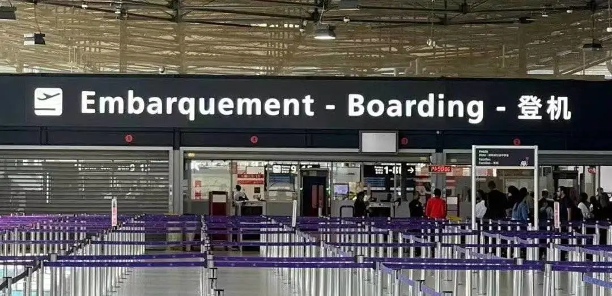
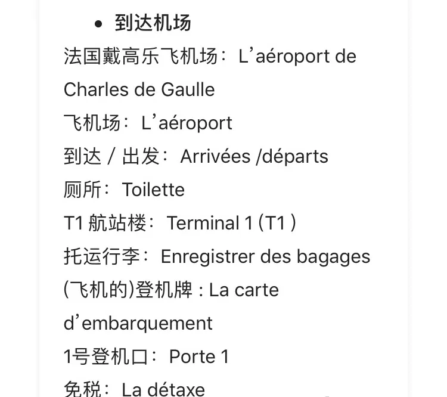

Semestr już blisko. Przy pierwszej podróży do Francji rezerwacja lotu to łatwa część — trudniejsze pytanie brzmi, jak wydostać się z lotniska i dostać do miasta, w którym będziesz studiować. Miasta takie jak Lyon, Bordeaux, Marsylia i Strasburg mają loty międzynarodowe, ale zdecydowana większość lotów z Chin ląduje na **paryskim Charles de Gaulle (CDG)**.

Dobra wiadomość jest taka, że CDG jest wyjątkowo przyjazne dla podróżnych mówiących po chińsku: wejście na pokład, odprawa, a nawet toalety są oznaczone po chińsku, więc podążanie za znakami zwykle wystarcza. Ten przewodnik obejmuje **orientację po przylocie**, **terminale i stację kolejową**, **dalszą podróż** oraz **listę francuskich zwrotów na lotnisku**.

## 1. Orientacja po przylocie

### Tunel przylotowy: trzy znaki decydują o wszystkim

Pierwszy odcinek po wyjściu z samolotu to słynny "tunel przylotowy" CDG — długi chodnik ruchomy pod znakiem, który już uporządkował tłum za ciebie:

- **Correspondances / Transfer** — pozostajesz na lotnisku na następny lot;
- **Bagages / Baggage** — odbiór nadanego bagażu z karuzeli;
- **Sortie / Exit** — wyjście z lotniska po odebraniu bagaży i przejściu odprawy celnej.

Klasyczny błąd początkującego to pójście za "Exit" aż na zewnątrz i zapomnienie o przesiadce lub bilecie kolejowym. Pamiętaj o kolejności: **najpierw zdecyduj, czy się przesiadasz, potem wybierz bagaż lub wyjście**.

### Chińskie oznakowanie aż po toalety

Na CDG chińskie oznakowanie tworzy nieprzerwany szlak: bramki mają "Embarquement - Boarding - 登机", strefa odprawy mówi "Enregistrement - Check-in - 办理值机手续", a nawet toalety dodają "洗手间" obok francuskiego i angielskiego. Znaki w centrum Paryża też często mają chiński, więc to nie język sprawi, że się zgubisz.

### Uważaj na nielegalne taksówki — i poznaj płatną usługę bagażowych

Ostrzeżenia wiszą na całym lotnisku, po chińsku, angielsku i francusku: **nielegalne taksówki to realne ryzyko** (FAUX TAXI = VRAIS RISQUES). Bierz taksówkę z oficjalnego postoju albo spotkaj samochód na aplikację w wyznaczonym punkcie odbioru — nigdy nie przyjmuj kierowcy, który sam do ciebie podchodzi.

Przy dużej ilości bagażu skorzystaj z oficjalnej **usługi bagażowych lotniska (Porteurs / Porters)**, której stanowisko podaje numer telefonu i pobiera opłatę. Wózki bagażowe również są płatne, więc miej pod ręką monety lub działającą kartę bankową.

## 2. Terminale, stacja kolejowa i poruszanie się po lotnisku

### Trzy terminale i siedem podterminali w obrębie T2

CDG ma **trzy terminale: 1, 2 i 3**. Terminal 2 jest głównym i dzieli się na **siedem podterminali — T2A, T2B, T2C, T2D, T2E, T2F i T2G** — ułożonych symetrycznie we wzór płatków; terminal 1 to okrągły "latający spodek" na północnym zachodzie; terminal 3 jest najmniejszy, leży na północy i obsługuje głównie tanie linie oraz czartery.

Terminale nie są blisko siebie, ale układ jest jasny: **sprawdź, którego podterminala używa twój lot** (na przykład T2E na karcie pokładowej), i tam się udaj.

### Stacja kolejowa: RER B i TGV, oba przy T2

Stacja CDG znajduje się pod terminalem 2 — **La gare SNCF de l'aéroport Paris-Charles de Gaulle** — do której dojedziesz schodami ruchomymi bezpośrednio z terminala. Według opisu lotniska łączy się z sieciami TGV Sud, Ouest i Nord oraz głównymi liniami Ouigo, Thalys i Eurostar, i to tam wsiadasz do **RER B** do Paryża.

| Linia | Dokąd prowadzi |
| --- | --- |
| RER B | Centrum Paryża (Gare du Nord, Châtelet i inne), około 25–30 minut |
| TGV Sud / Ouest / Nord | Lyon, Bordeaux, Nantes, Lille i reszta Francji |
| Ouigo | Budżetowe połączenia szybkiej kolei w kierunku Lyonu, Marsylii i dalej |
| Thalys / Eurostar | Bruksela, Amsterdam i Londyn |

**Kup bilet przed lotem, jeśli możesz.** Na stacji są automaty i kasy z personelem, ale odbiór bagaży i szukanie peronu zajmują czas, a w godzinach szczytu bilety na ten sam dzień się wyprzedają. **SNCF Connect** (lub sncf.com) działa z Chin — potrzebujesz karty, którą można płacić w euro — a bilety są zwykle elektroniczne, skanowane przy bramce. Alternatywnie poproś znajomego już we Francji o zakup.

### CDGVAL: bezpłatny pociąg wahadłowy kursujący całą dobę

Przemieszczanie się między terminalami, parkingami i stacją kolejową na terenie lotniska to zadanie **bezpłatnego pociągu wahadłowego CDGVAL** (zwanego też RoissyVal). Linia jest prosta: T1 → parking PR → Roissypole (gdzie jest terminal 3, około 5 minut pieszo) → parking PX → T2, gdzie można przesiąść się do pociągów TGV i RER B, obok hotelu Sheraton, autobusów wahadłowych hoteli i **przechowalni bagażu**.

**Godziny:** pociąg kursuje codziennie 04:00–01:00, a autobus wahadłowy obsługuje 01:00–04:00, więc połączenie nigdy nie zamyka się. Uzupełniają je lokalne autobusy N1 i N2, a przejścia między terminalami są dobrze oznaczone — z lekkim bagażem pieszo często szybciej niż czekać.

## 3. Dalsza podróż: przesiadki, Orly i prowincja

### 1. Przesiadka na CDG

Jeśli następny lot też wychodzi z CDG, po prostu zmieniasz terminale na lotnisku **bezpłatnym pociągiem CDGVAL** (patrz wyżej). Liczy się jedna decyzja:

- **Bagaż nie nadany na całą trasę (osobne bilety):** musisz przejść kontrolę imigracyjną, odebrać bagaż, zawieźć go do terminalu, z którego odlatuje następny lot, i odprawić się ponownie;
- **Bagaż nadany na całą trasę (jeden bilet):** idź za znakami **Transfer** prosto do terminalu i bramki następnego lotu — niczego nie trzeba odbierać.

Tak czy inaczej oznakowanie jest po chińsku, więc się nie zgubisz.

### 2. Dojazd do Orly (ORY)

Jeśli dalszy lot wychodzi z **paryskiego Orly**, pamiętaj, że między lotniskami nie ma bezpośredniego połączenia kolejowego — przesiadasz się po stronie miasta. Obecne opcje:

- **RER B + Orlyval:** dojedź RER B do **Antony**, następnie przesiądź się na automatyczną kolejkę **Orlyval** prosto do terminali Orly; około 60–90 minut i najkrótsze połączenie do przejścia z bagażem;
- **RER B + metro linii 14:** do miasta, następnie linia 14, przedłużona do Orly w 2024 roku — około 25 minut z centrum;
- **Taksówka lub prywatny transfer:** od drzwi do drzwi w około 45–60 minut, najlepsze, gdy czas lub bagaż są na wagę.

Pamiętaj, że stary **autokar Air France (Le Bus Direct, dawniej Les Cars Air France) zakończył działalność**; krążąca w internecie rada o "autokarze linii 3" jest nieaktualna, więc nie czekaj na niego na lotnisku.

### 3. Pociąg TGV na prowincję

Terminal 2 ma własną **stację szybkiej kolei SNCF**, a jeśli twoje miasto uniwersyteckie ma bezpośrednie połączenie, to najprostsza opcja — bez objazdu przez Paryż. Kup wcześniej, jak opisano wyżej, i **zostaw sobie dużo czasu**, na wypadek zgubienia się, zbyt długiego czekania na bagaż lub wyprzedania biletów w szczycie.

Jeśli nie ma bezpośredniego biletu, najpierw dojedź do Paryża i wyjedź z właściwego dworca: dworzec autobusowy lotniska (Gare routière) jest w Roissypole obok terminalu 3, z trasami takimi jak Roissybus do miasta, a RER B także dociera do paryskich dworców. Ceny i trasy się zmieniają — sprawdź Île-de-France Mobilités na dzień podróży.

### 4. Sześć głównych dworców kolejowych w Paryżu

Paryż ma sześć głównych dworców, po jednym na każdy kierunek kraju. Przed wyjazdem sprawdź, który jest wydrukowany na bilecie:

| Dworzec | Główny kierunek | Metro / RER |
| --- | --- | --- |
| Gare du Nord | Północna Francja, Belgia, Wielka Brytania (Eurostar) | Linie 4, 5; RER B, D |
| Gare de l'Est | Wschodnia Francja, Niemcy, Luksemburg | Linie 4, 5, 7 |
| Gare de Lyon | Południowo-wschodnia Francja, Szwajcaria, Włochy | Linie 1, 14; RER A, D |
| Gare d'Austerlitz | Południowo-zachodnia Francja, Hiszpania, Portugalia | Linie 5, 10; RER C |
| Gare Montparnasse | Zachodnia Francja, Bretania | Linie 4, 6, 12, 13 |
| Gare Saint-Lazare | W kierunku Normandii | Linie 3, 12, 13, 14 |

Na dworcu personel wskaże dokładne odjazdy do twojego celu — kup bilet i wsiadaj. Z ciężkimi torbami pamiętaj, że starsze linie metra (zwłaszcza linia 4) często oznaczają schody między peronami, więc zaplanuj czas na noszenie bagażu.

## 4. Lista francuskich zwrotów lotniskowych

Nie potrzebujesz francuskiego, żeby przejść przez CDG — te tabele obejmują całą trasę od lądowania do odprawy celnej, a czytanie ich z telefonu zwykle wystarcza.

### Przylot na lotnisko

| Polski | Francuski |
| --- | --- |
| Port lotniczy Paryż Charles de Gaulle | L'aéroport de Charles de Gaulle |
| Lotnisko | L'aéroport |
| Przyloty / odloty | Arrivées / départs |
| Toalety | Toilette |
| Terminal 1 | Terminal 1 (T1) |
| Nadać bagaż | Enregistrer des bagages |
| Karta pokładowa | La carte d'embarquement |
| Bramka 1 | Porte 1 |
| Zwrot podatku | La détaxe |

### Odprawa i kontrola bezpieczeństwa

| Polski | Francuski |
| --- | --- |
| Stanowisko odprawy | Un guichet d'embarquement |
| Paszport, proszę | Votre passeport, s'il vous plaît |
| Chciałbym miejsce przy oknie | Je voudrais avoir un siège du côté hublot, s'il vous plaît |
| Chciałbym miejsce przy przejściu | Je voudrais avoir un siège du côté couloir, s'il vous plaît |
| Kontrola bezpieczeństwa | Le contrôle de sécurité |
| Bagaż podręczny | Le bagage à main |
| Bagaż nadany | Le bagage enregistré |
| Bilet w jedną stronę / w obie strony | Un billet simple / un billet aller-retour |
| Klasa ekonomiczna / biznes | La classe économique / la classe d'affaire |

### Na pokładzie

| Polski | Francuski |
| --- | --- |
| Proszę zapiąć pasy bezpieczeństwa | Veillez à bien attacher vos ceintures de sécurité |
| Pas bezpieczeństwa / stewardesa | La ceinture de sécurité / une hôtesse de l'air |
| Czy mogłabym/mógłbym zmienić miejsce? | Ce serait possible de changer une place ? |
| Jakie napoje macie? | Quelles boissons avez-vous ? |
| Poproszę kawę | Je voudrais un café |
| Sok pomarańczowy / sok jabłkowy / cola | le jus d'orange / le jus de pomme / le coca |
| Wino / piwo / woda | le vin / la bière / l'eau |
| Śniadanie / lunch / kolacja | le petit déjeuner / le déjeuner / le dîner |
| Nie jem wieprzowiny | Je ne mange pas de porc |
| Czy mogłaby/mógłby mi pani/pan podać koc? | Est-ce que vous pouvez me donner une couverture ? |

### Wyjście z samolotu, odprawa celna i bagaż

| Polski | Francuski |
| --- | --- |
| Przechodzenie przez odprawę celną | passer la douane |
| Jak długo tu zostajesz? | Vous vous arrêterez ici pendant combien de temps ? |
| Czy ma pan/pani coś do zadeklarowania? | Avez-vous quelques choses à déclarer ? |
| Czy ma pan/pani przedmioty zabronione? | Avez-vous des choses interdites ? |
| Skąd pan/pani jest? | S'il vous plaît, d'où venez-vous ? |
| Proszę otworzyć walizki. | Veuillez ouvrir vos valises. |
| Co to jest? | Qu'est-ce que c'est ? |
| Deklaracja / deklaracja zdrowotna / formularz przylotu | la fiche de déclaration / la fiche de déclaration d'hygiène et de santé / la formulaire d'entrée |
| Czy wie pan/pani, gdzie odbiera się bagaż? | Est-ce que vous savez où est-ce qu'on récupère les bagages ? |
| Odbiór bagażu | la zone de récupération des bagages |
| Taksówka / autobus / metro / pociąg | le taxi / le bus / le métro / le train |

Oryginalne zrzuty ekranu listy zwrotów są poniżej, jeśli wolisz zapisać je w telefonie.

## Powiązane linki

- **Na tej stronie**: [Port lotniczy Paryż Charles de Gaulle (CDG)](/airport/CDG), [Port lotniczy Paryż Orly (ORY)](/airport/ORY), [Francja (FR)](/country/FR)
- **Wikipedia**: [Port lotniczy Charles de Gaulle](https://en.wikipedia.org/wiki/Paris_Charles_de_Gaulle_Airport), [Port lotniczy Orly](https://en.wikipedia.org/wiki/Paris_Orly_Airport)
- **Baidu Baike**: [Port lotniczy Charles de Gaulle](https://baike.baidu.com/item/%E5%B7%B4%E9%BB%8E%E5%A4%8F%E5%B0%94%C2%B7%E6%88%B4%E9%AB%98%E4%B9%90%E6%9C%BA%E5%9C%BA), [Port lotniczy Orly](https://baike.baidu.com/item/%E5%B7%B4%E9%BB%8E-%E5%A5%A5%E5%88%A9%E6%9C%BA%E5%9C%BA)
