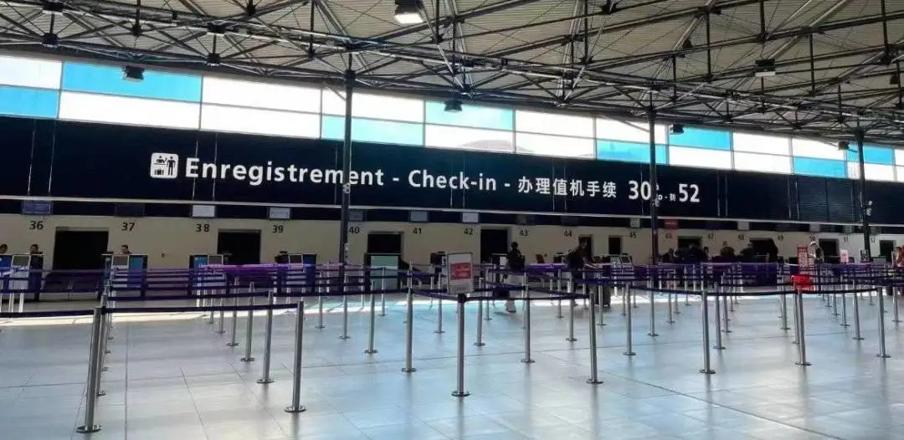
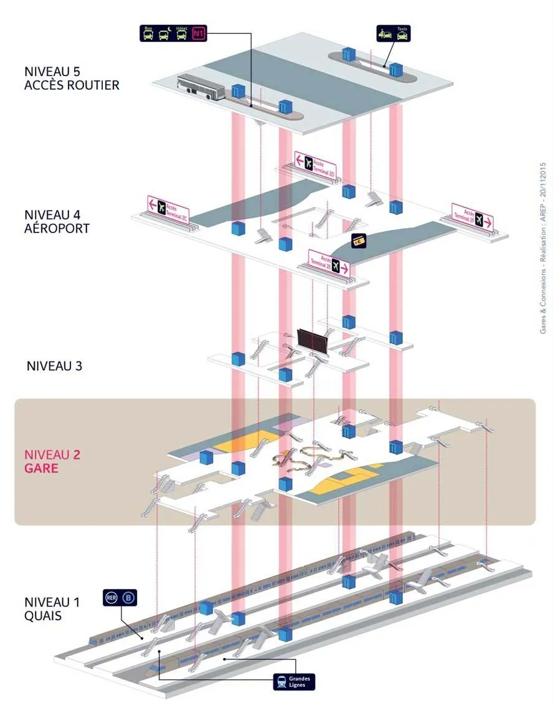

O início do semestre está próximo. Em uma primeira viagem à França, reservar o voo é a parte fácil — a pergunta mais difícil é como sair do aeroporto e chegar à cidade onde você vai estudar. Cidades como Lyon, Bordeaux, Marselha e Estrasburgo têm voos internacionais, mas a grande maioria dos voos vindos da China pousa em **Paris Charles de Gaulle (CDG)**.

A boa notícia é que o CDG é excepcionalmente amigável para viajantes que falam chinês: embarque, check-in e até os banheiros têm sinalização em chinês, então seguir as placas costuma bastar. Este guia cobre **como se orientar na chegada**, **terminais e a estação ferroviária**, **como seguir viagem** e **uma lista de frases em francês para o aeroporto**.

## 1. Como se orientar na chegada

### O túnel de chegada: três placas decidem tudo

O primeiro trecho depois de sair da aeronave é o famoso “túnel de chegada” do CDG — uma longa esteira rolante sob uma placa que já separou a multidão por você:

- **Correspondances / Transfer** — permanecer no aeroporto para o próximo voo;
- **Bagages / Baggage** — retirar a bagagem despachada nas esteiras;
- **Sortie / Exit** — sair do aeroporto depois de retirar as malas e passar pela alfândega.

O erro clássico de quem chega pela primeira vez é seguir “Exit” até o fim e esquecer um voo de conexão ou um bilhete de trem. Lembre-se da ordem: **decida primeiro se você está em conexão, depois escolha bagagem ou saída**.

### Sinalização em chinês, até nos banheiros

O CDG tem uma trilha completa em chinês: os portões trazem “Embarquement - Boarding - 登机”, a área de check-in diz “Enregistrement - Check-in - 办理值机手续”, e até os banheiros acrescentam “洗手间” ao lado do francês e do inglês. As placas no centro de Paris também costumam ter chinês, então o idioma não é o que vai fazer você se perder.

### Cuidado com táxis clandestinos — e conheça o serviço de carregadores pago

Há avisos por todo o aeroporto, em chinês, inglês e francês: **táxis clandestinos são riscos reais** (FAUX TAXI = VRAIS RISQUES). Pegue táxi no ponto oficial ou encontre o carro de aplicativo no ponto de embarque designado — nunca aceite um motorista que se aproxima de você.

Com muita bagagem, use o **serviço de carregadores (Porteurs / Porters)** oficial do aeroporto, cujo balcão mostra um telefone e cobra uma taxa. Os carrinhos de bagagem também são pagos, então tenha algumas moedas ou um cartão bancário que funcione à mão.

## 2. Terminais, a estação ferroviária e como circular pelo aeroporto

### Três terminais, e sete subterminais dentro do T2

O CDG tem **três terminais: 1, 2 e 3**. O Terminal 2 é o principal e se divide em **sete subterminais — T2A, T2B, T2C, T2D, T2E, T2F e T2G** — dispostos simetricamente em formato de pétalas; o Terminal 1 é um “disco voador” circular a noroeste; o Terminal 3 é o menor, fica ao norte e atende principalmente companhias de baixo custo e voos charter.

Os terminais não ficam próximos, mas a estrutura é clara: **confira qual subterminal o seu voo usa** (por exemplo, T2E no cartão de embarque) e siga para lá.

### A estação ferroviária: RER B e TGV, ambos no T2

A estação do CDG fica sob o Terminal 2 — **La gare SNCF de l'aéroport Paris-Charles de Gaulle** — e se chega por escada rolante direto do terminal. Segundo a descrição do próprio aeroporto, ela se conecta às redes TGV Sul, Oeste e Norte, bem como às principais linhas Ouigo, Thalys e Eurostar, e é onde você pega o **RER B** para Paris.

| Linha | Aonde leva |
| --- | --- |
| RER B | Centro de Paris (Gare du Nord, Châtelet e mais), cerca de 25–30 minutos |
| TGV Sul / Oeste / Norte | Lyon, Bordeaux, Nantes, Lille e o resto da França |
| Ouigo | Serviços de alta velocidade econômicos para Lyon, Marselha e além |
| Thalys / Eurostar | Bruxelas, Amsterdã e Londres |

**Compre o bilhete antes de voar, se puder.** Há máquinas e balcões com atendente na estação, mas retirar as malas e encontrar a plataforma consome tempo, e em períodos de pico os bilhetes para o mesmo dia esgotam. O **SNCF Connect** (ou o site sncf.com) funciona a partir da China — você precisará de um cartão que possa pagar em euros — e os bilhetes geralmente são eletrônicos, escaneados no portão. Como alternativa, peça a um amigo que já está na França para comprar.

### CDGVAL: o trem de traslado gratuito que funciona 24 horas

Circular entre terminais, estacionamentos e a estação ferroviária dentro do aeroporto é tarefa do **trem de traslado gratuito CDGVAL** (também chamado RoissyVal). A linha é simples: T1 → estacionamento PR → Roissypole (onde fica o Terminal 3, a cerca de 5 minutos a pé) → estacionamento PX → T2, onde você pode trocar para os trens de longa distância TGV e o RER B, ao lado do hotel Sheraton, dos ônibus de traslado dos hotéis e do **guarda-volumes**.

**Horário:** o trem funciona das 04:00 às 01:00 todos os dias, e um ônibus de traslado cobre das 01:00 às 04:00, então a ligação nunca fecha. Os ônibus de traslado locais N1 e N2 complementam o serviço, e as passarelas entre os terminais são bem sinalizadas — com bagagem leve, caminhar costuma ser mais rápido do que esperar.

## 3. Seguindo viagem: conexões, Orly e as províncias

### 1. Conexão no CDG

Se o seu próximo voo também parte do CDG, basta trocar de terminal dentro do aeroporto no **trem CDGVAL gratuito** (veja acima). Uma decisão importa:

- **Malas não despachadas até o destino final (bilhetes separados):** você precisa passar pela imigração, retirar a bagagem, levá-la ao terminal de onde parte o próximo voo e fazer o check-in de novo;
- **Malas despachadas até o destino final (um único bilhete):** siga as placas **Transfer** direto para o terminal e o portão do próximo voo — não é preciso retirar nada.

De qualquer forma, a sinalização é em chinês, então você não vai se perder.

### 2. Como chegar a Orly (ORY)

Se o seu voo seguinte parte de **Paris Orly**, observe que não há ligação ferroviária direta entre os dois aeroportos — a troca é feita do lado da cidade. As opções atuais:

- **RER B + Orlyval:** pegue o RER B até **Antony**, depois troque para o traslado automático **Orlyval** direto para os terminais de Orly; cerca de 60–90 minutos, e a conexão mais curta para percorrer a pé com bagagem;
- **RER B + linha 14 do metrô:** até a cidade, depois a linha 14, que foi estendida a Orly em 2024 — cerca de 25 minutos desde o centro;
- **Táxi ou traslado privado:** de porta a porta em cerca de 45–60 minutos, melhor quando o tempo ou a bagagem estão apertados.

Saiba que o antigo **ônibus da Air France (Le Bus Direct, antes Les Cars Air France) deixou de operar**; o conselho sobre o “ônibus da linha 3” que ainda circula on-line está desatualizado, então não fique esperando por ele no aeroporto.

### 3. Pegando o TGV para as províncias

O Terminal 2 tem a própria **estação de alta velocidade da SNCF**, e, se a cidade da sua universidade tem serviço direto, esta é a opção mais simples — sem desvio por Paris. Compre com antecedência como descrito acima e **deixe bastante tempo**, caso você se perca, espere demais pelas malas ou encontre os bilhetes esgotados em um período de pico.

Se não houver bilhete direto, vá primeiro a Paris e parta da estação certa: a rodoviária do aeroporto (Gare routière) fica em Roissypole, ao lado do Terminal 3, com rotas como o Roissybus para a cidade, e o RER B também chega às estações parisienses. Tarifas e rotas mudam — consulte a Île-de-France Mobilités para o dia da viagem.

### 4. As seis principais estações ferroviárias de Paris

Paris tem seis estações principais, uma para cada direção do país. Confira qual está impressa no seu bilhete antes de partir:

| Estação | Direção principal | Metrô / RER |
| --- | --- | --- |
| Gare du Nord | Norte da França, Bélgica, Reino Unido (Eurostar) | Linhas 4, 5; RER B, D |
| Gare de l'Est | Leste da França, Alemanha, Luxemburgo | Linhas 4, 5, 7 |
| Gare de Lyon | Sudeste da França, Suíça, Itália | Linhas 1, 14; RER A, D |
| Gare d'Austerlitz | Sudoeste da França, Espanha, Portugal | Linhas 5, 10; RER C |
| Gare Montparnasse | Oeste da França, Bretanha | Linhas 4, 6, 12, 13 |
| Gare Saint-Lazare | Em direção à Normandia | Linhas 3, 12, 13, 14 |

Na estação, a equipe informa as partidas exatas para o seu destino — compre o bilhete e embarque. Com bagagem pesada, lembre-se de que as linhas mais antigas do metrô (a linha 4 em particular) muitas vezes exigem escadas entre as plataformas, então reserve tempo para carregar a bagagem.

## 4. Lista de frases em francês para o aeroporto

Você não precisa de francês para atravessar o CDG — estas tabelas cobrem todo o trajeto do pouso à alfândega, e lê-las no celular costuma bastar.

### Chegando ao aeroporto

| Português | Francês |
| --- | --- |
| Aeroporto de Paris Charles de Gaulle | L'aéroport de Charles de Gaulle |
| Aeroporto | L'aéroport |
| Chegadas / partidas | Arrivées / départs |
| Banheiros | Toilette |
| Terminal 1 | Terminal 1 (T1) |
| Despachar bagagem | Enregistrer des bagages |
| Cartão de embarque | La carte d'embarquement |
| Portão 1 | Porte 1 |
| Restituição de impostos | La détaxe |

### Check-in e segurança

| Português | Francês |
| --- | --- |
| Balcão de check-in | Un guichet d'embarquement |
| Seu passaporte, por favor | Votre passeport, s'il vous plaît |
| Eu gostaria de um assento na janela | Je voudrais avoir un siège du côté hublot, s'il vous plaît |
| Eu gostaria de um assento no corredor | Je voudrais avoir un siège du côté couloir, s'il vous plaît |
| Controle de segurança | Le contrôle de sécurité |
| Bagagem de mão | Le bagage à main |
| Bagagem despachada | Le bagage enregistré |
| Passagem só de ida / ida e volta | Un billet simple / un billet aller-retour |
| Classe econômica / classe executiva | La classe économique / la classe d'affaire |

### A bordo

| Português | Francês |
| --- | --- |
| Apertem os cintos, por favor | Veillez à bien attacher vos ceintures de sécurité |
| Cinto de segurança / comissária de bordo | La ceinture de sécurité / une hôtesse de l'air |
| Eu poderia mudar de assento? | Ce serait possible de changer une place ? |
| Quais bebidas vocês têm? | Quelles boissons avez-vous ? |
| Eu gostaria de um café | Je voudrais un café |
| Suco de laranja / suco de maçã / cola | le jus d'orange / le jus de pomme / le coca |
| Vinho / cerveja / água | le vin / la bière / l'eau |
| Café da manhã / almoço / jantar | le petit déjeuner / le déjeuner / le dîner |
| Eu não como carne de porco | Je ne mange pas de porc |
| Você poderia me dar um cobertor? | Est-ce que vous pouvez me donner une couverture ? |

### Saindo da aeronave, alfândega e bagagem

| Português | Francês |
| --- | --- |
| Passar pela alfândega | passer la douane |
| Quanto tempo você vai ficar aqui? | Vous vous arrêterez ici pendant combien de temps ? |
| Você tem algo a declarar? | Avez-vous quelques choses à déclarer ? |
| Você tem algum item proibido? | Avez-vous des choses interdites ? |
| De onde você vem? | S'il vous plaît, d'où venez-vous ? |
| Por favor, abra as suas malas. | Veuillez ouvrir vos valises. |
| O que é isto? | Qu'est-ce que c'est ? |
| Formulário de declaração / formulário de saúde / formulário de entrada | la fiche de déclaration / la fiche de déclaration d'hygiène et de santé / la formulaire d'entrée |
| Você sabe onde retirar a bagagem? | Est-ce que vous savez où est-ce qu'on récupère les bagages ? |
| Retirada de bagagem | la zone de récupération des bagages |
| Táxi / ônibus / metrô / trem | le taxi / le bus / le métro / le train |

As capturas de tela originais da lista de frases estão abaixo, caso você prefira salvá-las no celular.

## Links relacionados

- **Neste site**: [Aeroporto de Paris Charles de Gaulle (CDG)](/airport/CDG), [Aeroporto de Paris Orly (ORY)](/airport/ORY), [França (FR)](/country/FR)
- **Wikipedia**: [Aeroporto Charles de Gaulle](https://en.wikipedia.org/wiki/Paris_Charles_de_Gaulle_Airport), [Aeroporto de Orly](https://en.wikipedia.org/wiki/Paris_Orly_Airport)
- **Baidu Baike**: [Aeroporto Charles de Gaulle](https://baike.baidu.com/item/%E5%B7%B4%E9%BB%8E%E5%A4%8F%E5%B0%94%C2%B7%E6%88%B4%E9%AB%98%E4%B9%90%E6%9C%BA%E5%9C%BA), [Aeroporto de Orly](https://baike.baidu.com/item/%E5%B7%B4%E9%BB%8E-%E5%A5%A5%E5%88%A9%E6%9C%BA%E5%9C%BA)
