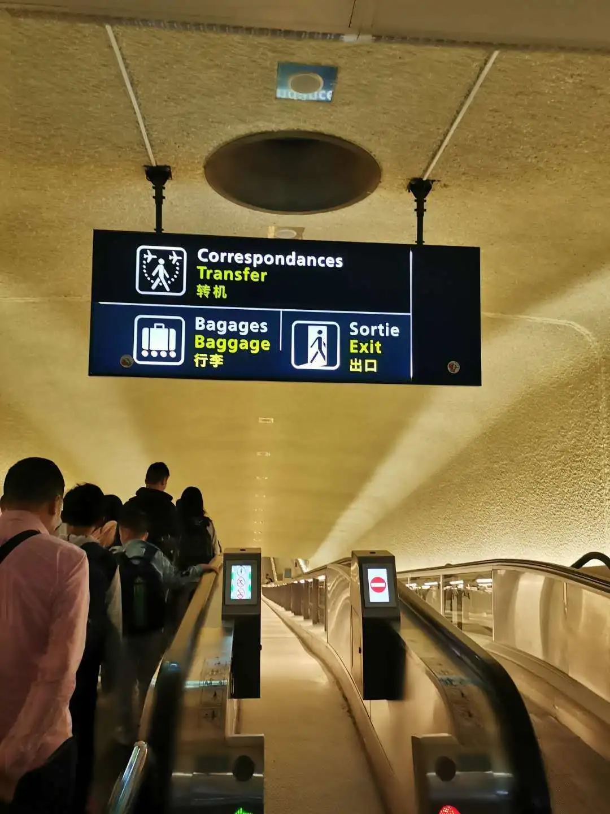

ใกล้เปิดภาคเรียนแล้ว สำหรับการเดินทางไปฝรั่งเศสครั้งแรก การจองเที่ยวบินเป็นส่วนที่ง่าย — คำถามที่ยากกว่าคือจะออกจากสนามบินไปยังเมืองที่คุณจะเรียนได้อย่างไร เมืองอย่างลียง บอร์โด มาร์แซย์ และสทราซบูร์มีเที่ยวบินระหว่างประเทศจริง แต่เที่ยวบินส่วนใหญ่จากจีนลงจอดที่ **ปารีสชาร์ลเดอโกล (CDG)**

ข่าวดีคือ CDG เป็นมิตรกับนักเดินทางที่พูดภาษาจีนอย่างผิดปกติ: การขึ้นเครื่อง เช็คอิน และแม้แต่ห้องน้ำมีป้ายภาษาจีน ดังนั้นการตามป้ายมักเพียงพอ คู่มือนี้ครอบคลุม **การหาทางเมื่อมาถึง** **อาคารผู้โดยสารและสถานีรถไฟ** **การเดินทางต่อไป** และ **รายการวลีภาษาฝรั่งเศสสำหรับสนามบิน**

## 1. การหาทางเมื่อมาถึง

### อุโมงค์ขาเข้า: ป้ายสามป้ายตัดสินทุกอย่าง

ช่วงแรกหลังลงจากเครื่องคือ «อุโมงค์ขาเข้า» ที่มีชื่อเสียงของ CDG — ทางเลื่อนยาวใต้ป้ายที่จัดฝูงชนให้คุณแล้ว:

- **Correspondances / Transfer** — อยู่ในสนามบินเพื่อเที่ยวบินต่อไป
- **Bagages / Baggage** — รับกระเป๋าโหลดจากสายพาน
- **Sortie / Exit** — ออกจากสนามบินหลังรับกระเป๋าและผ่านศุลกากร

ความผิดพลาดคลาสสิกของผู้มาครั้งแรกคือตาม «Exit» ออกไปจนสุดและลืมเที่ยวบินต่อหรือตั๋วรถไฟ จำลำดับไว้: **ตัดสินก่อนว่าต่อเครื่องหรือไม่ แล้วจึงเลือกกระเป๋าหรือทางออก**

### ป้ายภาษาจีน ไปจนถึงห้องน้ำ

CDG มีเส้นทางภาษาจีนครบทั้งเส้น: ประตูขึ้นเครื่องมี «Embarquement - Boarding - 登机» พื้นที่เช็คอินเขียน «Enregistrement - Check-in - 办理值机手续» และแม้แต่ห้องน้ำก็เพิ่ม «洗手间» ข้างภาษาฝรั่งเศสและอังกฤษ ป้ายในใจกลางปารีสก็มักมีภาษาจีนเช่นกัน ภาษาจึงไม่ใช่สิ่งที่ทำให้คุณหลงทาง

### ระวังแท็กซี่เถื่อน — และรู้จักบริการยกกระเป๋าแบบเสียเงิน

มีประกาศเตือนทั่วสนามบินเป็นภาษาจีน อังกฤษ และฝรั่งเศส: **แท็กซี่เถื่อนเป็นความเสี่ยงจริง** (FAUX TAXI = VRAIS RISQUES) ใช้แท็กซี่จากจุดรอทางการ หรือพบรถเรียกรถที่จุดรับที่กำหนด — อย่ารับคนขับที่เข้ามาหาคุณ

เมื่อมีสัมภาระมาก ให้ใช้ **บริการยกกระเป๋า (Porteurs / Porters)** ทางการของสนามบิน ซึ่งเคาน์เตอร์แสดงหมายเลขโทรศัพท์และคิดค่าบริการ รถเข็นสัมภาระก็คิดค่าบริการเช่นกัน จึงควรมีเหรียญหรือบัตรธนาคารที่ใช้งานได้ติดตัว

## 2. อาคารผู้โดยสาร สถานีรถไฟ และการเดินทางภายในสนามบิน

### สามอาคารผู้โดยสาร และเจ็ดอาคารย่อยภายใน T2

CDG มี **สามอาคารผู้โดยสาร: 1, 2 และ 3** อาคารผู้โดยสาร 2 เป็นอาคารหลัก แบ่งเป็น **อาคารย่อยเจ็ดแห่ง — T2A, T2B, T2C, T2D, T2E, T2F และ T2G** — เรียงสมมาตรเป็นรูปกลีบดอกไม้; อาคารผู้โดยสาร 1 เป็น «จานบิน» ทรงกลมทางตะวันตกเฉียงเหนือ; อาคารผู้โดยสาร 3 เล็กที่สุด อยู่ทางเหนือ และรองรับสายการบินราคาประหยัดและเช่าเหมาลำเป็นส่วนใหญ่

อาคารผู้โดยสารไม่ได้อยู่ใกล้กัน แต่ผังชัดเจน: **ตรวจสอบว่าสายการบินของคุณใช้อาคารย่อยใด** (เช่น T2E บนบัตรขึ้นเครื่อง) แล้วมุ่งไปที่นั่น

### สถานีรถไฟ: RER B และ TGV อยู่ที่ T2 ทั้งคู่

สถานีของ CDG อยู่ใต้อาคารผู้โดยสาร 2 — **La gare SNCF de l'aéroport Paris-Charles de Gaulle** — ขึ้นบันไดเลื่อนตรงจากอาคาร ตามคำอธิบายของสนามบินเอง สถานีเชื่อมกับเครือข่าย TGV Sud, Ouest และ Nord รวมถึงสายหลัก Ouigo, Thalys และ Eurostar และเป็นจุดขึ้น **RER B** เข้าปารีส

| สาย | พาไปที่ไหน |
| --- | --- |
| RER B | ใจกลางปารีส (Gare du Nord, Châtelet และอื่น ๆ) ประมาณ 25–30 นาที |
| TGV Sud / Ouest / Nord | ลียง บอร์โด น็องต์ ลีล และส่วนอื่นของฝรั่งเศส |
| Ouigo | บริการความเร็วสูงราคาประหยัดไปลียง มาร์แซย์ และไกลออกไป |
| Thalys / Eurostar | บรัสเซลส์ อัมสเตอร์ดัม และลอนดอน |

**ซื้อตั๋วก่อนบินหากทำได้** ที่สถานีมีเครื่องและเคาน์เตอร์ที่มีเจ้าหน้าที่ แต่การรับกระเป๋าและหาชานชาลากินเวลา และในช่วงพีคตั๋ววันเดียวกันขายหมด **SNCF Connect** (หรือ sncf.com) ใช้งานได้จากจีน — คุณต้องมีบัตรที่จ่ายเป็นยูโรได้ — และตั๋วมักเป็นอิเล็กทรอนิกส์ สแกนที่ประตู หรือจะขอให้เพื่อนที่อยู่ในฝรั่งเศสซื้อให้ก็ได้

### CDGVAL: รถไฟรับส่งฟรีที่วิ่ง 24 ชั่วโมง

การเคลื่อนที่ระหว่างอาคารผู้โดยสาร ลานจอดรถ และสถานีรถไฟภายในสนามบินเป็นหน้าที่ของ **รถไฟรับส่ง CDGVAL ฟรี** (เรียกอีกชื่อว่า RoissyVal) เส้นทางง่าย: T1 → ลานจอด PR → Roissypole (ที่ตั้งอาคารผู้โดยสาร 3 เดินประมาณ 5 นาที) → ลานจอด PX → T2 ซึ่งคุณเปลี่ยนไปรถไฟ TGV สายหลักและ RER B ได้ ข้างโรงแรม Sheraton รถรับส่งโรงแรม และ **สำนักงานฝากสัมภาระ**

**เวลาให้บริการ:** รถไฟวิ่ง 04:00–01:00 ทุกวัน และรถรับส่งครอบคลุม 01:00–04:00 ดังนั้นเส้นทางไม่เคยปิด รถรับส่งท้องถิ่น N1 และ N2 เสริม และทางเดินระหว่างอาคารมีป้ายชัด — เมื่อมีสัมภาระเบา การเดินมักเร็วกว่ารอ

## 3. การเดินทางต่อไป: การต่อเครื่อง ออร์ลี และต่างจังหวัด

### 1. ต่อเครื่องที่ CDG

หากเที่ยวบินต่อไปออกจาก CDG เช่นกัน คุณเพียงเปลี่ยนอาคารภายในสนามบินด้วย **รถไฟ CDGVAL ฟรี** (ดูด้านบน) มีการตัดสินใจหนึ่งเรื่องที่สำคัญ:

- **กระเป๋าไม่ได้โหลดต่อ (ตั๋วแยก):** คุณต้องผ่านตรวจคนเข้าเมือง รับสัมภาระ นำไปยังอาคารที่เที่ยวบินต่อไปออก และเช็คอินใหม่
- **กระเป๋าโหลดต่อ (ตั๋วใบเดียว):** ตามป้าย **Transfer** ตรงไปยังอาคารและประตูของเที่ยวบินต่อไป — ไม่ต้องรับอะไร

ไม่ว่ากรณีใด ป้ายเป็นภาษาจีน คุณจึงไม่หลงทาง

### 2. ไปออร์ลี (ORY)

หากเที่ยวบินต่อไปออกจาก **ปารีสออร์ลี** โปรดทราบว่าไม่มีรถไฟเชื่อมตรงระหว่างสองสนามบิน — คุณต้องเปลี่ยนในฝั่งเมือง ตัวเลือกปัจจุบัน:

- **RER B + Orlyval:** นั่ง RER B ไป **Antony** แล้วเปลี่ยนไป **Orlyval** รถรับส่งอัตโนมัติตรงสู่อาคารผู้โดยสารออร์ลี; ประมาณ 60–90 นาที และเป็นการเชื่อมต่อที่สั้นที่สุดเมื่อต้องเดินกับสัมภาระ
- **RER B + รถไฟใต้ดินสาย 14:** เข้าเมือง แล้วต่อสาย 14 ซึ่งขยายถึงออร์ลีในปี 2024 — ประมาณ 25 นาทีจากใจกลาง
- **แท็กซี่หรือรถรับจ้างส่วนตัว:** ประตูถึงประตูในประมาณ 45–60 นาที เหมาะที่สุดเมื่อเวลาหรือสัมภาระจำกัด

โปรดทราบว่า **รถโค้ช Air France เดิม (Le Bus Direct อดีต Les Cars Air France) หยุดให้บริการแล้ว**; คำแนะนำ «รถโค้ชสาย 3» ที่ยังหมุนเวียนออนไลน์เป็นข้อมูลเก่า อย่ารอที่สนามบิน

### 3. นั่ง TGV ไปต่างจังหวัด

อาคารผู้โดยสาร 2 มี **สถานีความเร็วสูง SNCF** ของตัวเอง และหากเมืองมหาวิทยาลัยของคุณมีบริการตรง นี่คือตัวเลือกที่ง่ายที่สุด — ไม่ต้องอ้อมเข้าเมืองปารีส ซื้อล่วงหน้าตามที่อธิบายข้างบน และ **เผื่อเวลาไว้มาก** ในกรณีหลงทาง รอกระเป๋านานเกิน หรือเจอของหมดช่วงพีค

หากไม่มีตั๋วตรง ให้เดินทางเข้าเมืองก่อนและออกจากสถานีที่ถูกต้อง: สถานีรถบัสของสนามบิน (Gare routière) อยู่ที่ Roissypole ข้างอาคารผู้โดยสาร 3 มีเส้นทางอย่าง Roissybus เข้าเมือง และ RER B ก็ถึงสถานีในเมือง ค่าโดยสารและเส้นทางเปลี่ยนได้ — ตรวจสอบ Île-de-France Mobilités สำหรับวันที่เดินทาง

### 4. สถานีรถไฟหลักหกแห่งในปารีส

ปารีสมีสถานีหลักหกแห่ง หนึ่งแห่งต่อทิศทางของประเทศ ตรวจสอบว่าสถานีใดพิมพ์บนตั๋วก่อนออกเดินทาง:

| สถานี | ทิศทางหลัก | รถไฟใต้ดิน / RER |
| --- | --- | --- |
| Gare du Nord | ฝรั่งเศสเหนือ เบลเยียม สหราชอาณาจักร (Eurostar) | สาย 4, 5; RER B, D |
| Gare de l'Est | ฝรั่งเศสตะวันออก เยอรมนี ลักเซมเบิร์ก | สาย 4, 5, 7 |
| Gare de Lyon | ฝรั่งเศสตะวันออกเฉียงใต้ สวิตเซอร์แลนด์ อิตาลี | สาย 1, 14; RER A, D |
| Gare d'Austerlitz | ฝรั่งเศสตะวันตกเฉียงใต้ สเปน โปรตุเกส | สาย 5, 10; RER C |
| Gare Montparnasse | ฝรั่งเศสตะวันตก บริตทานี | สาย 4, 6, 12, 13 |
| Gare Saint-Lazare | ไปนอร์ม็องดี | สาย 3, 12, 13, 14 |

ที่สถานี เจ้าหน้าที่จะบอกเที่ยวออกที่แน่นอนสำหรับจุดหมายของคุณ — ซื้อตั๋วแล้วขึ้นรถ เมื่อมีกระเป๋าหนัก โปรดจำไว้ว่ารถไฟใต้ดินสายเก่า (โดยเฉพาะสาย 4) มักต้องขึ้นบันไดระหว่างชานชาลา จึงควรเผื่อเวลาสำหรับถือสัมภาระ

## 4. รายการวลีภาษาฝรั่งเศสสำหรับสนามบิน

คุณไม่จำเป็นต้องรู้ภาษาฝรั่งเศสเพื่อผ่าน CDG — ตารางเหล่านี้ครอบคลุมเส้นทางทั้งหมดตั้งแต่ลงจอดถึงศุลกากร และการอ่านจากโทรศัพท์มักเพียงพอ

### มาถึงสนามบิน

| ไทย | ภาษาฝรั่งเศส |
| --- | --- |
| สนามบินปารีสชาร์ลเดอโกล | L'aéroport de Charles de Gaulle |
| สนามบิน | L'aéroport |
| ขาเข้า / ขาออก | Arrivées / départs |
| ห้องน้ำ | Toilette |
| อาคารผู้โดยสาร 1 | Terminal 1 (T1) |
| เช็คอินสัมภาระ | Enregistrer des bagages |
| บัตรขึ้นเครื่อง | La carte d'embarquement |
| ประตูขึ้นเครื่อง 1 | Porte 1 |
| การคืนภาษี | La détaxe |

### เช็คอินและการตรวจความปลอดภัย

| ไทย | ภาษาฝรั่งเศส |
| --- | --- |
| เคาน์เตอร์เช็คอิน | Un guichet d'embarquement |
| ขอหนังสือเดินทางหน่อย | Votre passeport, s'il vous plaît |
| ต้องการที่นั่งริมหน้าต่าง | Je voudrais avoir un siège du côté hublot, s'il vous plaît |
| ต้องการที่นั่งริมทางเดิน | Je voudrais avoir un siège du côté couloir, s'il vous plaît |
| การตรวจความปลอดภัย | Le contrôle de sécurité |
| สัมภาระถือ | Le bagage à main |
| สัมภาระโหลดใต้เครื่อง | Le bagage enregistré |
| ตั๋วเที่ยวเดียว / ไป-กลับ | Un billet simple / un billet aller-retour |
| ชั้นประหยัด / ชั้นธุรกิจ | La classe économique / la classe d'affaire |

### บนเครื่อง

| ไทย | ภาษาฝรั่งเศส |
| --- | --- |
| กรุณาคาดเข็มขัดนิรภัย | Veillez à bien attacher vos ceintures de sécurité |
| เข็มขัดนิรภัย / พนักงานต้อนรับบนเครื่อง | La ceinture de sécurité / une hôtesse de l'air |
| เปลี่ยนที่นั่งได้ไหม | Ce serait possible de changer une place ? |
| มีเครื่องดื่มอะไรบ้าง | Quelles boissons avez-vous ? |
| ขอกาแฟหนึ่งถ้วย | Je voudrais un café |
| น้ำส้ม / น้ำแอปเปิล / โคล่า | le jus d'orange / le jus de pomme / le coca |
| ไวน์ / เบียร์ / น้ำ | le vin / la bière / l'eau |
| อาหารเช้า / กลางวัน / เย็น | le petit déjeuner / le déjeuner / le dîner |
| ฉันไม่กินหมู | Je ne mange pas de porc |
| ขอผ้าห่มหน่อยได้ไหม | Est-ce que vous pouvez me donner une couverture ? |

### ลงจากเครื่อง ศุลกากร และกระเป๋า

| ไทย | ภาษาฝรั่งเศส |
| --- | --- |
| ผ่านศุลกากร | passer la douane |
| พักที่นี่นานเท่าไร | Vous vous arrêterez ici pendant combien de temps ? |
| มีอะไรต้องสำแดงไหม | Avez-vous quelques choses à déclarer ? |
| มีของต้องห้ามไหม | Avez-vous des choses interdites ? |
| คุณมาจากไหน | S'il vous plaît, d'où venez-vous ? |
| กรุณาเปิดกระเป๋า | Veuillez ouvrir vos valises. |
| นี่คืออะไร | Qu'est-ce que c'est ? |
| แบบฟอร์มสำแดง / สุขภาพ / ขาเข้า | la fiche de déclaration / la fiche de déclaration d'hygiène et de santé / la formulaire d'entrée |
| รู้ไหมว่ารับกระเป๋าที่ไหน | Est-ce que vous savez où est-ce qu'on récupère les bagages ? |
| พื้นที่รับกระเป๋า | la zone de récupération des bagages |
| แท็กซี่ / รถบัส / รถไฟใต้ดิน / รถไฟ | le taxi / le bus / le métro / le train |

ภาพหน้าจอต้นฉบับของรายการวลีอยู่ด้านล่าง หากต้องการบันทึกไว้ในโทรศัพท์

## ลิงก์ที่เกี่ยวข้อง

- **ในเว็บไซต์นี้**: [ท่าอากาศยานปารีสชาร์ลเดอโกล (CDG)](/airport/CDG), [ท่าอากาศยานปารีสออร์ลี (ORY)](/airport/ORY), [ฝรั่งเศส (FR)](/country/FR)
- **Wikipedia**: [ท่าอากาศยานชาร์ลเดอโกล](https://en.wikipedia.org/wiki/Paris_Charles_de_Gaulle_Airport), [ท่าอากาศยานออร์ลี](https://en.wikipedia.org/wiki/Paris_Orly_Airport)
- **Baidu Baike**: [ท่าอากาศยานชาร์ลเดอโกล](https://baike.baidu.com/item/%E5%B7%B4%E9%BB%8E%E5%A4%8F%E5%B0%94%C2%B7%E6%88%B4%E9%AB%98%E4%B9%90%E6%9C%BA%E5%9C%BA), [ท่าอากาศยานออร์ลี](https://baike.baidu.com/item/%E5%B7%B4%E9%BB%8E-%E5%A5%A5%E5%88%A9%E6%9C%BA%E5%9C%BA)
