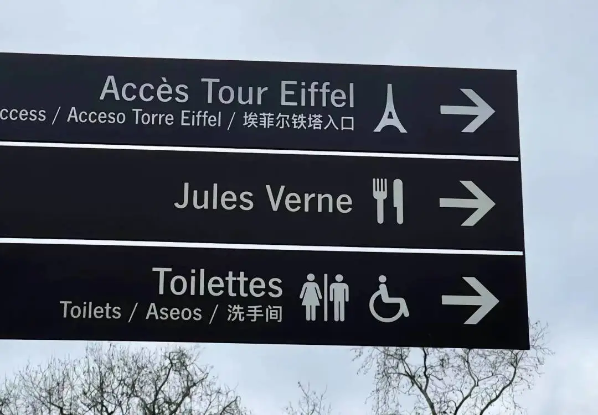

Kỳ học gần đến. Với lần đầu đến Pháp, đặt vé máy bay là phần dễ — câu hỏi khó hơn là làm sao ra khỏi sân bay và đến thành phố nơi bạn sẽ học. Các thành phố như Lyon, Bordeaux, Marseille và Strasbourg đều có chuyến quốc tế, nhưng phần lớn chuyến từ Trung Quốc hạ cánh ở **Paris Charles de Gaulle (CDG)**.

Tin tốt là CDG thân thiện với người nói tiếng Trung một cách bất thường: lên máy bay, làm thủ tục và cả nhà vệ sinh đều có biển tiếng Trung, nên đi theo biển thường là đủ. Hướng dẫn này đề cập **tìm đường khi đến**, **nhà ga và ga đường sắt**, **đi tiếp**, và **danh sách cụm từ tiếng Pháp cho sân bay**.

## 1. Tìm đường khi đến

### Đường hầm nhập cảnh: ba tấm biển quyết định mọi thứ

Chặng đầu tiên sau khi rời máy bay là “đường hầm nhập cảnh” nổi tiếng của CDG — một băng chuyền đi bộ dài dưới tấm biển đã phân loại đám đông giúp bạn:

- **Correspondances / Transfer** — ở lại sân bay cho chuyến bay tiếp theo;
- **Bagages / Baggage** — lấy hành lý ký gửi từ băng chuyền;
- **Sortie / Exit** — rời sân bay sau khi lấy hành lý và qua hải quan.

Sai lầm kinh điển của người lần đầu là đi theo “Exit” ra ngoài và quên chuyến nối tiếp hoặc vé tàu. Hãy nhớ thứ tự: **trước tiên xác định bạn có nối chuyến hay không, rồi chọn hành lý hoặc lối ra**.

### Biển tiếng Trung, đến tận nhà vệ sinh

CDG có cả một hệ thống tiếng Trung hoàn chỉnh: cổng ghi “Embarquement - Boarding - 登机”, khu làm thủ tục ghi “Enregistrement - Check-in - 办理值机手续”, và cả nhà vệ sinh cũng thêm “洗手间” bên cạnh tiếng Pháp và tiếng Anh. Biển ở trung tâm Paris cũng thường có tiếng Trung, nên ngôn ngữ không phải thứ khiến bạn lạc.

### Coi chừng taxi không phép — và biết dịch vụ khuân vác trả phí

Cảnh báo được dán khắp sân bay bằng tiếng Trung, Anh và Pháp: **taxi không phép là rủi ro thật** (FAUX TAXI = VRAIS RISQUES). Hãy bắt taxi ở bãi chính thức, hoặc gặp xe gọi tại điểm đón được chỉ định — đừng bao giờ nhận tài xế chủ động đến gần.

Với nhiều hành lý, hãy dùng **dịch vụ khuân vác chính thức (Porteurs / Porters)** của sân bay, quầy có số điện thoại và thu phí. Xe đẩy hành lý cũng tính phí, nên hãy để sẵn ít xu hoặc thẻ ngân hàng hoạt động.

## 2. Nhà ga, ga đường sắt và di chuyển trong sân bay

### Ba nhà ga, và bảy nhà ga con trong T2

CDG có **ba nhà ga: 1, 2 và 3**. Nhà ga 2 là chính và chia thành **bảy nhà ga con — T2A, T2B, T2C, T2D, T2E, T2F và T2G** — bố trí đối xứng theo hình cánh hoa; Nhà ga 1 là “đĩa bay” tròn ở phía tây bắc; Nhà ga 3 nhỏ nhất, ở phía bắc, chủ yếu phục vụ hãng giá rẻ và thuê chuyến.

Các nhà ga không gần nhau, nhưng bố cục rõ ràng: **hãy kiểm tra chuyến của bạn dùng nhà ga con nào** (ví dụ T2E trên thẻ lên máy bay) và đi đến đó.

### Ga đường sắt: RER B và TGV, đều ở T2

Ga của CDG nằm dưới Nhà ga 2 — **La gare SNCF de l'aéroport Paris-Charles de Gaulle** — đến bằng thang cuốn thẳng từ nhà ga. Theo mô tả của chính sân bay, ga kết nối với mạng TGV Sud, Ouest và Nord cùng các tuyến Ouigo, Thalys và Eurostar chính, và đây là nơi bạn bắt **RER B** vào Paris.

| Tuyến | Đưa bạn đến đâu |
| --- | --- |
| RER B | Trung tâm Paris (Gare du Nord, Châtelet và hơn thế), khoảng 25–30 phút |
| TGV Sud / Ouest / Nord | Lyon, Bordeaux, Nantes, Lille và phần còn lại của Pháp |
| Ouigo | Dịch vụ cao tốc giá rẻ về phía Lyon, Marseille và xa hơn |
| Thalys / Eurostar | Brussels, Amsterdam và London |

**Hãy mua vé trước khi bay nếu có thể.** Có máy và quầy có nhân viên ở ga, nhưng lấy hành lý và tìm sân ga tốn thời gian, và vào cao điểm vé trong ngày bán hết. **SNCF Connect** (hoặc sncf.com) hoạt động từ Trung Quốc — bạn cần thẻ thanh toán được bằng euro — và vé thường là điện tử, quét ở cổng. Hoặc nhờ một người bạn đã ở Pháp mua giúp.

### CDGVAL: tàu trung chuyển miễn phí chạy 24 giờ

Việc di chuyển giữa các nhà ga, bãi đỗ và ga đường sắt trong sân bay do **tàu trung chuyển CDGVAL miễn phí** (còn gọi RoissyVal) đảm nhận. Tuyến rất đơn giản: T1 → bãi đỗ PR → Roissypole (nơi có Nhà ga 3, đi bộ khoảng 5 phút) → bãi đỗ PX → T2, nơi bạn đổi sang tàu TGV đường dài và RER B, cạnh khách sạn Sheraton, xe buýt trung chuyển khách sạn và **văn phòng gửi hành lý**.

**Giờ chạy:** tàu chạy 04:00–01:00 mỗi ngày, và xe buýt trung chuyển phục vụ 01:00–04:00, nên tuyến không bao giờ đóng. Xe buýt trung chuyển N1 và N2 địa phương bổ sung, và lối đi bộ giữa các nhà ga có biển rõ — với hành lý nhẹ, đi bộ thường nhanh hơn chờ.

## 3. Đi tiếp: nối chuyến, Orly và các tỉnh

### 1. Nối chuyến tại CDG

Nếu chuyến tiếp theo cũng khởi hành từ CDG, bạn chỉ cần đổi nhà ga trong sân bay bằng **tàu CDGVAL miễn phí** (xem trên). Có một quyết định quan trọng:

- **Hành lý không ký gửi thẳng (vé riêng):** bạn phải qua nhập cảnh, lấy hành lý, mang đến nhà ga chuyến tiếp theo và làm thủ tục lại;
- **Hành lý ký gửi thẳng (một vé):** đi theo biển **Transfer** thẳng đến nhà ga và cổng của chuyến tiếp theo — không cần lấy gì.

Dù cách nào, biển chỉ dẫn đều có tiếng Trung, nên bạn sẽ không lạc.

### 2. Đi đến Orly (ORY)

Nếu chuyến tiếp theo khởi hành từ **Paris Orly**, lưu ý không có tuyến đường sắt trực tiếp giữa hai sân bay — bạn đổi ở phía thành phố. Các lựa chọn hiện tại:

- **RER B + Orlyval:** đi RER B đến **Antony**, rồi đổi sang tàu tự động **Orlyval** thẳng đến các nhà ga Orly; khoảng 60–90 phút, và là kết nối ngắn nhất để đi bộ cùng hành lý;
- **RER B + Metro tuyến 14:** vào trung tâm, rồi tuyến 14, đã được kéo dài đến Orly năm 2024 — khoảng 25 phút từ trung tâm;
- **Taxi hoặc xe đưa đón riêng:** từ cửa đến cửa khoảng 45–60 phút, tốt nhất khi thời gian hoặc hành lý eo hẹp.

Lưu ý **xe khách Air France cũ (Le Bus Direct, trước là Les Cars Air France) đã ngừng hoạt động**; lời khuyên “xe khách tuyến 3” vẫn lan truyền trên mạng đã lỗi thời, nên đừng chờ nó ở sân bay.

### 3. Đi TGV đến các tỉnh

Nhà ga 2 có **ga cao tốc SNCF** riêng, và nếu thành phố đại học của bạn có tuyến trực tiếp thì đây là lựa chọn đơn giản nhất — không phải vòng vào Paris. Hãy mua trước như mô tả trên, và **dành nhiều thời gian**, phòng khi lạc đường, chờ hành lý quá lâu hoặc gặp cảnh bán hết vé cao điểm.

Nếu không có vé trực tiếp, hãy vào Paris trước và khởi hành từ đúng ga: bến xe của sân bay (Gare routière) ở Roissypole cạnh Nhà ga 3, với các tuyến như Roissybus vào thành phố, và RER B cũng đến các ga trong thành phố. Giá vé và tuyến thay đổi — hãy kiểm tra Île-de-France Mobilités cho ngày bạn đi.

### 4. Sáu ga đường sắt chính ở Paris

Paris có sáu ga chính, mỗi ga phục vụ một hướng của đất nước. Hãy kiểm tra ga nào in trên vé trước khi lên đường:

| Ga | Hướng chính | Metro / RER |
| --- | --- | --- |
| Gare du Nord | Miền bắc nước Pháp, Bỉ, Anh (Eurostar) | Tuyến 4, 5; RER B, D |
| Gare de l'Est | Miền đông nước Pháp, Đức, Luxembourg | Tuyến 4, 5, 7 |
| Gare de Lyon | Miền đông nam nước Pháp, Thụy Sĩ, Ý | Tuyến 1, 14; RER A, D |
| Gare d'Austerlitz | Miền tây nam nước Pháp, Tây Ban Nha, Bồ Đào Nha | Tuyến 5, 10; RER C |
| Gare Montparnasse | Miền tây nước Pháp, Bretagne | Tuyến 4, 6, 12, 13 |
| Gare Saint-Lazare | Về phía Normandie | Tuyến 3, 12, 13, 14 |

Tại ga, nhân viên sẽ cho bạn biết chuyến chính xác đến điểm đến — mua vé và lên tàu. Với hành lý nặng, hãy nhớ các tuyến metro cũ (đặc biệt tuyến 4) thường phải đi cầu thang giữa các sân ga, nên hãy dành thời gian mang hành lý.

## 4. Danh sách cụm từ tiếng Pháp ở sân bay

Bạn không cần tiếng Pháp để qua CDG — các bảng này bao phủ toàn bộ lộ trình từ hạ cánh đến hải quan, và đọc trên điện thoại thường là đủ.

### Đến sân bay

| Tiếng Việt | Tiếng Pháp |
| --- | --- |
| Sân bay Paris Charles de Gaulle | L'aéroport de Charles de Gaulle |
| Sân bay | L'aéroport |
| Đến / khởi hành | Arrivées / départs |
| Nhà vệ sinh | Toilette |
| Nhà ga 1 | Terminal 1 (T1) |
| Ký gửi hành lý | Enregistrer des bagages |
| Thẻ lên máy bay | La carte d'embarquement |
| Cổng 1 | Porte 1 |
| Hoàn thuế | La détaxe |

### Làm thủ tục và an ninh

| Tiếng Việt | Tiếng Pháp |
| --- | --- |
| Quầy làm thủ tục | Un guichet d'embarquement |
| Hộ chiếu của bạn, làm ơn | Votre passeport, s'il vous plaît |
| Tôi muốn ghế cạnh cửa sổ | Je voudrais avoir un siège du côté hublot, s'il vous plaît |
| Tôi muốn ghế cạnh lối đi | Je voudrais avoir un siège du côté couloir, s'il vous plaît |
| Kiểm tra an ninh | Le contrôle de sécurité |
| Hành lý xách tay | Le bagage à main |
| Hành lý ký gửi | Le bagage enregistré |
| Vé một chiều / khứ hồi | Un billet simple / un billet aller-retour |
| Hạng phổ thông / hạng thương gia | La classe économique / la classe d'affaire |

### Trên máy bay

| Tiếng Việt | Tiếng Pháp |
| --- | --- |
| Hãy thắt dây an toàn | Veillez à bien attacher vos ceintures de sécurité |
| Dây an toàn / tiếp viên hàng không | La ceinture de sécurité / une hôtesse de l'air |
| Tôi có thể đổi chỗ không? | Ce serait possible de changer une place ? |
| Bạn có những đồ uống gì? | Quelles boissons avez-vous ? |
| Tôi muốn một ly cà phê | Je voudrais un café |
| Nước cam / nước táo / cola | le jus d'orange / le jus de pomme / le coca |
| Rượu vang / bia / nước | le vin / la bière / l'eau |
| Bữa sáng / bữa trưa / bữa tối | le petit déjeuner / le déjeuner / le dîner |
| Tôi không ăn thịt lợn | Je ne mange pas de porc |
| Bạn có thể cho tôi một chiếc chăn không? | Est-ce que vous pouvez me donner une couverture ? |

### Rời máy bay, hải quan và hành lý

| Tiếng Việt | Tiếng Pháp |
| --- | --- |
| Qua hải quan | passer la douane |
| Bạn ở đây bao lâu? | Vous vous arrêterez ici pendant combien de temps ? |
| Bạn có gì cần khai báo không? | Avez-vous quelques choses à déclarer ? |
| Bạn có mang vật bị cấm không? | Avez-vous des choses interdites ? |
| Bạn đến từ đâu? | S'il vous plaît, d'où venez-vous ? |
| Hãy mở vali của bạn. | Veuillez ouvrir vos valises. |
| Đây là gì? | Qu'est-ce que c'est ? |
| Tờ khai / tờ khai y tế / tờ khai nhập cảnh | la fiche de déclaration / la fiche de déclaration d'hygiène et de santé / la formulaire d'entrée |
| Bạn có biết chỗ nhận hành lý không? | Est-ce que vous savez où est-ce qu'on récupère les bagages ? |
| Khu nhận hành lý | la zone de récupération des bagages |
| Taxi / xe buýt / metro / tàu hỏa | le taxi / le bus / le métro / le train |

Ảnh chụp gốc của danh sách cụm từ ở dưới nếu bạn muốn lưu vào điện thoại.

## Liên kết liên quan

- **Trên trang này**: [Sân bay Paris Charles de Gaulle (CDG)](/airport/CDG), [Sân bay Paris Orly (ORY)](/airport/ORY), [Pháp (FR)](/country/FR)
- **Wikipedia**: [Sân bay Charles de Gaulle](https://en.wikipedia.org/wiki/Paris_Charles_de_Gaulle_Airport), [Sân bay Orly](https://en.wikipedia.org/wiki/Paris_Orly_Airport)
- **Baidu Baike**: [Sân bay Charles de Gaulle](https://baike.baidu.com/item/%E5%B7%B4%E9%BB%8E%E5%A4%8F%E5%B0%94%C2%B7%E6%88%B4%E9%AB%98%E4%B9%90%E6%9C%BA%E5%9C%BA), [Sân bay Orly](https://baike.baidu.com/item/%E5%B7%B4%E9%BB%8E-%E5%A5%A5%E5%88%A9%E6%9C%BA%E5%9C%BA)
