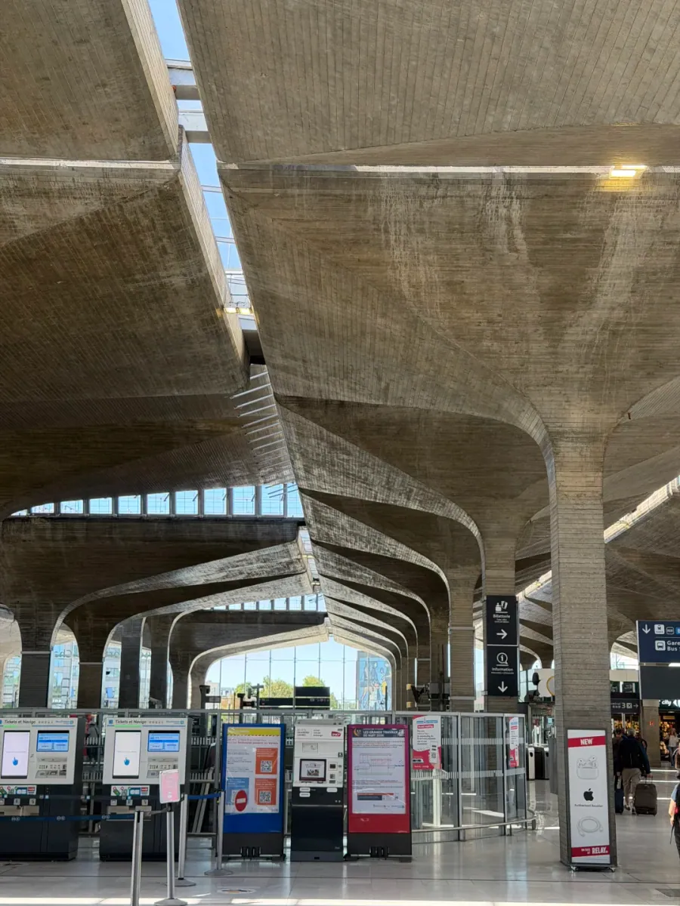

ডাবলিন থেকে প্যারিসে উড়ে আসা ভ্রমণকারী প্রশ্ন ও নথির ফোল্ডার নিয়ে প্রস্তুত ছিলেন। বিমানের দরজা থেকে এক্সিট পর্যন্ত প্রায় কিছুই তার পথ আটকায়নি। যেটা বিস্মিত করেছে তা হলো পদ্ধতি: পাসপোর্টে কোনো সিল নেই, আর সিল লাগানোর কোনো ইচ্ছাও নেই।

এই লেখায় সেই আগমন ক্রমান্বয়ে লিপিবদ্ধ করা হয়েছে — চীনা সাইন, সীমান্ত তল্লাশি, সিল কেন উঠে গেছে, এবং এরপর কী করতে হবে। CDG ফ্রান্সের বৃহত্তম বিমানবন্দর, তিনটি টার্মিনাল আর T2-এর ভেতরে সাতটি সাব-টার্মিনাল নিয়ে, যেখানে ট্রান্সফার ও এক্সিট সহজেই গুলিয়ে যায়। একটি সতর্কবার্তা: এটি এক ভ্রমণকারীর অভিজ্ঞতা, কোনো সরকারি পদ্ধতি নয়। যে নথিগুলোর কথা বলা হয়েছে সেগুলো তৈরি করা হয়েছিল কিন্তু দেখা হয়নি, আর সেটা "দরকার নেই" হওয়ার সমান নয়।

## 1. বিমানের দরজা থেকেই চীনা সাইনবোর্ড

বিমান থেকে নামার পর প্রথম সাইনে তিনটি ভাষা: Correspondances / Transfer / 转机, Sortie / Exit / 出口, এবং Bagages / Baggage / 行李提取। 出口 অনুসরণ করাই যথেষ্ট। এখানে চীনা ভাষা জেট ব্রিজ থেকে ব্যাগেজ হল পর্যন্ত একটানা ধারা; এমনকি জেট ব্রিজের কাচেও চার তিরসহ গোলাকার Sortie / Exit / 出口 স্টিকার আছে।

তার পরে লম্বা কাচের করিডোর — বাঁ দিকে অ্যাপ্রন ও এয়ারব্রিজ, ডান দিকে টার্মিনাল — কোনো মোড় নেই, তাই লিফট বা মেট্রোর লোগো খুঁজতে না গিয়ে ভিড় ও হলুদ সাইন অনুসরণ করুন।

প্রথম ঝুলন্ত সাইনই আসল সিদ্ধান্ত: এক পাশে ট্রান্সফার, সামনে ব্যাগেজ, ব্যাগেজ হল পেরিয়ে এক্সিট। পিক্টোগ্রাম — ট্রান্সফারের জন্য দুটি আলাদা হয়ে হাঁটা মূর্তি, এক্সিটের জন্য হাঁটা মূর্তি, ব্যাগের জন্য ক্যারোসেলের আকৃতি — ফরাসি না জানলেও কাজ করে।

গেট, চেক-ইন, টয়লেট ও ব্যাগেজ বেল্টেও চীনা লেখা থাকে, যা শান্ত রাতের আগমনে সবচেয়ে বেশি কাজে দেয়। কিন্তু সাইনে চীনা থাকা মানে কর্মীরাও চীনা বলেন না; সীমান্ত ও কাস্টমসের কথাবার্তা এখনো মূলত ফরাসি ও ইংরেজিতে হয়। হোটেলের ঠিকানা ও ভ্রমণসূচি ফোনে রাখুন, দরকার হলে স্ক্রিন দেখান।

## 2. সীমান্ত নিয়ন্ত্রণ: পাসপোর্ট, ভিসা, লেন

একই তিনটি শব্দ করিডোর জুড়ে বারবার আসে। "Portes 40-68"-এর মতো গেট নম্বর দেখানো সাইন উপেক্ষা করুন — সেটা গেটে যাওয়ার ট্রান্সফার পথ, অ্যারাইভাল চ্যানেল নয়। "Contrôle des passeports" খুঁজুন, বা সহজভাবে নন-EU প্রবাহ অনুসরণ করুন।

ভাগ করা হয় পাসপোর্টে এক নজরে। লেনের মাথায় থাকা কর্মীরা হাতের পাসপোর্টের প্রচ্ছদ দেখে সারিতে পাঠান: EU ও EEA পাসপোর্ট এক দিকে, বাকি সব অন্য দিকে। শেনজেন ভিসাসহ চীনা পাসপোর্ট নন-EU লেনে যায়; কোন সারি দ্রুত এগোয় তা আন্দাজ না করে কর্মীদের নির্দেশ অনুসরণ করুন।

জানালায় পাসপোর্ট ভিসার পাতায় খুলে দিন। এ ক্ষেত্রে কর্মকর্তা কিছু বলেননি, ভিসা দেখেছেন, ফিঙ্গারপ্রিন্ট রিডারের দিকে ইশারা করেছেন, আর ভ্রমণকারীকে হাত নেড়ে এগিয়ে দিয়েছেন। উদ্দেশ্য, থাকার সময় বা বাসস্থান নিয়ে কোনো প্রশ্ন নেই, বুকিং বা রিটার্ন টিকিট চাওয়া হয়নি; আগে থেকে তৈরি নথিগুলো একবারও দেখা হয়নি।

তবু এটা খালি হাতে ভ্রমণ করার কারণ নয়। কর্মকর্তাদের বিবেচনার অধিকার আছে আর তল্লাশি এলোমেলো; নথি হ্যান্ড ব্যাগে রাখুন, ফোনে কপিসহ। পাসপোর্ট কখনো চেক করা ব্যাগে দেবেন না।

ফিঙ্গারপ্রিন্ট সেখানেই নেওয়া হয়: এক হাতের চার আঙুল, তারপর অন্য হাত, তারপর দুটি বুড়ো আঙুল — রিডারে ডায়াগ্রাম ও চীনা বা ইংরেজি নির্দেশনা থাকে। স্ক্রিন নিশ্চিতকরণ দেখানো পর্যন্ত অপেক্ষা করুন, তারপর পাসপোর্ট ফিরিয়ে নিন।

প্রশ্ন যখন আসে, তখন সেগুলো সরল: উদ্দেশ্য, দিনসংখ্যা, অন্য দেশ, বাসস্থান, প্রস্থানের তারিখ। সামঞ্জস্যপূর্ণ উত্তরই যথেষ্ট, মুখস্থ করার কোনো স্ক্রিপ্ট নেই।

## 3. EES-এর পর: সিল কেন নেই

ভ্রমণকারী সিল চেয়েছিলেন, উত্তর পেয়েছিলেন সোজা "না"। ফ্রান্স প্রবেশ সিলের বদলে EES চালু করেছে।

EES হলো EU Entry/Exit System, 2025 সালের অক্টোবর থেকে ধাপে ধাপে চালু। এটি সারি–সিল–হাত নেড়ে পাঠানোর বদলে প্রথম প্রবেশে বায়োমেট্রিক নিবন্ধন করে: পাসপোর্ট ডেটা, মুখের ছবি ও ফিঙ্গারপ্রিন্ট, একটি নির্দিষ্ট সময় ধরে সংরক্ষিত, যাতে পরের ভ্রমণে একই রেকর্ড পড়া যায়। তারিখের সিল আর দরকার নেই।

তাই পরিষ্কার পাসপোর্ট মানে রেকর্ড নেই নয়, আর সিল চাইলে সাধারণত ফিরিয়ে দেওয়া হয়, কারণ সিস্টেমটাই আর সিল দেয় না। "সারিতে দাঁড়ান, সিল নিন, কয়েকটি প্রশ্নের উত্তর দিন" বলে যে পুরোনো গাইডগুলো, সেগুলো পুরোনো — আপনি ভুল পথে গেছেন তার প্রমাণ নয়।

রেসিডেন্স পারমিট, নবায়ন বা বিশ্ববিদ্যালয়ে নিবন্ধনের জন্য সিল কোনো কাজেই আসত না; বোর্ডিং পাস, ই-টিকিট ও হোটেলের রেকর্ড ভালো প্রমাণ, তাই ভ্রমণ শেষ হওয়া পর্যন্ত সেগুলো রেখে দিন।

EES পুরো শেনজেন জুড়ে। আপনি যেখানে প্রথম প্রবেশ করেন সেখানেই নিবন্ধন হয়, আর পরে অন্য জায়গায় প্রবেশে একই রেকর্ড পড়া হয় — এজন্য জার্মানি বা নেদারল্যান্ডস হয়ে কানেক্ট করা কিছু ভ্রমণকারী আগেই ফিঙ্গারপ্রিন্ট দিয়ে ফেলেন এবং প্যারিসে এসে করার কিছু পান না।

## 4. সীমান্ত নিয়ন্ত্রণের পর প্রথম কাজ

সীমান্ত পেরিয়ে করিডোর খুলে যায় ব্যাগেজ হলে, যেখানে সাইন বদলে হয় Bagages ও Sortie, আর বেল্টগুলোতে তাদের নম্বর। ব্যাগ নিন, ট্রলি ঠেলে বেরোন, তারপর কাস্টমস চ্যানেল পার হোন — ঘোষণার কিছু না থাকলে সবুজ, নাহলে লাল। ভ্রমণকারীকে থামানো হয়নি, তবে তল্লাশি এলোমেলো।

বাইরে বেরোলে আগে পরিবহন। বিমানবন্দরেই কার্ড কেনা যায়: RER B স্টেশনের হলুদ "Tickets et Navigo" মেশিন, বা SNCF কাউন্টার। প্যারিসে কয়েকদিন থাকলে দিন গুনে সিঙ্গেল, ডে পাস ও সাপ্তাহিক পাসের মধ্যে বেছে নিন; সাপ্তাহিক পাস বিমানবন্দরে বিক্রি হয় না, শহরে কর্মীযুক্ত কাউন্টার লাগে।

পরামর্শ হলো Île-de-France Mobilités অ্যাপে কিনে টিকিট Apple Wallet-এ যোগ করা, তাতে কার্ডের ফি ও সারি দুটোই বাঁচে — যদিও নিবন্ধনে সাধারণত ইউরোপীয় ফোন নম্বর লাগে।

স্তরগুলো খেয়াল করুন। CDG-তে আগমন, স্টেশন ও প্রস্থান আলাদা স্তরে, আর লিফটের পাশের বোর্ডে "5 Arrivals", "2 Train Station" ও RER B চিহ্ন একসঙ্গে থাকে, সঙ্গে ট্যাক্সি, হোটেল, টয়লেট ও কার পার্ক।

স্টেশন হলের কংক্রিটের ভল্টের নিচে "Tickets et Navigo" মেশিনের পাশেই Relay দোকান, তাই টিকিট, পানি ও প্লাগ অ্যাডাপ্টার সবই এক স্তরে। লিয়ঁ, বোর্দো বা মার্সেইর জন্য T2-এর নিচের হাই-স্পিড স্টেশন শহরে গিয়ে ফেরার ঝামেলা বাঁচায়; কেনার আগে টিকিটে লেখা স্টেশন দেখে নিন।

## 5. যেসব খুঁটিনাটি বিভ্রান্ত করে

স্বয়ংক্রিয় গেট সবার জন্য নয়। স্ব-পরিষেবা লেন EU পাসপোর্ট, ফরাসি রেসিডেন্স পারমিট ও অনুরূপ নথির জন্য; স্বল্পমেয়াদি চীনা পাসপোর্ট সাধারণত যোগ্য নয়। সামনের মানুষগুলোকে অনুসরণ করে গেট দিয়ে যাবেন না — কর্মীরা যে জানালায় পাঠান সেখানেই যান।

প্রশ্ন না করা মানে তল্লাশি নেই নয়। পাসপোর্ট, ভিসা, বাসস্থান, রিটার্ন টিকিট ও বিমা হ্যান্ড ব্যাগের একই কুঠুরিতে রাখুন, যাতে একবারেই বের করা যায়।

টার্মিনালগুলো পরস্পর থেকে অনেক দূরে: T1, A থেকে G সাব-টার্মিনালসহ T2, আর T3। টার্মিনাল বদলাতে বিনামূল্যের CDGVAL-এর সঙ্গে হাঁটা ও অপেক্ষা যোগ হয়, তাই 30 মিনিট বা বেশি ধরুন; কানেকশন টাইট হলে গেটে নিশ্চিত করুন ব্যাগ থ্রু-চেক করা আছে কি না।

এক্সিটের জন্য নম্বর দরকার। এক্সিটগুলো টার্মিনাল ও অ্যারাইভাল স্তর অনুযায়ী দলে বিভক্ত, তাই যিনি আপনাকে নিতে আসছেন তাকে টার্মিনাল, হল ও এক্সিট নম্বর পাঠান। বাইরে কোচ ও বাসের বে, কাঠের ছাদের নিচে QUAI C, D ও E লেখা নীল স্তম্ভ আর B3-এর মতো নম্বরযুক্ত স্ট্যান্ড।

একটু ভাষাও তৈরি রাখুন: সাইন চীনা ভাষায়, কর্মীরা হয়তো নন। "Bonjour" দিয়ে শুরু করুন, ভিসার পাতায় খোলা পাসপোর্ট এগিয়ে দিন, আর ধীরে কথা বলুন। প্রশ্ন অস্পষ্ট হলে আবার জিজ্ঞাসা করুন বা ফোনে ভ্রমণসূচি দেখান।

CDG-তে আগমন মানে তিনটি জিনিস: চীনা সাইন ধরে সীমান্ত পর্যন্ত যাওয়া, কর্মীরা যেখানে নির্দেশ দেন সেখানে পাসপোর্ট ও ভিসা দেওয়া, আর বিমানবন্দর ছাড়ার আগে পরিবহন ঠিক করা। ভ্রমণকারী একে বলেছেন মসৃণ, কিন্তু এই মসৃণতা ভাগ্যের নয়, সরলীকৃত পদ্ধতির ফল। এটি 2026 সালের আগস্টে এক ভ্রমণকারীর অভিজ্ঞতা; সীমান্তের প্রক্রিয়া, EES নিবন্ধন ও পরিবহনের ভাড়া সবই বদলাতে পারে, তাই সেই দিনের ফরাসি সরকারি ও বিমানবন্দরের তথ্য দেখে নিন।

## সম্পর্কিত লিংক

- **এই সাইটে**: [Paris Charles de Gaulle Airport (CDG)](/airport/CDG), [France (FR)](/country/FR)
- **Wikipedia**: [Paris Charles de Gaulle Airport](https://en.wikipedia.org/wiki/Paris_Charles_de_Gaulle_Airport)
- **Baidu Baike**: [Paris Charles de Gaulle Airport](https://baike.baidu.com/item/%E5%B7%B4%E9%BB%8E%E5%A4%8F%E5%B0%94%C2%B7%E6%88%B4%E9%AB%98%E4%B9%90%E6%9C%BA%E5%9C%BA)
