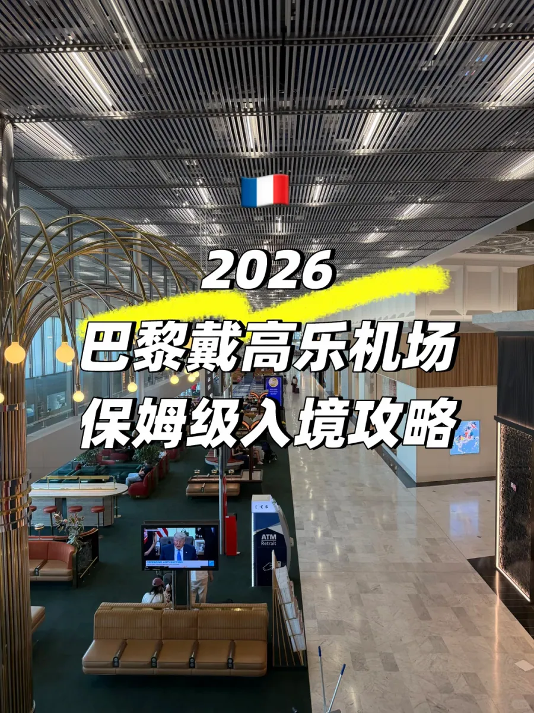
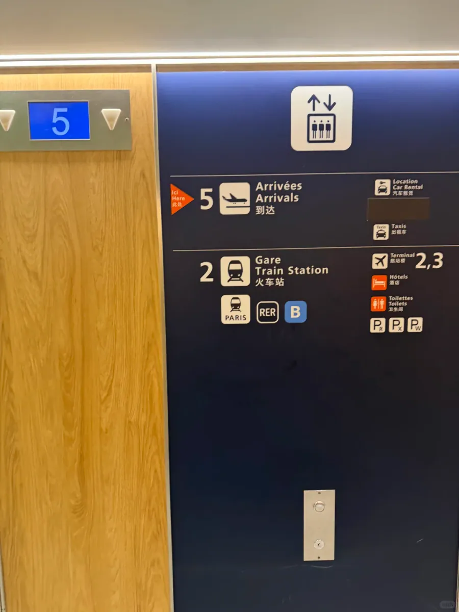

Při letu do Paříže z Dublinu se cestovatel připravil na otázky a na složku s dokumenty. Cestu ode dveří letadla k východu téměř nic nepřerušilo. Překvapil ho ale postup: žádné razítko v pase a žádný úmysl ho přidat.

Tento text zaznamenává tento přílet popořadě — čínské značky, hraniční kontrolu, proč razítko zmizelo a co dělat dál. CDG je největší letiště Francie se třemi terminály a sedmi dílčími terminály uvnitř T2, kde si přestup a východ snadno spletete. Jedno upozornění: jde o zkušenost jednoho cestovatele, ne o oficiální postup. Popsané dokumenty byly připravené, ale nikdo je nekontroloval, což není totéž jako že nebyly potřeba.

## 1. Čínské nápisy už od dveří letadla

První značka po výstupu z letadla nese tři jazyky: Correspondances / Transfer / 转机, Sortie / Exit / 出口 a Bagages / Baggage / 行李提取. Stačí se držet 出口. Čínština tu tvoří souvislou stopu od nástupního mostu až do zavazadlové haly; dokonce i sklo mostu nese kulatou samolepku Sortie / Exit / 出口 se čtyřmi šipkami.

Za ní je dlouhá prosklená chodba — vlevo odbavovací plocha a nástupní mosty, vpravo terminál — bez odboček, takže jděte s proudem a podle žlutých značek, místo abyste hledali výtah nebo logo metra.

První zavěšená značka je skutečné rozhodnutí: přestup na jednu stranu, zavazadla rovně a východ za zavazadlovou halou. Piktogramy — dvě postavy jdoucí od sebe pro přestup, kráčející postava pro východ, tvar karuselu pro zavazadla — fungují i bez francouzštiny.

Čínština se objevuje i u bran, na odbavení, u toalet a u zavazadlových pásů, což nejvíc pomůže při klidném pozdním příletu. Čínské nápisy ale neznamenají, že personál čínsky mluví; na hranicích a na celnici se stále mluví hlavně francouzsky a anglicky. Mějte v telefonu adresu hotelu a itinerář a v případě potřeby ukažte obrazovku.

## 2. Hraniční kontrola: pas, vízum, pruhy

Stejná tři slova se opakují podél celé chodby. Nevšímejte si značek s čísly bran, jako „Portes 40-68“ — to je přestupní trasa k branám, ne příletový koridor. Hledejte „Contrôle des passeports“, nebo se prostě držte proudu cestujících mimo EU.

Třídění je otázka pohledu na pas. Personál na začátku pruhů se podívá na obal v ruce a mávnutím vás pošle do fronty: pasy EU a EHP jedním směrem, všechno ostatní druhým. Čínský pas se schengenským vízem patří do pruhu mimo EU; řiďte se personálem, místo abyste hádali, která fronta jde rychleji.

U přepážky otevřete pas na stránce s vízem. V tomto případě úředník nic neřekl, podíval se na vízum, ukázal na čtečku otisků a cestovatele propustil mávnutím. Žádné otázky na účel cesty, délku pobytu ani ubytování a žádná žádost o rezervaci nebo zpáteční letenku; předem připravené dokumenty nikdo neviděl.

To ale není důvod cestovat s prázdnýma rukama. Úředníci mají prostor pro uvážení a kontroly jsou namátkové; doklady mějte v příručním zavazadle a jejich kopie v telefonu. Pas nikdy nedávejte do odbaveného zavazadla.

Otisky prstů se snímají na místě: čtyři prsty jedné ruky, pak druhé, poté oba palce, se schématy a čínskými nebo anglickými pokyny na čtečce. Počkejte, až obrazovka potvrdí, a pak si vezměte pas zpět.

Otázky, když přijdou, jsou prosté: účel, počet dní, další země, ubytování, datum odjezdu. Stačí konzistentní odpovědi a není třeba se učit žádný scénář.

## 3. Po EES: proč chybí razítko

Cestovatel požádal o razítko a dostal jasné „ne“. Francie nahradila vstupní razítko systémem EES.

EES je vstupně-výstupní systém EU, zaváděný postupně od října 2025. Nahrazuje frontu – razítko – mávnutí biometrickou registrací při prvním vstupu: údaje z pasu, snímek obličeje a otisky prstů, uchované po určitou dobu, takže další návštěvy čtou stejný záznam. Datové razítko už není potřeba.

Prázdný pas tedy neznamená žádný záznam a žádost o razítko bývá odmítnuta, protože systém už razítka nedává. Staré průvodce popisující „fronta, razítko, pár otázek“ jsou zastaralé, ne důkaz, že jste se vydali špatným směrem.

Pro povolení k pobytu, jeho prodloužení nebo zápis na univerzitě by razítko stejně nepomohlo; palubní vstupenky, elektronické jízdenky a hotelové záznamy jsou lepším dokladem, proto si je schovejte až do konce cesty.

EES platí v celém Schengenu. Registrujete se tam, kde poprvé vstoupíte, a další vstupy jinde čtou stejný záznam — proto někteří cestující, kteří přestupovali v Německu nebo Nizozemsku, už otisky dali a v Paříži nemají co dělat.

## 4. První věc po pasové kontrole

Za hranicí se chodba vlévá do zavazadlové haly, kde se značky přepínají na Bagages a Sortie a pásy mají svá čísla. Vezměte zavazadla, vyvezte vozík a projděte celním koridorem — zelený pro nic k prohlášení, červený v ostatních případech. Cestovatele nikdo nezastavil, ale kontroly jsou namátkové.

Venku jde nejdřív o dopravu. Jízdenky se dají koupit na letišti: žluté automaty „Tickets et Navigo“ na nádraží RER B nebo u přepážky SNCF. Na několik dní v Paříži vybírejte mezi jednosměrkami, denními jízdenkami a týdenní jízdenkou podle počtu dní; týdenní jízdenka se na letišti neprodává a potřebujete obsluhovanou přepážku ve městě.

Doporučení zní koupit jízdenku v aplikaci Île-de-France Mobilités a přidat ji do Apple Wallet, čímž ušetříte poplatek za kartu i frontu — registrace však obvykle vyžaduje evropské telefonní číslo.

Pozor na úrovně. Na CDG jsou příletová úroveň, nádraží a odletová úroveň oddělené a tabule u výtahů uvádí pohromadě „5 Arrivals“, „2 Train Station“ a značku RER B, vedle taxíků, hotelů, toalet a parkovišť.

Pod betonovými klenbami nádražní haly stojí automaty „Tickets et Navigo“ vedle obchodu Relay, takže jízdenky, voda i cestovní adaptér jsou na jedné úrovni. Pro Lyon, Bordeaux nebo Marseille může vysokorychlostní nádraží pod T2 ušetřit cestu do města a zpět; před koupí zkontrolujte, které nádraží je na jízdence vytištěné.

## 5. Detaily, které matou

Automatické brány nejsou pro všechny. Samoobslužné pruhy slouží pasům EU, francouzským povolením k pobytu a podobně; čínský pas pro krátkodobý pobyt obvykle nestačí. Nechoďte za lidmi před sebou přes bránu — jděte k obsluhované přepážce, na kterou vás personál nasměruje.

Žádné otázky neznamenají žádné kontroly. Mějte pas, vízum, ubytování, zpáteční letenku a pojištění v jedné přihrádce příručního zavazadla, aby vše vylezlo jediným pohybem.

Terminály jsou daleko od sebe: T1, T2 s dílčími terminály A až G a T3. Přejezd mezi terminály znamená bezplatný CDGVAL plus chůzi a čekání, proto počítejte s 30 minutami i více; při těsném přestupu si u brány ověřte, zda jsou zavazadla odbavena až do cíle.

Východ potřebuje číslo. Východy jsou rozdělené podle terminálu a příletové úrovně, proto tomu, kdo vás vyzvedává, pošlete terminál, halu a číslo východu. Venku jsou stání autobusů a autokarů s modrými sloupky QUAI C, D a E a očíslovanými stáními, například B3, pod dřevěným přístřeškem.

Připravte si i trochu jazyka: značky jsou v čínštině, personál už nemusí. Začněte „Bonjour“, podejte pas už otevřený na vízu a mluvte pomalu. Pokud otázce nerozumíte, požádejte o zopakování nebo ukažte itinerář v telefonu.

Přílet na CDG jsou tři věci: jít podle čínských značek k hranicím, odevzdat pas a vízum tam, kam vás personál nasměruje, a vyřešit dopravu ještě před odchodem z letiště. Cestovatel to označil za hladký průběh, ale ta hladkost pramení ze zjednodušeného postupu, ne ze štěstí. To byla jedna cesta v srpnu 2026; hraniční praxe, registrace v EES i jízdné se mohou změnit, proto si v den cesty ověřte francouzské oficiální a letištní informace.

## Související odkazy

- **Na tomto webu**: [Letiště Paris Charles de Gaulle (CDG)](/airport/CDG), [Francie (FR)](/country/FR)
- **Wikipedia**: [Letiště Paris Charles de Gaulle](https://en.wikipedia.org/wiki/Paris_Charles_de_Gaulle_Airport)
- **Baidu Baike**: [Letiště Paris Charles de Gaulle](https://baike.baidu.com/item/%E5%B7%B4%E9%BB%8E%E5%A4%8F%E5%B0%94%C2%B7%E6%88%B4%E9%AB%98%E4%B9%90%E6%9C%BA%E5%9C%BA)
