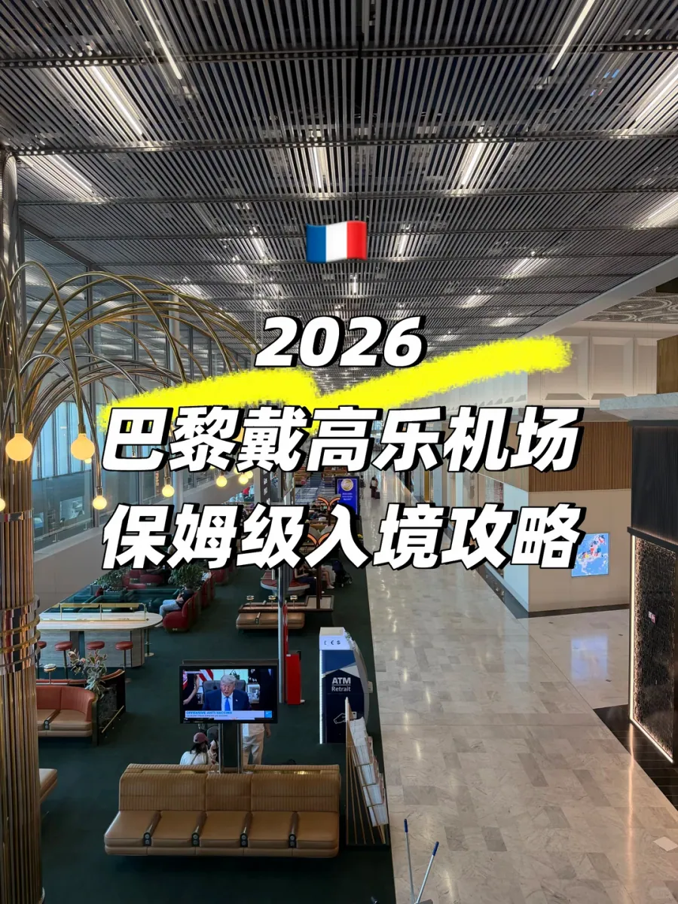

Von Dublin nach Paris, gelandet in Charles de Gaulle. Vor dem Abflug hatte der Reisende viel gelesen – ob die französische Grenze viele Fragen stellt, ob man einen ganzen Stapel Unterlagen vorbereiten muss. Dann verlief der Weg von der Flugzeugtür bis zum Ausgang fast ohne Halt. Überraschend war weniger das Tempo als der Ablauf selbst: kein Stempel im Pass, und der Beamte hatte auch nicht vor, einen zu setzen.

Dieser Bericht folgt der Reihenfolge nach der Landung: zuerst die chinesischen Schilder, dann die Passkontrolle, danach die Erklärung, warum es keinen Stempel mehr gibt, und zum Schluss die eine Sache, die nach der Kontrolle zählt. Charles de Gaulle ist Frankreichs größter Flughafen, mit drei Terminals und sieben Unterterminals in T2; beim ersten Besuch verwechselt man leicht „Transfer“ und „Ausgang“. Die chinesische Beschilderung ist hier so vollständig, dass die Sprache kein Hindernis ist – der Ablauf ist es.

Vorab eine Einordnung: Das ist eine persönliche Erfahrung, keine amtliche Beschreibung des Verfahrens. Befragung, Stichproben und Spuraufteilung entscheidet die Lage vor Ort; verschiedene Flüge und Tageszeiten können völlig unterschiedlich laufen. Die erwähnte Liste an Unterlagen heißt „vorbereitet, aber nicht angesehen“ – nicht „nicht nötig“.

## 1. Chinesische Beschilderung nach der Landung

Kaum ist die Flugzeugtür offen, hängt das erste Schild da, dreisprachig nebeneinander: „Correspondances / Transfer / 转机“, „Sortie / Exit / 出口“, „Bagages / Baggage / 行李提取“. Man muss nicht erst erkennen, welches Wort französisch ist – wer den beiden Zeichen für „Ausgang“ folgt, geht trotzdem richtig. Auf diesem Flug aus Dublin war der unmittelbare Eindruck, dass Chinesisch keine sporadische Zutat ist, sondern eine durchgehende Führung von der Fluggastbrücke über die Gänge und die Passkontrolle bis zur Gepäckhalle – selbst auf der Glastür der Fluggastbrücke klebt ein runder Aufkleber „Sortie / Exit / 出口“, daneben vier Pfeile in Richtung Ausgang.

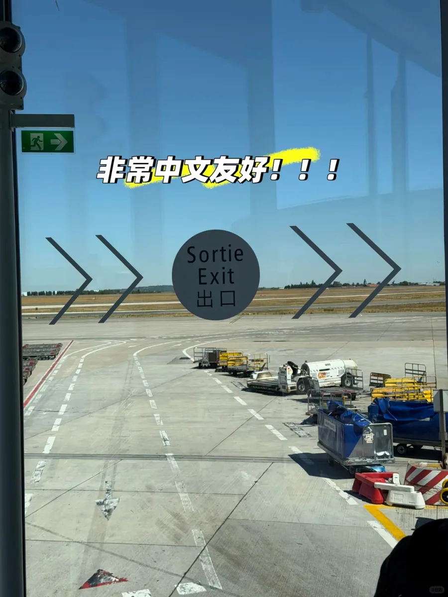

Nach der Fluggastbrücke folgt ein langer Glasgang: links das Vorfeld und die Fluggastbrücken, rechts das Terminal, und man kann nur vorwärtsgehen; erst am Ende kommt die Gabelung. Auf diesem Stück gibt es keine Abzweigung – folgen Sie dem Strom und den gelben Schildern und suchen Sie nicht eilig nach Aufzug oder Metro-Zeichen.

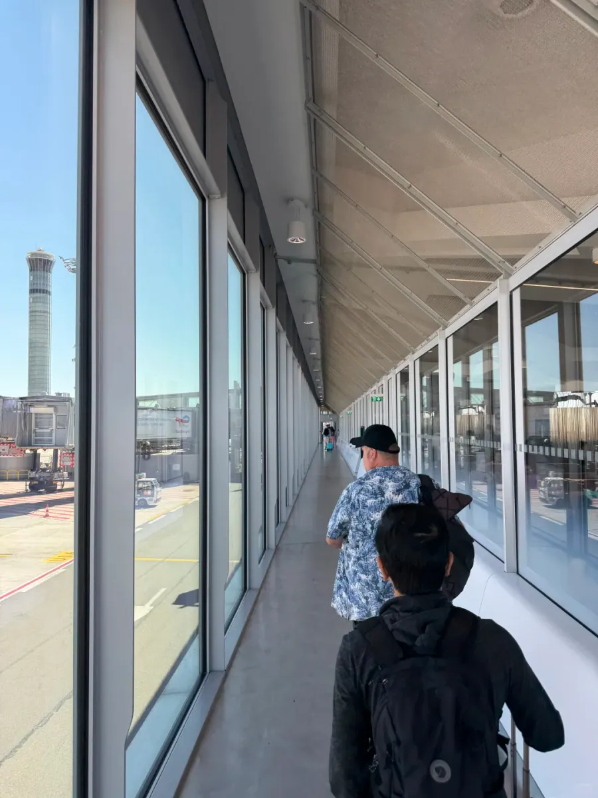

Die eigentliche Entscheidung kommt am ersten hängenden Schild: Transfer über Correspondances, Gepäck über Bagages, direkt aus dem Flughafen hinaus über Sortie. Das Schild stellt die drei Wörter mit Symbolen zusammen – zwei gegenläufig gehende Figuren für den Transfer, eine gehende Figur für den Ausgang, die Form eines Gepäckbands für das Gepäck; auch ohne Französisch lässt sich das an den Piktogrammen ablesen.

Chinesisch findet sich außerdem an den Gates, im Check-in-Bereich, an den Toiletten und an den Gepäckbändern – das hilft besonders bei einer nächtlichen Ankunft mit wenig Betrieb und müden Beinen. Aber Vorsicht: Schilder auf Chinesisch bedeuten nicht, dass das Personal Chinesisch spricht. Die Gespräche bei Passkontrolle und Zoll laufen weiterhin vor allem auf Französisch und Englisch; speichern Sie Hoteladresse, Reiseverlauf und Rückflugdatum im Handy und halten Sie den Bildschirm im Zweifel einfach hin – das ist wirksamer, als vor Ort Sätze zu bauen.

## 2. Die Passkontrolle

Von der Gabelung bis zur Passkontrolle ist es noch ein Stück, und auf dem Weg wiederholen die hängenden Schilder dieselben drei Wörter. Folgen Sie nicht Angaben wie „Portes 40-68“: Das ist die Richtung zu den Gates für Transferpassagiere, nicht der Weg zur Einreise. Halten Sie sich an „Contrôle des passeports“ oder gehen Sie einfach mit dem Strom der Nicht-EU-Reisenden.

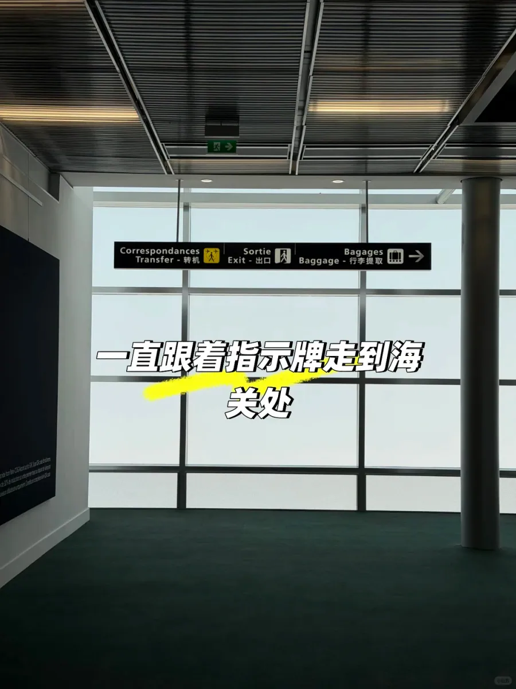

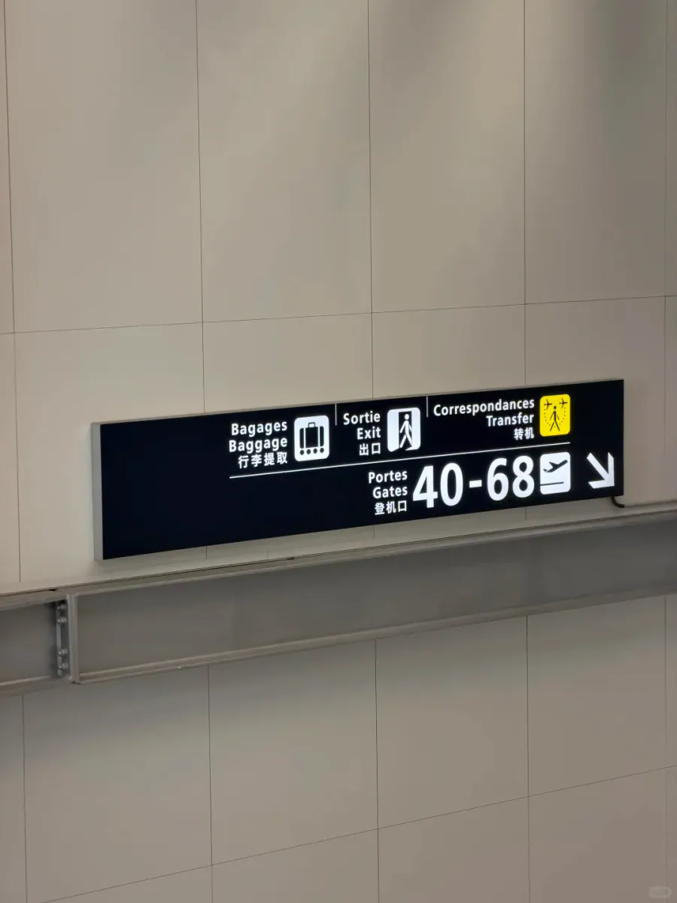

Die Aufteilung vor der Passkontrolle beginnt mit einem Blick auf den Pass. Kurz vor dem Bereich steht Personal am Zugang, sieht sich den Umschlag des Passes in Ihrer Hand an und weist Sie per Handzeichen in die passende Schlange: EU- und EWR-Pässe auf die eine Seite, alle anderen auf die andere. Mit chinesischem Pass und Schengen-Visum geht es in die Nicht-EU-Spur; Sie müssen nicht selbst abschätzen, welche Schlange schneller ist – der Anweisung des Personals zu folgen ist am sichersten.

Am Schalter schlagen Sie den Pass auf der Seite mit dem Schengen-Visum auf und reichen ihn hinein. Die tatsächliche Erfahrung: Der Beamte sagte nichts, öffnete den Pass, sah das Visum an, wies auf das Gerät für die Fingerabdrücke, und nach der Aufnahme kam der Pass zurück, begleitet von einer Handbewegung, die weitergehen hieß. Keine Frage, was man vorhabe, wo man wohne, wie lange man bleibe; auch keine Hotelbuchung und kein Rückflugticket. Die extra vorbereitete Unterkunftsbestätigung, das Rück- oder Anschlussticket, die Reiseplanung und die Reiseversicherung wurden nicht ein einziges Mal angesehen.

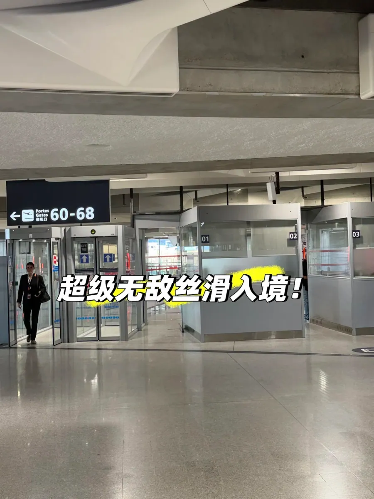

Das heißt nicht, dass man mit leeren Händen durchkommt. Die Beamten haben Ermessen, Stichproben sind zufällig; die Unterlagen im Handgepäck zu haben und eine elektronische Kopie im Handy, um sie auf Nachfrage sofort vorzeigen zu können, ist die richtige Haltung. Was Sie wirklich vermeiden sollten: Pass und Visum in den aufgegebenen Koffer zu packen – wenn Sie sie zeigen sollen, stehen Sie am Schalter und wühlen im Gepäck.

Die Fingerabdrücke werden vor Ort nach Anweisung genommen: Finger auf das Lesegerät, in der Regel zuerst vier Finger der rechten Hand, dann vier der linken, zuletzt beide Daumen; am Gerät hängen Abbildungen und Hinweise auf Chinesisch oder Englisch, folgen Sie ihnen einfach. Warten Sie nach der Aufnahme auf die Freigabe am Bildschirm und nehmen Sie dann den Pass zurück. Bei trockenen Fingern oder frisch eingecremten Händen kann das Lesen scheitern – wischen Sie die Hand ab und versuchen Sie es erneut, das ist kein Grund zur Unruhe.

Die Fragen der Beamten sind meist schlicht: Was machen Sie in Frankreich, wie viele Tage bleiben Sie, welche Länder sehen Sie noch, wo wohnen Sie, wann reisen Sie ab. Es genügt, wenn die Antworten zu Ticket, Hotel und Reiseverlauf passen; Sie müssen keinen Text auswendig lernen und die Reise nicht komplizierter darstellen, als sie ist. Tourismus heißt Tourismus, Transfer heißt Transfer – ausweichende Antworten lösen eher Rückfragen aus als einfache.

## 3. Nach EES: warum es keinen Stempel mehr gibt

Beim Vorlegen des Passes fragte der Reisende ausdrücklich, ob er einen Stempel bekommen könne; die Antwort war ein knappes „no“. Das war keine Abfertigung und keine schlechte Laune, sondern eine Systemänderung: Frankreich hat den Einreisestempel durch EES ersetzt.

EES ist das Einreise- und Ausreisesystem der EU (Entry/Exit System), das ab Oktober 2025 stufenweise eingeführt wird. Es ersetzt das bisherige „Anstehen – stempeln – durchwinken“ durch „bei der ersten Einreise biometrisch registrieren – danach anhand des Eintrags prüfen“. Kurzreisende – auch Inhaber eines chinesischen Passes mit Schengen-Visum – geben bei der ersten Einreise an der Grenze Passdaten, Lichtbild und Fingerabdrücke ab; diese Angaben bleiben eine Zeit lang im System gespeichert, und bei späteren Einreisen genügt der Rückgriff auf den Eintrag, um Ein- und Ausreisezeit zu bestätigen. Ein Datumsstempel im Pass ist dafür nicht mehr nötig.

Ein sauberer Pass bedeutet also nicht, dass keine Einreise verzeichnet ist; wer aktiv um einen Stempel bittet, wird in der Regel abgelehnt, weil es diesen Vorgang im System nicht mehr gibt. Viele blättern in alten Berichten, in denen „anstehen → Zollstempel → ein paar Fragen“ steht, und zweifeln vor Ort, ob sie im falschen Gang gelandet sind – dabei hat das Verfahren nur eine Generation gewechselt.

Der fehlende Stempel hat eine praktische Folge: Für einen Aufenthaltstitel, eine Verlängerung, die Einschreibung an einer Hochschule oder den Nachweis eines bestimmten Einreisedatums hilft ein Stempel im Pass später nicht weiter. Boardingpässe, elektronische Reisebestätigungen und Hotelbelege sind die verlässlicheren Belege – löschen Sie sie nach der Landung nicht vorschnell, sondern heben Sie sie mindestens bis zum Ende dieser Reise auf.

Wichtig ist außerdem: EES ist ein System für den gesamten Schengen-Raum, keine zusätzliche französische Etappe. Wo Sie zum ersten Mal in den Schengen-Raum einreisen, dort werden Sie registriert; bei späteren Reisen in andere Schengen-Staaten wird derselbe Eintrag gelesen. Deshalb haben manche Reisende, die über Deutschland oder die Niederlande umgestiegen sind, ihre Fingerabdrücke schon abgegeben und in Frankreich nichts mehr zu tun.

## 4. Das Erste nach der Kontrolle

Nach der Passkontrolle schickt der Gang die Reisenden in die Gepäckhalle, über der jetzt „Bagages / Baggage / 行李提取“ und „Sortie / Exit / 出口“ hängen, und über den Bändern stehen die Nummern der Umläufe. Nehmen Sie das Gepäck, schieben Sie den Wagen zum Ausgang, und davor kommt der Zollkanal, meist in zwei Spuren: grün für nichts zu verzollen, rot für Waren mit Anmeldung. Diesmal gab es keine Kontrolle des Koffers, aber Stichproben sind zufällig – die grüne Spur bedeutet nicht, dass niemand Sie aufhält.

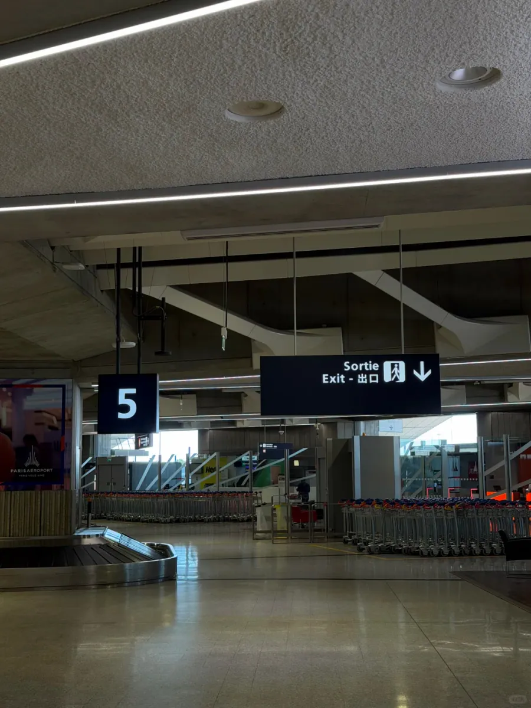

Draußen geht es zuerst um den Transport. Die Fahrkarten für Charles de Gaulle bekommen Sie schon am Flughafen: an den gelben Automaten „Tickets et Navigo“ im RER-B-Bahnhof und am SNCF-Schalter, dort als Karte oder als Einzelfahrschein. Wer in die Stadt will und einige Tage bleibt, wählt nach Tagen zwischen Einzelfahrt, Tageskarte und Wochenkarte; die Wochenkarte gibt es am Flughafen nicht, sie wird erst in der Stadt am besetzten Schalter ausgestellt – das sollten Sie vorher wissen, damit Sie nicht immer wieder im Menü der Automaten suchen.

Praktischer ist: Wenn Sie über die App von Île-de-France Mobilités kaufen und das Ticket in Apple Wallet legen können, nutzen Sie die App – das spart die Kartengebühr und das Anstehen. Der Preis dafür ist, dass die Registrierung meist eine europäische Handynummer verlangt; wer keine hat, bleibt bei der Karte aus Kunststoff.

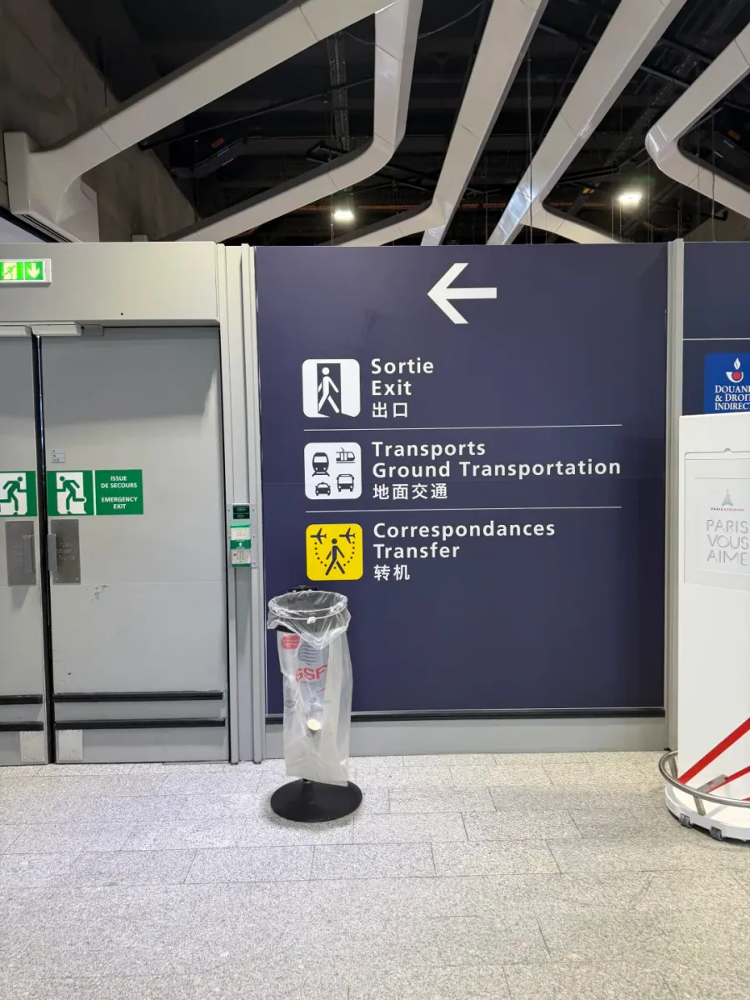

Achten Sie beim Suchen zuerst auf die Ebene. In Charles de Gaulle liegen Ankunftsebene, Bahnhofsebene und Abflugebene getrennt, und das Schild am Aufzug stellt „5 Ankunft“, „2 Bahnhof“ und das RER-B-Zeichen nebeneinander, rechts daneben Taxi, Hotel, Toiletten und Parkplätze; wer die Etage zuerst liest und dann drückt, ist deutlich schneller, als im Terminal im Kreis zu laufen.

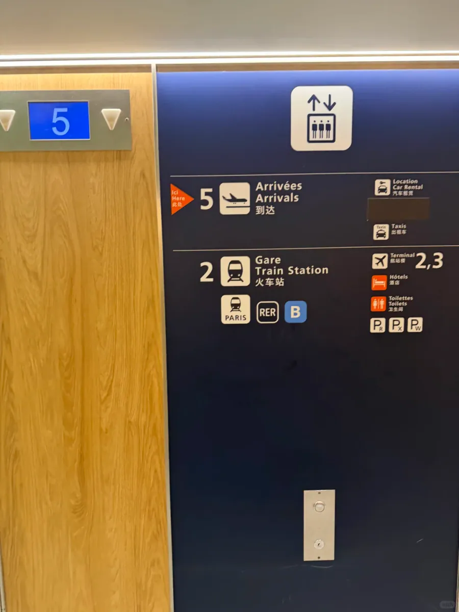

Unter den Betongewölben der Bahnhofshalle stehen die Automaten „Tickets et Navigo“ neben einem Relay-Laden, sodass Fahrkarte, Wasser und Reiseadapter auf derselben Ebene zu bekommen sind. Wer nicht nach Paris, sondern nach Lyon, Bordeaux oder Marseille will, kann den Hochgeschwindigkeitsbahnhof unter T2 direkt nehmen und muss nicht erst in die Stadt und zurück; prüfen Sie vor dem Kauf, welcher Bahnhof auf dem Ticket steht, und verwechseln Sie nicht „einen Bahnhof in Paris“ mit dem „TGV-Bahnhof am Flughafen“.

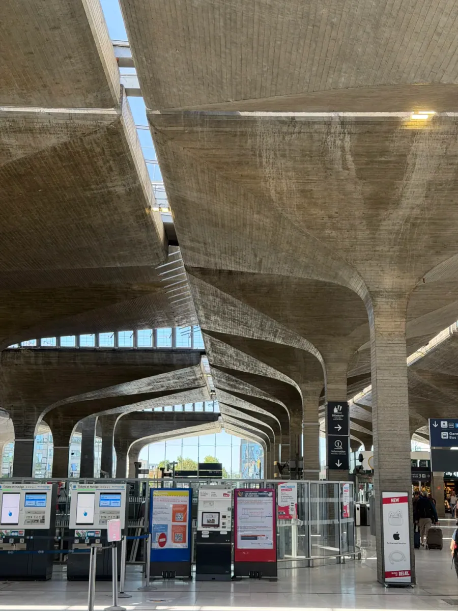

## 5. Häufige Fehlannahmen

Erstens: Die Automatik-Gates sind nicht für alle. Neben der Passkontrolle gibt es eine Reihe automatischer Spuren für EU-Pässe und Inhaber einer französischen Aufenthaltskarte; für Kurzreisende mit chinesischem Pass gilt das in der Regel nicht. Wenn die Leute vor Ihnen den Pass auflegen und durchgehen, folgen Sie ihnen nicht, sondern gehen Sie an den besetzten Schalter, zu dem das Personal Sie schickt – so werden Sie nicht am Gate aufgehalten und müssen zurück.

Zweitens: Keine Fragen heißt nicht keine Prüfung. Diesmal gab es keine Fragen und keine Kontrolle der Unterlagen, aber die Beamten können beim nächsten Flug sehr wohl genauer nachfragen. Legen Sie Pass, Visum, Unterkunftsnachweis, Rückflugticket und Versicherung in dasselbe Fach des Handgepäcks, dann kommen sie auf einmal heraus – das wirkt souveräner, als alles einzeln zu suchen.

Drittens: Die Terminals liegen weit auseinander. Charles de Gaulle hat die Terminals T1, T2 und T3, und T2 ist noch in die sieben Unterterminals A bis G geteilt; für einen Transfer oder einen Terminalwechsel brauchen Sie den kostenlosen CDGVAL plus Fußwege und Wartezeit, planen Sie also gut 30 Minuten ein. Bei knapper Umsteigezeit prüfen Sie am Gate zuerst, ob das Gepäck durchgecheckt ist, und entscheiden Sie dann, ob Sie überhaupt aus dem Transitbereich gehen.

Viertens: Für den Ausgang und das Abholen braucht es eine genaue Nummer. Die Ausgänge in Charles de Gaulle sind nach Terminal und Ankunftsebene gegliedert; „hol mich in CDG ab“ hilft niemandem. Schicken Sie der abholenden Person Terminal, Halle und Ausgangsnummer, dann kann sie das Auto an der richtigen Stelle abstellen. Direkt vor dem Ausgang liegen die Haltestellen der Fernbusse und Flughafenbusse, mit blauen Pfeilern, auf denen QUAI C, D, E steht, und unter dem hölzernen Vordach Nummern wie B3.

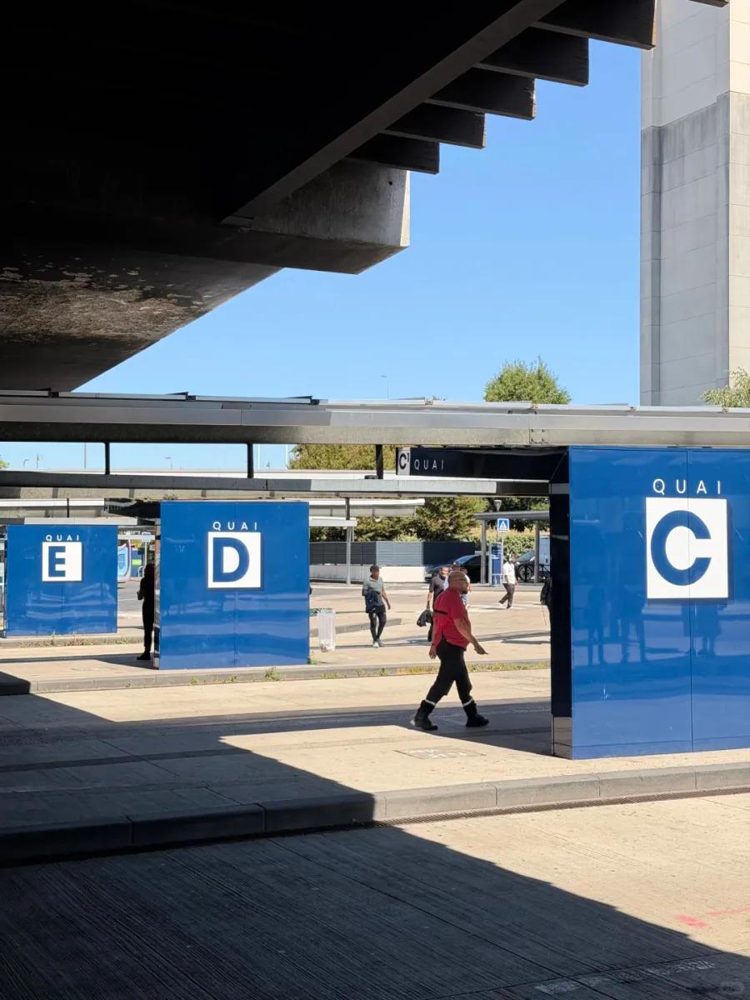

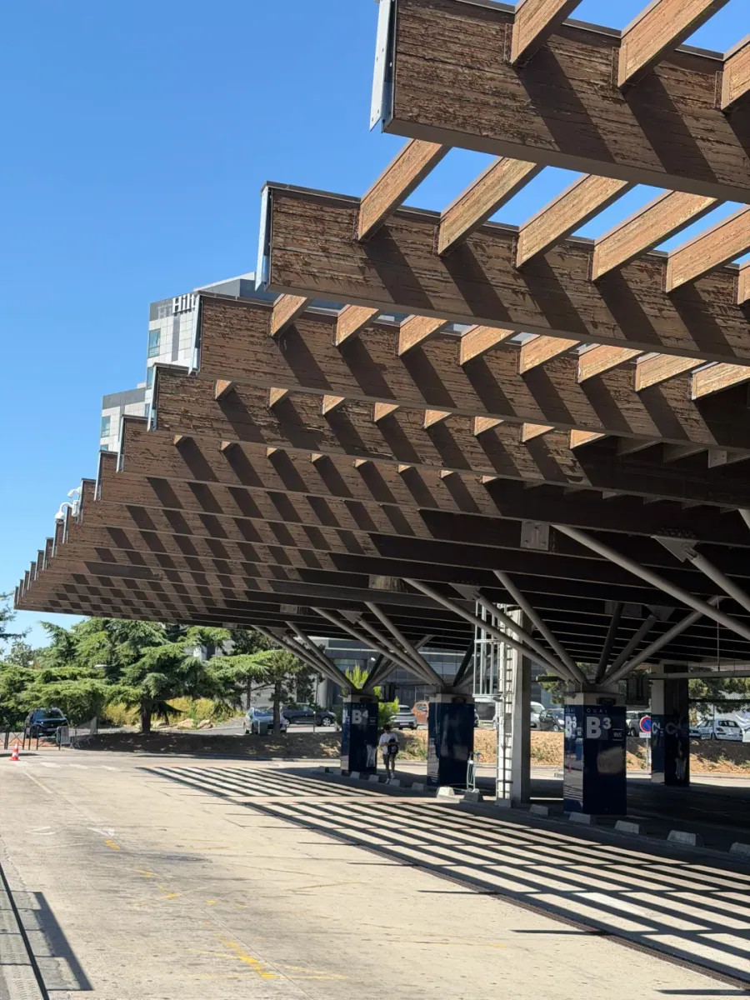

Fünftens: Die sprachliche Vorbereitung ist wichtiger, als man denkt. Die Schilder sind auf Chinesisch, die Passkontrolle und der Zoll nicht unbedingt. Mit einem „Bonjour“ zu beginnen, den Pass schon auf der Visumseite aufgeschlagen zu überreichen und beim Antworten den Gegenüber anzusehen und langsam zu sprechen, hilft mehr als eine eingeübte lange Antwort. Wenn Sie eine Frage nicht verstehen, bitten Sie um Wiederholung oder halten Sie die Reiseplanung im Handy hin.

Alles zusammengenommen sind es bei der Einreise in Charles de Gaulle nur drei Dinge: den chinesischen Schildern bis zur Passkontrolle folgen, dort Pass und Visum nach der Anweisung des Personals vorlegen und nach der Kontrolle zuerst den Transport klären, bevor Sie den Flughafen verlassen. Dieser Flug aus Dublin fühlte sich durchweg flüssig an – aber die Flüssigkeit kommt daher, dass das Verfahren selbst einfacher geworden ist, nicht vom Glück. Im August 2026 ist ein Reisender diesen Weg so gegangen; Ablauf der Passkontrolle, Form der EES-Registrierung und Fahrpreise können sich ändern – maßgeblich sind vor der Abreise die aktuellen Angaben der französischen Behörden und des Flughafens.

## Weiterführende Links

- **Auf dieser Website**: [Flughafen Paris Charles de Gaulle (CDG)](/airport/CDG), [Frankreich (FR)](/country/FR)
- **Wikipedia**: [Flughafen Paris Charles de Gaulle](https://en.wikipedia.org/wiki/Paris_Charles_de_Gaulle_Airport)
- **Baidu Baike**: [Flughafen Paris Charles de Gaulle](https://baike.baidu.com/item/%E5%B7%B4%E9%BB%8E%E5%A4%8F%E5%B0%94%C2%B7%E6%88%B4%E9%AB%98%E4%B9%90%E6%9C%BA%E5%9C%BA)
