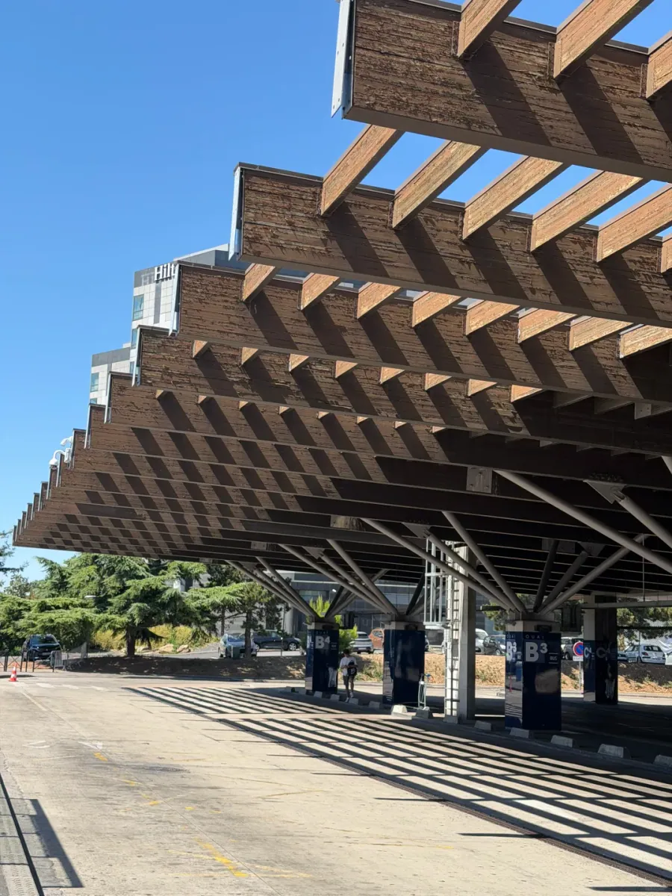

ダブリンからパリへ飛んだ旅行者は、質問に備えて書類のファイルを用意していました。しかし航空機の扉から出口までの道のりで、ほとんど何も止められませんでした。驚いたのは手続きです。パスポートにスタンプは押されず、押す気配もありませんでした。

この記事はその到着を順に記録します。中国語の看板、入国審査、スタンプがなくなった理由、次にすべきことです。CDGはフランス最大の空港で、3つのターミナルとT2内の7つのサブターミナルがあり、乗り継ぎと出口を混同しやすい場所です。ただし注意点があります。これは一人の旅行者の体験であり、公式の手続きではありません。紹介する書類は用意したものの検査されなかっただけで、不要だったわけではありません。

## 1. 航空機の扉からの中国語案内

航空機を降りて最初の看板は3言語で書かれています。Correspondances / Transfer / 转机、Sortie / Exit / 出口、Bagages / Baggage / 行李提取です。「出口」の表示に従えば十分です。ここでは中国語が搭乗橋から手荷物ロビーまで途切れずに続いており、搭乗橋のガラスにさえ、4本の矢印が付いた円形の「Sortie / Exit / 出口」ステッカーがあります。

その先は長いガラスの通路です。左にエプロンと搭乗橋、右にターミナルがあり、曲がり角はありません。エレベーターやメトロのマークを探すより、人の流れと黄色い看板に従いましょう。

最初の吊り下げ看板が本当の分岐点です。乗り継ぎは片側、手荷物は前方、出口は手荷物ロビーの先です。ピクトグラムは、2人が離れて歩く絵が乗り継ぎ、歩く人物が出口、ターンテーブルの形が手荷物を表し、フランス語がわからなくても機能します。

中国語はゲート、チェックイン、トイレ、手荷物ベルトにも表示されており、静かな深夜到着のときに最も役立ちます。ただし看板が中国語だからといって、スタッフが話せるわけではありません。入国審査や税関での会話は、今も主にフランス語と英語です。ホテルの住所と旅程をスマートフォンに入れておき、必要なら画面を見せましょう。

## 2. 入国審査：パスポート、ビザ、レーン

同じ3つの単語が通路沿いに繰り返し現れます。「Portes 40-68」のようなゲート番号の看板は無視してください。それはゲートへの乗り継ぎルートで、到着客の通路ではありません。「Contrôle des passeports」を探すか、EU外の人の流れに従うだけで十分です。

振り分けはパスポートを一目見るだけです。レーンの先頭のスタッフが手に持った表紙を見て、列へ誘導します。EU・EEAのパスポートはこちら、それ以外はあちらです。シェンゲンビザを持つ中国パスポートはEU外レーンへ進みます。どちらの列が速いかを推測するより、スタッフの指示に従いましょう。

窓口ではパスポートをビザのページで開きます。このときは係員が何も言わず、ビザを見て、指紋読み取り機を指し示し、旅行者を手で通しました。目的、滞在期間、宿泊先についての質問も、予約や帰国便の提示要求もなく、事前に用意した書類は一度も見られませんでした。

だからといって手ぶらで行く理由にはなりません。係員には裁量があり、検査は抜き打ちです。書類は機内持ち込み手荷物に入れ、スマートフォンにもコピーを保存してください。パスポートを受託手荷物に入れて預けてはいけません。

指紋はその場で採取します。片手の4本の指、次にもう片方の4本、最後に両方の親指です。読み取り機には図と中国語または英語の案内が表示されます。画面の確認を待ってから、パスポートを受け取ります。

質問が出る場合も単純です。目的、日数、ほかの訪問国、宿泊先、出国日。一貫した回答があれば十分で、暗記する台本はありません。

## 3. EESの後：スタンプがない理由

旅行者がスタンプを求めると、きっぱり「No」と言われました。フランスは入国スタンプをEESに置き換えたのです。

EESはEUのEntry/Exit System（入出国システム）で、2025年10月から段階的に導入されています。初回入国時に生体認証で登録することで、列に並ぶ・スタンプを押す・通すという流れに代わります。パスポート情報、顔画像、指紋を一定期間保存し、後の訪問時には同じ記録を読み出します。日付のスタンプは必要ありません。

したがって、パスポートに何も押されていなくても記録がないわけではありません。スタンプを求めても通常は断られるのは、システムがもうスタンプを押さないからです。「列に並び、スタンプをもらい、いくつか質問に答える」と書いた古いガイドは、道を間違えた証拠ではなく、情報が古いだけです。

在留許可、更新、大学の登録には、スタンプはそもそも役に立ちません。搭乗券、eチケット、ホテルの記録のほうがよい証拠になるので、旅行が終わるまで保管してください。

EESはシェンゲン域内共通です。最初に入国した場所で登録し、その後ほかの国から入国しても同じ記録を読み出します。ドイツやオランダで乗り継いだ旅行者が、すでに指紋を提出済みで、パリでは何もすることがない、ということがあるのはそのためです。

## 4. 入国審査の後に最初にすること

入国審査を過ぎると、通路は手荷物ロビーに出ます。看板はBagagesとSortieに変わり、ベルトには番号が付いています。荷物を受け取り、カートを押して外へ出て、税関のチャネルを通ります。申告なしなら緑、それ以外は赤です。旅行者は止められませんでしたが、検査は抜き打ちです。

外に出たら、まず交通です。カードは空港で買えます。RER B駅にある黄色い「Tickets et Navigo」券売機か、SNCFカウンターです。パリに数日滞在するなら、日数を見て、単券、1日券、週間パスのどれにするか決めます。週間パスは空港では販売しておらず、市内の有人カウンターが必要です。

おすすめはÎle-de-France Mobilitésのアプリで購入し、切符をApple Walletに追加する方法です。カード発行手数料と列に並ぶ手間が省けますが、登録には通常ヨーロッパの電話番号が必要です。

階に注意してください。CDGでは到着、駅、出発の階が分かれており、エレベーター横の案内板に「5 Arrivals」「2 Train Station」とRER Bのマークがまとめて表示され、タクシー、ホテル、トイレ、駐車場も並んでいます。

駅ホールのコンクリートの穹窿の下には、「Tickets et Navigo」券売機がRelayショップの隣に並び、切符、水、変換プラグが同じ階で揃います。リヨン、ボルドー、マルセイユへ行くなら、T2の下の高速鉄道駅を使えば市内へ出て戻る手間が省けます。買う前に切符に印刷された駅を確認してください。

## 5. 誤解を招く細部

自動改札は誰にでも使えるわけではありません。セルフレーンの対象はEUパスポート、フランスの在留許可などで、短期滞在の中国パスポートは通常対象外です。前の人について改札を通らず、スタッフが示す有人窓口へ行ってください。

質問がないことは検査がないことを意味しません。パスポート、ビザ、宿泊先、帰国便、保険を機内持ち込み手荷物の同じポケットにまとめ、一度に取り出せるようにしてください。

ターミナルは離れています。T1、サブターミナルA〜Gを持つT2、T3です。ターミナルを移動するには無料のCDGVALに加えて徒歩と待ち時間が必要なので、30分以上見ておきましょう。乗り継ぎが迫っている場合は、ゲートで荷物がスルーチェックインされているか確認してください。

出口には番号が必要です。出口はターミナルと到着階ごとにまとまっているので、迎えに来る人にはターミナル、ホール、出口番号を伝えてください。外にはコーチとバスの乗り場があり、青い柱にQUAI C、D、E、木製の屋根の下にB3などの番号付き乗り場があります。

言葉の準備も少ししておきましょう。看板は中国語でも、スタッフが話せるとは限りません。「Bonjour」と挨拶し、ビザのページを開いたパスポートを渡し、ゆっくり話します。質問がわからなければ、もう一度尋ねるか、スマートフォンの旅程を見せてください。

CDGの到着は3つに尽きます。中国語の看板に従って入国審査へ行き、スタッフの指示に従ってパスポートとビザを渡し、空港を出る前に交通を確保することです。旅行者は「スムーズだった」と語りましたが、そのスムーズさは運ではなく手続きの簡素化によるものです。これは2026年8月の一人の旅行者の体験です。入国審査の運用、EES登録、交通運賃は変わる可能性があるため、当日はフランスの公式情報と空港の情報を確認してください。

## 関連リンク

- **このサイト内**：[パリ＝シャルル・ド・ゴール空港 (CDG)](/airport/CDG)、[フランス (FR)](/country/FR)
- **Wikipedia**：[パリ＝シャルル・ド・ゴール空港](https://en.wikipedia.org/wiki/Paris_Charles_de_Gaulle_Airport)
- **百度百科**：[パリ＝シャルル・ド・ゴール空港](https://baike.baidu.com/item/%E5%B7%B4%E9%BB%8E%E5%A4%8F%E5%B0%94%C2%B7%E6%88%B4%E9%AB%98%E4%B9%90%E6%9C%BA%E5%9C%BA)
