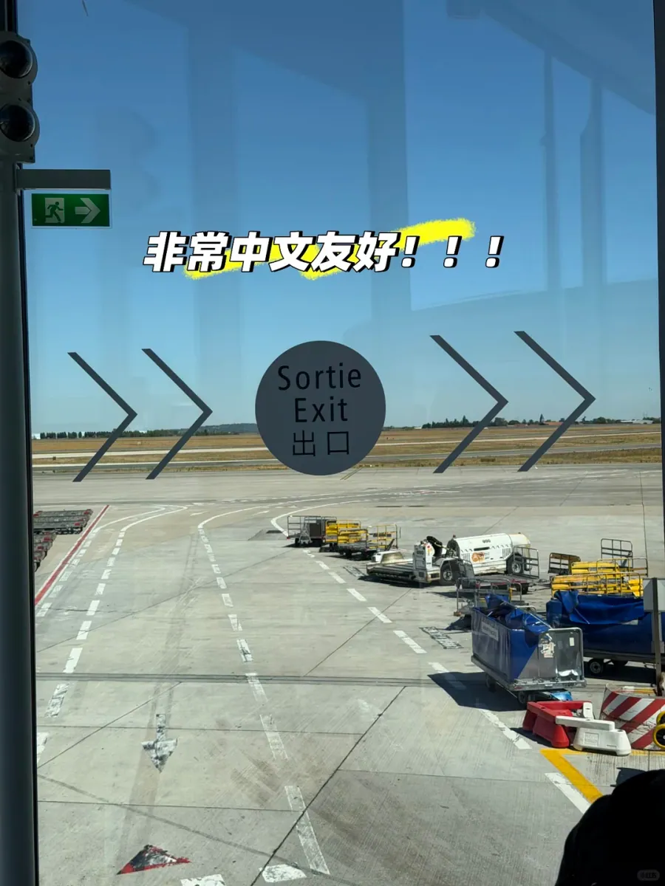

Lecąc do Paryża z Dublina, podróżny przygotował się na pytania i teczkę dokumentów. Niemal nic nie zakłóciło przejścia od drzwi samolotu do wyjścia. Zaskoczyła procedura: brak pieczątki w paszporcie i brak zamiaru jej wstawienia.

Ten tekst opisuje ten przylot po kolei — chińskie znaki, kontrolę graniczną, dlaczego pieczątka zniknęła i co robić dalej. CDG to największy port lotniczy Francji, z trzema terminalami i siedmioma podterminalami w obrębie T2, gdzie przesiadkę i wyjście łatwo pomylić. Jedno zastrzeżenie: to doświadczenie jednego podróżnego, nie oficjalna procedura. Opisane dokumenty były przygotowane, ale nie sprawdzane, co nie znaczy, że nie były potrzebne.

## 1. Chińskie oznakowanie od drzwi samolotu

Pierwszy znak po wyjściu z samolotu ma trzy języki: Correspondances / Transfer / 转机, Sortie / Exit / 出口 i Bagages / Baggage / 行李提取. Wystarczy iść za 出口. Chiński tworzy tu ciągły szlak od rękawa do hali bagażowej; nawet szyba rękawa ma okrągłą naklejkę Sortie / Exit / 出口 z czterema strzałkami.

Za nią ciągnie się długi szklany korytarz — płyta i rękawy po lewej, terminal po prawej — bez zakrętów, więc podążaj za przepływem i żółtymi znakami, zamiast szukać windy lub logo metra.

Pierwszy podwieszany znak to prawdziwa decyzja: przesiadka w jedną stronę, bagaż prosto, wyjście za halą bagażową. Piktogramy — dwie postacie idące w różne strony dla przesiadek, idąca postać dla wyjścia, kształt karuzeli dla bagażu — działają nawet bez francuskiego.

Chiński pojawia się też przy bramkach, odprawie, toaletach i taśmach bagażowych, co najbardziej pomaga przy spokojnym późnym przylocie. Ale oznakowanie po chińsku nie znaczy, że personel nim mówi; rozmowy na granicy i w odprawie celnej nadal prowadzone są głównie po francusku i angielsku. Trzymaj adres hotelu i plan podróży w telefonie i pokaż ekran, jeśli zajdzie potrzeba.

## 2. Kontrola graniczna: paszport, wiza, pasy

Te same trzy słowa powtarzają się wzdłuż korytarza. Ignoruj znaki z numerami bramek, takie jak "Portes 40-68" — to trasa przesiadkowa do bramek, a nie kanał przylotów. Szukaj "Contrôle des passeports" albo po prostu idź za przepływem podróżnych spoza UE.

Sortowanie to rzut oka na paszport. Personel na początku pasów patrzy na okładkę w twojej ręce i kieruje cię do kolejki: paszporty UE i EOG w jedną stronę, wszystko inne w drugą. Chiński paszport z wizą Schengen trafia na pas dla podróżnych spoza UE; idź za personelem, zamiast zgadywać, która kolejka rusza szybciej.

Przy okienku otwórz paszport na wizie. W tym przypadku funkcjonariusz nic nie powiedział, spojrzał na wizę, wskazał czytnik odcisków palców i machnął podróżnemu, by przeszedł. Żadnych pytań o cel, długość pobytu ani nocleg, żadnej prośby o rezerwację lub bilet powrotny; przygotowane wcześniej dokumenty nie zostały nawet obejrzane.

To nie powód, by podróżować z pustymi rękami. Funkcjonariusze mają uznaniowość, a kontrole są wyrywkowe; trzymaj dokumenty w bagażu podręcznym, z kopiami w telefonie. Nigdy nie oddawaj paszportu do bagażu nadawanego.

Odcisków palców pobiera się na miejscu: cztery palce jednej dłoni, potem drugiej, następnie oba kciuki, z instrukcjami i komunikatami po chińsku lub angielsku na czytniku. Poczekaj na potwierdzenie na ekranie, a potem odbierz paszport.

Pytania, gdy się pojawiają, są proste: cel, liczba dni, inne kraje, nocleg, data wyjazdu. Spójne odpowiedzi wystarczą, a żadnego skryptu nie trzeba się uczyć.

## 3. Po EES: dlaczego nie ma pieczątki

Podróżny poprosił o pieczątkę i usłyszał krótkie "nie". Francja zastąpiła pieczątkę wjazdową systemem EES.

EES to unijny system wjazdu/wyjazdu (Entry/Exit System), wprowadzany etapami od października 2025 roku. Zastępuje kolejkę–pieczątkę–machnięcie ręką rejestracją biometryczną przy pierwszym wjeździe: dane paszportowe, obraz twarzy i odciski palców, przechowywane przez określony czas, więc kolejne wizyty odczytują ten sam rekord. Pieczątka z datą nie jest potrzebna.

Czysty paszport nie oznacza więc braku wpisu, a prośba o pieczątkę jest zwykle odrzucana, bo system już tego nie robi. Stare przewodniki opisujące "kolejka, pieczątka, kilka pytań" są nieaktualne, a nie dowodem, że skręciłeś w złą stronę.

Przy pozwoleniu na pobyt, przedłużeniu czy rejestracji na uniwersytecie pieczątka i tak by nie pomogła; karty pokładowe, e-bilety i potwierdzenia hotelowe są lepszym dowodem, więc zachowaj je do końca podróży.

EES działa w całej strefie Schengen. Rejestrujesz się tam, gdzie pierwszy raz wjeżdżasz, a kolejne wjazdy gdzie indziej odczytują ten sam rekord — dlatego niektórzy podróżni, którzy przesiadali się przez Niemcy lub Holandię, oddali już odciski palców i w Paryżu nie mają nic do zrobienia.

## 4. Pierwsza rzecz po kontroli granicznej

Za granicą korytarz przechodzi w halę bagażową, gdzie znaki zmieniają się na Bagages i Sortie, a taśmy mają swoje numery. Odbierz bagaże, wypchnij wózek i przejdź kanał celny — zielony, jeśli nie masz nic do zadeklarowania, czerwony w przeciwnym razie. Podróżnego nie zatrzymano, ale kontrole są wyrywkowe.

Na zewnątrz najpierw transport. Karty można kupić na lotnisku: żółte automaty "Tickets et Navigo" na stacji RER B albo w kasie SNCF. Przy kilku dniach w Paryżu wybieraj między biletami jednorazowymi, dziennymi i tygodniowym, licząc dni; bilet tygodniowy nie jest sprzedawany na lotnisku i wymaga kasy z personelem w mieście.

Rada jest taka, by kupować w aplikacji Île-de-France Mobilités i dodawać bilet do Apple Wallet, oszczędzając opłatę za kartę i kolejkę — choć rejestracja zwykle wymaga europejskiego numeru telefonu.

Uważaj na poziomy. Na CDG przyloty, stacja i odloty są na osobnych poziomach, a tablica przy windach łączy "5 Arrivals", "2 Train Station" i znak RER B, z taksówkami, hotelami, toaletami i parkingami obok.

Pod betonowymi sklepieniami hali dworca automaty "Tickets et Navigo" stoją obok sklepu Relay, więc bilety, woda i przejściówka do gniazdka są na jednym poziomie. Dla Lyonu, Bordeaux lub Marsylii stacja szybkiej kolei pod T2 może oszczędzić podróż do miasta i z powrotem; przed zakupem sprawdź dworzec wydrukowany na bilecie.

## 5. Szczegóły, które mylą

Bramki automatyczne nie są dla wszystkich. Pasy samoobsługowe są dla paszportów UE, francuskich pozwoleń na pobyt i podobnych dokumentów; chiński paszport na krótki pobyt zwykle się nie kwalifikuje. Nie idź za ludźmi przed sobą przez bramkę — podejdź do stanowiska z personelem, na które personel cię wskazuje.

Brak pytań nie oznacza braku kontroli. Trzymaj paszport, wizę, potwierdzenie noclegu, bilet powrotny i ubezpieczenie w jednej kieszeni bagażu podręcznego, żeby wyjąć je jednym ruchem.

Terminale są daleko od siebie: T1, T2 z podterminalami A do G oraz T3. Zmiana terminala oznacza bezpłatny CDGVAL plus chodzenie i czekanie, więc zaplanuj 30 minut lub więcej; przy krótkiej przesiadce potwierdź przy bramce, czy bagaż jest nadany na całą trasę.

Wyjście potrzebuje numeru. Wyjścia są pogrupowane według terminala i poziomu przylotów, więc wyślij terminal, halę i numer wyjścia osobie, która cię odbiera. Na zewnątrz są stanowiska autokarów i autobusów, z niebieskimi filarami oznaczonymi QUAI C, D i E oraz numerowanymi stanowiskami, takimi jak B3, pod drewnianym zadaszeniem.

Przygotuj też trochę języka: znaki są po chińsku, personel może nie być. Zacznij od "Bonjour", podaj paszport już otwarty na wizie i mów powoli. Jeśli pytanie jest niejasne, poproś o powtórzenie lub pokaż plan podróży w telefonie.

Przylot na CDG to trzy rzeczy: idź za chińskimi znakami do granicy, podaj paszport i wizę tam, gdzie wskazuje personel, i ogarnij transport przed opuszczeniem lotniska. Podróżny nazwał to płynnym, ale płynność wynika z uproszczonej procedury, nie ze szczęścia. To był jeden przebieg jednego podróżnego w sierpniu 2026 roku; praktyka graniczna, rejestracja EES i ceny transportu mogą się zmienić, więc sprawdź oficjalne informacje francuskie i lotniskowe w dniu podróży.

## Powiązane linki

- **Na tej stronie**: [Port lotniczy Paryż Charles de Gaulle (CDG)](/airport/CDG), [Francja (FR)](/country/FR)
- **Wikipedia**: [Port lotniczy Paryż Charles de Gaulle](https://en.wikipedia.org/wiki/Paris_Charles_de_Gaulle_Airport)
- **Baidu Baike**: [Port lotniczy Paryż Charles de Gaulle](https://baike.baidu.com/item/%E5%B7%B4%E9%BB%8E%E5%A4%8F%E5%B0%94%C2%B7%E6%88%B4%E9%AB%98%E4%B9%90%E6%9C%BA%E5%9C%BA)
