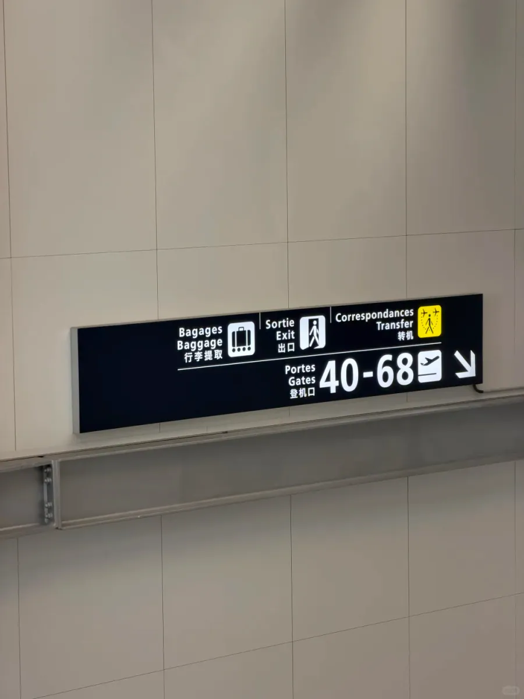
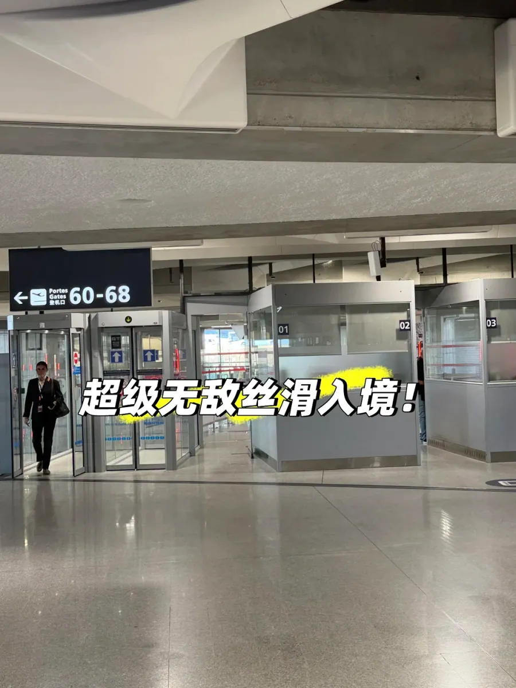
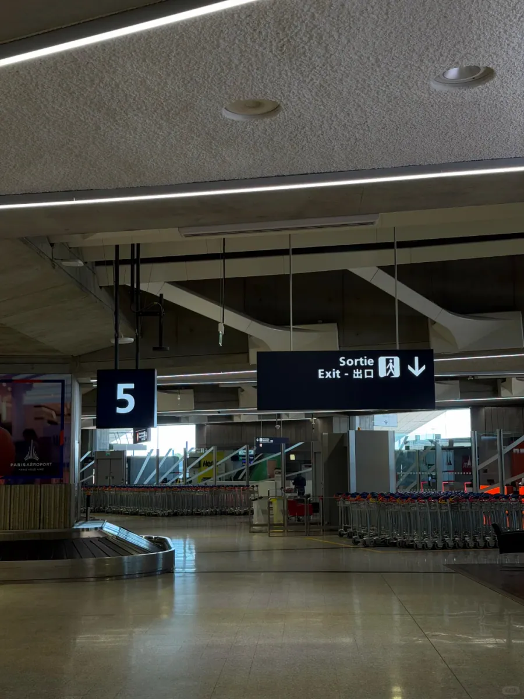
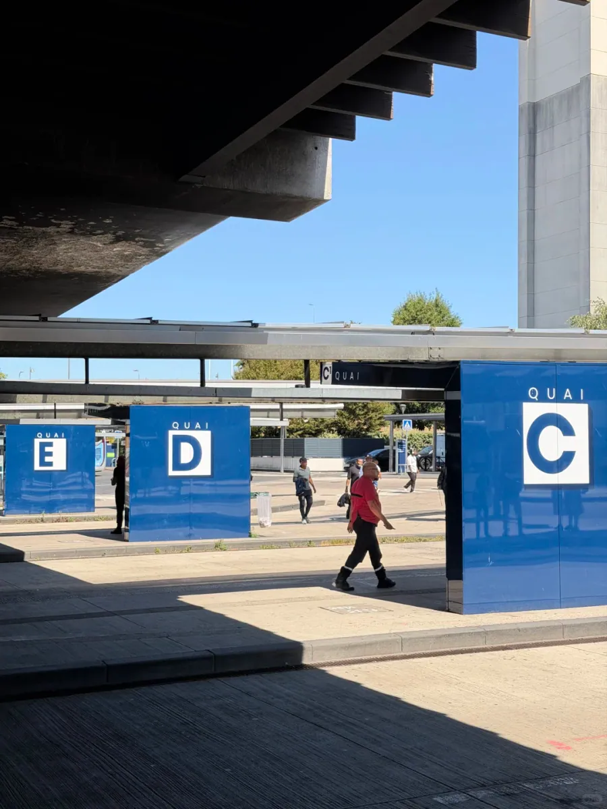

När resenären flög in till Paris från Dublin hade hen förberett sig på frågor och en mapp med dokument. Nästan inget avbröt promenaden från flygplansdörren till utgången. Det som förvånade var rutinen: ingen stämpel i passet, och ingen avsikt att sätta dit någon.

Här skildras den ankomsten i ordning – de kinesiska skyltarna, gränskontrollen, varför stämpeln har försvunnit och vad du gör härnäst. CDG är Frankrikes största flygplats, med tre terminaler och sju delterminaler i T2, där byte och utgång är lätta att blanda ihop. En brasklapp: det här är en resenärs erfarenhet, inte en officiell rutin. Dokumenten som beskrivs hade förberetts men kontrollerades inte, vilket inte betyder att de inte behövs.

## 1. Kinesisk skyltning från flygplansdörren

Den första skylten när du lämnar flygplanet har tre språk: Correspondances / Transfer / 转机, Sortie / Exit / 出口 och Bagages / Baggage / 行李提取. Det räcker att följa 出口. Kinesiskan här bildar en sammanhängande väg från ombordstigningsbryggan till bagagehallen; till och med glaset på bryggan har en rund dekal med Sortie / Exit / 出口 och fyra pilar.

Bortom den finns en lång glaskorridor – uppställningsplattan och ombordstigningsbryggorna till vänster, terminalen till höger – utan avtagsvägar, så följ flödet och de gula skyltarna i stället för att leta efter en hiss eller en tunnelbanelogotyp.

Den första hängande skylten är det verkliga beslutet: byte till ena sidan, bagage rakt fram, utgång förbi bagagehallen. Piktogrammen – två figurer som går ifrån varandra för byten, en gående figur för utgången, en karusellform för bagage – fungerar även utan franska.

Kinesiska finns också vid gater, incheckning, toaletter och bagageband, vilket hjälper mest vid en lugn sen ankomst. Men skyltning på kinesiska betyder inte att personalen talar det; samtalen vid gräns och tull förs fortfarande mest på franska och engelska. Ha hotelladressen och resplanen i telefonen och visa skärmen om det behövs.

## 2. Gränskontroll: pass, visum, köer

Samma tre ord upprepas längs korridoren. Ignorera skyltar med gatenummer som "Portes 40-68" – det är transfervägen till gaterna, inte ankomstkanalen. Leta efter "Contrôle des passeports" eller följ helt enkelt flödet för resenärer utanför EU.

Sorteringen sker med en blick på passet. Personalen längst fram vid köerna tittar på omslaget i din hand och vinkar dig till en kö: pass från EU och Europeiska ekonomiska samarbetsområdet åt ena hållet, allt annat åt det andra. Ett kinesiskt pass med Schengenvisum går till kön för resenärer utanför EU; följ personalen i stället för att gissa vilken kö som rör sig snabbast.

Vid luckan öppnar du passet på visumsidan. I det här fallet sa tjänstemannen ingenting, tittade på visumet, pekade mot fingeravtrycksläsaren och vinkade igenom resenären. Inga frågor om syfte, vistelsens längd eller boende, och ingen begäran om bokning eller returbiljett; dokumenten som förberetts i förväg tittades aldrig på.

Det är inte ett skäl att resa tomhänt. Tjänstemännen har eget bedömningsutrymme och kontrollerna är slumpmässiga; ha dokumenten i handbagaget, med kopior i telefonen. Lägg aldrig passet i en incheckad väska.

Fingeravtrycken tas på plats: fyra fingrar på ena handen, sedan den andra och därefter båda tummarna, med bilder och instruktioner på kinesiska eller engelska på läsaren. Vänta tills skärmen bekräftar och ta sedan tillbaka passet.

Frågorna, när de kommer, är enkla: syfte, antal dagar, andra länder, boende och avresedatum. Det räcker med konsekventa svar, och det finns inget manus att lära sig.

## 3. Efter EES: varför det inte finns någon stämpel

Resenären bad om en stämpel och fick ett blankt "nej". Frankrike har ersatt inresestämpeln med EES.

EES är EU:s in- och utresesystem, som infördes gradvis från och med oktober 2025. Det ersätter kön–stämpeln–vinka igenom med biometrisk registrering vid första inresan: passuppgifter, ansiktsbild och fingeravtryck som sparas under en period, så att senare besök läser samma post. Ingen datumsstämpel behövs.

Ett tomt pass betyder alltså inte att det inte finns någon registrering, och att be om en stämpel avslås vanligtvis eftersom systemet inte längre gör det. Gamla guider som beskriver "köa, bli stämplad, svara på några frågor" är inaktuella snarare än bevis på att du gick fel.

För ett uppehållstillstånd, en förnyelse eller en universitetsregistrering skulle en stämpel inte ha hjälpt ändå; boardingkort, e-biljetter och hotellbokningar är bättre bevis, så spara dem tills resan är över.

EES gäller i hela Schengen. Du registrerar dig där du först reser in, och senare inresor någon annanstans läser samma post – därför har vissa resenärer som mellanlandat i Tyskland eller Nederländerna redan lämnat fingeravtryck och har inget kvar att göra i Paris.

## 4. Det första du gör efter gränskontrollen

Efter gränsen mynnar korridoren ut i bagagehallen, där skyltarna övergår till Bagages och Sortie och banden har sina nummer. Hämta väskorna, kör ut vagnen och passera tullkanalen – grönt om du inte har något att deklarera, rött annars. Resenären stoppades inte, men kontrollerna är slumpmässiga.

Utanför kommer transporten först. Resekort kan köpas på flygplatsen: de gula "Tickets et Navigo"-maskinerna på RER B-stationen eller SNCF-disken. För flera dagar i Paris väljer du mellan enkelbiljetter, dagkort och veckokort genom att räkna dagarna; veckokortet säljs inte på flygplatsen och kräver en bemannad disk i staden.

Rådet är att köpa i Île-de-France Mobilités-appen och lägga till biljetten i Apple Wallet, vilket sparar kortavgiften och kön – även om registreringen vanligtvis kräver ett europeiskt telefonnummer.

Håll koll på nivåerna. På CDG är ankomst-, stations- och avgångsnivåerna separata, och tavlan vid hissarna samlar "5 Arrivals", "2 Train Station" och RER B-märket, med taxi, hotell, toaletter och parkeringar bredvid.

Under stationshallens betongvalv står "Tickets et Navigo"-maskinerna bredvid en Relay-butik, så biljetter, vatten och en reseadapter finns på samma nivå. För Lyon, Bordeaux eller Marseille kan höghastighetsstationen under T2 spara en resa in till staden och tillbaka; kontrollera stationen som står på biljetten innan du köper.

## 5. Detaljer som vilseleder

De automatiska grindarna är inte för alla. Självbetjäningsköerna är för EU-pass, franska uppehållstillstånd och liknande; ett kinesiskt pass för kortare vistelse kvalificerar sig normalt inte. Följ inte personerna framför genom en grind – gå till den bemannade luckan som personalen hänvisar dig till.

Inga frågor betyder inte inga kontroller. Ha pass, visum, boende, returbiljett och försäkring i samma fack i handbagaget så att du kan ta fram allt i en rörelse.

Terminalerna ligger långt ifrån varandra: T1, T2 med delterminaler A till G och T3. Att byta terminal innebär gratis CDGVAL plus promenader och väntan, så räkna med 30 minuter eller mer; vid en tajt anslutning bör du vid gaten bekräfta om väskorna är genomcheckade.

En utgång behöver ett nummer. Utgångarna är grupperade efter terminal och ankomstnivå, så skicka terminal, hall och utgångsnummer till den som hämtar dig. Utanför finns bussuppställningsplatserna för långdistansbussar och flygbussar, med blå pelare märkta QUAI C, D och E och numrerade platser som B3 under trätaket.

Förbered också lite språk: skyltarna är på kinesiska, men det är kanske inte personalen. Inled med "Bonjour", lämna över passet redan öppnat på visumet och tala långsamt. Om en fråga är oklar kan du be att få den upprepad eller visa resplanen i telefonen.

Ankomsten till CDG handlar om tre saker: följ de kinesiska skyltarna till gränsen, lämna pass och visum där personalen hänvisar dig och ordna transporten innan du lämnar flygplatsen. Resenären kallade det smidigt, men smidigheten kommer från en förenklad rutin snarare än tur. Det här var en resenärs erfarenhet i augusti 2026; gränsförfaranden, EES-registrering och transportpriser kan alla ändras, så kontrollera fransk officiell information och flygplatsinformation samma dag.

## Relaterade länkar

- **På den här webbplatsen:** [Paris Charles de Gaulle-flygplatsen (CDG)](/airport/CDG), [Frankrike (FR)](/country/FR)
- **Wikipedia:** [Charles de Gaulle-flygplatsen](https://en.wikipedia.org/wiki/Paris_Charles_de_Gaulle_Airport)
- **Baidu Baike:** [Charles de Gaulle-flygplatsen](https://baike.baidu.com/item/%E5%B7%B4%E9%BB%8E%E5%A4%8F%E5%B0%94%C2%B7%E6%88%B4%E9%AB%98%E4%B9%90%E6%9C%BA%E5%9C%BA)
