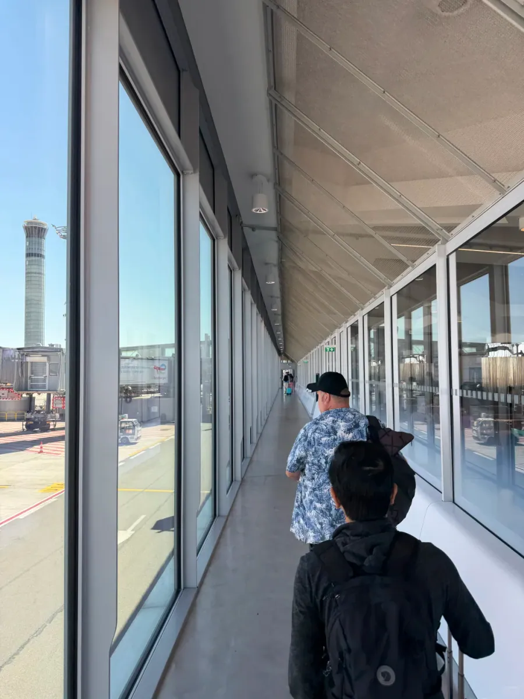

เที่ยวบินเข้าปารีสจากดับลิน นักเดินทางเตรียมตัวสำหรับคำถามและแฟ้มเอกสาร แต่แทบไม่มีอะไรขัดขวางการเดินจากประตูเครื่องบินถึงทางออก สิ่งที่ทำให้ประหลาดใจคือขั้นตอน: ไม่มีตราประทับในหนังสือเดินทาง และไม่มีความตั้งใจจะเพิ่ม

บทความนี้บันทึกการมาถึงนั้นตามลำดับ — ป้ายภาษาจีน การตรวจที่ด่าน ทำไมตราประทับหายไป และสิ่งที่ต้องทำต่อ CDG เป็นสนามบินที่ใหญ่ที่สุดของฝรั่งเศส มีสามอาคารผู้โดยสารและอาคารย่อยเจ็ดแห่งใน T2 ซึ่งการเปลี่ยนเครื่องและทางออกสับสนได้ง่าย ข้อควรระวังหนึ่ง: นี่คือประสบการณ์ของนักเดินทางคนหนึ่ง ไม่ใช่ขั้นตอนทางการ เอกสารที่อธิบายถูกเตรียมมาแต่ไม่ถูกตรวจ ซึ่งไม่เหมือนกับไม่จำเป็น

## 1. ป้ายภาษาจีนตั้งแต่ประตูเครื่องบิน

ป้ายแรกหลังลงจากเครื่องมีสามภาษา: Correspondances / Transfer / 转机, Sortie / Exit / 出口 และ Bagages / Baggage / 行李提取 ตาม 出口 ก็เพียงพอ ภาษาจีนที่นี่เป็นเส้นทางต่อเนื่องจากสะพานเชื่อมถึงโถงกระเป๋า; แม้แต่กระจกสะพานเชื่อมก็มีสติกเกอร์กลม Sortie / Exit / 出口 พร้อมลูกศรสี่อัน

ถัดไปเป็นทางเดินกระจกยาว — ลานจอดและสะพานเชื่อมเครื่องบินทางซ้าย อาคารผู้โดยสารทางขวา — ไม่มีทางแยก จึงควรตามกระแสและป้ายสีเหลืองแทนการหาลิฟต์หรือโลโก้รถไฟใต้ดิน

ป้ายแขวนป้ายแรกคือการตัดสินใจจริง: ต่อเครื่องฝั่งหนึ่ง กระเป๋าข้างหน้า ทางออกเลยโถงกระเป๋าไป ภาพสัญลักษณ์ — คนสองคนเดินแยกกันสำหรับต่อเครื่อง คนเดินสำหรับทางออก รูปสายพานสำหรับกระเป๋า — ใช้ได้แม้ไม่รู้ภาษาฝรั่งเศส

ภาษาจีนยังปรากฏที่ประตูขึ้นเครื่อง เช็คอิน ห้องน้ำ และสายพานกระเป๋า ซึ่งช่วยมากที่สุดเมื่อมาถึงตอนดึกที่เงียบ แต่ป้ายภาษาจีนไม่ได้หมายความว่าเจ้าหน้าที่พูดภาษาจีน; บทสนทนาที่ด่านและศุลกากรยังเป็นภาษาฝรั่งเศสและอังกฤษเป็นหลัก เก็บที่อยู่โรงแรมและกำหนดการในโทรศัพท์และแสดงหน้าจอหากจำเป็น

## 2. ด่านตรวจคนเข้าเมือง: หนังสือเดินทาง วีซ่า ช่องทาง

สามคำเดิมปรากฏซ้ำตามทางเดิน เพิกเฉยป้ายที่แสดงหมายเลขประตูเช่น «Portes 40-68» — นั่นคือเส้นทางต่อเครื่องไปประตู ไม่ใช่ช่องผู้โดยสารขาเข้า มองหา «Contrôle des passeports» หรือเพียงตามกระแสผู้โดยสารนอกสหภาพยุโรป

การคัดแยกคือการมองหนังสือเดินทางแวบเดียว เจ้าหน้าที่ที่หัวช่องมองปกในมือคุณแล้วโบกให้เข้าคิว: หนังสือเดินทางสหภาพยุโรปและ EEA ทางหนึ่ง ที่เหลืออีกทาง หนังสือเดินทางจีนพร้อมวีซ่าเชงเกนไปช่องนอกสหภาพยุโรป; ตามเจ้าหน้าที่แทนการเดาว่าคิวไหนเคลื่อนไหวเร็วกว่า

ที่หน้าต่าง เปิดหนังสือเดินทางที่หน้าวีซ่า ในกรณีนี้เจ้าหน้าที่ไม่พูดอะไร มองวีซ่า ชี้ไปที่เครื่องอ่านลายนิ้วมือ และโบกให้นักเดินทางผ่าน ไม่มีคำถามเรื่องจุดประสงค์ ระยะเวลาพัก หรือที่พัก และไม่ขอการจองหรือตั๋วขากลับ; เอกสารที่เตรียมไว้ล่วงหน้าไม่เคยถูกมอง

นั่นไม่ใช่เหตุผลให้เดินทางมือเปล่า เจ้าหน้าที่มีดุลพินิจและการตรวจเป็นแบบสุ่ม; เก็บเอกสารในกระเป๋าถือ พร้อมสำเนาในโทรศัพท์ อย่าโหลดหนังสือเดินทางเข้าสัมภาระใต้เครื่องเด็ดขาด

ลายนิ้วมือถูกเก็บทันที: สี่นิ้วของมือหนึ่ง แล้วอีกมือ แล้วนิ้วหัวแม่มือทั้งสอง พร้อมภาพอธิบายและข้อความภาษาจีนหรืออังกฤษบนเครื่องอ่าน รอให้จอยืนยันแล้วรับหนังสือเดินทางคืน

คำถามเมื่อมีมาเป็นเรื่องตรงไปตรงมา: จุดประสงค์ จำนวนวัน ประเทศอื่น ที่พัก วันออกเดินทาง คำตอบที่สอดคล้องกันก็เพียงพอ และไม่มีบทพูดที่ต้องท่อง

## 3. หลัง EES: ทำไมไม่มีตราประทับ

นักเดินทางขอตราประทับและได้รับคำตอบสั้น ๆ ว่า «ไม่» ฝรั่งเศสแทนที่ตราประทับขาเข้าด้วย EES

EES คือระบบเข้า-ออกของสหภาพยุโรป (Entry/Exit System) ทยอยใช้ตั้งแต่เดือนตุลาคม 2025 แทน «ต่อคิว–ประทับตรา–โบกผ่าน» ด้วยการลงทะเบียนชีวมณฑลเมื่อเข้าครั้งแรก: ข้อมูลหนังสือเดินทาง ภาพใบหน้า และลายนิ้วมือ เก็บไว้ช่วงหนึ่ง เพื่อให้การเยือนครั้งต่อ ๆ ไปอ่านบันทึกเดียวกัน ไม่ต้องมีตราประทับวันที่

หนังสือเดินทางสะอาดจึงไม่ได้หมายถึงไม่มีบันทึก และการขอตราประทับมักถูกปฏิเสธเพราะระบบไม่ทำแล้ว คู่มือเก่าที่บรรยาย «ต่อคิว รับตราประทับ ตอบคำถามไม่กี่ข้อ» เป็นข้อมูลล้าสมัย ไม่ใช่หลักฐานว่าคุณเดินผิดทาง

สำหรับใบอนุญาตพำนัก การต่ออายุ หรือการลงทะเบียนมหาวิทยาลัย ตราประทับก็ไม่ช่วยอยู่แล้ว; บัตรขึ้นเครื่อง e-ticket และบันทึกโรงแรมเป็นหลักฐานที่ดีกว่า จึงควรเก็บไว้จนจบทริป

EES ใช้ทั่วเชงเกน คุณลงทะเบียนที่จุดเข้าแรก และการเข้าครั้งต่อ ๆ ไปที่อื่นอ่านบันทึกเดียวกัน — นี่คือเหตุผลที่นักเดินทางบางคนที่ต่อเครื่องผ่านเยอรมนีหรือเนเธอร์แลนด์ได้ให้ลายนิ้วมือแล้วและไม่พบสิ่งที่ต้องทำในปารีส

## 4. สิ่งแรกหลังด่านตรวจคนเข้าเมือง

ผ่านด่านแล้ว ทางเดินเปิดสู่โถงกระเป๋า ซึ่งป้ายเปลี่ยนเป็น Bagages และ Sortie และสายพานมีหมายเลข รับกระเป๋า ผลรถเข็นออกไป และผ่านช่องศุลกากร — สีเขียวสำหรับไม่มีของต้องสำแดง สีแดงสำหรับกรณีอื่น นักเดินทางไม่ถูกหยุด แต่การตรวจเป็นแบบสุ่ม

ด้านนอก การเดินทางมาก่อน สามารถซื้อบัตรได้ที่สนามบิน: เครื่อง «Tickets et Navigo» สีเหลืองในสถานี RER B หรือเคาน์เตอร์ SNCF สำหรับหลายวันในปารีส ให้เลือกหว่างตั๋วเที่ยวเดียว ตั๋วรายวัน และตั๋วรายสัปดาห์โดยนับวัน; ตั๋วรายสัปดาห์ไม่ขายที่สนามบินและต้องใช้เคาน์เตอร์ที่มีเจ้าหน้าที่ในเมือง

คำแนะนำคือซื้อในแอป Île-de-France Mobilités แล้วเพิ่มตั๋วใน Apple Wallet ประหยัดค่าบัตรและคิว — แต่การลงทะเบียนมักต้องใช้หมายเลขโทรศัพท์ยุโรป

ระวังชั้นต่าง ๆ ที่ CDG ชั้นผู้โดยสารขาเข้า สถานี และขาออกแยกกัน และป้ายข้างลิฟต์รวม «5 Arrivals», «2 Train Station» และสัญลักษณ์ RER B ไว้ด้วยกัน พร้อมแท็กซี่ โรงแรม ห้องน้ำ และที่จอดรถ

ใต้เพดานโค้งคอนกรีตของโถงสถานี เครื่อง «Tickets et Navigo» ตั้งอยู่ข้างร้าน Relay ดังนั้นตั๋ว น้ำ และอะแดปเตอร์ปลั๊กอยู่ในชั้นเดียวกัน สำหรับลียง บอร์โด หรือมาร์แซย์ สถานีความเร็วสูงใต้ T2 ช่วยประหยัดการเดินทางเข้าเมืองและกลับ; ตรวจสอบสถานีที่พิมพ์บนตั๋วก่อนซื้อ

## 5. รายละเอียดที่ทำให้เข้าใจผิด

ประตูอัตโนมัติไม่ได้สำหรับทุกคน ช่องบริการตนเองสำหรับหนังสือเดินทางสหภาพยุโรป ใบอนุญาตพำนักฝรั่งเศส และกรณีทำนองเดียวกัน; หนังสือเดินทางจีนพำนักระยะสั้นปกติไม่เข้าเกณฑ์ อย่าตามคนข้างหน้าผ่านประตู — ใช้หน้าต่างที่มีเจ้าหน้าที่ที่เจ้าหน้าที่ชี้ให้

ไม่มีคำถามไม่ได้หมายถึงไม่มีการตรวจ เก็บหนังสือเดินทาง วีซ่า ที่พัก ตั๋วขากลับ และประกันไว้ในช่องเดียวของกระเป๋าถือ เพื่อหยิบออกในครั้งเดียว

อาคารผู้โดยสารอยู่ห่างกัน: T1, T2 พร้อมอาคารย่อย A ถึง G และ T3 การเปลี่ยนอาคารต้องใช้ CDGVAL ฟรีบวกการเดินและการรอ จึงควรเผื่อ 30 นาทีขึ้นไป; หากต่อเครื่องกระชั้น ให้ยืนยันที่ประตูว่ากระเป๋าโหลดต่อหรือไม่

ทางออกต้องมีหมายเลข ทางออกจัดกลุ่มตามอาคารและชั้นผู้โดยสารขาเข้า จึงควรส่งอาคาร โถง และหมายเลขทางออกให้คนที่มารับ ด้านนอกเป็นอ่าวรถโค้ชและรถบัส มีเสาสีน้ำเงินที่เขียน QUAI C, D และ E และช่องจอดมีหมายเลขเช่น B3 ใต้หลังคาไม้

เตรียมภาษาไว้บ้าง: ป้ายเป็นภาษาจีน แต่เจ้าหน้าที่อาจไม่ใช่ เริ่มด้วย «Bonjour» ยื่นหนังสือเดินทางที่เปิดหน้าวีซ่าแล้ว และพูดช้า ๆ หากคำถามไม่ชัด ให้ถามซ้ำหรือแสดงกำหนดการในโทรศัพท์

การมาถึง CDG มีสามสิ่ง: ตามป้ายภาษาจีนไปด่าน ยื่นหนังสือเดินทางและวีซ่าตามที่เจ้าหน้าที่ชี้ และจัดการการเดินทางก่อนออกจากสนามบิน นักเดินทางเรียกว่าราบรื่น แต่ความราบรื่นมาจากขั้นตอนที่เรียบง่าย ไม่ใช่โชค นี่คือการเดินทางของนักเดินทางคนหนึ่งในเดือนสิงหาคม 2026; แนวปฏิบัติที่ด่าน การลงทะเบียน EES และค่าโดยสารเดินทางเปลี่ยนได้ จึงควรตรวจสอบข้อมูลทางการฝรั่งเศสและสนามบินในวันเดินทาง

## ลิงก์ที่เกี่ยวข้อง

- **ในเว็บไซต์นี้**: [ท่าอากาศยานปารีสชาร์ลเดอโกล (CDG)](/airport/CDG), [ฝรั่งเศส (FR)](/country/FR)
- **Wikipedia**: [ท่าอากาศยานปารีสชาร์ลเดอโกล](https://en.wikipedia.org/wiki/Paris_Charles_de_Gaulle_Airport)
- **Baidu Baike**: [ท่าอากาศยานปารีสชาร์ลเดอโกล](https://baike.baidu.com/item/%E5%B7%B4%E9%BB%8E%E5%A4%8F%E5%B0%94%C2%B7%E6%88%B4%E9%AB%98%E4%B9%90%E6%9C%BA%E5%9C%BA)
