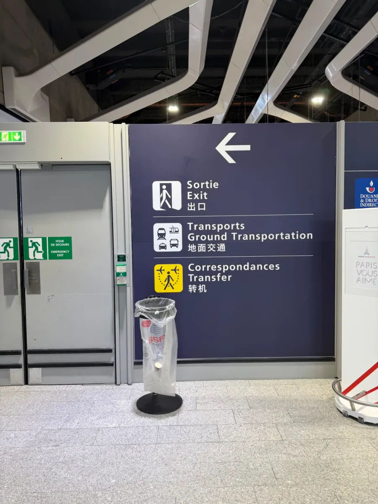

Dublin'den Paris'e uçan gezgin, sorulara ve bir dosya dolusu belgeye hazırlanmıştı. Uçak kapısından çıkışa kadar yürüyüşü neredeyse hiçbir şey kesmedi. Şaşırtıcı olan prosedürdü: pasaportta damga yok ve damga vurma niyeti de yok.

Bu yazı o varışı sırasıyla kaydediyor — Çince tabelalar, sınır kontrolü, damganın neden kalktığı ve sonra ne yapılacağı. CDG Fransa'nın en büyük havalimanı; üç terminal ve T2 içinde yedi alt terminal var, aktarma ile çıkışı karıştırmak kolay. Bir uyarı: bu bir gezginin deneyimi, resmî bir prosedür değil. Anlatılan belgeler hazırlanmış ama incelenmemiş; bu, gerekli olmadıkları anlamına gelmez.

## 1. Uçak kapısından itibaren Çince tabelalar

Uçaktan indikten sonraki ilk tabela üç dil taşıyor: Correspondances / Transfer / 转机, Sortie / Exit / 出口 ve Bagages / Baggage / 行李提取. 出口'i izlemek yeterli. Burada Çince, körükten bagaj salonuna kadar kesintisiz bir iz; körük camında bile dört oklu yuvarlak bir Sortie / Exit / 出口 etiketi var.

Ötesinde uzun bir cam koridor var — solda apron ve körükler, sağda terminal — hiç dönüş yok, bu yüzden asansör veya metro logosu aramak yerine akışı ve sarı tabelaları izleyin.

İlk asma tabela gerçek karar noktası: bir yanda aktarma, ileride bagaj, bagaj salonunun ötesinde çıkış. Piktogramlar — aktarma için ayrı yürüyen iki figür, çıkış için yürüyen bir figür, bagaj için döner bant biçimi — Fransızca olmadan da işe yarıyor.

Çince kapılarda, check-in'de, tuvaletlerde ve bagaj bantlarında da görünüyor; bu en çok sakin bir geç varışta yardımcı oluyor. Ama Çince tabela, personelin Çince konuştuğu anlamına gelmiyor; sınır ve gümrük konuşmaları hâlâ ağırlıklı olarak Fransızca ve İngilizce. Otel adresini ve seyahat planını telefonunuzda tutun, gerekirse ekranı gösterin.

## 2. Sınır kontrolü: pasaport, vize, şeritler

Aynı üç kelime koridor boyunca tekrarlanıyor. “Portes 40-68” gibi kapı numaraları gösteren tabelaları görmezden gelin — o, kapılara giden aktarma güzergâhı, varış kanalı değil. “Contrôle des passeports”u arayın veya basitçe AB dışı akışı izleyin.

Yönlendirme, pasaporta bir bakışla yapılıyor. Şeritlerin başındaki görevliler elinizdeki kapağa bakar ve sizi bir kuyruğa yönlendirir: AB ve AEA pasaportları bir yana, geri kalan her şey diğer yana. Schengen vizeli bir Çin pasaportu AB dışı şeride gider; hangi kuyruğun daha hızlı ilerlediğini tahmin etmek yerine görevlileri izleyin.

Gişede pasaportu vize sayfasında açın. Bu vakada memur hiçbir şey söylemedi, vizeye baktı, parmak izi okuyucusunu gösterdi ve gezgini geçirdi. Amaç, kalış süresi veya konaklama hakkında soru yok, rezervasyon ya da dönüş bileti talebi yok; önceden hazırlanan belgelere hiç bakılmadı.

Bu, eli boş seyahat etmek için bir neden değil. Memurların takdir yetkisi var ve kontroller rastgele; belgeleri el bagajında, kopyaları telefonda tutun. Pasaportu asla bagaja vermeyin.

Parmak izleri yerinde alınıyor: bir elin dört parmağı, sonra diğeri, sonra iki başparmak; okuyucuda şemalar ve Çince veya İngilizce istemler var. Ekranın onaylamasını bekleyin, sonra pasaportu geri alın.

Sorular geldiğinde sade: amaç, gün sayısı, diğer ülkeler, konaklama, ayrılış tarihi. Tutarlı yanıtlar yeterli ve ezberlenecek bir metin yok.

## 3. EES'ten sonra: neden damga yok

Gezgin damga istedi ve net bir “hayır” aldı. Fransa giriş damgasının yerine EES'i koydu.

EES, AB Giriş/Çıkış Sistemi; Ekim 2025'ten itibaren kademeli olarak uygulanıyor. Kuyruk–damga–geçiş düzeninin yerini ilk girişte biyometrik kayıt alıyor: pasaport verileri, yüz görüntüsü ve parmak izleri bir süre saklanıyor, böylece sonraki ziyaretler aynı kaydı okuyor. Tarih damgasına gerek yok.

Bu yüzden damgasız bir pasaport kayıt yok anlamına gelmez ve damga istemek genellikle reddedilir çünkü sistem artık bunu yapmıyor. “Kuyruğa gir, damga al, birkaç soru yanıtla” diyen eski rehberler yanlış yola saptığınızın kanıtı değil, yalnızca güncelliğini yitirmiş.

Oturma izni, yenileme veya üniversite kaydı için damga zaten yardımcı olmazdı; biniş kartları, e-biletler ve otel kayıtları daha iyi kanıttır, bu yüzden yolculuk bitene kadar onları saklayın.

EES Schengen genelinde geçerli. İlk girdiğiniz yerde kaydolursunuz ve başka yerlerdeki sonraki girişler aynı kaydı okur — bu yüzden Almanya veya Hollanda üzerinden aktarma yapan bazı gezginler parmak izini çoktan vermiştir ve Paris'te yapacak bir şey bulamaz.

## 4. Sınır kontrolünden sonraki ilk şey

Sınırı geçince koridor bagaj salonuna açılıyor; tabelalar Bagages ve Sortie'ye dönüyor ve bantlar numaralarını taşıyor. Bagajları alın, arabayı dışarı itin ve gümrük kanalından geçin — beyan edecek bir şey yoksa yeşil, varsa kırmızı. Gezgin durdurulmadı, ama kontroller rastgele.

Dışarıda önce ulaşım geliyor. Kartlar havalimanında alınabilir: RER B istasyonundaki sarı “Tickets et Navigo” makineleri veya SNCF gişesi. Paris'te birkaç gün kalacaksanız günleri sayarak tek biletler, günlük geçişler ve haftalık geçiş arasında seçin; haftalık geçiş havalimanında satılmıyor ve şehirde görevli bir gişe gerektiriyor.

Tavsiye, Île-de-France Mobilités uygulamasından alıp bileti Apple Wallet'a eklemek; kart ücretinden ve kuyruktan tasarruf edersiniz — ancak kayıt genellikle bir Avrupa telefon numarası gerektiriyor.

Katları göz önünde tutun. CDG'de varış, istasyon ve kalkış katları ayrıdır; asansörlerin yanındaki pano “5 Arrivals”, “2 Train Station” ve RER B işaretini bir arada gösterir; yanlarında taksiler, oteller, tuvaletler ve otoparklar vardır.

İstasyon salonunun beton tonozları altında “Tickets et Navigo” makineleri bir Relay mağazasının yanında duruyor; yani bilet, su ve priz adaptörü aynı katta. Lyon, Bordeaux veya Marsilya için T2'nin altındaki hızlı tren istasyonu şehre gidip dönme zahmetini kurtarabilir; almadan önce bilette yazan istasyonu kontrol edin.

## 5. Yanıltan ayrıntılar

Otomatik turnikeler herkese açık değil. Self-servis şeritler AB pasaportları, Fransız oturma izinleri ve benzerleri için; kısa süreli bir Çin pasaportu normalde uygun değil. Önünüzdekileri turnikeden izlemeyin — görevlilerin yönlendirdiği görevli gişeye gidin.

Soru sorulmaması kontrol yapılmadığı anlamına gelmez. Pasaport, vize, konaklama, dönüş bileti ve sigortayı el bagajının tek bir bölmesinde tutun ki tek hareketle çıksınlar.

Terminaller birbirinden uzak: T1, A'dan G'ye alt terminalleriyle T2 ve T3. Terminal değiştirmek ücretsiz CDGVAL artı yürüme ve bekleme demek, bu yüzden 30 dakika veya daha fazla bırakın; sıkı bir aktarmada kapıda bagajların aktarmalı olup olmadığını doğrulayın.

Bir çıkışın numarası olmalı. Çıkışlar terminal ve varış katına göre gruplanmış, bu yüzden sizi karşılayacak kişiye terminali, salonu ve çıkış numarasını gönderin. Dışarıda otobüs körfezleri var; ahşap kanopi altında QUAI C, D ve E yazılı mavi sütunlar ve B3 gibi numaralı peronlar.

Biraz da dil hazırlayın: tabelalar Çince, personel öyle olmayabilir. “Bonjour” ile başlayın, pasaportu vize sayfasında açık olarak verin ve yavaş konuşun. Bir soru net değilse yeniden sorun veya telefonunuzdaki seyahat planını gösterin.

CDG'ye varış üç şey: sınıra kadar Çince tabelaları izleyin, pasaport ve vizeyi görevlilerin yönlendirdiği yerde verin ve havalimanından çıkmadan ulaşımı halledin. Gezgin bunu sorunsuz diye nitelendirdi, ama sorunsuzluk şanstan değil basitleştirilmiş bir prosedürden geliyor. Bu, Ağustos 2026'da bir gezginin deneyimiydi; sınır uygulamaları, EES kaydı ve ulaşım ücretleri değişebilir, bu yüzden o gün Fransız resmî ve havalimanı bilgilerini kontrol edin.

## İlgili bağlantılar

- **Bu sitede**: [Paris Charles de Gaulle Havalimanı (CDG)](/airport/CDG), [Fransa (FR)](/country/FR)
- **Wikipedia**: [Paris Charles de Gaulle Havalimanı](https://en.wikipedia.org/wiki/Paris_Charles_de_Gaulle_Airport)
- **Baidu Baike**: [Paris Charles de Gaulle Havalimanı](https://baike.baidu.com/item/%E5%B7%B4%E9%BB%8E%E5%A4%8F%E5%B0%94%C2%B7%E6%88%B4%E9%AB%98%E4%B9%90%E6%9C%BA%E5%9C%BA)
