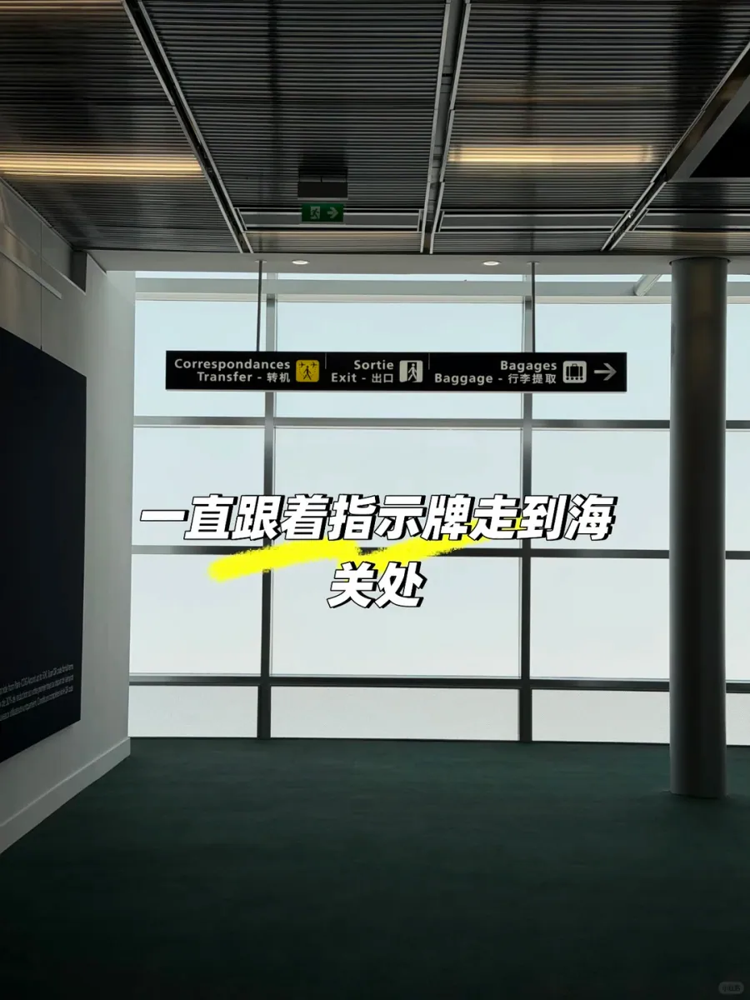

Летячи до Парижа з Дубліна, мандрівник готувався до запитань і зібрав теку документів. Майже ніщо не завадило пройти від дверей літака до виходу. Здивувала процедура: у паспорті не було штампа, і ніхто не збирався його ставити.

Ця стаття відтворює ту подорож у хронологічному порядку: китайськомовні покажчики, прикордонну перевірку, причини зникнення штампа й наступні кроки. CDG — найбільший аеропорт Франції з трьома терміналами й сімома субтерміналами в T2, де пересадку легко переплутати з виходом. Одне застереження: це досвід одного мандрівника, а не офіційна процедура. Описані документи були підготовлені, але їх не перевіряли, що не означає, ніби вони не потрібні.

## 1. Китайськомовні покажчики від дверей літака

Перший покажчик після виходу з літака містить три мови: Correspondances / Transfer / 转机, Sortie / Exit / 出口 і Bagages / Baggage / 行李提取. Достатньо йти за 出口. Китайська тут утворює безперервний ланцюжок від телетрапа до залу видачі багажу; навіть на склі телетрапа є кругла наліпка Sortie / Exit / 出口 із чотирма стрілками.

Далі — довгий скляний коридор: ліворуч перон і телетрапи, праворуч термінал, без поворотів; ідіть за потоком і жовтими покажчиками, не шукаючи ліфт чи логотип метро.

Перший підвісний покажчик — це справжнє рішення: пересадка в один бік, багаж попереду, вихід — далі за залом видачі багажу. Піктограми — дві фігури, що розходяться, для пересадки, фігура, що йде, для виходу й форма каруселі для багажу — зрозумілі навіть без французької.

Китайська також є на виходах на посадку, реєстрації, туалетах і стрічках видачі багажу, що найбільше допомагає під час тихого пізнього прибуття. Але китайськомовні покажчики не означають, що персонал розмовляє китайською; на кордоні й митниці спілкуються переважно французькою та англійською. Тримайте адресу готелю й маршрут у телефоні та за потреби покажіть екран.

## 2. Прикордонний контроль: паспорт, віза, смуги

Ті самі три слова повторюються вздовж коридора. Ігноруйте покажчики з номерами виходів на кшталт «Portes 40-68» — це маршрут пересадки до виходів, а не смуга прибуття. Шукайте «Contrôle des passeports» або просто йдіть за потоком пасажирів з-поза ЄС.

Розподіл відбувається з погляду на паспорт. Працівники на початку смуг дивляться на обкладинку в руці й жестом направляють вас у чергу: паспорти ЄС і ЄЕП — в один бік, усі інші — в інший. Китайський паспорт із шенгенською візою прямує до смуги для громадян країн поза ЄС; слухайте працівників, а не вгадуйте, яка черга рухається швидше.

Біля вікна відкрийте паспорт на сторінці з візою. У цьому випадку офіцер нічого не сказав, подивився на візу, показав на зчитувач відбитків пальців і жестом запросив мандрівника пройти. Жодних запитань про мету, тривалість перебування чи житло, жодного прохання показати бронювання чи зворотний квиток; заздалегідь підготовлені документи так і не перевірили.

Це не привід вирушати без документів. Офіцери мають право вирішувати на власний розсуд, а перевірки бувають вибірковими; тримайте документи в ручній поклажі, а копії — у телефоні. Ніколи не здавайте паспорт у загальний багаж.

Відбитки пальців знімають на місці: чотири пальці однієї руки, потім другої, потім обидва великі пальці; на зчитувачі є схеми й підказки китайською або англійською. Дочекайтеся підтвердження на екрані й забирайте паспорт.

Запитання, якщо вони виникають, прості: мета, кількість днів, інші країни, житло, дата вильоту. Достатньо послідовних відповідей; завчати якийсь сценарій не потрібно.

## 3. Після EES: чому немає штампа

Мандрівник попросив поставити штамп і отримав категоричне «ні». Франція замінила штамп про в’їзд системою EES.

EES — Європейська система в’їзду та виїзду, яку поступово запроваджують із жовтня 2025 року. Вона замінює схему «черга — штамп — прохід» біометричною реєстрацією під час першого в’їзду: дані паспорта, зображення обличчя та відбитки пальців зберігаються певний строк, тож під час наступних візитів система зчитує той самий запис. Штамп із датою більше не потрібен.

Тож чистий паспорт не означає відсутності запису, а прохання поставити штамп зазвичай відхиляють, бо система цього більше не передбачає. Старі путівники з описами «станьте в чергу, отримайте штамп, дайте кілька відповідей» застаріли, і це не означає, що ви пішли не туди.

Для посвідки на проживання, її продовження чи університетської реєстрації штамп однаково не допоміг би; посадкові талони, електронні квитки й підтвердження бронювання готелю є кращим доказом, тож зберігайте їх до кінця поїздки.

EES діє на всій території Шенгенської зони. Ви реєструєтеся там, де вперше в’їжджаєте, а наступні в’їзди в інших країнах зчитують той самий запис; саме тому деякі мандрівники, які летіли з пересадкою через Німеччину чи Нідерланди, уже здали відбитки пальців і в Парижі їм нічого робити.

## 4. Перше, що слід зробити після прикордонного контролю

Після кордону коридор виходить до залу видачі багажу, де покажчики змінюються на Bagages і Sortie, а стрічки мають номери. Заберіть багаж, викотіть візок і пройдіть митний коридор — зелений, якщо нічого декларувати, червоний в іншому разі. Мандрівника не зупиняли, але перевірки бувають вибірковими.

На виході передусім подбайте про транспорт. Квитки можна купити в аеропорту: у жовтих автоматах «Tickets et Navigo» на станції RER B або в касі SNCF. Якщо плануєте кілька днів у Парижі, обирайте між разовими квитками, денними абонементами й тижневим проїзним, порахувавши дні; тижневий проїзний не продають в аеропорту — для нього потрібна каса з персоналом у місті.

Порада: купуйте квиток у застосунку Île-de-France Mobilités і додавайте його до Apple Wallet — так ви заощадите на вартості картки й не стоятимете в черзі, хоча для реєстрації зазвичай потрібен європейський номер телефону.

Стежте за рівнями. У CDG рівні прибуття, залізничної станції та вильоту розділені, а табло біля ліфтів поєднує позначки «5 Прибуття», «2 Залізнична станція» та RER B, поруч — таксі, готелі, туалети й автостоянки.

Під бетонними склепіннями станційної зали автомати «Tickets et Navigo» стоять поруч із магазином Relay, тож квитки, вода й перехідник для розетки — на одному рівні. Якщо ви прямуєте до Ліона, Бордо чи Марселя, високошвидкісна станція під T2 може позбавити вас поїздки до міста й назад; перед покупкою перевірте, яка станція зазначена на квитку.

## 5. Деталі, що вводять в оману

Автоматичні ворота підходять не всім. Смуги самообслуговування призначені для паспортів ЄС, французьких посвідок на проживання тощо; китайський паспорт для короткострокового перебування зазвичай не підходить. Не проходьте за людьми попереду через ворота — прямуйте до вікна з персоналом, на яке вам указують.

Відсутність запитань не означає відсутності перевірок. Тримайте паспорт, візу, підтвердження житла, зворотний квиток і страховку в одному відділенні ручної поклажі, щоб дістати їх одним рухом.

Термінали розташовані далеко: T1, T2 із субтерміналами A–G і T3. Зміна термінала означає безкоштовний CDGVAL плюс піші переходи й очікування, тож закладайте 30 хвилин або більше; якщо пересадка тісна, уточніть біля виходу на посадку, чи зареєстровано багаж до кінцевого пункту.

Вихід має номер. Виходи згруповані за терміналом і рівнем прибуття, тож повідомте тому, хто вас зустрічає, термінал, залу й номер виходу. Ззовні розташовані автобусні платформи з синіми стовпами QUAI C, D і E та пронумерованими місцями, як-от B3, під дерев’яним навісом.

Підготуйте й трохи мови: покажчики китайською, а персонал може нею не володіти. Почніть із «Bonjour», передайте паспорт, уже відкритий на сторінці з візою, і говоріть повільно. Якщо запитання незрозуміле, перепитайте або покажіть маршрут у телефоні.

Прибуття до CDG — це три речі: іти за китайськими покажчиками до кордону, передати паспорт і візу там, куди вказують працівники, і вирішити питання транспорту до виходу з аеропорту. Мандрівник назвав подорож гладкою, але ця гладкість — результат спрощеної процедури, а не удачі. Це був один випадок у серпні 2026 року; прикордонна практика, реєстрація в EES і тарифи на транспорт можуть змінюватися, тож того дня перевіряйте офіційну французьку інформацію та дані аеропорту.

## Пов’язані посилання

- **На цьому сайті**: [Аеропорт Париж — Шарль де Голль (CDG)](/airport/CDG), [Франція (FR)](/country/FR)
- **Вікіпедія**: [Аеропорт Париж — Шарль де Голль](https://en.wikipedia.org/wiki/Paris_Charles_de_Gaulle_Airport)
- **Baidu Baike**: [Аеропорт Париж — Шарль де Голль](https://baike.baidu.com/item/%E5%B7%B4%E9%BB%8E%E5%A4%8F%E5%B0%94%C2%B7%E6%88%B4%E9%AB%98%E4%B9%90%E6%9C%BA%E5%9C%BA)
