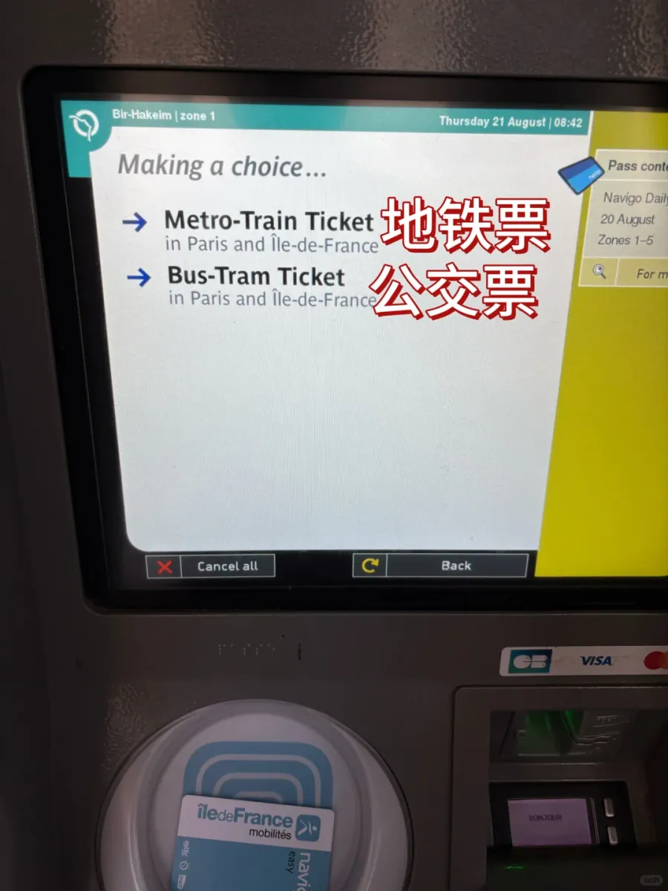

CDG প্যারিসের উত্তর-পূর্বে প্রায় 25 কিমি দূরে, আর শহরে ঢোকার পথ সহজ: Train / RER সাইন ধরে নিচের স্টেশনে যান এবং RER B ধরুন। বিভ্রান্তি শুরু হয় টিকিট হল থেকে, যেখানে হলুদ "Tickets et Navigo" মেশিনে Tickets, Passes এবং Airport Tickets মেলে, আর একটি পোস্টারে লেখা "Paris ↔ Airport 13€ +2€"।

এই গাইডে একটি আগমনের পুরো পথ ধরে দেখানো হয়েছে: প্ল্যাটফর্ম, পাঁচ ধরনের টিকিট, যে নিয়মগুলো না জানলে সাপ্তাহিক পাসে সহজেই টাকা নষ্ট হয়, মেশিনের স্ক্রিন ধরে ধরে কেনাকাটা, এবং প্রাদেশিক গন্তব্যের ট্রেন কোন স্টেশন থেকে ছাড়ে। দামগুলো ২০২৬ সালের আগস্টে এক যাত্রী যা দিয়েছিলেন, সেই অনুযায়ী।

RER B আলাদা কোনো "এয়ারপোর্ট এক্সপ্রেস" নয়; এটি প্যারিস আঞ্চলিক নেটওয়ার্কের লাইন B, যা শহরের ভেতর দিয়ে চলে এবং Gare du Nord ও Châtelet-এ থামে। Google Maps এটিকে RER B লেখে, আর নীলের ওপর সাদা B-ই অনুসরণ করার চিহ্ন।

## 1. CDG থেকে প্যারিসে ঢোয়া

ব্যাগেজ ক্লেম থেকে বেরিয়ে Métro নয়, Train / RER বা Gares সাইন খুঁজুন। স্টেশনটি টার্মিনাল 2-এর নিচে, আগমন তল থেকে এক তলা নিচে; টার্মিনাল 1 বা 3 থেকে এলে প্রথমে বিনামূল্যের CDGVAL শাটলে T2-এ যান।

নিচতলায় দুটি বিকল্প: সারি সারি হলুদ মেশিন, আর কাচের দেয়ালের SNCF অফিস, যার দরজার ওপরে লেখা "Services Navigo / Tickets Paris et Île-de-France" এবং ভেতরে কাউন্টার 01 থেকে 03। শুধু একটি বিমানবন্দর টিকিট কিনতে মেশিনই দ্রুততম; কাউন্টারে সাপ্তাহিক পাসের প্রশ্ন, টিকিট বদল ও ট্রেনের টিকিট দেখে।

গেট পেরিয়ে, সাদা ফ্রেমের RER, নীল B ও দুটি নিচমুখী তিরসহ গাঢ় নীল সাইন প্ল্যাটফর্মের দিক দেখায়, নিচে Voie 11, 12 এবং Paris লেখা। Gare du Nord বা Châtelet-Les Halles পর্যন্ত যাত্রায় প্রায় 25–30 মিনিট লাগে। বড় স্যুটকেস থাকলে সকালের ভিড় এড়িয়ে চলুন।

বিমানবন্দরের একক টিকিটের দাম **€13**, ট্রিপের সবচেয়ে দামি টিকিট এবং একমাত্র টিকিট যা বিমানবন্দর ও শহরের মধ্যে RER B-তে বৈধ। এটি কেবল ওই অংশ কভার করে, তাই প্যারিসের মেট্রো ও বাসে যেতে শহরের টিকিট লাগবে। সাপ্তাহিক পাস নেওয়ার ইচ্ছা থাকলেও এই €13-এর টিকিট বিমানবন্দরেই কিনতে হবে — দেখুন 3 নম্বর অংশ।

## 2. প্যারিসে টিকিটের ধরন ও দাম

পাঁচ ধরনের টিকিট আছে: একক যাত্রা, বিমানবন্দরের টিকিট, দশটির কার্নে, এক দিনের পাস এবং সাপ্তাহিক পাস। প্রথম কার্ডে **€2 ফি** লাগে, আর পরে একই কার্ডে টাকা লোড করা যায়। দিন ও যাত্রার সংখ্যা দেখে সিদ্ধান্ত নিন: দুই দিনে তিন-চারটি যাত্রা হলে একক টিকিট বা কার্নে; এক সপ্তাহে পাঁচ দিন হলে সাপ্তাহিক পাসের দিকে ঝুঁকুন।

| টিকিট | দাম | যাদের জন্য ভালো | বিমানবন্দর লাইন কভার করে? |
| --- | --- | --- | --- |
| একক যাত্রা (শহরের মধ্যে মেট্রো / RER) | €2.50 | দিনে দুই-তিনটি যাত্রা | না |
| একক যাত্রা (বাস) | €2 | ছোট দূরত্ব, পথে শহর দেখা | না |
| বিমানবন্দরের একক টিকিট | €13 | আগমন বা প্রস্থানের দিন | হ্যাঁ |
| দশটির কার্নে | €25 | তিন থেকে পাঁচ দিন, লাইনে না দাঁড়িয়ে | না |
| এক দিনের পাস | €12 | একদিনে কয়েকটি দর্শনীয় স্থান | না |
| সাপ্তাহিক Navigo | €31.50 এবং €5-এর কার্ড | সপ্তাহজুড়ে থাকা, প্রতিদিন যাতায়াত | হ্যাঁ |

মেট্রোর একক টিকিট **€2.50**, বাসের একক টিকিট **€2**। কার্নের দাম **€25**, অর্থাৎ প্রতি যাত্রায় €2.50 — একক টিকিটের সমান; তাই এটি লাইনে দাঁড়ানোর সময় বাঁচায়, ছাড় দেয় না। দিনের পাস **€12** এবং সেদিন **24:00**-এ মেয়াদ শেষ হয়, 24 ঘণ্টা পরে নয়; তাই সকালেই কিনুন।

দুটি বিষয় মনে রাখা জরুরি। একবার কার্ডে বিমানবন্দরের টিকিট থাকলে ওই কার্ডে পরে মেট্রোর একক টিকিট নেওয়া যায় না, কেবল বাসের টিকিট নেওয়া যায় — যাত্রী এটি দেখেছিলেন। আর দিনের পাস বিমানবন্দর লাইন বাদ দেয় — স্ক্রিনে লেখা "excluding airports" — তাই RER B-এর জন্য আলাদা €13-এর টিকিট লাগে।

সাপ্তাহিক পাসের দাম **€31.50** এবং **€5**-এর কার্ড, বিমানবন্দর লাইন কভার করা একমাত্র দীর্ঘমেয়াদি টিকিট।

## 3. সাপ্তাহিক পাসের চারটি নিয়ম

পাসটি যে সপ্তাহে কিনেছেন, সেই সপ্তাহের **রবিবার 24:00**-এ শেষ হয়, কেনার পর সাত দিন গড়িয়ে নয়। সোমবারে পাবেন সাত দিন, বৃহস্পতিবারে চার, রবিবারে প্রায় কিছুই না; এটি ক্যালেন্ডার-সপ্তাহের পণ্য, দিনের পাস বা কার্নের মতো নয়। কার্ডে **পাসপোর্ট-মাপের একটি ছবি** লাগে; ছবি না থাকলে কার্ড অবৈধ গণ্য হতে পারে। এটি **শুধু কর্মরত কাউন্টার এবং Île-de-France Mobilités অ্যাপে** বিক্রি হয়, কখনো মেশিনে নয়। আর **বিমানবন্দরে এটি বিক্রি করা যায় না**: নামার পর €13-এর একক টিকিট কিনুন (কার্ড না থাকলে আরও €2), তারপর শহরের স্টেশনের কাউন্টার থেকে সাপ্তাহিক পাস কিনুন।

একক ও দিনের পাসের মতো নয়, এই পাস বিমানবন্দর লাইন কভার করে: সপ্তাহের মাঝখানে নামলে এবং সপ্তাহান্তে ফিরলে €13-এর ফেরত যাত্রা এর মধ্যে পড়ে, আর রবিবার 24:00-এর পরে ফিরলে আরেকটি একক টিকিট লাগবে।

Apple Wallet-এ টিকিট যোগ করলে অ্যাপ কার্ডের ফি এড়ায়, তবে নিবন্ধন সাধারণত ইউরোপীয় ফোন নম্বর চায়। কার্ডসহ পাসের খরচ €31.50 + €5 = **€36.50**, দিনে €12-এর বিপরীতে: চারটি দিনের পাস €48, তিনটি €36 এবং প্রায় সমান হয়ে যায়, যদিও পাসটি একটি বিমানবন্দর যাত্রা কভার করে।

| যেদিন কিনবেন | আসলে যে দিনগুলো পাবেন | রায় |
| --- | --- | --- |
| সোমবার | 7 | সেরা মূল্য; কিনে ফেলুন |
| মঙ্গলবার | 6 | ভালো মূল্য |
| বুধবার | 5 | ভালো মূল্য |
| বৃহস্পতিবার | 4 | চারটি দিনের পাসের সমান, সঙ্গে একটি বিমানবন্দর যাত্রা |
| শুক্রবার | 3 | কেবল ফেরার যাত্রাও RER-এ হলে লাভজনক |
| শনিবার | 2 | দিনের পাসই ভালো |
| রবিবার | 1 | ওই রাতেই মেয়াদ শেষ; কিনবেন না |

## 4. মেশিনে টিকিট কেনা

দুটি মেশিন একই খোলসে: **ticket** চিহ্নিতটি কার্ড বিক্রি ও রিলোড করে, **recharge** চিহ্নিতটি কেবল রিলোড করে। কার্ড না থাকলে ticket বেছে নিন। এগুলো Visa, Mastercard ও কয়েন নেয়।

ডানদিকে লাল পোস্টারে লেখা "To leave this Airport: Paris ↔ Airport ticket ONLY", সঙ্গে **13€** ও **+2€** — ভাড়া ও নতুন কার্ডের ফি-র আনুষ্ঠানিক রূপ।

প্রথম স্ক্রিনে পুরোনো কার্ড রিলোড করতে "Place your Navigo pass" অথবা নতুন কার্ড কিনতে "You don't have a Navigo Pass: touch here" দেখায়।

দ্বিতীয় স্ক্রিনে **Tickets**, **Passes** ও **Airport Tickets**। Airport Tickets ভাড়া ও কার্ডের ফি একসঙ্গে যোগ করে।

Tickets-এ গেলে **Metro-Train** বা **Bus-Tram** (€2.50 বনাম €2), তারপর **full fare** বা **reduced fare**; reduced 4 থেকে 10 বছরের কম বয়সী শিশু বা ডিসকাউন্ট কার্ডধারীদের জন্য, তাই দর্শনার্থীদের full fare নিতে হবে।

Passes-এ গেলে **Forfait Day Pass** (বিমানবন্দর বাদে) বা **Forfait Paris Visite** (1, 2, 3 বা 5 দিন)। দিনের পাসের ক্ষেত্রে শুরুর তারিখ জিজ্ঞাসা করে, আজ থেকে সাত দিন পর পর্যন্ত তালিকা দেখায়; অভ্যাসবশত আজকের তারিখে চাপ দেবেন না।

কার্ড বা কয়েনে টাকা দিন; নতুন কার্ডে শেষে €2 যোগ হয়। সাপ্তাহিক পাস এখানে একেবারেই বিক্রি হয় না।

1. মেশিন বাছুন: ticket নতুন কার্ড বিক্রি করে, recharge কেবল রিলোড করে।
2. প্রথম স্ক্রিন: কার্ড দেখান, বা "You don't have a Navigo Pass" চাপুন।
3. দ্বিতীয় স্ক্রিন: Tickets, Passes বা Airport Tickets।
4. তৃতীয় স্ক্রিন (একক টিকিটের জন্য): Metro-Train বা Bus-Tram।
5. চতুর্থ স্ক্রিন: full fare বা reduced fare।
6. দিনের পাসের জন্য: Passes → Forfait Day Pass → শুরুর তারিখ।
7. টাকা দিন; নতুন কার্ডে €2 স্বয়ংক্রিয়ভাবে যোগ হয়।

## 5. প্যারিস ছাড়া: স্টেশন চিনে নিন

প্যারিসে ছয়টি মূল লাইন স্টেশন, প্রতিটি নিজের দিকের ট্রেন দেখে, অনেকটা বেইজিংয়ের একাধিক টার্মিনালের মতো: ভুল স্টেশন মানে ট্রেন মিস।

বুকিং অ্যাপ স্টেশনের নাম অনুবাদ করে, তাই "Paris Est" ও "Paris Gare de Lyon" দুটোই প্যারিস হিসেবে দেখায়, অথচ কিলোমিটার দূরে অবস্থিত। স্ক্রিনশটে দেখা যায় Reims-এর ট্রেন **Paris Est থেকে 09:58**-এ ছেড়ে 11:22-এ Reims পৌঁছায়, আর Lyon-এর ট্রেন **Paris Gare de Lyon থেকে 11:52**-এ ছেড়ে 13:56-এ Lyon Part-Dieu পৌঁছায়।

তৃতীয় সম্ভাবনা: **Aéroport Charles de Gaulle 2 TGV** নামের টিকিট, টার্মিনাল 2-এর নিচের স্টেশন, যেখানে শহরে না গিয়ে নিচতলায় নেমে যেতে পারেন।

| স্টেশন | প্রধান গন্তব্যদিক | মেট্রো / RER |
| --- | --- | --- |
| Gare du Nord | উত্তর ফ্রান্স, বেলজিয়াম, ব্রিটেন (Eurostar) | লাইন 4, 5; RER B, D |
| Gare de l'Est | পূর্ব ফ্রান্স, জার্মানি, লুক্সেমবার্গ | লাইন 4, 5, 7 |
| Gare de Lyon | দক্ষিণ-পূর্ব ফ্রান্স, সুইজারল্যান্ড, ইতালি | লাইন 1, 14; RER A, D |
| Gare d'Austerlitz | দক্ষিণ-পশ্চিম ফ্রান্স, স্পেন, পর্তুগাল | লাইন 5, 10; RER C |
| Gare Montparnasse | পশ্চিম ফ্রান্স, ব্রিটনি | লাইন 4, 6, 12, 13 |
| Gare Saint-Lazare | নরম্যান্ডি | লাইন 3, 12, 13, 14 |

পুরোনো টার্মিনালগুলো বেশিরভাগ ডেড-এন্ড: বোর্ডে ট্রেন ও তার প্ল্যাটফর্ম (voie) দেখে নিন, তারপর ট্র্যাকে হাঁটুন। পুরোনো মেট্রো লাইনে সিঁড়ি বেশি, লিফট কম, তাই ভারী স্যুটকেসের জন্য সময় রাখুন; ছাড়ার 45–60 মিনিট আগে পৌঁছানো বুদ্ধিমানের বাফার।

এই ক্রমে করলে প্যারিসে যাতায়াত সহজ: **€13**-এর বিমানবন্দর একক টিকিট কিনুন, দিনের পাস ও সাপ্তাহিক পাসের তুলনা করুন, সাধারণ টিকিট মেশিনে নিন আর সাপ্তাহিক পাস কাউন্টার বা অ্যাপে, এবং নিজের স্টেশন যাচাই করুন। ভাড়া ও ব্যবস্থা বদলায়, তাই সেই দিনই Île-de-France Mobilités ও SNCF-এর তথ্য দেখে নিন।

## সম্পর্কিত লিংক

- **এই সাইটে**: [প্যারিস শার্ল দ্য গল বিমানবন্দর (CDG)](/airport/CDG), [ফ্রান্স (FR)](/country/FR)
- **Wikipedia**: [প্যারিস শার্ল দ্য গল বিমানবন্দর](https://en.wikipedia.org/wiki/Paris_Charles_de_Gaulle_Airport)
- **Baidu Baike**: [প্যারিস শার্ল দ্য গল বিমানবন্দর](https://baike.baidu.com/item/%E5%B7%B4%E9%BB%8E%E5%A4%8F%E5%B0%94%C2%B7%E6%88%B4%E9%AB%98%E4%B9%90%E6%9C%BA%E5%9C%BA)
